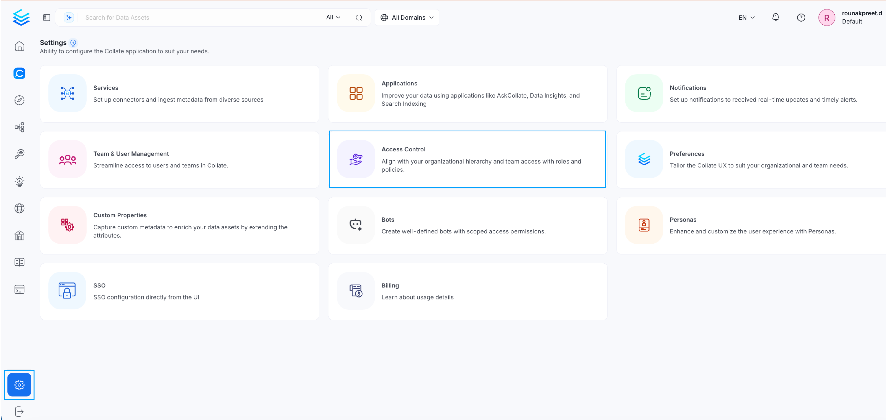
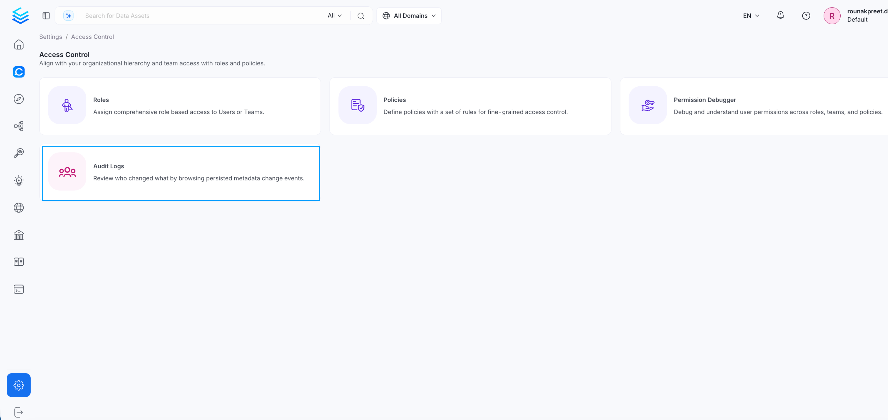
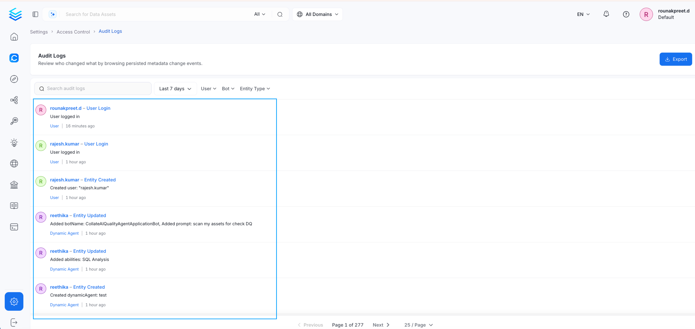
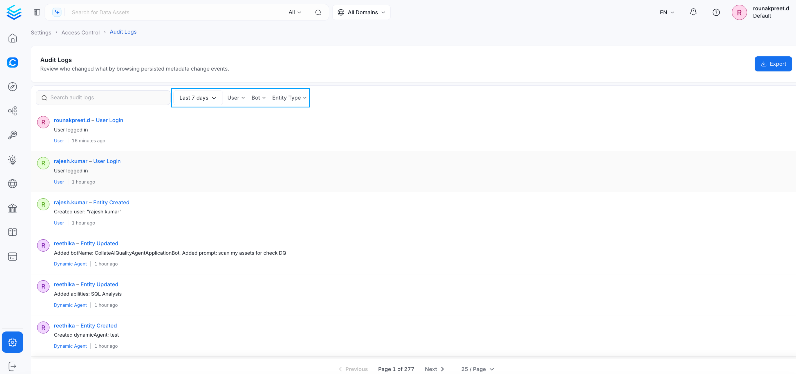
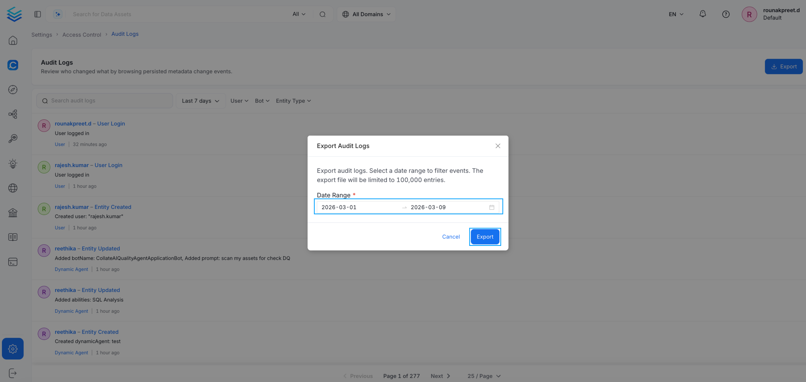

# Audit Logs

<iframe
  width="800"
  height="450"
  src="https://www.youtube.com/embed/8yAC_kykzb8"
  frameBorder="0"
  allow="accelerometer; autoplay; clipboard-write; encrypted-media; gyroscope; picture-in-picture"
  allowFullScreen>
</iframe>

Audit logs provide visibility into activities performed in Collate. They help track user actions across the platform and support governance, monitoring, and troubleshooting. Audit logs capture information such as who performed an action, what action was performed, and when it occurred.

## Access Audit Logs

1. Go to **Settings**
2. Navigate to **Access Control**
3. Select **Audit Logs**

This page provides a centralized view of activities across the platform.

## What Audit Logs Capture

Audit logs record platform activities, including:

- User logins
- Updates to entities
- Changes to tables, glossaries, or other assets
- Data quality test updates
- Actions performed by users or service accounts

Each record includes details such as user, action, entity type, and timestamp.

<Note>
**Note**: The Audit Logs page shows each event time as a relative time, for example "3 hours ago". It doesn't show the exact date and time. To get the exact time of every event, [export the audit logs](#export-audit-logs).
</Note>

## Filter Audit Logs

You can filter audit logs to narrow down specific activities. Supported filters include:

- **User** - View actions performed by a specific user
- **Entity type** - Filter by entity type such as tables or glossaries
- **Time range** - Filter by last 7 days or a custom date range
- **Bot** - View actions triggered by platform bots or automation processes

Filtering helps identify who made a change and when it occurred.

<Tip>
**Tip**: A permanently deleted (hard-deleted) entity, such as a glossary, is recorded with the entity's last edit time instead of the time of the delete. A **Time range** filter around the delete can therefore hide the entry. To find it, clear the time filter, enter the entity name in **Search audit logs**, and set **Entity type** (for example, Glossary). Soft deletes are recorded with the time of the delete.
</Tip>

## Export Audit Logs

Audit logs can be exported for further analysis.

1. Select the required date range
2. Click **Export**

The export is generated as a JSON file. Each event in the file is structured as a JSON record. This format allows you to parse the data or integrate it with external monitoring or governance systems.

### Export Scope and Limits

- **Permission**: Exporting requires the `AuditLogs` permission, which administrators have. To let another role export audit logs, grant it this permission.
- **Filters**: The filters and the search term you applied on the page carry into the export. The export includes only matching events.
- **Date range**: The range runs from the start of the first day to the end of the last day, in your browser's time zone.
- **Event limit**: An export from the page includes up to 10,000 events per run. The audit logs API accepts a `limit` of up to 100,000 events per run. To export more, split the date range into several exports.

### Exported Fields

The file is a JSON array with one object per event. Unlike the page, the export contains the exact time of each event.

| Field | Description |
|:------|:------------|
| `eventTs` | Time of the event as a Unix timestamp in milliseconds, in UTC. For example, `1763380188000`. |
| `eventType` | The kind of event, such as an entity update or a deletion. |
| `userName` | The user or bot that performed the action. |
| `actorType` | The kind of actor: `USER`, `BOT`, or `AGENT`. |
| `impersonatedBy` | The bot that performed the action on behalf of the user, if any. |
| `serviceName` | The service the asset belongs to. |
| `entityType` | The type of the changed asset, such as a table or a glossary. |
| `entityFQN` | The full name of the asset, including its parent hierarchy. |
| `changeEvent` | The details of the change, including the previous and new value of every changed field. A change to a column is listed with the column's name. |
| `summary` | A readable description of the change. |

To read the changed values, open `changeEvent.changeDescription`. It lists the fields that were added, updated, or deleted. Each updated field has an `oldValue` and a `newValue`. The values are JSON strings.

### Pull Audit Logs on a Schedule

For recurring pulls, call the audit logs API instead of exporting from the page. Use `GET /v1/audit/logs` with filters such as `startTs`, `endTs`, `userName`, `actorType`, and `entityType`. The response is paginated and uses the same fields as the export.

## Use Cases

Audit logs help with:

- Investigating changes made to assets
- Monitoring user activity
- Reviewing system activity over time
- Supporting governance and compliance requirements
- Exporting logs for external review or automated monitoring
