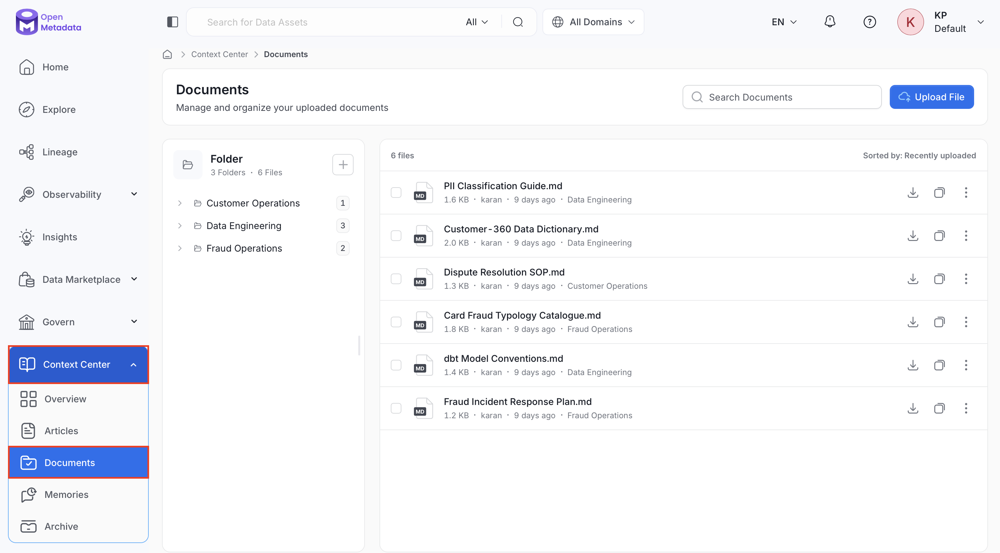
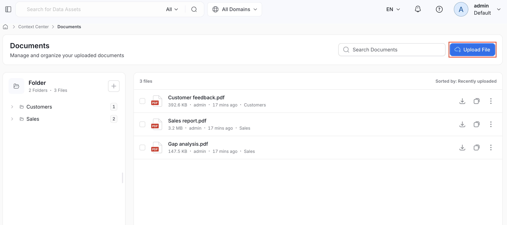
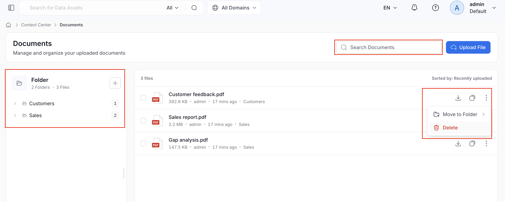
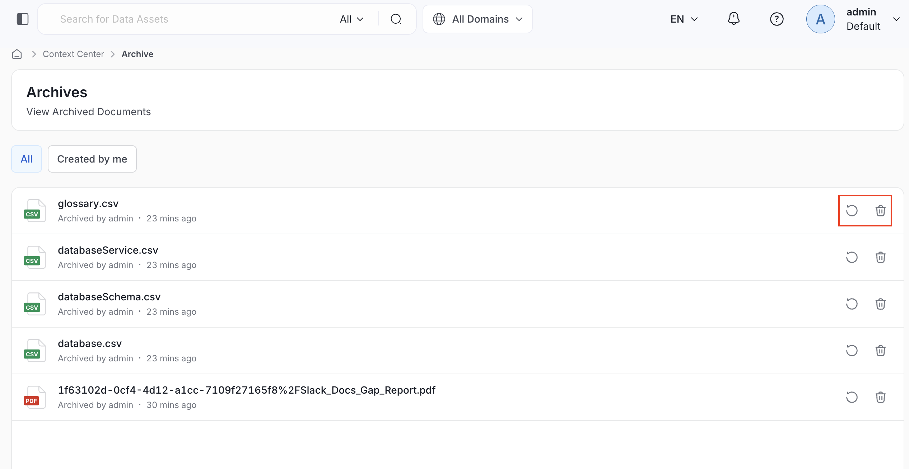

# Documents and Archive

Documents let you upload files, such as reports, spreadsheets, and compliance audits, without rewriting them as an Article. When OpenMetadata extracts question and answer notes from a file, MCP assistants can retrieve the extracted content. The assistant searches the extracted notes, not the Document record itself. MCP assistants reach Articles through the `find_context` tool instead. Organize files into folders to keep related documents together.

## Upload a Document

<Note>
Uploaded files are saved in object storage, which an administrator must turn on. If it is off, uploads look successful but downloads fail with `No current content found for this file`. For more information, see [Configure Object Storage](/v2.0.x/deployment/object-storage).
</Note>

1. From the left navigation bar, navigate to **Context Center** > **Documents**.

    

2. Click **Upload File**.

    

3. Browse to the files on your computer and upload them.
4. Optionally, organize the file into a folder:
   - Click the **+** icon next to **Folder** to create a new folder.
   - Files you don't move into a folder stay listed at the top level.

## View and Manage Documents

The **Documents** page shows:

- **Search bar**: Search documents by file name.
- **Folder panel**: Lists your folders on the left, each showing how many files it contains.
    - To create a new folder, click the  icon next to **Folder**.
    - Click a folder to see only the files inside it.
- **File list**: Shows the total number of files, sorted by **Recently uploaded** by default.
- **Files Actions**:
  - **Download**: Save a copy of the file to your local system.
  - **Copy link**: Copy the document URL.
  - **Three-dot (**⋮**) menu**:
    - **Move to Folder**: Move the file into a different folder.
    - **Delete**: Remove the file from Documents. This doesn't erase it immediately. See [Archive](#archive).

    

## Upload and Manage Documents with the API

Everything you can do in **Documents** goes through the OpenMetadata REST API, so you can load many files with a script. Create a bot in **Settings** > **Bots** and use its token. Object storage must be on. For more information, see [Configure Object Storage](/v2.0.x/deployment/object-storage).

| Task | Request |
| --- | --- |
| Upload a file | `POST /v1/contextCenter/drive/files/upload` |
| Download a file | `GET /v1/contextCenter/drive/files/{id}/download` |
| Delete a file | `DELETE /v1/contextCenter/drive/files/{id}` |
| Delete, move, or download several files | `POST /v1/contextCenter/drive/files/bulk/delete`, `PUT /v1/contextCenter/drive/files/bulk/move`, `POST /v1/contextCenter/drive/files/bulk/download` |

The upload request is a multipart form. It takes these fields:

- `file`: The file to upload.
- `displayName`: Optional. The name shown in **Documents**.
- `description`: Optional. A description of the file.
- `folder`: Optional. The fully qualified name of the folder to put the file in.

```bash
curl -X POST "https://<your-host>/api/v1/contextCenter/drive/files/upload" \
  -H "Authorization: Bearer $TOKEN" \
  -F "file=@report.pdf" \
  -F "displayName=Quarterly report" \
  -F "folder=<folder-fqn>"
```

To upload many files, run one request for each file.

A delete moves the file to **Archive**. To remove it permanently, add `?hardDelete=true` to the delete request.

If a download fails with `No current content found for this file`, the object storage setting is the most likely cause. For more information, see [Configure Object Storage](/v2.0.x/deployment/object-storage#check-that-it-works).

## Archive

Deleting a document moves it to **Context Center** > **Archive** instead of erasing it right away. From Archive, you can:

- To restore the document, click the **Restore** icon next to the document.
- To remove the document permanently, click the **Delete** icon next to the document.

    

Archive currently holds only deleted Documents. Deleted Articles and Memories aren't tracked here.
