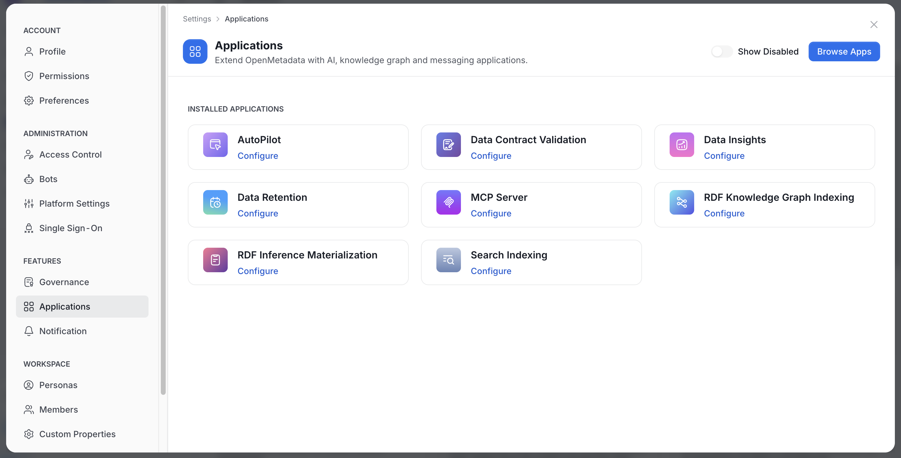
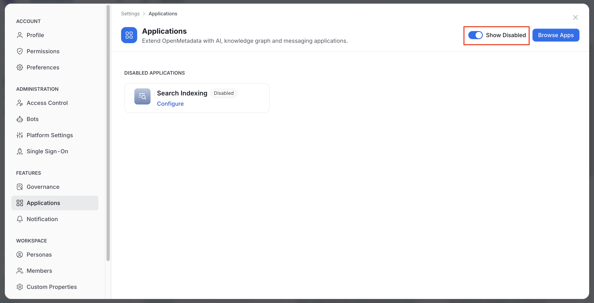
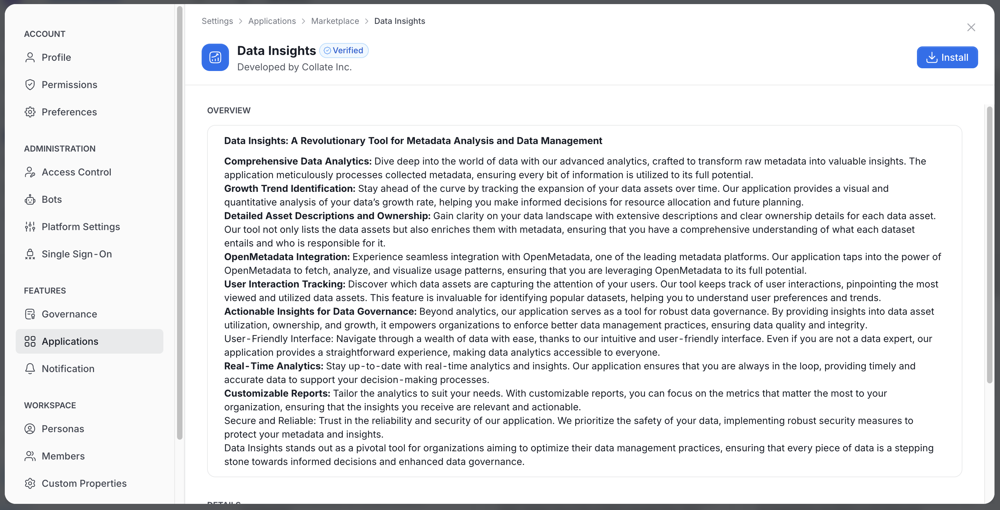
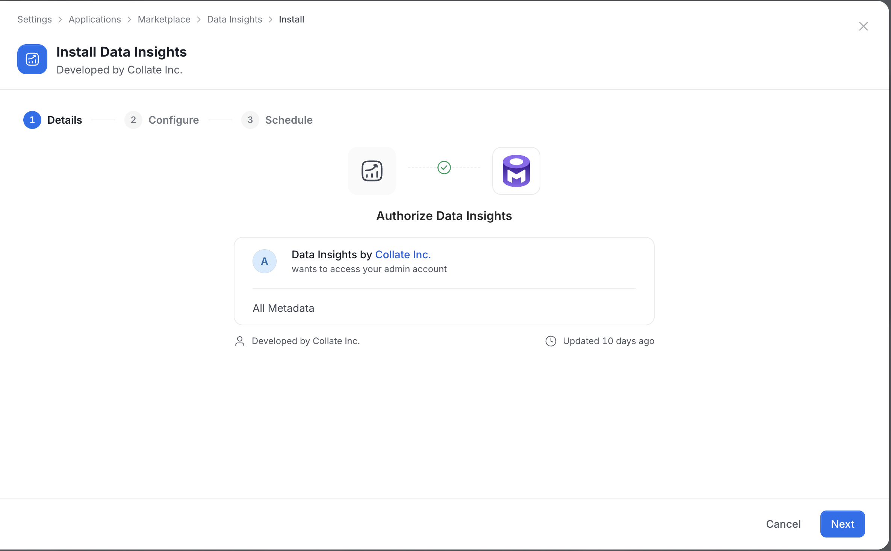
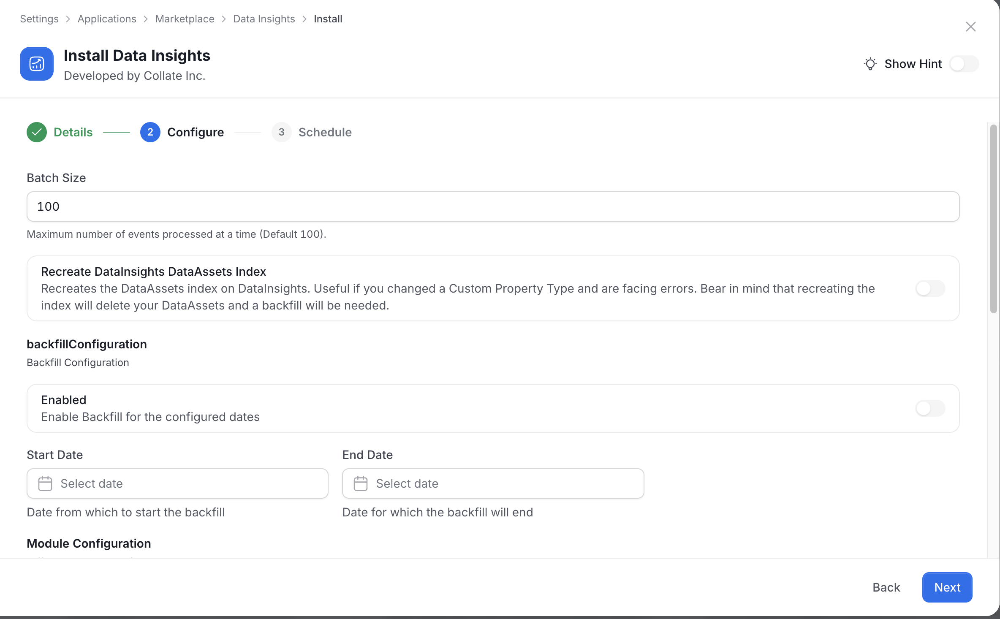
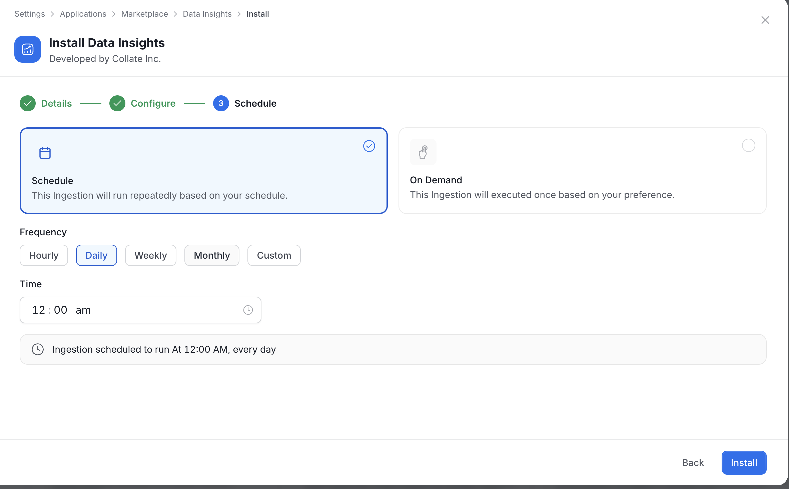
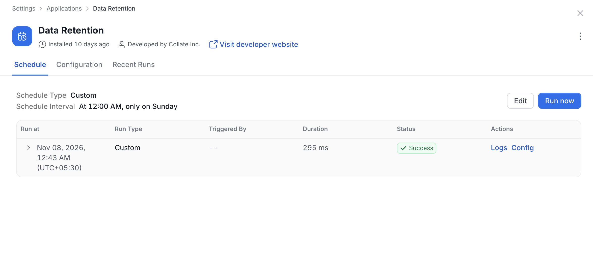
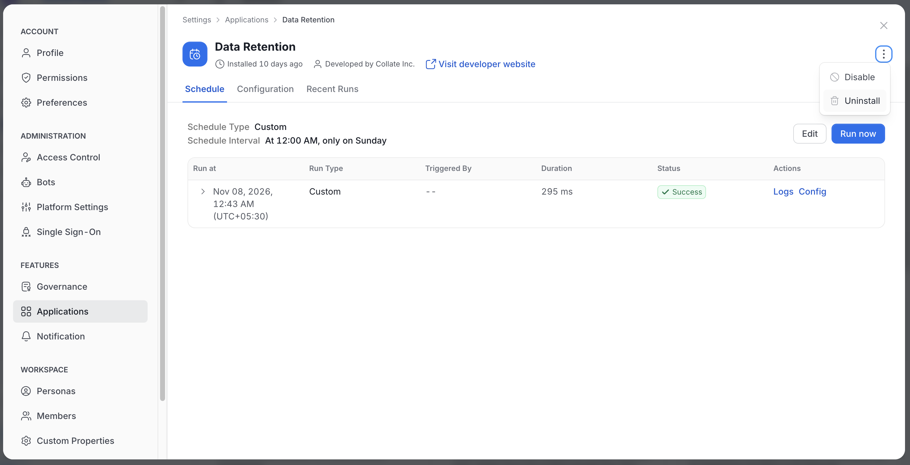

# Manage Applications

Admins install and manage OpenMetadata applications from **Settings** > **Applications**. Only admins see **Applications** and the marketplace.

<Note>
This page describes AI mode, where **Settings** opens as a modal. For more information, see [Profile Menu and Settings](/v2.1.x-SNAPSHOT/how-to-guides/admin-guide/profile).
</Note>

To open the page, click the **Profile** icon, select **Settings**, and then click **Applications** in the **Features** group.

## Installed Applications

The page lists your installed applications.

- Turn on **Show Disabled** to list disabled applications instead. The heading changes from **Installed Applications** to **Disabled Applications**.
- Click **Browse Apps** to open the **Marketplace**.

## Install an Application

1. Click **Browse Apps** and select an application. The application page shows an **Overview** and its **Details**.

    

2. Click **Install**.
3. Complete the wizard steps. The buttons in the footer change with each step:
    - **Details**: Review the authorization screen, which lists what the application can access, such as **All Metadata**. The footer has **Cancel** and **Next**.
    - **Configure**: Fill in the application settings. The footer has **Back** and **Next**.
    - **Schedule**: Choose how the application runs. The footer has **Back** and **Install**.

    

    

On the **Schedule** step, select one of the following:

- **Schedule**: Runs the application repeatedly. Select a **Frequency**, then set the **Day** (for weekly runs) and the **Time**. The available frequencies depend on the application, for example **Hourly**, **Daily**, **Weekly**, **Monthly**, or **Custom**. A summary line shows when the next runs happen.
- **On Demand**: Runs the application once, when you start it.

OpenMetadata skips **Configure** when the application has no configuration form or does not allow configuration. If the configuration form fails to load, OpenMetadata shows "No application schema found for" followed by the application name.

## Application Details

Select an installed application to open its details.

- **Header**: Shows **Installed** with a relative time, "Developed by" with the developer name, and **Visit developer website** when a website exists.
- **Tabs**:
    - **Schedule**: Set when the application runs. This tab is hidden for applications without a schedule.
        - It shows the schedule type and interval, with **Edit** and **Run now** buttons.
        - A table lists each run with its run time, type, who triggered it, duration, and status, and links to the logs and configuration.
    - **Configuration**: Edit the application settings. It appears only for applications that have a configuration form and allow configuration. When none is available, the page shows **No Configuration**.
    - **Recent Runs**: Review past runs.
    - **Live Indexing**: Appears only for the Search Indexing application.
- **Show Hint**: On the **Configuration** tab, turn on **Show Hint** to display field hints.

## Disable, Restore, or Uninstall

Use the three-dot menu in the application header.

- **Disable**: Turns the application off. A disabled application moves to the **Disabled Applications** list.
- **Restore**: Appears instead of **Disable** for a disabled application. It turns the application back on.
- **Uninstall**: Removes the application. It is not offered for system applications.

Each action asks you to confirm.

An application with no schedule, configuration, or runs shows only the header and **No Configuration**.

## Permissions

Actions on an application depend on your permissions.

- **Delete**: Shows the three-dot menu.
- **EditAll**: Allows edits to the schedule and configuration.
- **Trigger**: Allows **Run now**.
- **Deploy**: Allows deploying the application.
