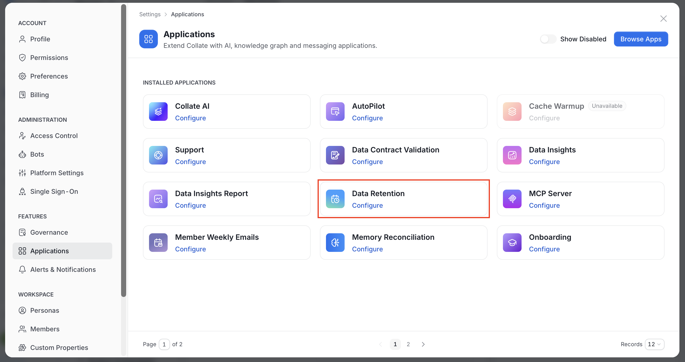
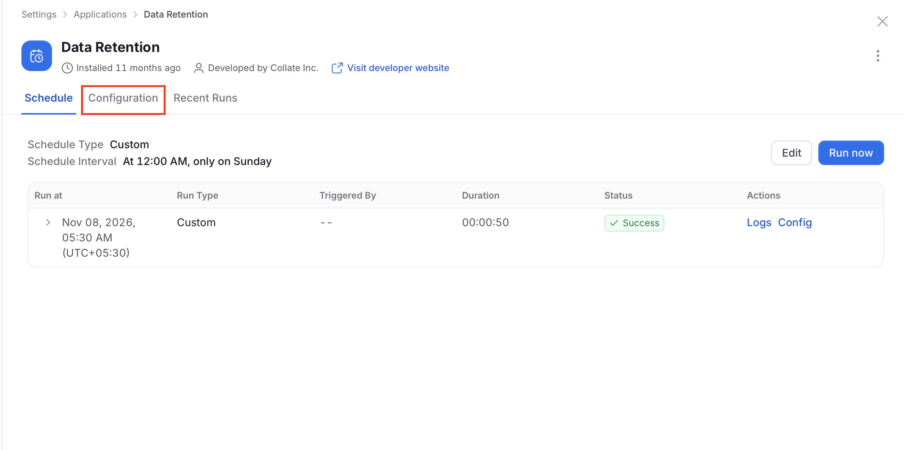
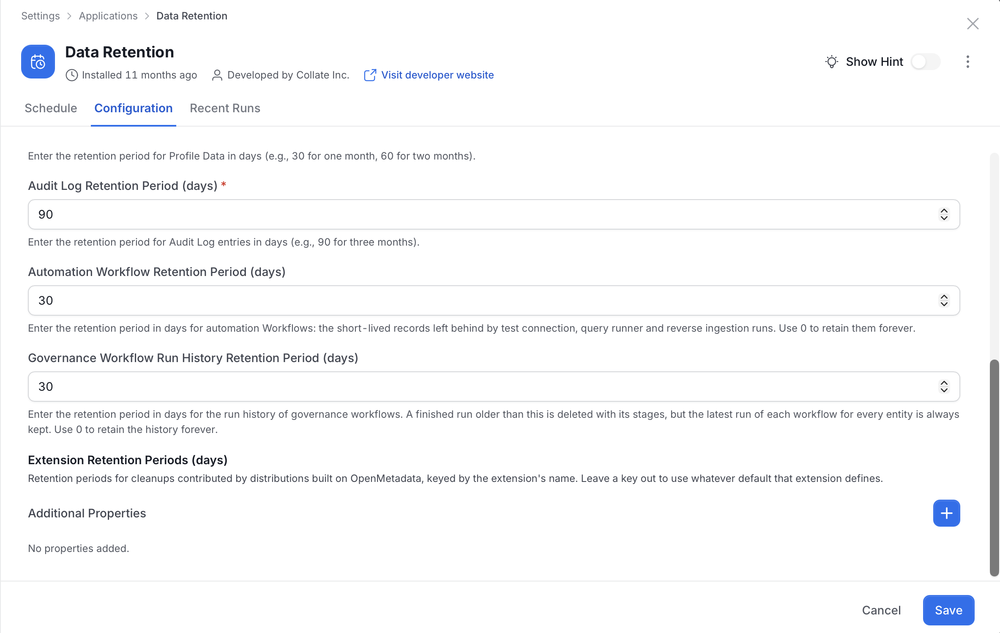

# Configure Data Retention

The Data Retention application removes operational records after their configured retention periods. In OpenMetadata 2.1, it also cleans up short-lived Automation Workflow records. Test Connection, Query Runner, and Reverse Ingestion runs create these records.

Data Retention is installed by default and runs weekly on Sundays at midnight.

## Configure Automation Workflow Retention

You need administrator access to configure and run the Data Retention application.

1. Click the **Profile** icon and navigate to **Settings** > **Applications** > **Data Retention**.

   

2. Click **Configuration**.

   

3. Scroll to **Automation Workflow Retention Period (days)**.
4. Set the retention period:
   - Enter a positive integer to delete Automation Workflow records older than that many days.
   - Enter `0` to retain Automation Workflow records indefinitely.

    
5. Save the configuration.
6. Return to the Data Retention application details.
7. Optional: To apply the policy without waiting for the next scheduled run, select **Run Now**.

The default retention period is `30` days. Cleanup uses each Workflow record's last-updated time, so a record that has remained in `Pending` or `Running` beyond the retention period is also eligible for deletion.

<Warning>
Deleting expired Automation Workflow records is irreversible. This setting defaults to `30` days even for an application configuration saved before the field existed. After an upgrade, the next scheduled Data Retention run can therefore remove existing records older than 30 days. Set the value to `0` before that run if you must retain them.
</Warning>

Removing these records does not delete the service that a workflow used. OpenMetadata also cleans up the Workflow's related ownership records and stored connection secrets.

<Note>
One application run deletes at most 100,000 Automation Workflow records. Run the application again when an older installation has a larger backlog.
</Note>

## Governance Workflow Run History Retention

Governance workflows record every run and its stages. The Data Retention application deletes old runs based on a retention period that you set.

You need administrator access to configure and run the Data Retention application.

1. Click the **Profile** icon and navigate to **Settings** > **Applications**, then select **Data Retention**.

    

2. Click **Configuration**.

    

3. Scroll to **Governance Workflow Run History Retention Period (days)** and set the retention period:
    - Enter a positive integer to delete finished governance workflow runs older than that many days. The default is `30`.
    - Enter `0` to retain the run history forever.

    

4. Click **Save**.

<Warning>
Deleting expired run history is irreversible. Enter `0` to retain the history forever.
</Warning>

The application deletes a run, with all its stages, only when all of these are true:

- The run has ended, with any status other than **Running**.
- The run started before the retention cutoff. OpenMetadata keeps every run inside the retention period.
- A newer run of the same workflow exists for the same entity. Each entity keeps its latest run of each workflow, however old it is. Runs that have no entity are grouped per workflow, so the newest of those is kept too.

## Related Retention Settings

The same application configures retention for other record types. It covers change events and activity records. It also covers test results, profile data, and audit logs. Each field is measured in days. Review every value before you run the application in a production environment.
