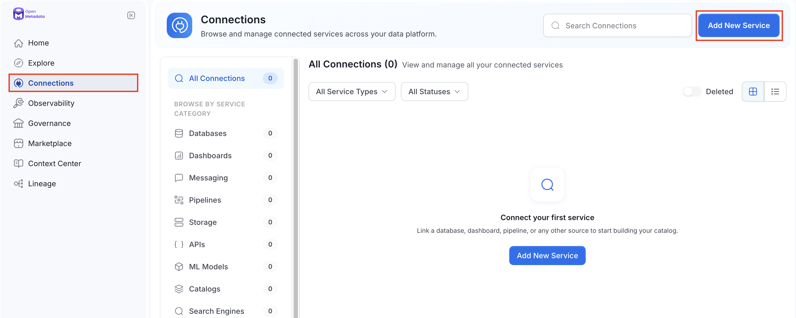
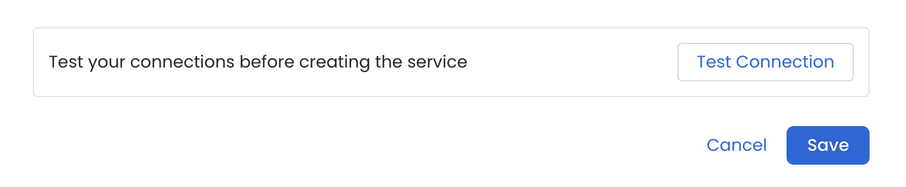
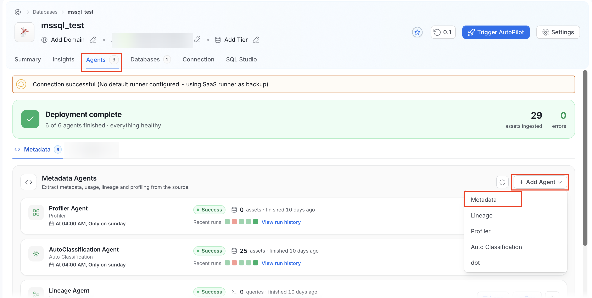
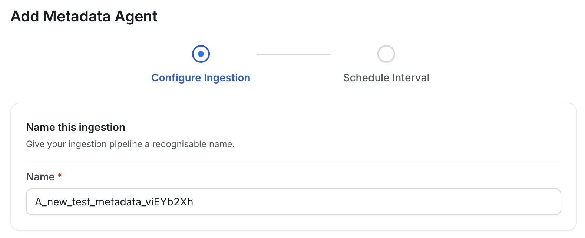
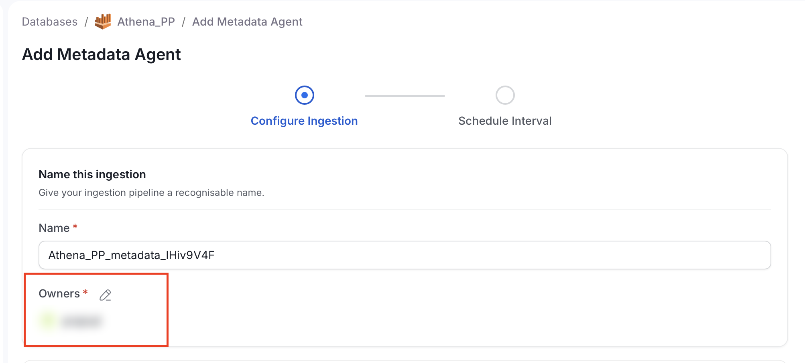
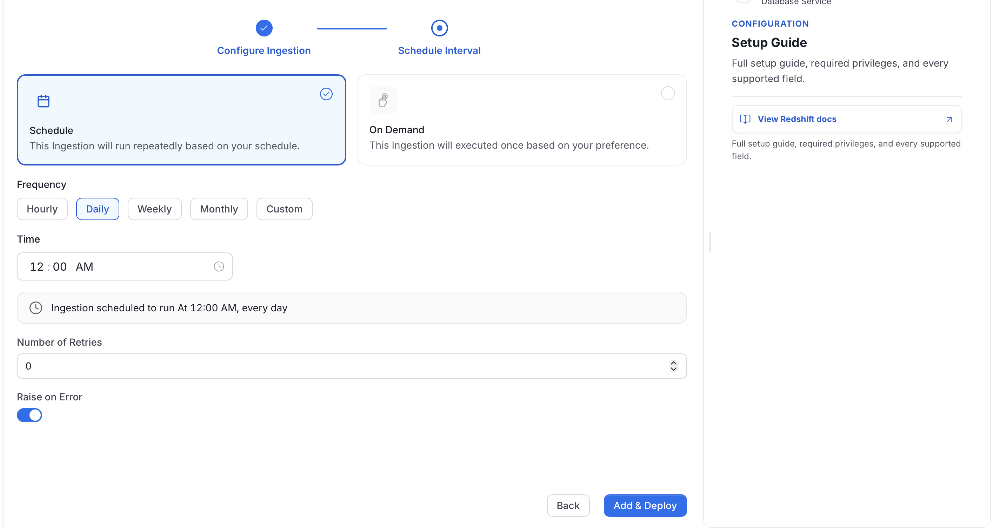
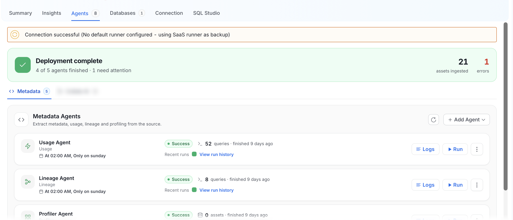
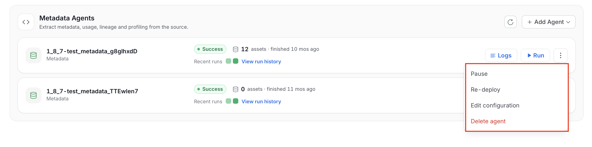
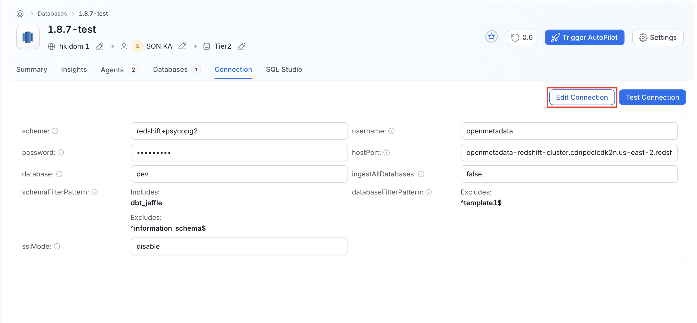
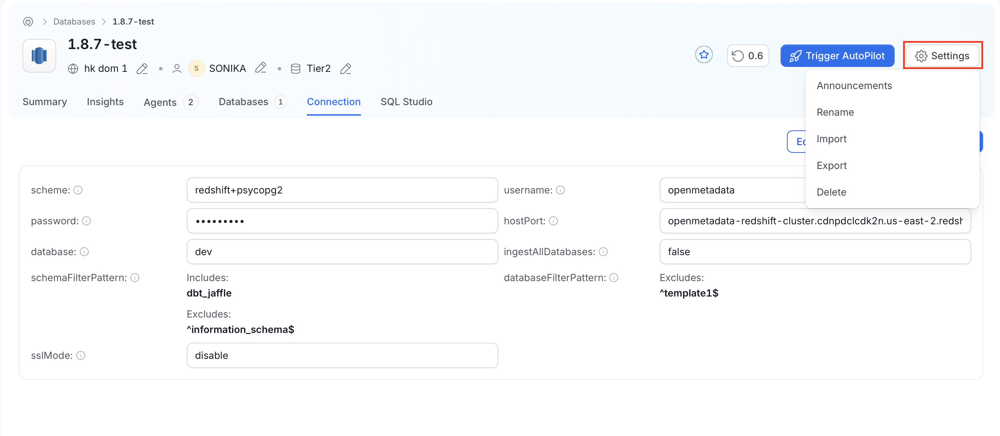

# How to Ingest Metadata

*This guide covers how to connect a data source to OpenMetadata and run metadata ingestion from the UI.*

OpenMetadata supports metadata ingestion from third-party sources through the CLI or the UI. Admin users can connect to multiple service types: Databases, Dashboards, Pipelines, ML Models, Messaging, Storage, Search, and Metadata services. You can add a connector and schedule metadata ingestion at your preferred frequency.

<Note>

**Note**: You must have **Admin** access in the source tool to add a connector and ingest metadata.

</Note>

The steps below apply to all service types. For connection details specific to your source, see the [Connectors](/v2.1.x-SNAPSHOT/connectors) documentation.

## Step 1: Add a New Service

1. In the left navigation bar, select **Connections**.
2. On the **Connections** page, click **Add New Service**.

    

## Step 2: Select a Service Type and Connector

From the service type dropdown, select the type that matches your data source, then click the connector tile for your source.

OpenMetadata supports the following service types:

- **Databases**
- **Dashboards**
- **Pipelines**
- **Messaging**
- **ML Models**
- **Storage**
- **Search**
- **Metadata**
- **APIs**
- **Drives**
- **Security**

For the full list of available connectors, see [Connectors](/v2.1.x-SNAPSHOT/connectors).

## Step 3: Add a Service Name and Description

1. Enter a unique, descriptive **Service Name**. OpenMetadata identifies services by their service name. Choose a name that distinguishes this service from other services of the same type.
2. (Optional) Enter a **Description** to document the service and help other users understand what it contains.

<Note>

**Note**: The service name can't be changed after you set it.

</Note>

## Step 4: Configure Connection Options

### Enter Connection Details

Enter the connection credentials for your source. The required fields differ by connector. For the full list of fields and accepted values, see the connector-specific documentation in the [Connectors](/v2.1.x-SNAPSHOT/connectors) section.

The right-side panel in the OpenMetadata UI displays inline help for each field as you fill in the form.

#### Who Can See Connection Details

When you read a service, the connection details depend on who you are. Ingestion bots receive the full connection. Users who can edit the service, meaning administrators and anyone with `EditAll` on it, receive the connection with sensitive values masked. Users with view-only access do not receive the connection details, and the service itself stays readable. The JWT token inside an OpenMetadata server connection is masked for callers that are not bots.

### Test the Connection

1. Click **Test Connection** to verify access before saving. The test checks connectivity and confirms which data assets can be ingested using the provided credentials.

    

2. After the connection test passes, continue to the next step.

## Step 5: Configure What to Ingest

Use filter patterns to control which assets OpenMetadata ingests from the service.

**How filter patterns work**

- **Include**: Add one or more comma-separated regular expressions. OpenMetadata ingests only assets whose names match at least one expression. Leave blank to include all assets.
- **Exclude**: Add one or more comma-separated regular expressions. OpenMetadata skips any asset whose name matches at least one expression. Leave blank to exclude nothing.

When both **Include** and **Exclude** are set, **Exclude** takes priority.

Rules match asset names using one of the following expressions:

- **contains**: Matches any name containing the value.
- **starts with**: Matches names beginning with the value.
- **ends with**: Matches names ending with the value.
- **is exactly**: Matches the exact name only.
- **matches regex**: Matches names using a full regular expression.

<Tip>

**Tip**: Leave all filter patterns empty to ingest all assets available in the source.

</Tip>

## Step 6: Save the Service

Click **Save** to deploy the agent and start the first metadata ingestion run. OpenMetadata saves the service configuration and immediately starts pulling metadata from the source.

To monitor progress or view the service you just added, go to **Connections** in the left navigation bar and select your service.

## Step 7: Configure the Metadata Agent

After the service is created, you can add another metadata agent and set its ingestion schedule.

1. On the service page, go to the **Agents** tab and click **Add Agent** > **Metadata**.

    

    <Note>

    **Note**: The **Agents** tab is visible only to Admins, direct owners of the service, or members of an owner team.

    </Note>

2. Enter a **Name** for the agent. OpenMetadata pre-populates the name with the service name and a random suffix to ensure uniqueness.

    

3. Use the edit icon next to **Owners** to select the users and teams that own this agent. OpenMetadata fills the field with the owners of the service. If the service has no owners, OpenMetadata adds you. The agent needs at least one owner, so the field is required. To change the owners of an existing agent, you need permission to edit owners.

    

4. Configure the filter patterns and options for the agent. The available options depend on the service type. For database services, you can set the following:
    - **Database Filter Pattern**: Include or exclude specific databases.
    - **Schema Filter Pattern**: Include or exclude specific schemas within a database.
    - **Table Filter Pattern**: Include or exclude specific tables within a schema.
    - **Use FQN For Filtering**: Apply the filters on fully qualified names.
    - **Include Views**: Include views as part of metadata ingestion.
    - **Include Tags**: Include tags as part of metadata ingestion.
    - **Enable Debug Log**: Recommended for troubleshooting.
    - **Mark Deleted Tables**: Soft delete tables that no longer exist in the source.
    - **Query Parsing Timeout Limit**: Set the timeout, in seconds, for parsing view definition SQL queries during lineage analysis. Defaults to `300`.

5. Click **Next**.

## Step 8: Schedule and Deploy the Metadata Agent

Define when the metadata agent runs. You can select a preset schedule or create a **Custom** schedule.

1. Select **Schedule**.
2. Select a preset frequency (**Hourly**, **Daily**, **Weekly**, or **Monthly**), or select **Custom** to define your own schedule.
3. Enter **Number of Retries**. This sets the number of times the ingestion workflow restarts in case of failure.
4. Click **Add & Deploy**.

    

## Viewing Agent Run Status

After the agent deploys, go to the **Agents** tab on the service page. The **Metadata Agents** section lists each deployed agent with its status badge (**Success**, **Failed**, **Running**, and so on), asset count, and the time it last ran. The status shows whether a pipeline is queued, running, failed, or successful.

Hover over an agent to view its scheduling frequency and the start and end times for recent runs. Click **View run history** under an agent to see a full log of past runs.



To manage an agent, use the buttons on each agent row:

- **Logs**: View the pipeline logs for the most recent run.
- **Run**: Trigger the ingestion pipeline immediately.
- **Pause**: In the three-dot menu, pause the scheduled pipeline without deleting it.
- **Re-deploy**: In the three-dot menu, redeploy the pipeline definition after configuration, schedule, or credential changes. Use this if the source connection credentials change after the initial setup. Redeploying applies the new access permissions and ingests any additionally accessible data.
- **Edit configuration**: In the three-dot menu, edit the agent's filter patterns, schedule, settings, and owners.
- **Delete agent**: In the three-dot menu, remove the agent from the list. If the agent's runner is unavailable, an administrator can [force-delete the agent](#force-delete-an-agent).

## Force Delete an Agent

When an agent's runner is unavailable, deleting a deployed agent fails, because OpenMetadata can't remove the agent's workflow from the runner. An administrator can force-delete the agent through the API. Force delete removes the agent from OpenMetadata even when the runner is unreachable.



<Warning>
**Warning**: Force delete can't be undone. It removes the agent's metadata and run history from OpenMetadata. If the runner is unavailable, OpenMetadata skips the runner cleanup, and the agent's workflow might stay on the runner. Remove it manually.
</Warning>

To force-delete an agent:

1. Get the ID of the agent, for example from the response of `GET {base_url}/api/v1/services/ingestionPipelines`.
2. Send a `DELETE` request with an administrator's access token and with both `hardDelete=true` and `force=true`:

    ```bash
    curl -X DELETE "{base_url}/api/v1/services/ingestionPipelines/{agent_id}?hardDelete=true&force=true" \
      -H "Authorization: Bearer {access_token}"
    ```

3. Check the response headers. If OpenMetadata skipped the runner cleanup, the response includes `X-OpenMetadata-Runner-Cleanup: skipped-unavailable`.

The request fails in the following cases:

- **400**: The request has `force=true` without `hardDelete=true`.
- **403**: The caller isn't an administrator.

## Browsing Ingested Data

After ingestion completes, open the service page and go to the relevant asset tab. For example, a database service has a **Databases** tab that lists all ingested databases. From there, drill down to view schemas, tables, and columns.

<Note>
**Note**: After running a metadata agent pipeline, you can create separate pipelines for [**Usage**](/v2.1.x-SNAPSHOT/connectors/ingestion/workflows/usage), [**Lineage**](/v2.1.x-SNAPSHOT/connectors/ingestion/workflows/lineage), [**dbt**](/v2.1.x-SNAPSHOT/connectors/database/dbt), or [**Profiler**](/v2.1.x-SNAPSHOT/how-to-guides/data-quality-observability/profiler/profiler-workflow). To add a pipeline, go to the **Agents** tab, select the required agent type, and enter the details.
</Note>

## Managing Services

Admin users can create, edit, or delete services, and view connection details for existing services.

To open a service, click **Connections** in the left navigation and select the service.

### View and Edit the Connection

The **Connection** tab shows the connection details of the service, such as the scheme, username, host and port, and filter patterns. Sensitive values, such as passwords, are masked.

To change the connection:

1. Open the service and click the **Connection** tab.
2. Click **Edit Connection**, update the connection details, and save your changes.

    

To check that OpenMetadata can reach the source, click **Test Connection**. This button appears for services that support connection tests.

You see **Edit Connection** and **Test Connection** only if your role allows you to edit the service.

### Manage the Service

Click **Settings** at the top right of the service page to open the service menu.



The menu has the following options:

- **Announcements**: Create and manage announcements for the service.
- **Rename**: Change the display name of the service.
- **Import**: Import service details from a CSV file. This option is available for database services only.
- **Export**: Export the service details to a CSV file. This option is available for database services only.
- **Delete**: Delete the service. For more information, see [Delete a Service Connection](/v2.1.x-SNAPSHOT/how-to-guides/admin-guide/delete-service-connection).

The menu shows only the options that your role allows.

<Tip>
**Tip**: For agent configuration and scheduling, see [Best Practices for Metadata Agent](/v2.1.x-SNAPSHOT/connectors/ingestion/best-practices).
</Tip>

<Card title="Delete a Service Connection" href="/v2.1.x-SNAPSHOT/how-to-guides/admin-guide/delete-service-connection" >
    Permanently delete a service connection.
  </Card>
