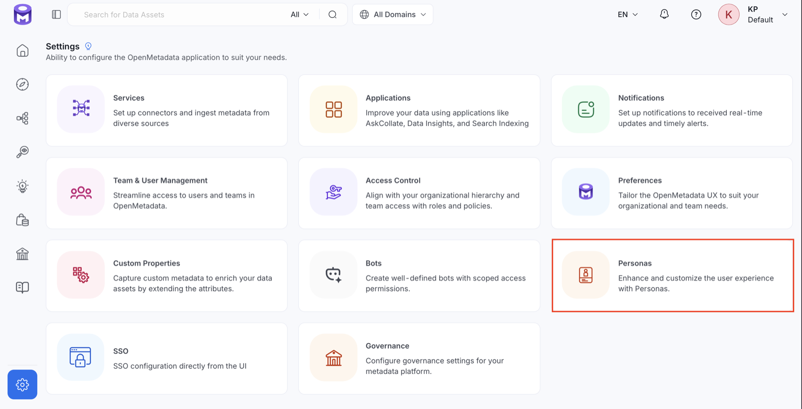
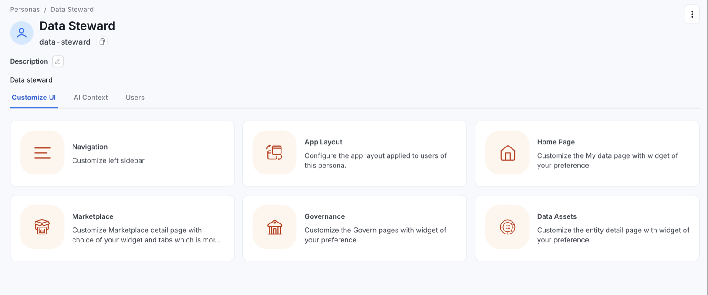
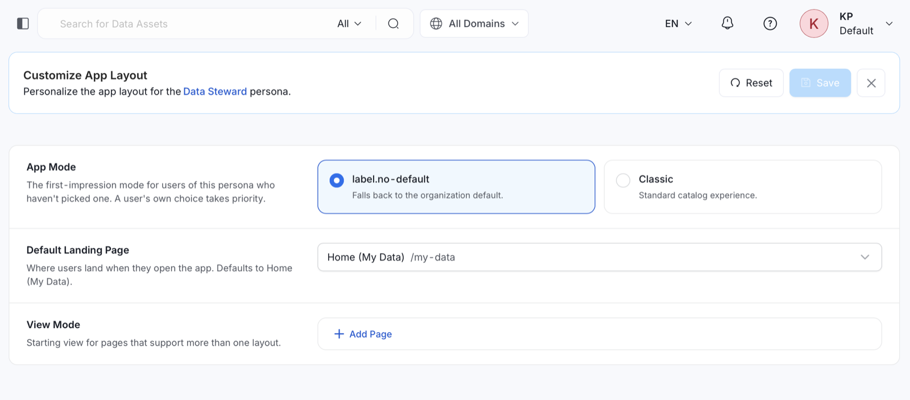
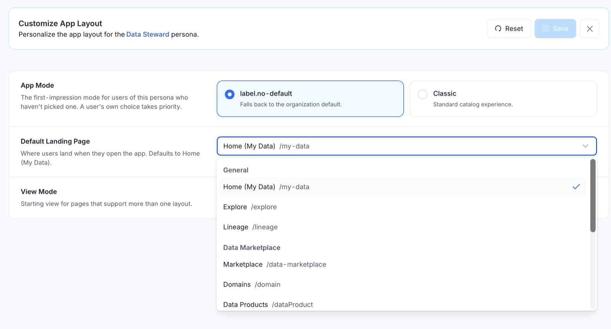
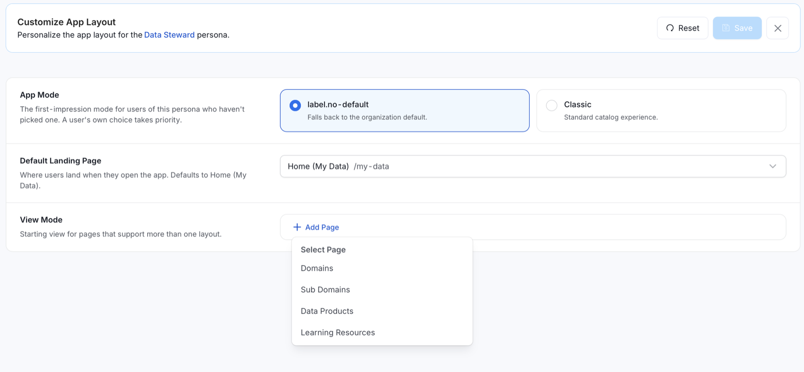
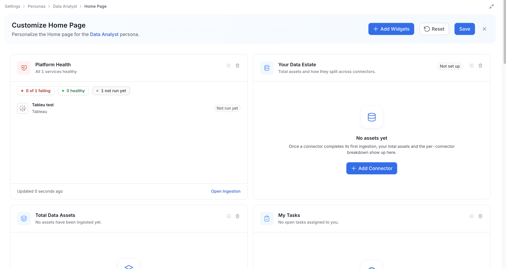
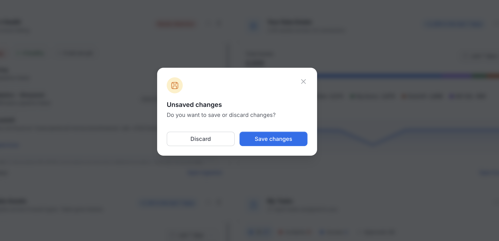
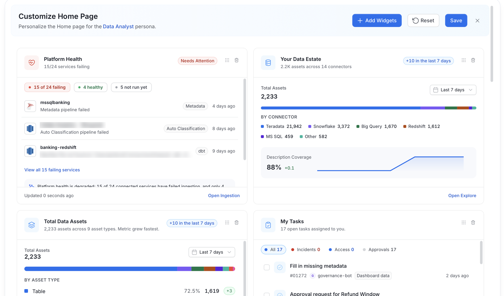
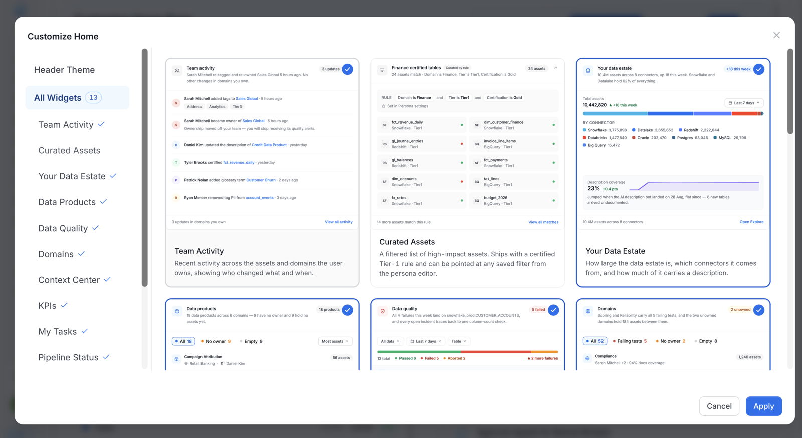

# Customizable Landing Page with Pluggable Panels

OpenMetadata's customizable landing page allows admins to tailor the layout based on the user's persona, providing a more relevant and enriched experience. The landing page is built using **pluggable panels**, which can be added, removed, or rearranged to meet the unique needs of different personas, such as **data scientists**, **data engineers**, or **data stewards**.

## Customize App Layout

Use the **App Layout** category on a persona to set the app mode, the default landing page, and the starting view for pages that offer more than one layout. Changes apply to every user assigned to the persona.

To open these settings:

1. Navigate to **Settings** > **Personas**.

   

2. Select a persona.
3. Click the **Customize UI** tab.

   

4. Click the **App Layout** card.

After you change a setting, click **Save**. Click **Reset** to discard your changes.

### App Mode

Use **App Mode** to choose the experience users of this persona see when they open the app and haven't picked an app mode themselves. A user's own app mode choice takes priority over the persona setting.

- **No default**: Uses the organization default.
- **Classic**: Uses the standard catalog experience.

### Default Landing Page

Use **Default Landing Page** to choose where users of this persona land when they open the app. The default is **Home (My Data)**. Select one of the following pages from the dropdown:

- **General**: **Home (My Data)**, **Explore**, and **Lineage**.
- **Data Marketplace**: **Marketplace**, **Domains**, and **Data Products**.
- **Observability**: **Data Quality**, **Incident Manager**, and **Insights**.
- **Govern**: **Glossary**, **Classification**, and **Metrics**.

OpenMetadata sends users to this page when the app first opens. This happens after sign-in, after a page reload, or in a new browser tab. A deep link that a user opened before signing in takes priority. OpenMetadata doesn't redirect later visits to the home page inside the app, such as when a user clicks the logo.

### View Mode

Use **View Mode** to set the starting view for pages that offer more than one layout. Pages without a setting open in **Table** view. To set a starting view:

1. Click **Add Page**.
2. Select a page.
3. Choose its view.

The following pages and views are available:

- **Domains**: **Table**, **Grid**, or **Tree**.
- **Sub Domains**: **Table** or **Grid**.
- **Data Products**: **Table** or **Grid**.
- **Learning Resources**: **Table** or **Grid**.

Users can still switch the view on the page.

## How to Customize a Landing Page:

1. **Set Up Personas**:
    After defining personas, navigate to **Settings > Persona**.

2. **Select a Persona**:
   Customize a landing page for a specific persona (e.g., data steward) and then select homepage to customize it.

Customizing the **Home Page** and the entity pages opens a full-page editor. If you exit with unsaved changes, an **Unsaved changes** prompt asks "Do you want to save or discard changes?" Click **Save changes** or **Discard**.

3. **Add Widgets**:
   In the **Customize Home Page** editor, click **Add Widgets**.

4. **Select Widgets**:
   In the **Customize Home** dialog, select **All Widgets**, select the widgets to show, and click **Apply**. A tick marks a widget that is already on the page. The dialog lists only widgets that can be shown.

5. **Header Theme**:
   Optional: in the **Customize Home** dialog, select **Header Theme** to preview the home page header and select its background color.

6. **Rearrange and Save**:
   Drag a widget by its handle to change its position, or click the trash icon to remove it. Click **Save** to apply the layout, or **Reset** to discard your changes.

### Available Widgets

The following widgets are available:

| Widget | What it shows |
|---|---|
| **Platform Health** | Ingestion health across every connected service, with the worst offenders first. |
| **Your Data Estate** | How large the data estate is, which connectors it comes from, and how much of it has a description. |
| **Total Data Assets** | How many data assets the estate holds, split by asset type, and how each type changed over the selected period. |
| **My Tasks** | Open tasks assigned to the user or their teams, with incidents first. |
| **Team Activity** | Recent activity across the assets and domains the user owns, showing who changed what and when. |
| **Yours and Followed** | The assets the user owns alongside the ones they follow. |
| **Context Center** | The most recently updated Context Center pages and articles, with how many changed this week. |
| **Curated Assets** | A filtered list of high-impact assets. The rule is set in the persona editor. |
| **Data Quality** | Passing, failing, and aborted data quality tests, with a link to the failing tests. |
| **Domains** | Domain-by-domain overview of owner, description coverage, and failing tests. |
| **Data Products** | Data products across the platform with their owning domain. |
| **KPIs** | Progress against each active KPI: target, current pace, and whether it is on track by its end date. |
| **Pipeline Status** | Each pipeline's latest run, failures first, with its last 10 runs and the error behind a failure. |

### Example Use Case:

For a **data scientist**, the KPIs widget may be removed, while prioritizing Yours and Followed and Team Activity.
A **data engineer** might add the Pipeline Status widget, while a **data steward** might include widgets focused on data governance, such as Domains and Data Products.

## Switching Between Personas

Users can switch between different personas without logging out or reconfiguring the platform. Upon switching, the application’s landing page and configuration adjust automatically to reflect the new role.

### Setting a Default Persona:
Users can set a **default persona**, so the system displays the layout and settings relevant to that role every time they log in.

## Use Case Examples:

### 1. Data Engineer
- **Needs**: Data pipeline monitoring, data quality, and task management.
- **Customized Landing Page**: Includes the Pipeline Status, Data Quality, and My Tasks widgets. The KPIs widget might be deprioritized.
- **Persona-Specific Widgets**: Add the Pipeline Status widget for real-time updates on data workflows.

### 2. Data Steward
- **Needs**: Access to the assets they own and follow, performance indicators, and governance gaps.
- **Customized Landing Page**: Prioritizes the Yours and Followed and KPIs widgets, while removing unnecessary widgets such as Pipeline Status.
- **Persona-Specific Widgets**: Data stewards might add the Domains and Data Products widgets to spot missing owners and descriptions.

## Future Customizations:

OpenMetadata plans to expand persona-based customization beyond landing pages to **entity pages** as well. For example:

### 1. Entity Pages Customization:
Users can add panels that display specific metadata, such as **product-related knowledge articles** or **glossary terms** associated with an entity.

### 2. Knowledge Panel Expansion:
Additional panels like **Product Knowledge Articles** or **Service Status** will allow deeper insights based on the user’s role.
