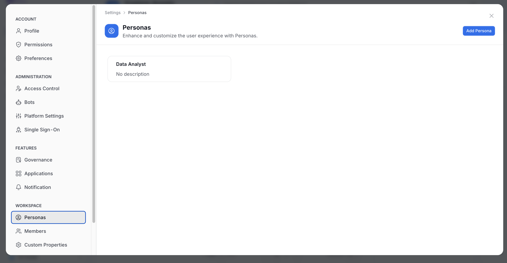
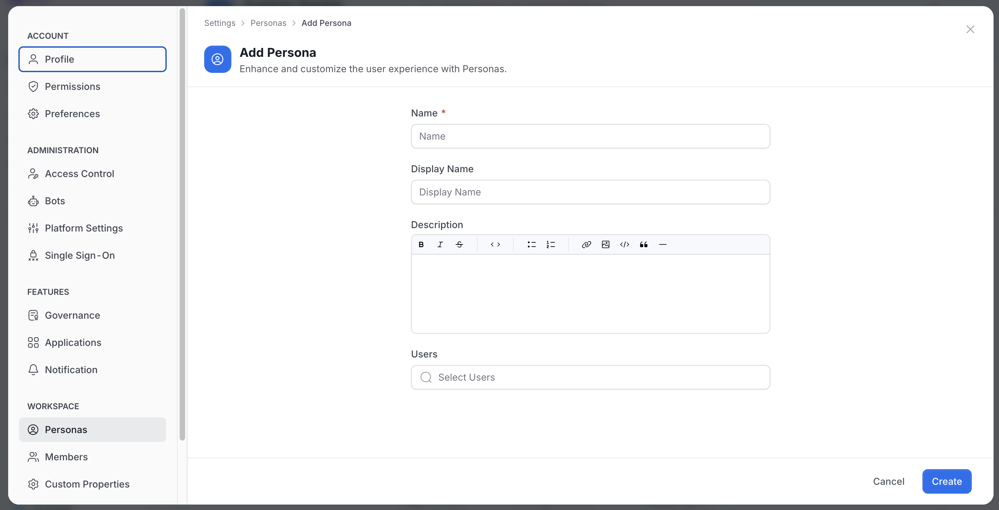
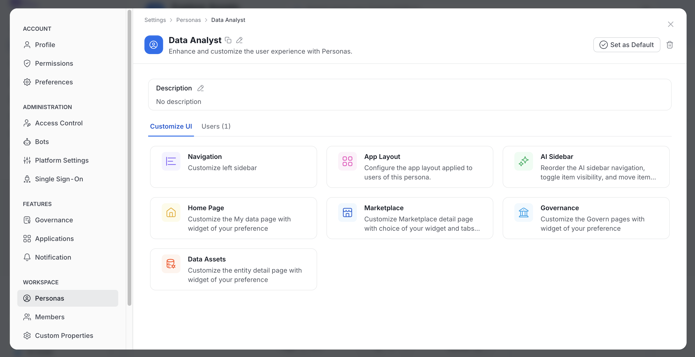
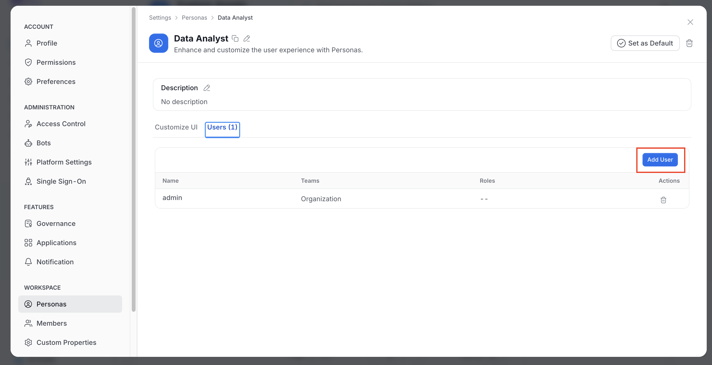
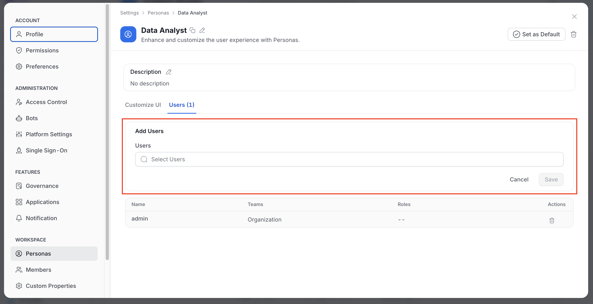

# How to Define Personas

## What is a Persona?
In OpenMetadata, a **persona** represents an organization's specific role or function, such as a **data engineer**, **data steward**, or **data scientist**. Personas define how the user interacts with the platform by tailoring the interface and functionality to their role.

**Example**:
- A **data engineer** might focus on pipelines and data quality.
- A **data steward** is more concerned with governance and glossary management.

## Steps to Define a Persona:

1. As an administrator, navigate to **Settings > Personas** in OpenMetadata.

 Personas" />

2. **Create a new persona** or modify an existing one.

3. **Associate users** with the appropriate persona to customize their experience based on their roles.

