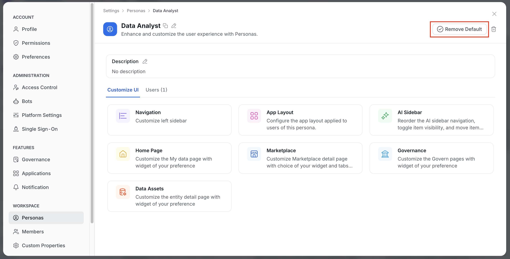

# How to Define Personas

## What is a Persona?
In OpenMetadata, a **persona** represents an organization's specific role or function, such as a **data engineer**, **data steward**, or **data scientist**. Personas define how the user interacts with the platform by tailoring the interface and functionality to their role.

**Example**:
- A **data engineer** might focus on pipelines and data quality.
- A **data steward** is more concerned with governance and glossary management.

## Steps to Define a Persona:

1. As an administrator, navigate to **Settings > Personas** in OpenMetadata.

 Personas" />

2. **Create a new persona** or modify an existing one.

3. **Associate users** with the appropriate persona to customize their experience based on their roles.

## Manage a Persona

Select a persona in **Settings** > **Personas** to open its detail page. Only admins see **Personas**. The page header and tabs offer the following actions.

- **Copy URL**: Click the copy icon next to the title to copy a link to the persona. OpenMetadata confirms with "Link copied to clipboard".
- **Rename**: Click the pencil icon to change the display name. This needs the EditDescription permission.
- **Edit the description**: Edit the text under **Description**, and then save it.
- **Set as Default** or **Remove Default**: Click the button in the header to make this persona the organization default, or to remove that status. This needs the EditAll permission.
- **Delete**: Click the delete icon and confirm. This needs the EditAll or Delete permission.

<Note>
**Set as Default** is a button in the page header in AI mode. In Classic mode, open the **⋮** menu on the persona page and select **Set as Default** instead. Only one persona can be the default. Setting a new default removes the previous one for all users.
</Note>

### Users Tab

The **Users** tab lists the users assigned to the persona, with their teams and roles.

- Click **Add User**, select the users in the **Users** field, and click **Save**.
- Use the remove action in a row to take a user out of the persona.
