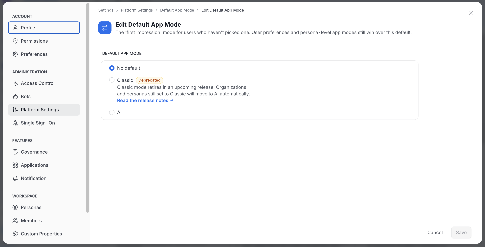
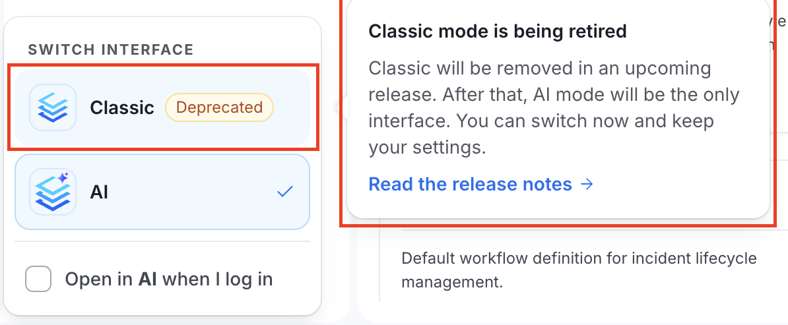

# Default App Mode

OpenMetadata has two app experiences:

- **Classic**
- **AI**

Each user can switch between them. **Default App Mode** sets the experience users land in until they have made that choice themselves.

<Warning>
Classic mode is deprecated. It will be removed in an upcoming release, and AI mode will then be the only interface. Organizations and personas still set to **Classic** move to AI automatically. OpenMetadata has not announced a removal date.
</Warning>

## How to Configure

This setting requires Admin access.

1. Navigate to **Settings** > **Preferences** > **Default App Mode**. In AI mode, open **Settings** from the profile menu and select **Platform Settings** > **Default App Mode**.
2. Choose one of the following options:
    - **No default**: OpenMetadata doesn't set an organization default.
    - **Classic** (marked **Deprecated**): Users without a personal or persona-level mode land in the Classic experience. Under this option, OpenMetadata shows the hint "Classic mode retires in an upcoming release. Organizations and personas still set to Classic will move to AI automatically." A **Read the release notes** link follows the hint.
    - **AI**: Users without a personal or persona-level mode land in the AI experience.
3. Click **Save**.

## Which Mode a User Lands In

OpenMetadata uses the first of these that is set:

1. **The user's own choice**: Saved for each user when they switch modes.
2. **The persona's app mode**: Set for each persona. For more information, see [App Mode](/v2.1.x-SNAPSHOT/how-to-guides/admin-guide/persona-landing-page-customization/customizable-landing-page#app-mode).
3. **This default**: The mode you set on this page.

Because the user's own choice comes first, this default never forces a mode on anyone.

## What Users See

Users see **Deprecated** next to **Classic** in the interface switcher. Hovering over it shows a "Classic mode is being retired" card that explains the change and links to the release notes. The card says that after Classic is removed, AI mode will be the only interface, and that users can switch now and keep their settings.
