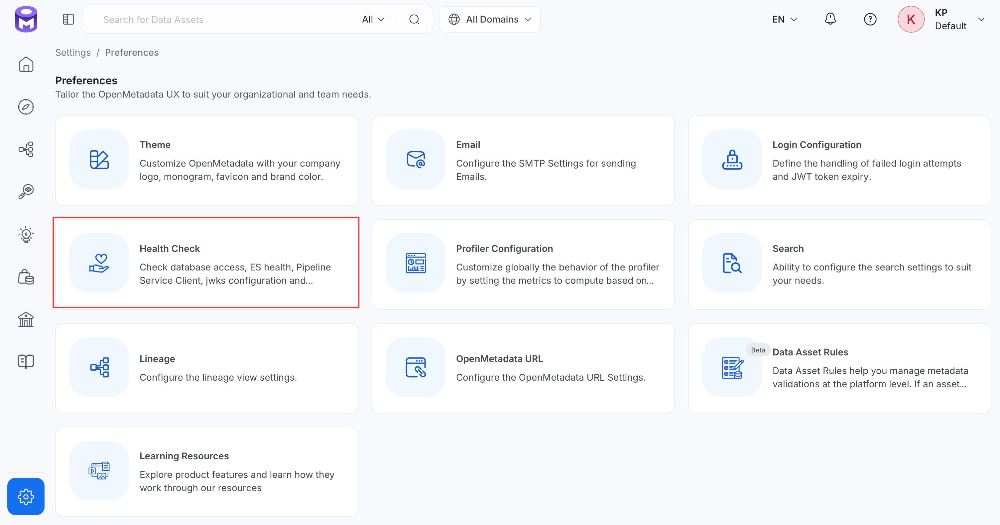
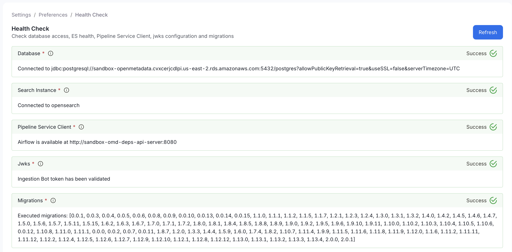

# Health Check

Health Check is a read-only diagnostics panel, not a form you fill in. It reports, in real time, whether the platform's core dependencies are reachable and correctly configured:

- **Infrastructure**: Database, search index, schema migrations, system bots
- **Search**: Search reindex status, semantic search embeddings (when enabled)
- **External dependencies**: Authentication keys, LDAP directory (when LDAP login is used), ingestion service, log storage (when configured), object storage

The `GET /api/v1/system/status` endpoint behind the panel is available only to administrators and bots. Run it first whenever something feels off elsewhere in OpenMetadata. A stuck ingestion pipeline or missing search results often trace back to one of these checks failing.

**Purpose and Benefits**
- **Purpose**: Check live status of the platform's core dependencies, such as the database and search index.
- **Benefits**: Gives you one place to look before troubleshooting an issue anywhere else.

## How to Check

To check platform health, follow the steps below:

1. Navigate to **Settings** > **Preferences** > **Health Check**.

    

2. Review the status of each check:

    **Infrastructure**
    - **Database**: Connectivity to the metadata database. If this fails, nothing in OpenMetadata can read or write metadata.
    - **Search Instance**: Connectivity to the search/index cluster. If this fails, search, discovery, and lineage graphs stop returning results.
    - **Migrations**: That all expected schema migrations have run. An incomplete migration can cause unpredictable errors elsewhere until it's resolved.
    - **System Bots**: That every built-in bot and its bot user exist, and that each bot's token can be decrypted and passes JWT validation. OpenMetadata checks each bot independently, so one missing bot does not hide problems with the others. A failing check lists each problem under **Show Logs**, naming the bot and the reason, for example `Token not usable: bot <name> (cannot be decrypted)`. The reason is one of:
        - `no JWT configured`: The bot has no JWT authentication configured.
        - `bot user not found`: The bot has no matching bot user.
        - `cannot be decrypted`: The stored token cannot be decrypted through the secrets manager.
        - `could not be loaded`: The bot's token could not be loaded for another reason.
        - `rejected by JWT validation`: The token was decrypted but failed JWT validation.

        OpenMetadata caches token results for 5 minutes, so a fixed bot can take up to 5 minutes to turn green.

    **Search**
    - **Search Reindex Status**: That every deployed search index was built from the current index mapping, so no reindex is pending. A pending reindex means some assets might not appear in search until it completes.
    - **Semantic Search**: That the embeddings used for semantic search are working, shown only when semantic search is enabled. If this fails, natural-language search requests return an error instead of results.

    **External dependencies**
    - **Pipeline Service Client**: Connectivity to the ingestion pipeline service. If this fails, no ingestion or profiler workflow can be triggered.
    - **JWKs**: That the configured JWKS (JSON Web Key Set) validates correctly. If this fails, token-based authentication can break for some or all users.
    - **LDAP**: Shown only when the login provider is LDAP. That OpenMetadata can reach the directory, sign in with the lookup account, and read the user base DN. A failure names the step that failed.
    - **Log Storage**: Connectivity to S3 log storage, shown only when S3 storage is configured. If this fails, ingestion logs aren't retrievable from the UI.
    - **Object Storage**: Connectivity to object storage used for uploaded file content, for example Context Center Drive. If this fails, uploaded files become unreachable.

    

3. Click **Refresh** to re-run all checks after fixing a reported issue.
