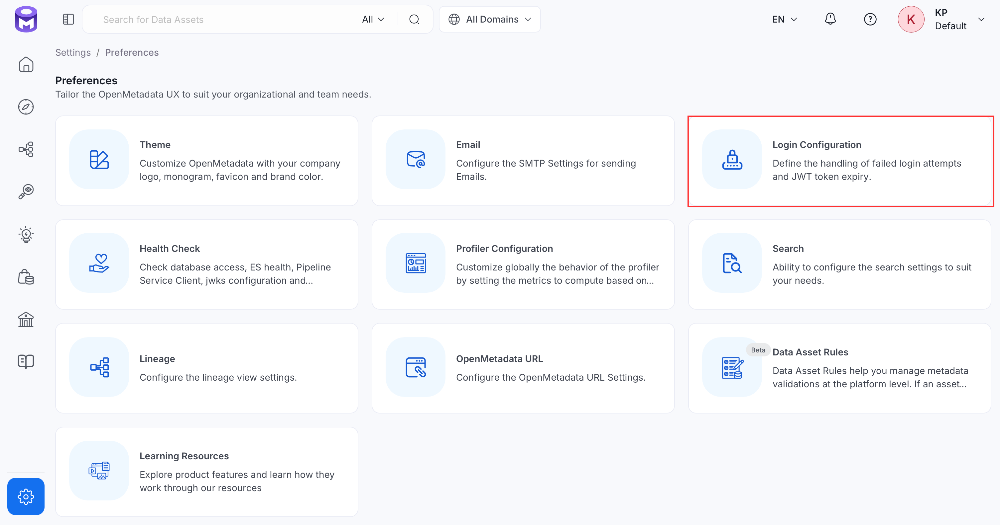
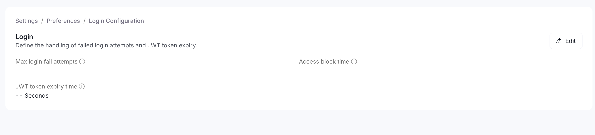
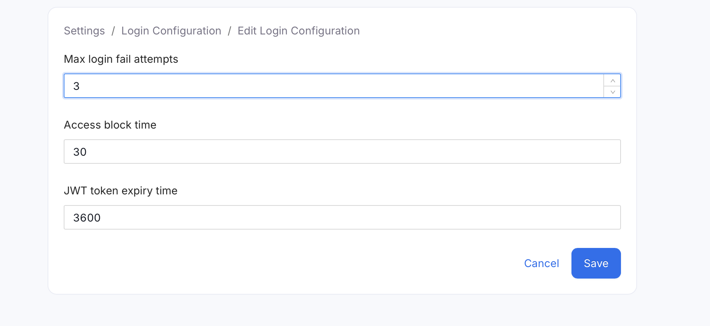

# Login Configuration

Login Configuration protects your instance against repeated failed sign-in attempts and controls how long a signed-in session stays valid. Use it to decide:

- How many wrong passwords an account tolerates before it's temporarily locked out
- How long that lockout lasts
- How often a signed-in user is asked to sign in again

Getting this right matters for security (too lenient invites brute-force attempts) and for user experience (too strict logs people out constantly).

**Purpose and Benefits**
- **Purpose**: Set the failed-login lockout threshold and JWT session expiry.
- **Benefits**: Protects against brute-force login attempts while controlling how often users are asked to sign back in.

## How to Configure

To configure Login Configuration, follow the steps below:

1. Navigate to **Settings** > **Preferences** > **Login Configuration**.

    

2. Click **Edit**.

    

3. Set the following fields:
    - **Max Login Fail Attempts**: Number of consecutive failed login attempts allowed before the account is temporarily blocked. Default: `3`.
    - **Access Block Time**: How long, in seconds, an account stays blocked after exceeding the max failed attempts. Default: `30`.
    - **JWT Token Expiry Time**: How long, in seconds, a login session token remains valid before the user must sign in again. Default: `3600`.

    

4. Click **Save**.

<Note>
  Changes to Login Configuration can take a few minutes to take effect across the platform.
</Note>

## How the Lockout Works

Login Configuration limits failed sign-in attempts and blocks sign-in for a set time. The following rules describe how the lockout behaves.

- **Counting**: OpenMetadata counts consecutive failed sign-in attempts. A correct password before the limit is reached clears the count.
- **Lockout**: Once the limit is reached, sign-in is refused until the block time passes or the password changes, even with the correct password.
- **Lifting the lockout**: For accounts that use Basic authentication, any password change lifts the lockout immediately, because failed attempts are counted against the current password:
    - An administrator resetting the user's password
    - The user changing their own password
    - The user setting a new password from a password reset link
    - An administrator running `openmetadata-ops reset-password` for the user
- **Sign-in page message**: While an account is locked, the sign-in page shows the server's message as an error notification instead of "You have entered an invalid username or password": "Failed Login Attempts Exceeded. Use Forgot Password or retry after some time."
