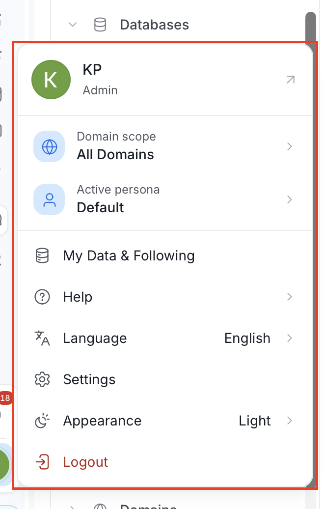
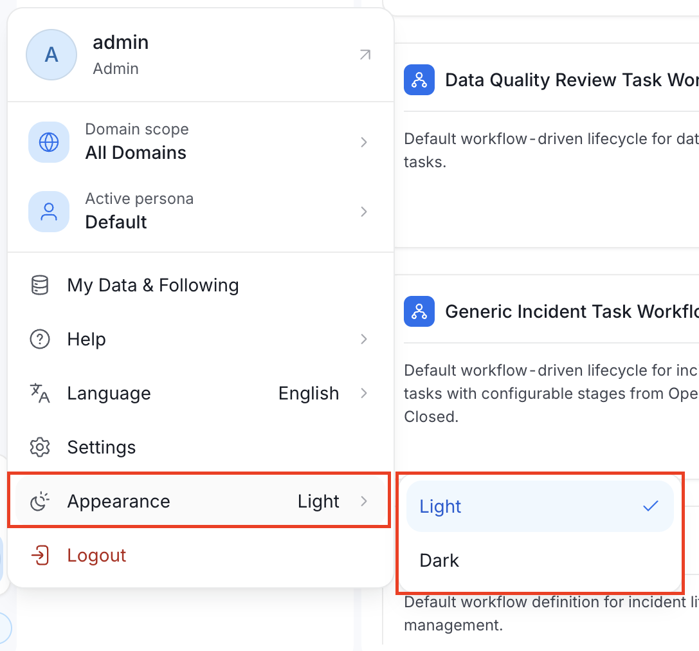
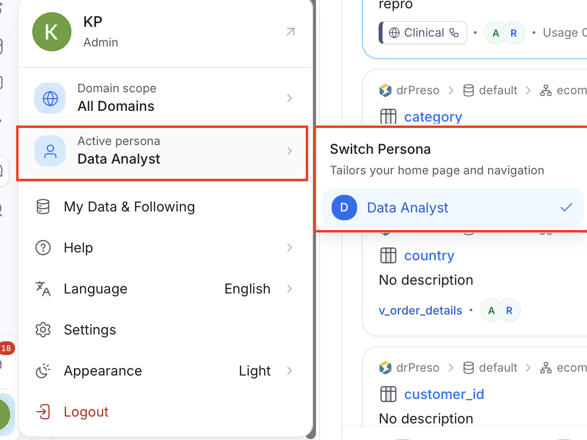
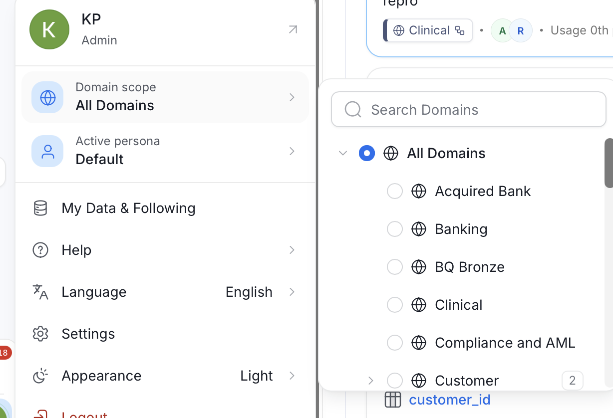
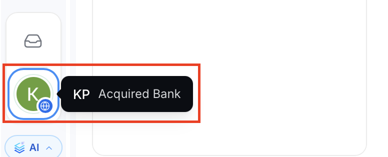
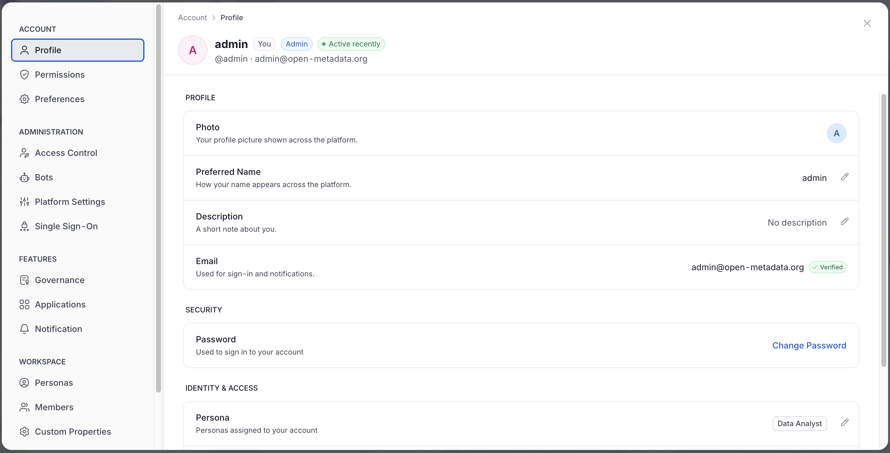
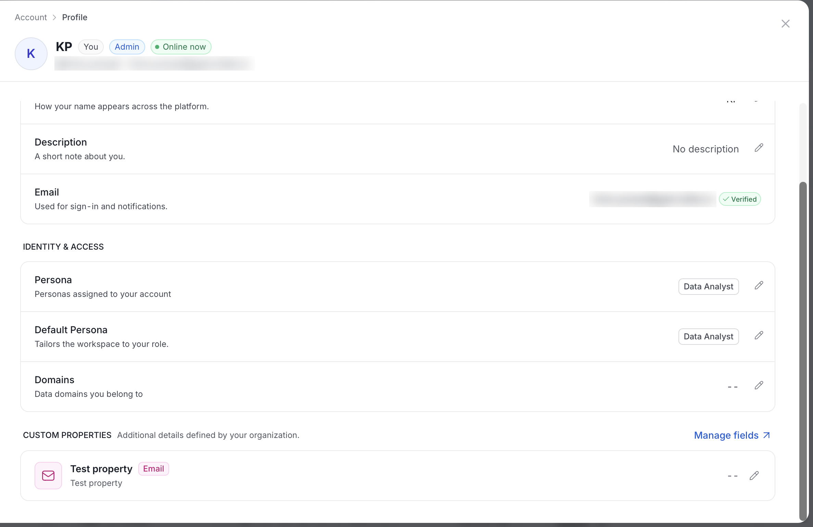
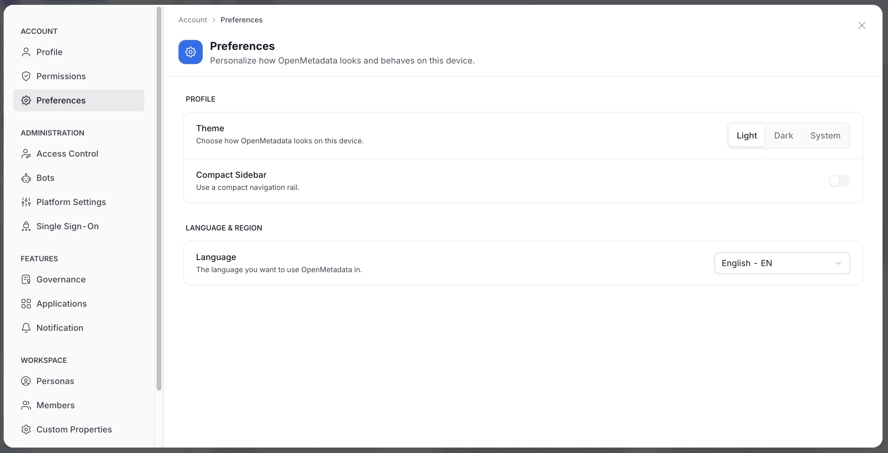

# Profile Menu and Settings

In AI mode, the profile menu in the sidebar gives you quick access to your workspace context and to **Settings**. **Settings** opens as a modal over the page you are on, so you keep your place. In it you manage your account and, if you are an admin, administer the platform.

<Note>
This page describes AI mode. In Classic mode, **Settings** opens as a separate page. Classic mode is deprecated. For more information, see [Default App Mode](/v2.1.x-SNAPSHOT/how-to-guides/admin-guide/preferences/app-mode).
</Note>

## Profile Menu

Click the **Profile** icon at the bottom of the sidebar to open the menu.

The menu lists the following items:

- **Your name and role**: Click it to open your **Profile** in **Settings**.
- **Domain scope**: Limits what you see to a single domain. For more information, see [Domain Scope](#domain-scope).
- **Active persona**: Shows your current persona, or **Default** if none is selected. Click it to open the **Switch Persona** submenu.
- **My Data & Following**: Opens the assets you own and follow.
- **Help**: Opens the help links.
- **Language**: Shows the current language. Select another language to change it. The page reloads to apply it.
- **Settings**: Opens the **Settings** modal.
- **Appearance**: Switches between **Light** and **Dark**.
- **Logout**: Signs you out.

### Switch Persona

Your persona tailors your home page and navigation. To switch persona, open the profile menu and click **Active persona**. In the **Switch Persona** submenu, a check mark shows the active persona. Select another persona to switch to it.

For more information about personas, see [Persona and Landing Page Customization](/v2.1.x-SNAPSHOT/how-to-guides/admin-guide/persona-landing-page-customization).

### Domain Scope

Use **Domain scope** to work inside one domain at a time.

- Select a domain to scope the platform to it. Select **All Domains** to remove the scope.
- The page reloads after you pick a domain.
- If you can access only one domain, **Domain scope** is disabled. Hover over it to see "You only have access to your assigned domain(s)."
- With the sidebar expanded, the profile card shows a globe icon and the active domain name.
- With the sidebar collapsed, a globe badge appears on your avatar only when a domain scope is active. Hover over the avatar to see your name and the active domain.

## Settings Modal

To open **Settings**, click the **Profile** icon and select **Settings**. The navigation panel on the left groups the sections as follows.

| Group | Section | Where to find the details |
|:--- |:--- |:--- |
| **Account** | Profile | See [Profile Details](#profile-details). |
| **Account** | Permissions | Shows the roles and policies that apply to you. For more information, see [Permission Debugger](/v2.1.x-SNAPSHOT/how-to-guides/admin-guide/permission-debugger). |
| **Account** | Preferences | See [Your Preferences](#your-preferences). Admins set platform-wide options, such as **Default App Mode**, in [Preferences](/v2.1.x-SNAPSHOT/how-to-guides/admin-guide/preferences). |
| **Administration** | Access Control | See [Roles and Policies](/v2.1.x-SNAPSHOT/how-to-guides/admin-guide/roles-policies) and [Audit Logs](/v2.1.x-SNAPSHOT/how-to-guides/admin-guide/audit-logs). |
| **Administration** | Bots | Manage bot accounts. |
| **Administration** | Platform Settings | The platform-wide settings, such as email, lineage, and [Default App Mode](/v2.1.x-SNAPSHOT/how-to-guides/admin-guide/preferences/app-mode). |
| **Administration** | Single Sign-On | See [Single Sign-On](/v2.1.x-SNAPSHOT/how-to-guides/admin-guide/sso). |
| **Features** | Governance | Governance settings. |
| **Features** | Applications | See [Applications](/v2.1.x-SNAPSHOT/how-to-guides/admin-guide/applications). |
| **Features** | Notification | See [Alerts and Notifications](/v2.1.x-SNAPSHOT/how-to-guides/data-quality-observability/alerts-notifications/data-observability-alerts). |
| **Workspace** | Personas | See [Define Personas](/v2.1.x-SNAPSHOT/how-to-guides/admin-guide/persona-landing-page-customization/defining-persona). |
| **Workspace** | Members | See [Teams and Users](/v2.1.x-SNAPSHOT/how-to-guides/admin-guide/teams-and-users) and [User Details](/v2.1.x-SNAPSHOT/how-to-guides/admin-guide/teams-and-users/user-details). |
| **Workspace** | Custom Properties | See [Create a Custom Property](/v2.1.x-SNAPSHOT/how-to-guides/guide-for-data-users/custom). |
| **Credentials** | Access Token | Your personal access token. |

<Note>
Some sections depend on your role or permissions. If you don't see one, ask an OpenMetadata admin.

- **Admin only**: Access Control, Bots, Platform Settings, Single Sign-On, Governance, Applications, and Personas.
- **Permission based**: **Members** appears if you can view teams or users. The **Online Users** card on that page is admin only. **Custom Properties** needs view permission on the Type resource. **Notification** needs view permission on event subscriptions.
</Note>

### Settings Pages in AI Mode

Some settings pages exist only in Classic mode. In AI mode, links to those settings open the modal at the matching section. The addresses that start with `/settings/`, `/marketplace/`, or `/bots/` are not served in AI mode and show a **Page Not Found** screen. To reach these pages, open the profile menu and select **Settings**.

<Warning>
Settings pages that have no section in the modal, such as services, are not reachable in AI mode. Switch to Classic mode to use them.
</Warning>

## Profile Details

The **Profile** section shows your personal details.

- **Profile**
    - **Photo**: Your profile picture.
    - **Preferred Name**: How your name appears across the platform. Click the pencil icon to edit it.
    - **Description**: A short note about you. Click the pencil icon to edit it.
    - **Email**: Used for sign-in and notifications. A **Verified** badge shows when OpenMetadata has verified it.
- **Security**: **Change Password**. It appears only if you sign in with Basic authentication.
- **Identity & Access**
    - **Persona**: The personas assigned to your account.
    - **Default Persona**: The persona that tailors the workspace to your role.
    - **Domains**: The domains you belong to. Only an admin can change your domains.

## Your Preferences

The **Preferences** section controls how OpenMetadata looks on this device.

- **Theme**: Select **Light**, **Dark**, or **System**. **System** follows your device setting. Your choice applies in AI mode only. Classic mode always uses the light theme, and OpenMetadata keeps your choice for when you return to AI mode.
- **Compact Sidebar**: Turn on to use a compact navigation rail.
- **Language**: Choose the language you want to use. The page reloads to apply it.

<Info>
**Appearance** in the profile menu switches between **Light** and **Dark** only. To follow your device setting, use **Theme** > **System** here.
</Info>

For the organization-wide logo and colors that admins set, see [Theme and Branding](/v2.1.x-SNAPSHOT/how-to-guides/admin-guide/preferences/theme-and-branding).
