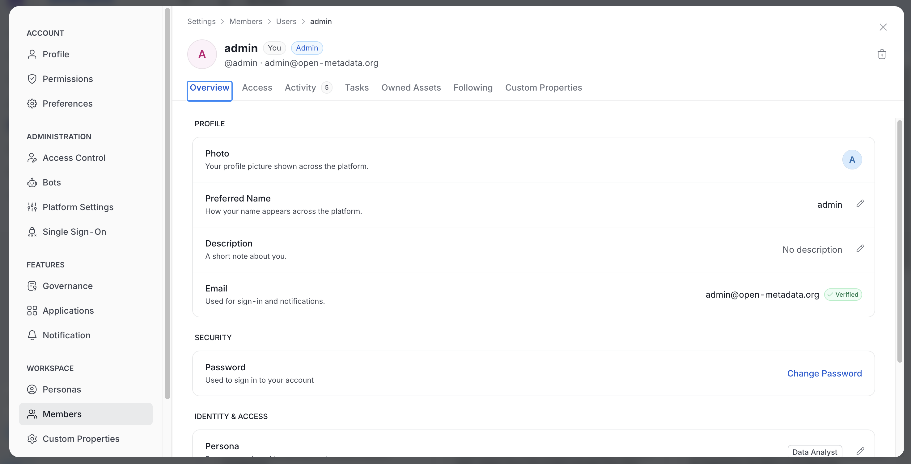
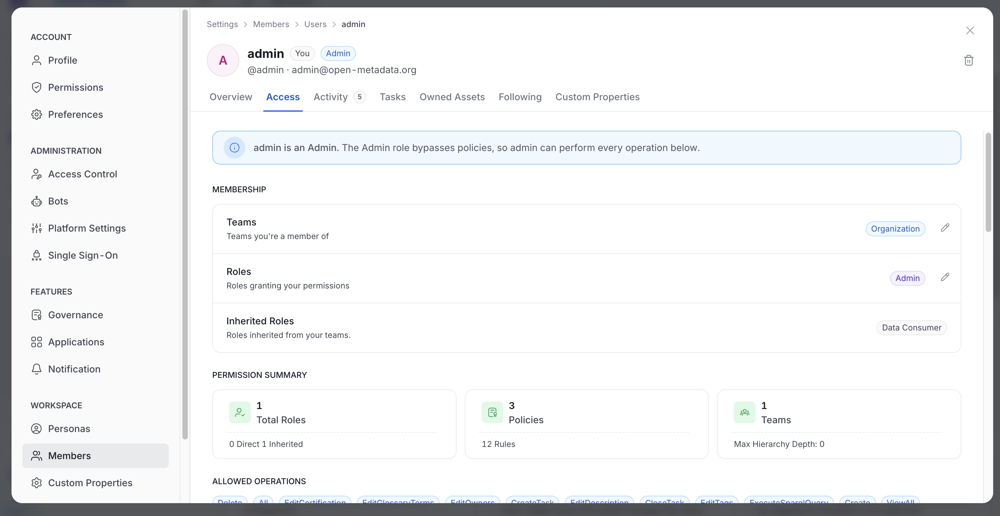
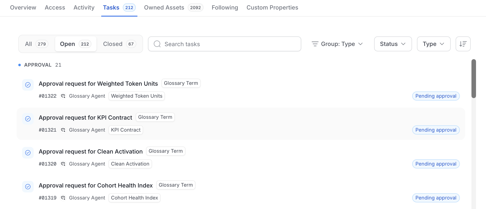

# User Details

The user details view shows everything OpenMetadata knows about a single user in one place. Open it from **Settings** > **Members** > **Users** by selecting a user. The breadcrumb reads **Settings** > **Members** > **Users** > the user's name.

## Header

The header identifies the user and shows their status. It contains:

- **Avatar and name**: The user's profile picture and display name.
- **Badges**: **You** on your own profile, **Admin** for administrators, **Bot** for bot accounts, and **Deleted** for deleted users. Bots never show the **Admin** badge.
- **Activity badge**: **Online now** or **Active recently** shows how recently the user was active. OpenMetadata hides the badge when the user has been inactive for more than an hour, and for bots.
- **Username and email**: Shown as `@username` followed by the email address. OpenMetadata hides the email when it is masked.
- **Delete icon**: Appears only if you have the **Delete** permission. For a deleted user, the icon is labeled **Delete permanently**.

A deleted user shows a banner above the tabs with the deletion date and a **Restore User** button. The profile is read-only, but the user's activity, tasks, and owned assets stay visible for audit.

## Tabs

Tabs with items show a count badge. A count of zero is hidden.

| Tab | What it shows | Who can see it |
|:--- |:--- |:--- |
| **Overview** | Profile details, **Security**, and identity details | Everyone who can open the user |
| **Access** | The user's roles and access | Admins, and the user on their own profile |
| **Activity** | The user's activity | Everyone who can open the user |
| **Tasks** | The user's tasks | Everyone who can open the user |
| **Owned Assets** | Assets the user owns | Everyone who can open the user |
| **Following** | Assets the user follows | Everyone, except for bot users |
| **Custom Properties** | Custom property values for the user | Users with view permission on custom properties |

### Overview

The **Overview** tab groups the user's details into sections. A pencil icon next to a value edits it, if you have permission.

- **Profile**: **Photo**, **Preferred Name**, **Description**, and **Email**. The email shows a **Verified** badge when OpenMetadata has verified it.
- **Security**: **Change Password**. For more information, see [Change a User's Password](#change-a-users-password).
- **Identity & Access**: **Persona**, **Default Persona**, and **Domains**.

### Access

The **Access** tab shows how the user gets their permissions.

- **Banner**: For an administrator, a banner explains that the Admin role bypasses policies, so the user can perform every operation.
- **Membership**: **Teams**, **Roles**, and **Inherited Roles**.
- **Permission Summary**: Cards for **Total Roles**, **Policies**, and **Teams**.
- **Direct Roles**: The roles assigned directly to the user.

### Tasks

The **Tasks** tab lists the user's tasks. Select a task to open it as a full page. The breadcrumb ends with the task ID.

- **All**, **Open**, and **Closed**: Switch between task states.
- **Search tasks**: Find a task by name.
- **Group**, **Status**, and **Type**: Group the list and filter by status or task type.

### Owned Assets and Following

These tabs list assets in the same card layout. Use the controls to narrow the list:

- **Search assets**: Enter text to find an asset by name.
- **Type**: Filter the list by asset type.

When the user owns or follows nothing, the tab shows an empty message. A failed load shows an error instead of an empty list.

### Custom Properties

The tab lists one row for each custom property defined for users. For more information, see [Set a Value on a User](/v2.1.x-SNAPSHOT/how-to-guides/guide-for-data-users/custom#set-a-value-on-a-user).

## Change a User's Password

The **Security** section on the **Overview** tab includes a **Change Password** option. OpenMetadata offers it only when all of these conditions are true:

- The user is active, not deleted, and not a bot.
- The user signs in with Basic authentication.
- You are viewing your own profile, or you are an admin.

## Permissions

What you can do in the user details view depends on your permissions:

- **EditAll** on the user: Edit the display name, description, persona, and teams.
- **Delete**: Delete the user.
- **Admin only**: Assign roles, set the admin flag, and change a user's domains.

Without view access to the user, OpenMetadata shows a permissions message instead of the details.

## Error States

These messages can appear when OpenMetadata can't load a user.

- **No User found**: The user doesn't exist.
- **Something went wrong**: OpenMetadata couldn't load the user. Select **Reload** to try again.
