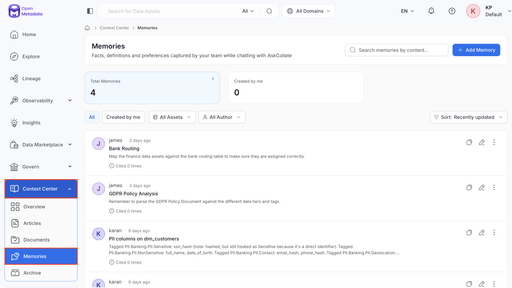
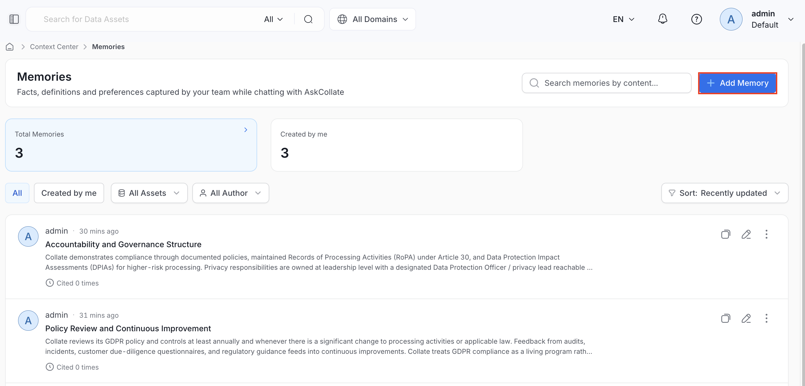
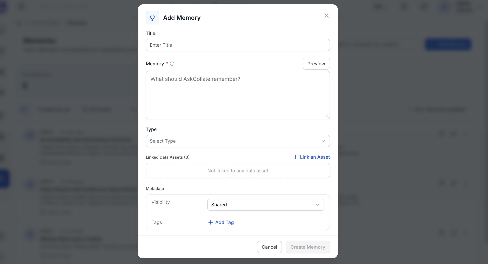
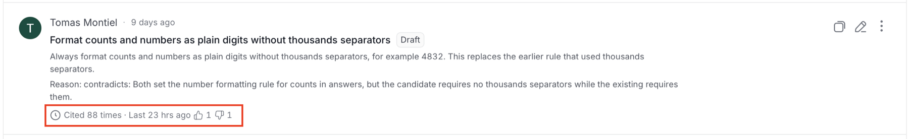
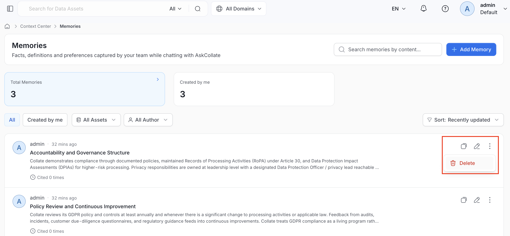
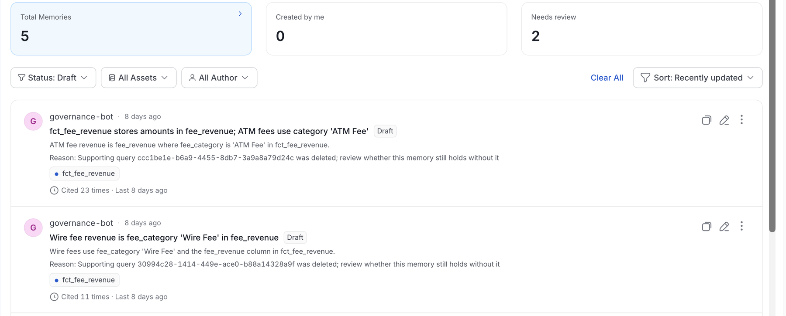
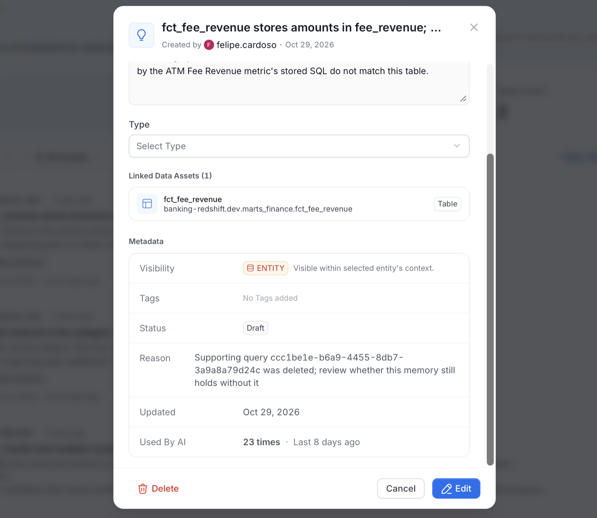
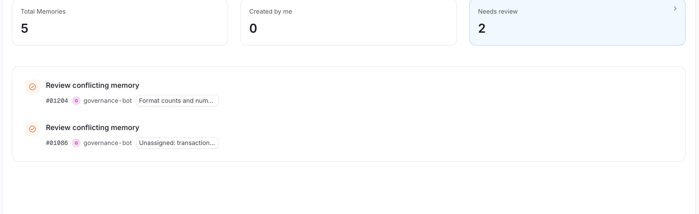
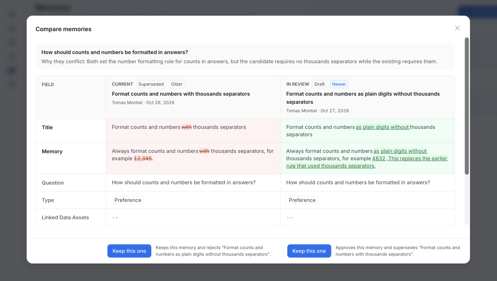
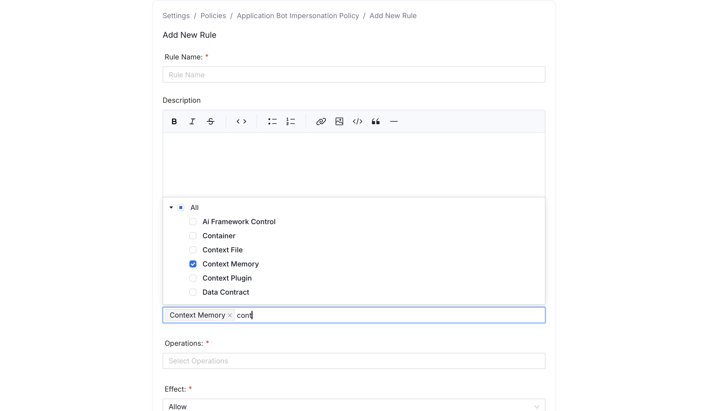

# Memories

Memories are short, atomic facts, such as definitions, preferences, and answers to recurring questions, captured by your team while working with an AI assistant, or added manually. Unlike Articles, Memories aren't meant to be full pages. They're quick, reusable pieces of context. The [`create_context_memory`](/v2.1.x-SNAPSHOT/how-to-guides/mcp/reference#create_context_memory) MCP tool can create a memory when you ask an assistant to remember something. The `company_context` tool retrieves only the question and answer notes extracted from uploaded files. It doesn't retrieve manually created or remembered Memories.

## Create a Memory

To create a memory, follow these steps:

1. From the left navigation bar, navigate to **Context Center** > **Memories**.

    

2. Select **Add Memory**.

    

3. In the **Add Memory** dialog, fill in the following details:
    - **Title**: An optional label for the memory.
    - **Memory**: Required. Describe what the assistant should remember, written in plain markdown. Click **Preview** to see how the formatted content will look. **Create Memory** stays disabled until this field has content.
    - **Type**: Optional. Choose the kind of memory:
      - **FAQ**: A recurring question and its answer.
      - **Note**: A general fact worth remembering.
      - **Preference**: A personal preference for how the assistant should behave for you.
      - **Runbook**: A step-by-step procedure.
      - **Use Case**: A specific scenario and how to handle it.
    - **Linked Data Assets**: Optionally link the memory to one or more data assets using **Link an Asset**.
    - **Metadata**:
      - **Visibility**: Choose who can see the memory. Defaults to **Private**.
        - **Shared**: Visible to people or teams in the memory's shared-with list. The **Add Memory** dialog currently doesn't let you add people or teams to that list.
        - **Entity**: Visible to everyone who can view the linked data asset, or to everyone when no asset is linked.
        - **Private**: Visible only to you.
      - **Tags**: Optionally tag the memory using **Add Tag**.

    

4. Click **Create Memory** to save it.

An AI assistant can also create memories on its own during a conversation, for example when you ask it to remember a preference.

## View and Manage Memories

The **Memories** page shows:

- **Search bar**: Search memories by their content.
- **Summary cards**: Three cards, **Total Memories**, **Created by me**, and **Needs review**, each showing a count. Select a card to switch the list to that view. The cards work with the keyboard, and the page has no **All**, **Created by me**, or **Needs review** tabs.
- **Filters**: Narrow the list by **Status**, **All Assets**, or **All Author**. **Status** defaults to **Approved**, **Unprocessed**, and **Draft**. Select **Clear All** to reset the filters.
- **Sort**: Order the list, for example by **Recently updated** or **Most used**. **Most used** sorts by how many answers a memory was applied to.
- **Memory list**: Each row shows the memory's author and when it was last updated, its title and status, and its content. A **Reason** line appears when a memory is held for review. When usage figures are available, the last line of a row shows how the memory has been used:
  - **Cited N times**: The number of saved answers the memory was applied to, followed by when it was last used.
  - **Thumbs-up and thumbs-down counts**: The helpful and unhelpful votes on those answers.
  - **Corrected N times**: How many times a memory captured from a conversation corrected this one. This appears only when the number is above zero.

    

  Usage figures are written by an application that recounts how memories are used, so they appear only when such an application is running, as in Collate.
- **Row actions**:
  - **Copy link**: Copy the memory URL.
  - **Edit**: Open the memory to change its title, content, type, visibility, tags, or linked assets.
  - **Delete**: Open the **⋮** menu and select **Delete** to remove the memory.

    

## Memory Statuses

Every memory has a status. A new memory starts as **Approved**, because OpenMetadata has no reconciliation step. A distribution that requires review, such as Collate, starts new memories as **Unprocessed** instead. Only **Approved** memories ground AI assistant answers for other users.

The **Status** filter lists these statuses:

- **Unprocessed**: Awaiting reconciliation.
- **Draft**: Held for a person to review. A **Reason** line on the memory explains why.
- **Approved**: In use.
- **Superseded**: Replaced by another memory. A superseded memory must name the memory that replaces it.
- **Invalidated**: Found to be incorrect.
- **Archived**: No longer in use.
- **Deprecated** and **Rejected**: Older retirement stages that remain readable.

By default, the list shows **Approved**, **Unprocessed**, and **Draft** memories, so memories held for review appear with their **Reason**. When you select several statuses, the filter button reads **Status: N Statuses**.

### Who Can See Pending Memories

**Unprocessed** and **Draft** memories are listed only to their owners and to admins, in the **Memories** list, in search, and on a document's memory card. A pending memory extracted from a document is also listed to that document's owners, including team owners. Everyone else sees a memory only after it is **Approved**.

### Memories Held for Review

OpenMetadata moves a memory to **Draft** when a saved query that supports it is permanently deleted. Select a held memory to read its **Reason** in the list or in the memory details, under **Metadata**.

    

    

Each **Approved** or **Unprocessed** memory that cites the deleted query moves to **Draft**. The reason reads `Supporting query <id> was deleted; review whether this memory still holds without it`, and OpenMetadata removes the query from the memory's related entities. Memories in other statuses aren't changed.

A hold for a deleted query doesn't open a review task. The owner or an admin approves or rejects it directly from the memory. A reader who can't view a query sees only its ID and type in a memory's evidence.

## Review Conflicting Memories

A **Review conflicting memory** task asks you to decide between two memories that contradict each other. OpenMetadata creates the task as `governance-bot` and assigns it to the owners of both memories. Memory reconciliation in Collate is what detects a contradiction and holds the memory, so these tasks appear only when such an application writes the disputes. The task also appears in your **Inbox** > **Tasks**, where each row and the task detail header carry a **Memory conflict** chip.

To review a conflict, follow these steps:

1. Navigate to **Context Center** > **Memories** and select the **Needs review** card. Admins see all reviews. Other users see the reviews assigned to them or to their teams. The list loads 20 at a time, so select **Load more** to see the rest.

    

2. Open a review. The **Compare memories** dialog compares the two memories side by side:
    - **Current**: The **Approved** memory that is currently in use, on the left.
    - **In review**: The memory in review, on the right.
    - Each side shows its title, author, date, status, and whether it is **Newer** or **Older**.
    - **Why they conflict**: The reason for the conflict.
    - A table compares the **Title**, **Memory**, **Question**, **Type**, and **Linked Data Assets** of both memories, with the differences highlighted.
    - When several memories are contradicted, use the selector to switch between them.

    

3. Click **Keep this one** under the memory you want to keep:
    - Under the memory in review: **Approves this memory and supersedes** the disputed memory. The reviewed memory becomes **Approved**, and the disputed **Approved** memories become **Superseded**.
    - Under the **Approved** memory: **Keeps this memory and rejects** the memory in review. The reviewed memory becomes **Rejected**, and the disputed memory isn't changed.

OpenMetadata refuses the decision and leaves the task open when:

- The memory left review another way.
- A disputed memory was edited after the conflict was found.
- You can't read or supersede the disputed memory.
- Either memory changed while you were deciding.

Approving or rejecting the memory elsewhere in Context Center, moving it through a workflow transition, or deleting it closes the open review. You can't create, edit, or close a review manually through the Tasks API.

## Control Access to Memories with Roles and Policies

Memories are a governed resource in OpenMetadata's role-based access control system, listed as **Context Memory** under the **Misc** resource category. Admins control who can view, create, edit, or delete memories platform-wide by adding a rule to a policy that targets the **Context Memory** resource.

1. Click the **Profile** icon and navigate to **Settings** > **Access Control** > **Policies**.
2. Open an existing policy and click **Add Rule**.
3. Fill in the following details:
    - **Name**: Enter a unique rule name.
    - **Description** (optional): Add a note explaining what this rule does and why, so other admins reviewing the policy later understand its intent.
    - **Resources**: Select `Context Memory`.
    - **Operations**: Set the actions to allow or deny, for example `All` to cover every operation, or a specific set such as `Create` and `EditAll`.
    - **Effect**: Select from `Allow` or `Deny`.
    - **Condition** (optional): A CEL expression to scope the rule further, such as restricting it to a domain.
4. Click **Save**, then attach it to the roles that should have this access.

    

You can also add this rule while creating a new policy, instead of adding it to an existing one.

### Default Access for Data Consumers

By default, every user can create memories, including the ones an AI assistant saves from their conversations. The seeded **Data Consumer** policy includes the allow rule `DataConsumerPolicy-CreateContextMemory-Rule` (**Create** on **Context Memory**), and every user receives it through the **Organization** team. The creator owns the new memory and can edit or delete it.

Users who can only create memories have these limits:

- They can create only memories that they own. Naming another owner returns a 403 error.
- They can link only data assets they can view.
- They can't set extraction sources.

To make memory creation admin-only, delete `DataConsumerPolicy-CreateContextMemory-Rule` from the **Data Consumer** policy. To withdraw creation from chosen users only, add a **Deny** rule for **Create** on **Context Memory** to a role assigned to them.

Memories with **Entity** visibility that are linked to an asset are also findable in search by anyone who can view that asset.

### RBAC and Visibility

This RBAC layer is separate from a memory's own **Visibility** setting (see [Create a Memory](#create-a-memory)): RBAC controls whether a role can interact with memories as a resource type at all, while Visibility and sharing control who can see one specific memory once it exists. Seeing a memory requires both: RBAC permission on Context Memory, and visibility into that memory, either as its owner, through its shared-with list, or through **Entity** visibility on a linked asset.

See [Roles and Policies](/v2.1.x-SNAPSHOT/how-to-guides/admin-guide/roles-policies) for how rules, policies, and roles fit together, and [Resource Scope and Operations Reference](/v2.1.x-SNAPSHOT/how-to-guides/admin-guide/roles-policies/resource-scope) for the full list of operations available on Context Memory and other resources.
