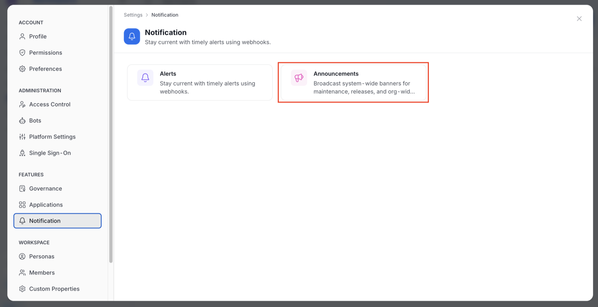
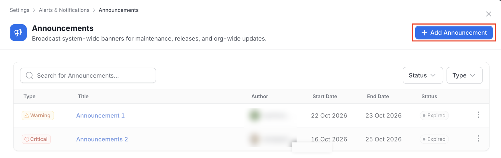
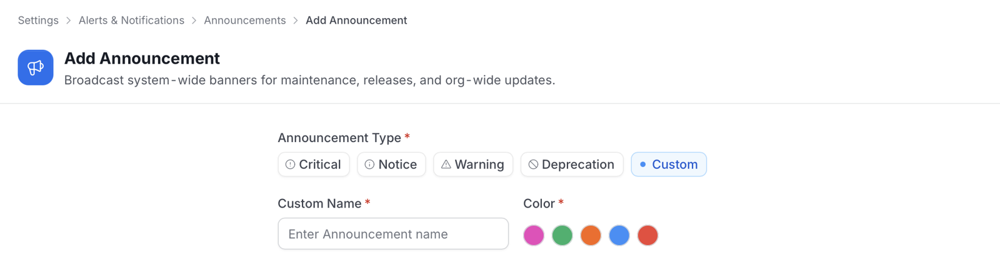
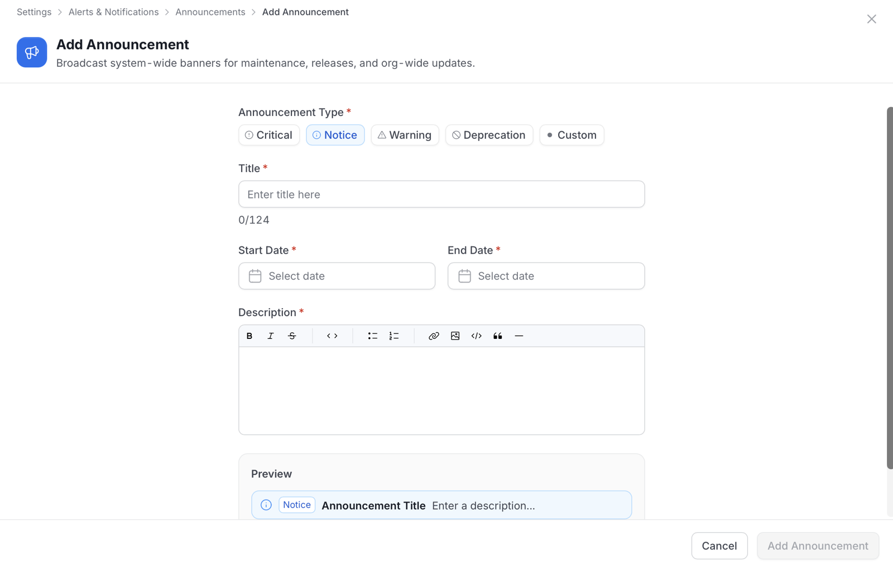
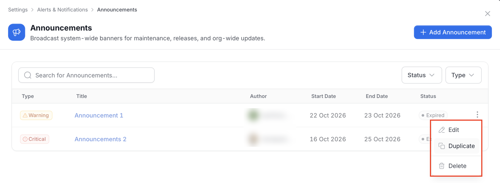

# System Announcements

System announcements broadcast a message to everyone in OpenMetadata, such as a maintenance window, a release, or a deprecation. Unlike an asset announcement, a system announcement is not tied to a data asset.

<Note>

**Note**: Only admins can create, edit, duplicate, or delete system announcements. The **Announcements** card is hidden from other users, and the pages deny them access.

</Note>

## Open the Announcements List

1. Click the **Profile** icon and go to **Settings** > **Notification**.
2. Click the **Announcements** card.

   

The list has these columns:

- **Type**: The announcement type.
- **Title**: The announcement title.
- **Author**: The user who created it.
- **Start Date** and **End Date**: The window in which the announcement is live.
- **Status**: **Scheduled** before the start date, **Active** between the two dates, and **Expired** after the end date. The status comes from the dates.

Use the controls above the list to find an announcement:

- **Search**: Filter by title.
- **Status**: Filter by **Scheduled**, **Active**, or **Expired**.
- **Type**: Filter by announcement type.
- **Clear all**: Appears once a filter is active and resets the filters.

## Add an Announcement

To create an announcement, follow these steps:

1. On the **Announcements** page, click **Add Announcement**.

   

2. Select the **Announcement Type**: **Critical**, **Notice**, **Warning**, **Deprecation**, or **Custom**. **Notice** is selected by default. For **Custom**, enter a **Custom Name** (up to 64 characters) and select a **Color**.

   

3. Enter the **Title**. It must be 5 to 124 characters, and a counter shows how many you have used.
4. Set the **Start Date** and **End Date**. The end date must be after the start date.
5. Enter the **Description** in the rich-text editor. The description is required.
6. Check the **Preview** below the description. It shows how the banner appears to everyone in the organization.
7. Click **Add Announcement**.

## Edit, Duplicate, or Delete an Announcement

Click the **⋮** icon next to an announcement to manage it:

- **Edit**:
  1. Click **Edit** and modify the details.
  2. Click **Save Changes**.
- **Duplicate**:
  1. Click **Duplicate**. A pre-filled form opens with the title followed by "(copy)".
  2. Modify the details.
  3. Click **Add Announcement**. This creates a new announcement and leaves the original unchanged.
- **Delete**:
  1. Click **Delete**.
  2. Confirm the deletion when prompted.

## Where Users See System Announcements

Users see only **Critical** system announcements outside Settings.

- **Home page**: A live critical announcement appears as a banner at the top of the home page for every user. When several are live, the banner pages through them, newest first.
- **Dismissing**: Each user can dismiss a banner. The choice is remembered for that user in their browser and does not hide the banner from anyone else.
- **Other types**: Notice, warning, deprecation, and custom announcements appear only in the **Announcements** list in Settings.

## System and Asset Announcements

| | System announcement | Asset announcement |
|---|---|---|
| **Scope** | The whole organization | One data asset |
| **Created from** | **Settings** > **Notification** > **Announcements** | The data asset |
| **Linked asset** | None | Yes |

For announcements on a data asset, see [Announcements](/v2.1.x-SNAPSHOT/how-to-guides/data-collaboration/announcements).
