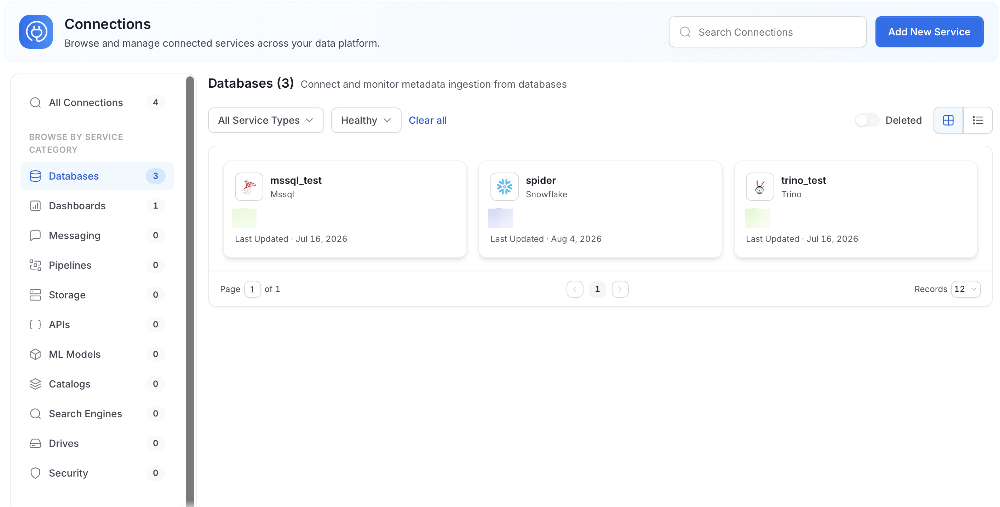
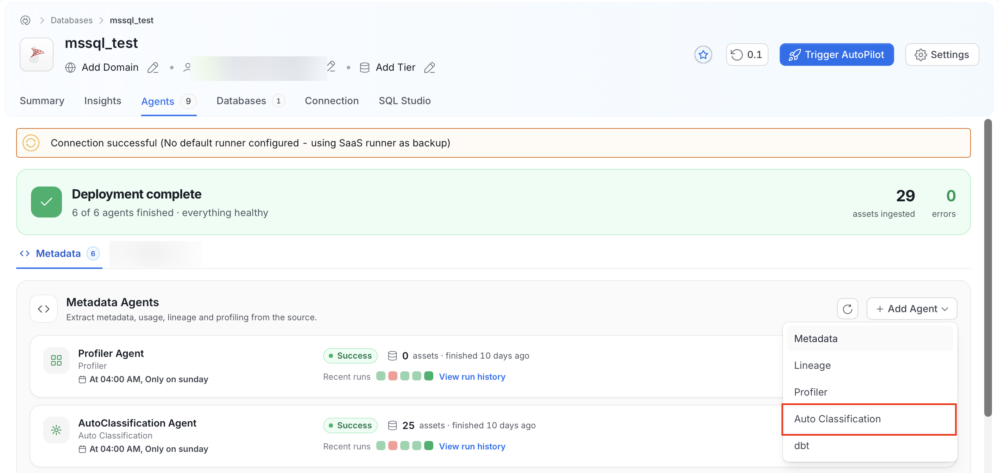
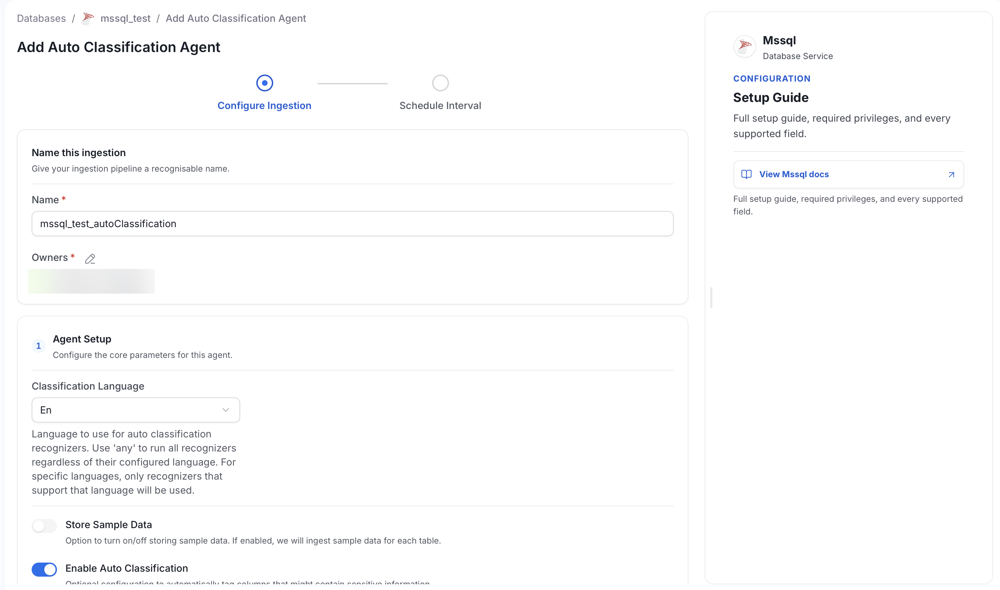
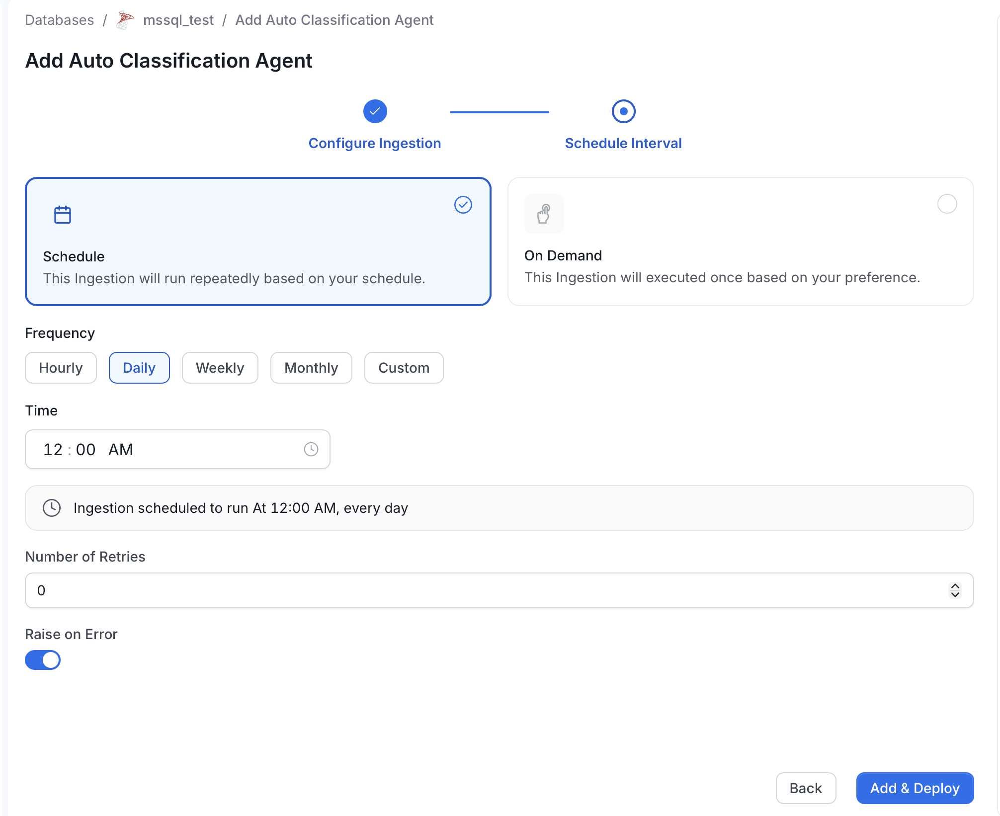

# Adding Auto Classification Agent through the UI

Follow these steps to configure Auto Classification Agent via the OpenMetadata UI:

## 1. Navigate to the Database Service
1. Go to **Connections** > **Databases** in the OpenMetadata UI.
2. Select the database service for which you want to configure Auto Classification Agent.

## 2. Access the Agents Tab
1. In the selected database service, go to the **Agents** tab.
2. Click **Add Agent** > **Auto Classification**.

## 3. Configure Auto Classification Details
1. Fill in the details for your Auto Classification Agent workflow.
2. Each field's purpose is explained directly in the UI, allowing you to customize the configuration based on your requirements.

**Store Sample Data** is turned off by default. To ingest sample data during scheduled runs, turn it on in the Agent configuration.

## 4. Set the Schedule
Specify the time interval at which the Auto Classification Agent should run.

## 5. Add the Agent Workflow
Once all details are configured, click **Add & Deploy** to save and activate the workflow.

By following these steps, you can set up an Auto Classification Agent workflow to automatically identify and tag sensitive data in your databases.
