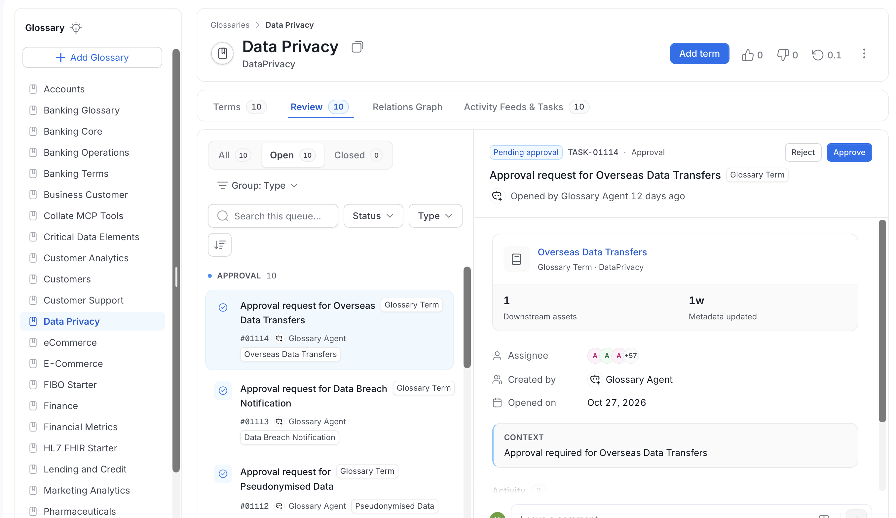
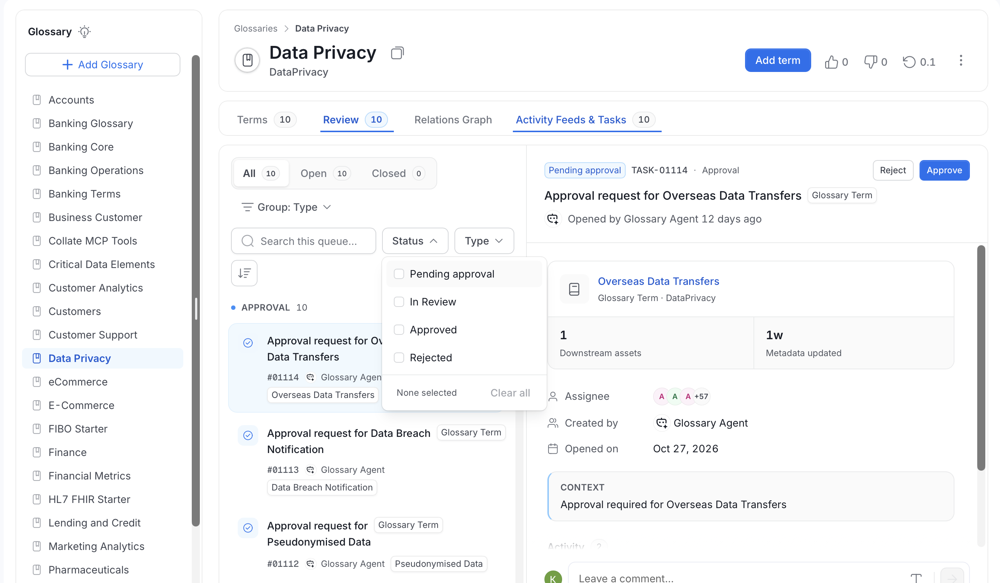
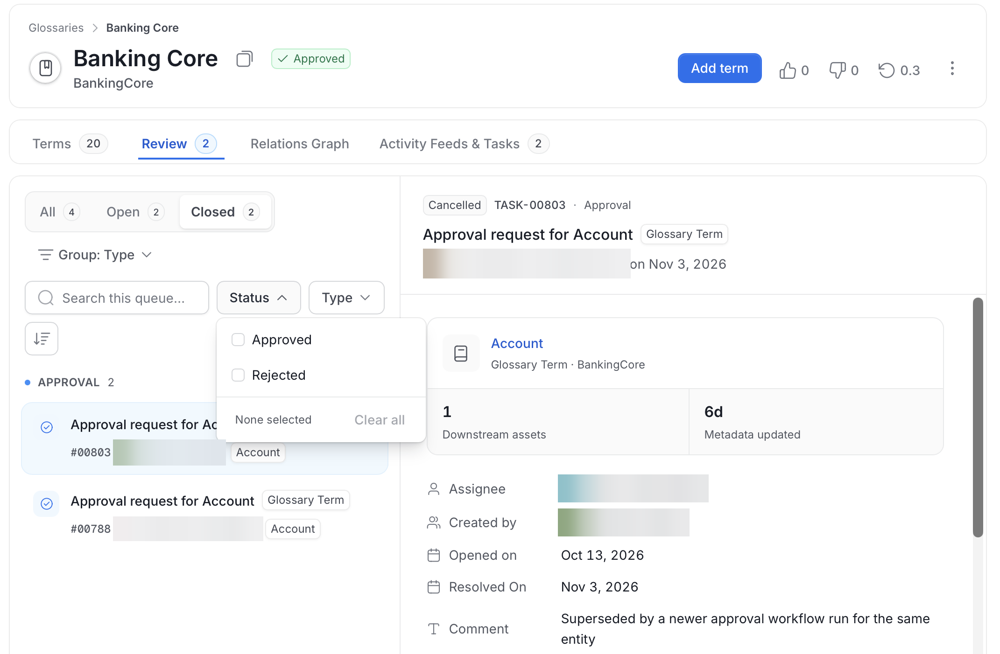

# Glossary Approval Workflow

The business glossary plays a vital role in standardizing terminology in an organization. The Glossary Approval Workflow provides control where every term added to a business glossary has been reviewed and approved by the reviewers of the glossary. This helps avoid duplicate terms, incomplete definitions, and obsolete terminologies.

Watch the video to learn more about **[Glossary Approval Workflow](https://www.youtube.com/watch?v=PgTcKQtpAks&t=4s)**

<iframe
  width="800"
  height="450"
  src="https://www.youtube.com/embed/PgTcKQtpAks?start=0&end=171"
  frameBorder="0"
  allow="accelerometer; autoplay; clipboard-write; encrypted-media; gyroscope; picture-in-picture"
  allowFullScreen>
</iframe>

To automate the approval workflow, ensure that your Glossary has **Reviewers** assigned. If you glossary has reviewers assigned, the glossary approval workflow gets triggered when a **New Term** is added.

- The new term will show up in the Glossary, but will be marked as **Draft**.
- Only the assigned **Reviewers** can Approve or Reject the term by editing its status directly.
- The workflow decides who can approve through the term's **Task**. From OpenMetadata 2.0.6, an approval by an administrator or owner that the workflow authorizes also updates the term.
- A **Task** is assigned for the Reviewers.
- The details of the glossary term can be viewed in the **Overview Tab**.
- Users can discuss further about the term by **replying** on the task.
- Other users can be pulled into the conversation using **@mentions**.
- The approved terms will have the **Approved** label next to them.
- Similarly, the rejected terms will be marked as **Rejected**.

<Warning>
In case, the glossary **does not have any Reviewers** assigned, then the glossary terms will be **Approved** by default.
</Warning>

## Review Tab

Reviewers decide on glossary term proposals in the **Review** tab. The tab appears after **Terms** on a glossary page, and its badge shows the number of open requests.

- **Queue**: The request list shows the approval requests for the glossary and its terms.
  - Use the **All**, **Open**, and **Closed** tabs to filter by state. Each tab shows its count.
  - Use **Group** to group the requests by **Type** or to show them ungrouped with **None**. The list shows each group with its count, for example **Approval**.
  - Use **Search this queue...** and the **Type** filter to find a request. Use the **Status** filter to narrow the state further. On the **Open** tab, select **Pending approval** or **In Review**. On the **Closed** tab, select **Approved** or **Rejected**.
  - Use the sort button to order the list by **Newest first** or **Oldest first**.

    

    

  - Each row shows the request title, its task ID, who created it, and the term it is about. For a term that an AI agent proposed, the row shows the agent's name with an agent badge instead of a person.
- **Request details**: Select a request to see its details in the details pane.
  - The header shows the status, such as **Awaiting review**, the task ID, and the **Reject** and **Approve** buttons.
  - A card shows the term, with its downstream assets and when its metadata was last updated.
  - **Assignee**, **Created by**, and **Opened on** show who is involved and when the request opened.
  - **Context** explains why the approval is needed, and **Activity** lists the comments. Use **Leave a comment...** to discuss the term with the creator.
- **Decisions**: Select **Approve** or **Reject**. Only the request's assignees see these buttons. The assignees are the reviewers of the term or, when there are none, its owners or the administrators. Other users can read the request and comment on it.

The **Terms** table still marks proposals from AI agents and from people, and shows a status badge for each proposal.

## Proposals from AI Agents

A term that an AI agent proposes is created as a **Draft** term and goes through the same glossary approval workflow as a term that a person creates.

- Only a person can approve an AI-proposed term. The approval request goes to the glossary's reviewers. If the glossary has no reviewers, the request goes to the term's owners, and then to the administrators.
- A glossary without reviewers still sends an AI-proposed term for review. Terms that people create in that glossary are approved automatically.
- An edit by a reviewer approves the term, as it does for any term. An edit by anyone else sends the change for review.

<Card title="Glossary Styling" href="/v2.1.x-SNAPSHOT/how-to-guides/data-governance/glossary/styling" >
    Associate glossary terms to data assets making it easier for data discovery
  </Card>