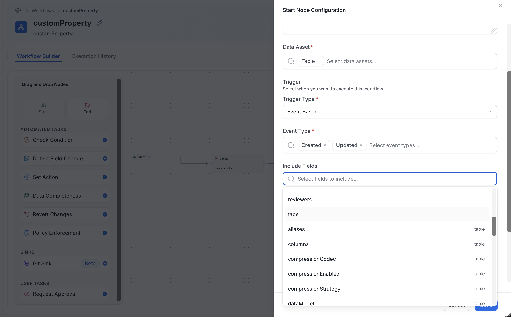
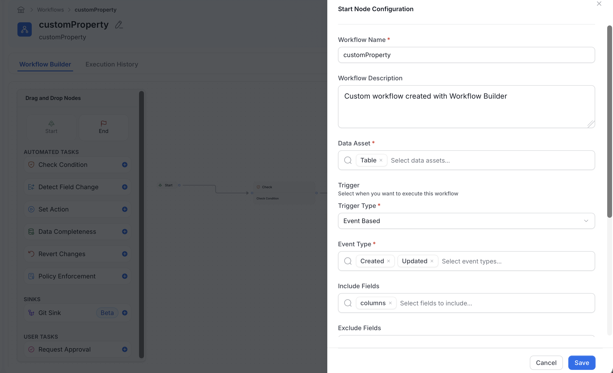
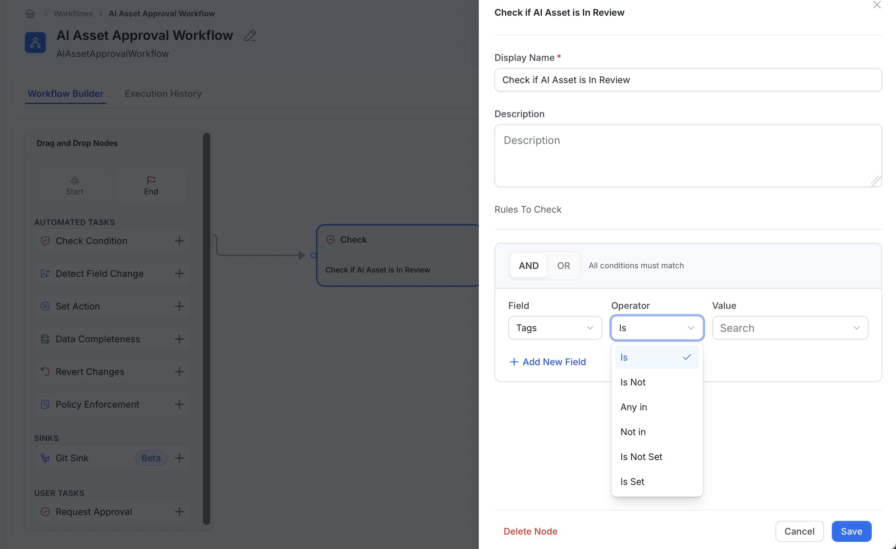
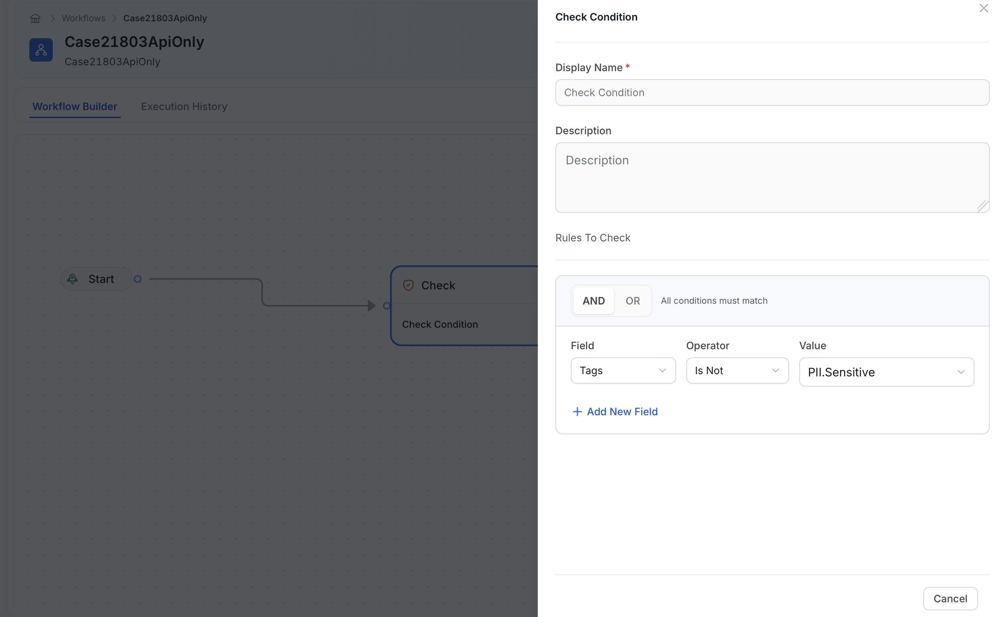
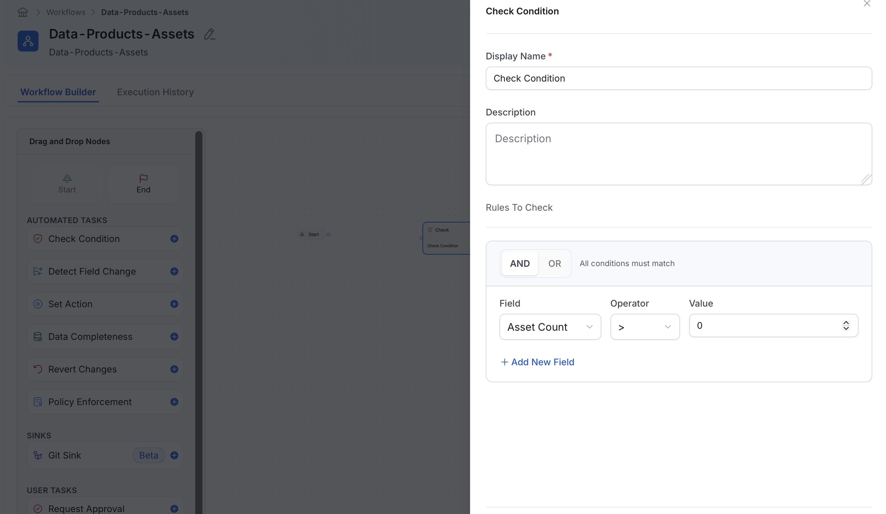
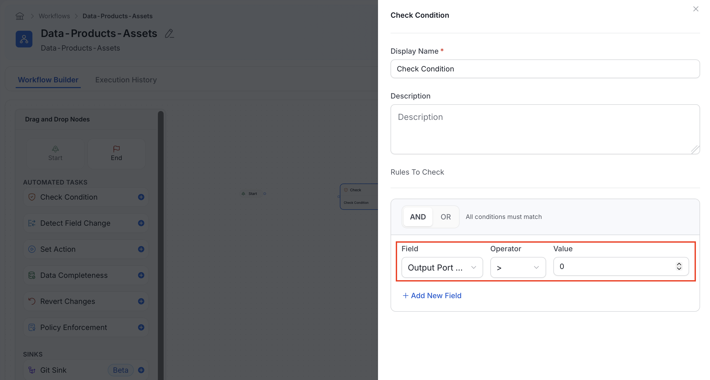

# Configure Governance Workflow Triggers and Conditions

Governance workflows can respond to changes on specific data assets and route an entity based on its metadata. OpenMetadata 2.1 adds entity-specific trigger fields, support for column custom-property changes, and Data Product count conditions.

You need permission to create or edit a Workflow Definition. You also need the `Deploy` operation to deploy the completed workflow.

## Choose Which Changes Trigger a Workflow

For an event-based start node, the **Include Fields** and **Exclude Fields** lists contain only fields that apply to the selected data asset types. The lists combine:

- Common fields, such as `description`, `owners`, and `tags`.
- Fields for the selected entity type, such as `columns` for a Table or `outputPorts` for a Data Product.
- Custom properties defined for the selected entity type. The selector marks these entries as **Custom Property**.

This keeps a workflow from offering fields that cannot change on the selected entity type.

<Info>
If **Include Fields** is empty, any supported common or entity-specific field can trigger the workflow. Use **Include Fields** when the workflow should respond only to a smaller set of changes.
</Info>

### Trigger a Workflow When a Column Custom Property Changes

Use the Table `columns` field to respond when a custom property on any column changes.

1. Go to **Govern** > **Workflows**, create or edit a workflow, and select the start node.
2. Under **Data Asset**, select **Table**. Select **Dashboard Data Model** instead when the custom property belongs to a dashboard data model column.
3. Set **Trigger Type** to **Event Based**.
4. Under **Include Fields**, select `columns`.
5. Complete the workflow, save it, and deploy it.

Changing a column custom property now creates a column change on the parent entity and starts the workflow. One update to a table starts the workflow at most once, even when the update changes multiple columns.

<Note>
The trigger watches the `columns` field as a whole. It cannot be limited to one column or one column custom property. The condition builder does not offer `columns` because it is an array of column objects and cannot be compared as a single value.
</Note>

## Negative Operators on List Fields

The condition builder for the **Data Asset Filter** and the **Check Condition** node treats the **Is Not**, **Not in**, and **Is Not Set** operators on list fields as a check on the whole list. List fields include **Tags**, **Owners**, **Reviewers**, **Domains**, and **Data Products**. For these fields, the **Operator** list also includes **Is**, **Any in**, and **Is Set**.

- **Is Not**: The asset is not tagged with the selected value. An asset with no tags passes. An asset with the selected tag fails, even if it has other tags too.
- **Not in**: The asset has none of the selected values.
- **Is Not Set**: The asset has no value in the field, for example no tags.

A condition group that shows a **NOT** badge is negated as a whole. Its helper text explains the effect, for example "At least one condition must not match" or "No condition can match". This happens, for example, with a rule created through the API that negates several conditions.

## Route Data Products by Asset or Output Port Count

The **Check Condition** node provides two numeric fields when the workflow evaluates a Data Product:

| Field | Internal name | What it counts |
|---|---|---|
| **Asset Count** | `assetsCount` | Assets assigned to the Data Product |
| **Output Port Count** | `outputPortsCount` | Assets configured as output ports |

For example, use `Asset Count > 0` to continue only when the Data Product contains an asset, or `Output Port Count > 0` to require at least one output port.

1. Configure the start node with **Data Product** selected under **Data Asset**. The count fields are not available when the start node processes Tables or another entity type.
2. Add a **Check Condition** node. If you changed the start node after adding this node, close and reopen its configuration so the field list refreshes.
3. In the condition builder's **Field** list, select **Asset Count** or **Output Port Count**. Do not select **Data Product**. That option represents an entity relationship and provides operators such as **Is** and **Is Not**.
4. Select `>` and enter `0` to require at least one item.
5. Connect the true and false branches to the appropriate next steps.
6. Save and deploy the workflow.

OpenMetadata calculates these counts when the condition runs. They are available for workflow evaluation but are not stored as fields on the Data Product.

<Tip>
To validate both requirements, add conditions for `assetsCount > 0` and `outputPortsCount > 0`, then use the branch that matches your approval process.
</Tip>

## Hold Edits for Approval

An event-based start node has an **Approval Mode** setting with two options. **Default** publishes edits immediately and runs the workflow afterward. **Enforce** holds each edit as a change request until a reviewer approves it.

In an Enforce workflow, add a **User Approval** task. Approving the task publishes the held edit, and rejecting it discards the edit. For the requester and reviewer experience, see [Approval-Gated Changes](/v2.1.x-SNAPSHOT/how-to-guides/data-governance/approval-gated-changes).

## Naming Rules

OpenMetadata uses some names you enter to build the variables that the workflow runs on, so they accept only letters, digits, and underscores (`_`):

- **Node name**: The name of a **User Approval** task node, and of a node that creates and runs an ingestion pipeline.
- **Expiry timer variables**: The `durationVariable` and `dateVariable` of an approval task's `expiryTimer`.

OpenMetadata rejects a workflow definition that uses other characters when you save it, including a definition created through the API. Other node types accept a wider set of characters in their names. Use **Display Name** for a readable label.

## Verify the Workflow

Test the deployed workflow with a non-production entity:

1. Change a selected trigger field on the entity.
2. Confirm that a workflow instance starts.
3. For a Data Product condition, test once with an empty collection and once after adding an asset or output port.
4. Confirm that each instance follows the expected true or false branch.
