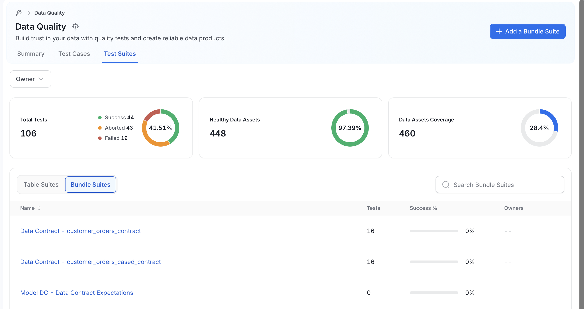
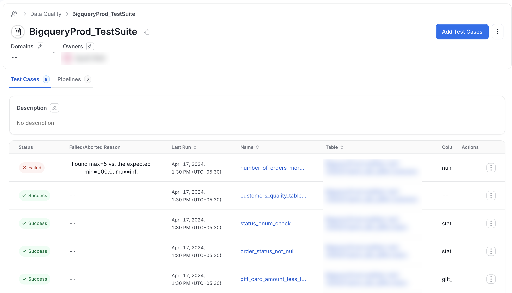
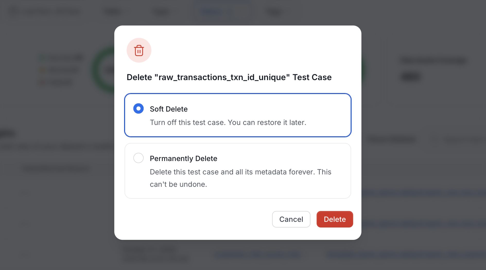
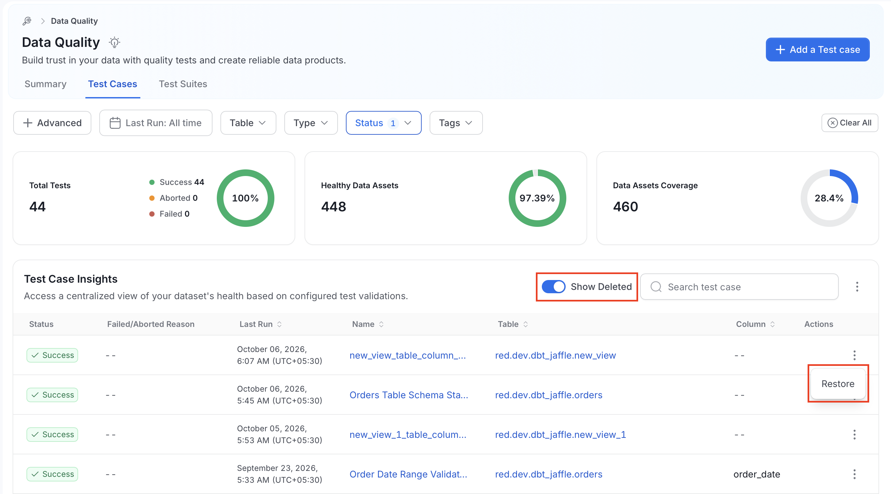
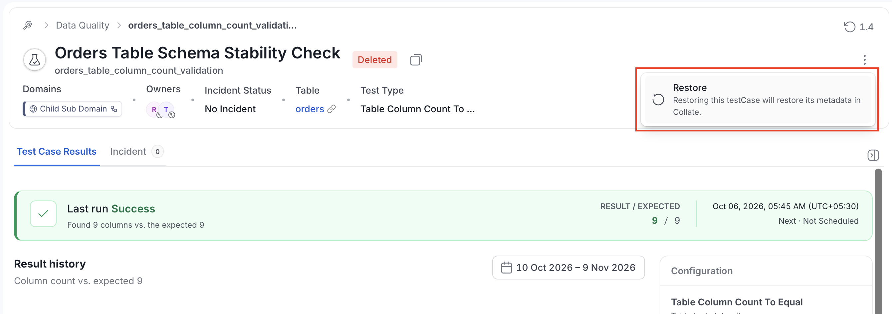

# How to Visualize Test Results
## From the Quality Page
From the left navigation bar, navigate to **Observability** > **Data Quality**. The page has these tabs:
- **Summary**: The overall health of your data quality tests.
- **Test Cases**: All test cases, with filters and search.
- **Test Suites**: Your tests grouped by test suite.

To look at your tests grouped by test suite, select the **Test Suites** tab. This opens the Test Suite page to select a specific test suite.

From there you can select a Test Suite and visualize the results associated with this specific Test Suite.

## Delete and Restore a Test Case

On the **Test Cases** tab, deleting a test case soft deletes it by default, so the test case can be restored later.

To delete a test case:

1. Open the three-dot menu on the test case row and select **Delete**.
2. In the delete dialog, whose title names the test case, choose **Soft Delete** (selected by default) or **Permanently Delete**. A permanent delete cannot be undone.
3. Select **Delete**.

A soft-deleted test case leaves the list. To see it again, turn on **Show Deleted** in the **Test Case Insights** header, next to the search box. While **Show Deleted** is on:
- Deleted test cases appear in the list.
- Bulk actions and the **New test case** action are hidden.
- The three-dot menu of a deleted test case offers only **Restore**.

To restore a test case from the list:

1. Turn on **Show Deleted**.
2. Open the three-dot menu on the deleted test case row and select **Restore**.
3. Confirm in the **Restore Test case** dialog.

Restoring keeps the display name, description, parameters, inherited tags, and the last run result. Restoring requires permission to edit the test case.

The details page of a deleted test case shows a **Deleted** badge next to its name. The page is read-only except for restoring, and **Run now** and **Retry** are not offered. Incidents of a deleted test case do not appear in the Incident Manager.

To restore a test case from its details page:

1. Open the three-dot menu in the header.
2. Select **Restore**.

## From a Table Entity
Navigate to your table and click on the `profiler & Data Quality` tab. From there you'll be able to see test results at the table or column level.
### Table Level Test Results
In the top panel, click on the white background `Data Quality` button. This will bring you to a summary of all your quality tests at the table level

