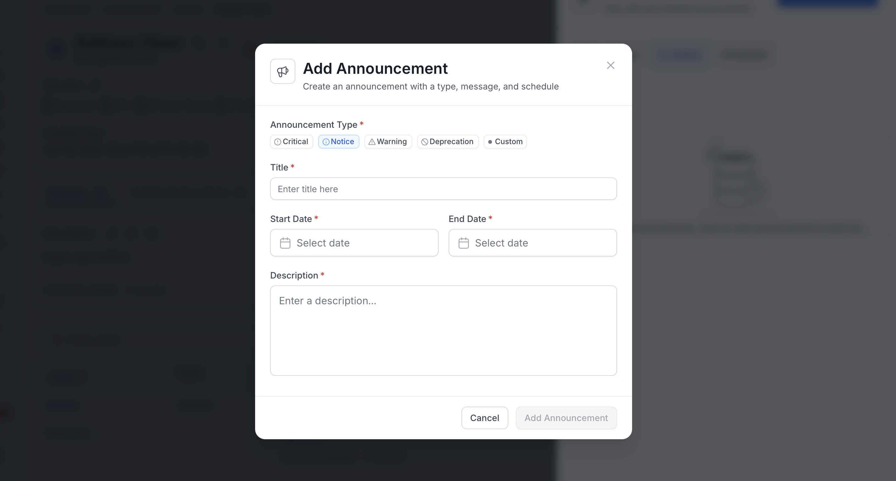

# How to Create an Announcement

<Tip>
**Quick Tip:** Always watch out for announcements on the backward incompatible changes. Saves a ton of debugging time later on for data teams.
</Tip>

To add an announcement, follow these steps:

1. Navigate to **Explore** and the relevant **Data Asset** section to select a specific asset.
2. Click on the vertical ellipsis icon **⋮** located on the top right and select **Announcements**.

   

3. Click on **Add Announcement**.

   

4. Enter the following information and click **Submit**:
   - **Announcement Type**: **Notice** (default), **Critical**, **Warning**, **Deprecation**, or **Custom**. For **Custom**, also enter a **Custom Name** (up to 64 characters) and select a **Color**.
   - **Title**: Title of the announcement.
   - **Start Date**: Date the announcement starts displaying.
   - **End Date**: Date the announcement stops displaying.
   - **Description**: Details about the upcoming change.

   

This announcement will be displayed in OpenMetadata during the scheduled time. It will be displayed to all the users who own or follow that particular data asset.

<Warning>
**Pro Tip:** Create Announcements for deletion, deprecation, and other important changes. Let your team know of a tentative date when these changes will be implemented.
</Warning>

<Card title="Data Asset Versioning" href="/v2.1.x-SNAPSHOT/how-to-guides/guide-for-data-users/versions" >
    Review all the major and minor changes with version history
  </Card>