# Understanding the Basics of OpenMetadata

## Let’s Start with the Home Page

Once you log in to OpenMetadata, you start on the home page. It summarizes what you need to know in **Topics to catch up on**, a set of cards for your data estate, tasks, activity, and data quality. Open a card for the full view.

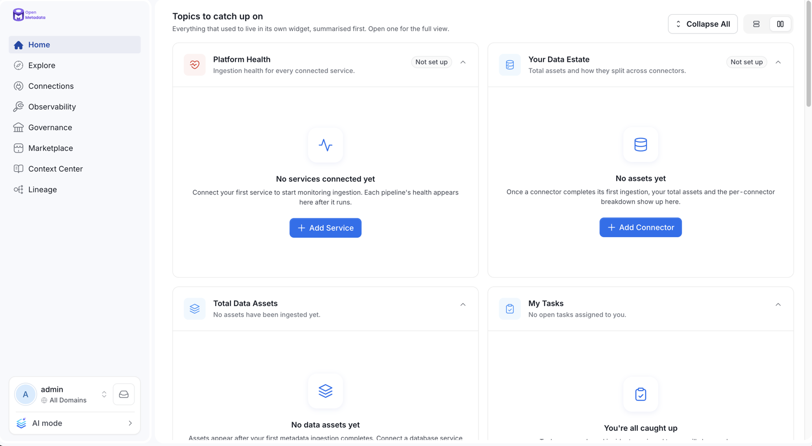

## Section Controls

The heading row of **Topics to catch up on** has these controls:

- **Collapse All** / **Expand All**: Collapse every card to its header, or expand them all again.
- **List** / **Grid**: Switch between one card per row and two cards per row.
- **Customize**: Open the home page editor for your persona. It appears only when you belong to a persona.
- **Chevron** on a card: Collapse or expand that card.

Collapsing cards and switching between list and grid change only your view.

## Announcements

The top of the home page shows announcements.

- **Critical banner**: When a critical system announcement is live, a banner appears at the top for every user. Admins create system announcements from **Settings**. For more information, see [System Announcements](/v2.1.x-SNAPSHOT/how-to-guides/data-collaboration/system-announcements).
- **Announcements on data assets**: The **Announcements** section shows live announcements about data assets. It appears only when at least one is live. Click **View all** to see every live announcement. For more information, see [How to Create an Announcement](/v2.1.x-SNAPSHOT/how-to-guides/guide-for-data-users/add-announcement).
- **Dismiss**: Click the close icon on a card or banner to dismiss it. The choice is remembered for you in that browser.

## Cards

Each card summarizes one area of your platform.

### Platform Health

Shows ingestion health across every connected service, with the worst offenders first. The header shows how many services are failing, and the chips show the failing, healthy, and not-run-yet counts.

### Your Data Estate

Shows how large the data estate is, which connectors it comes from, and how much of it has a description.

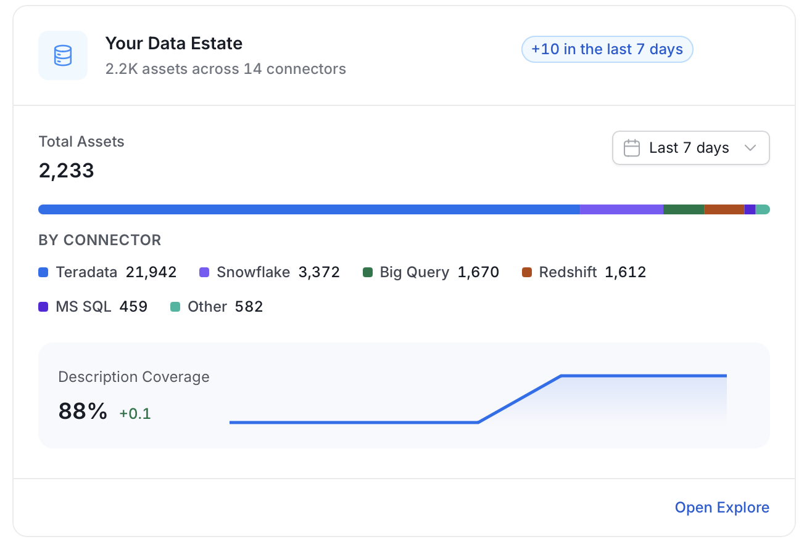

### Total Data Assets

Shows how many data assets the estate holds, split by asset type, and how each type changed over the selected period.

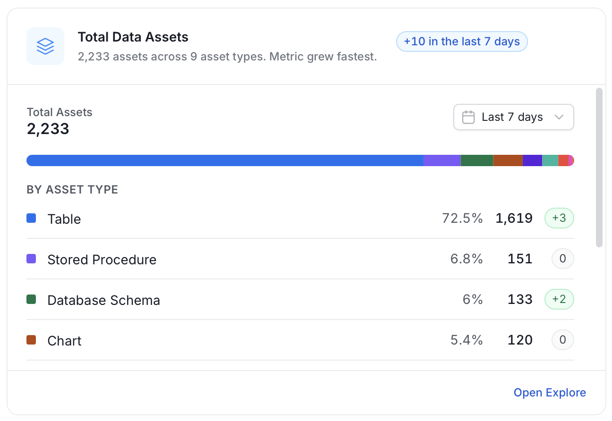

### My Tasks

Lists your open tasks and the tasks assigned to your teams, with incidents first. Use the **All**, **Incidents**, **Access**, and **Approvals** tabs to filter.

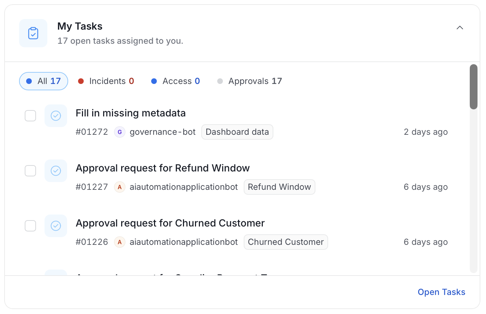

### Team Activity

Shows recent activity across the assets and domains you own, including who changed what and when.

### Yours and Followed

Keeps the assets you own and the assets you follow in one place. Use the **Owned** and **Following** tabs to switch. For more information, see [How to Follow a Data Asset](/v2.1.x-SNAPSHOT/how-to-guides/guide-for-data-users/follow-data-asset).

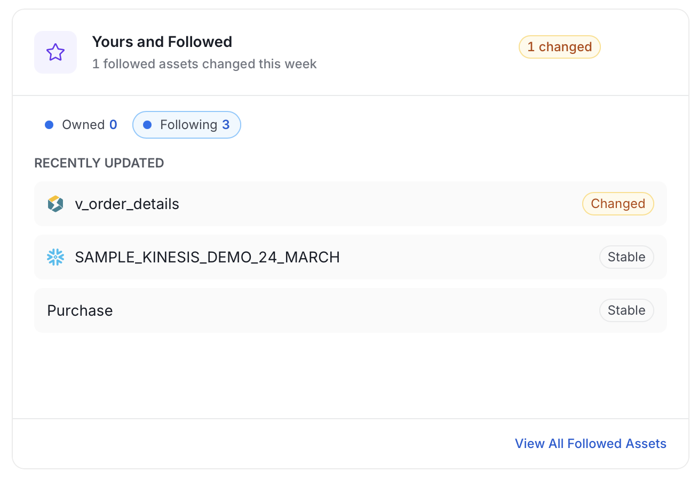

### Context Center

Shows the most recently updated Context Center pages and articles, with how many changed this week.

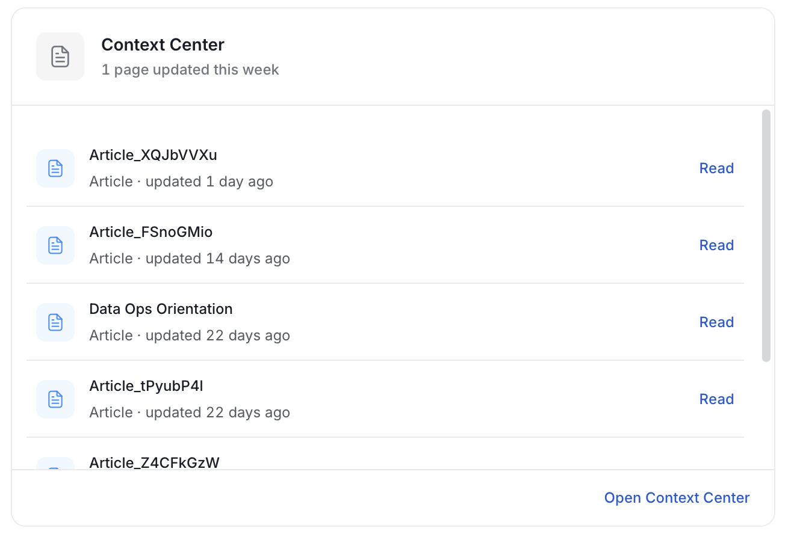

### Curated Assets

Shows a filtered list of high-impact assets. An admin sets the rule that picks the assets for the persona.

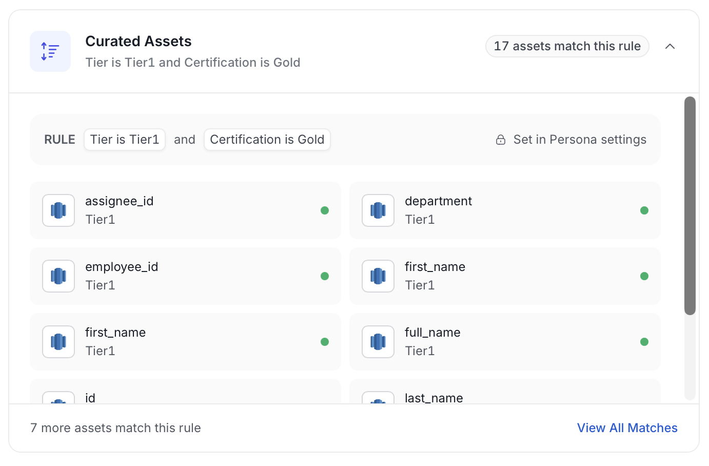

### Data Quality

Shows passing, failing, and aborted data quality tests, with a link to the failing tests.

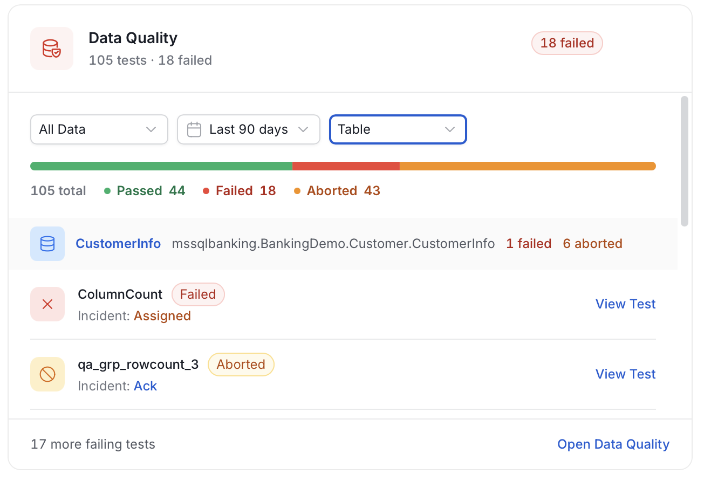

### Domains

Gives a domain-by-domain overview of owner, description coverage, and failing tests.

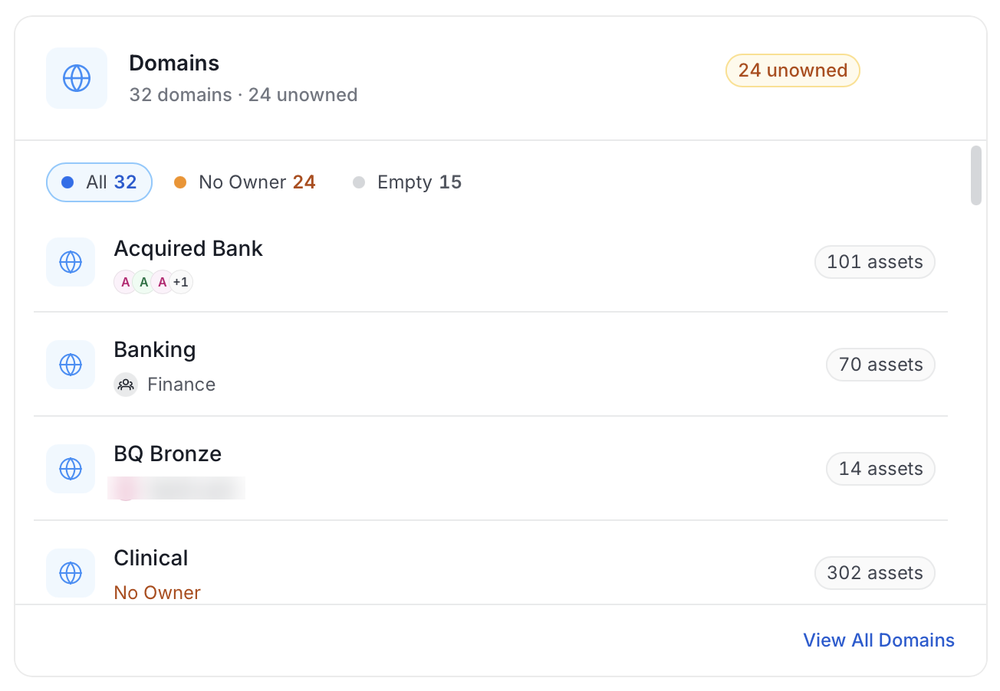

### Data Products

Lists data products across the platform with their domain and owners.

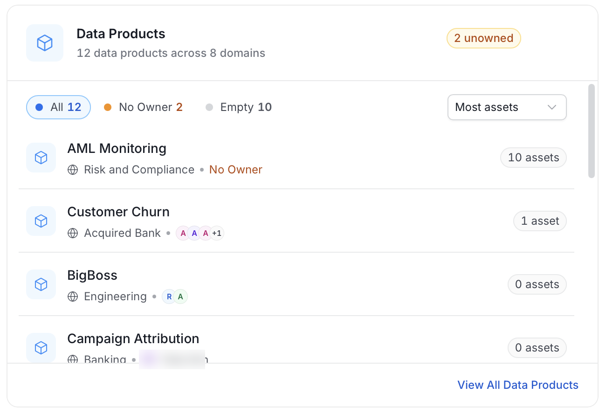

### KPIs

Shows progress against each active KPI: its target, the current value, and whether it is on track by its end date.

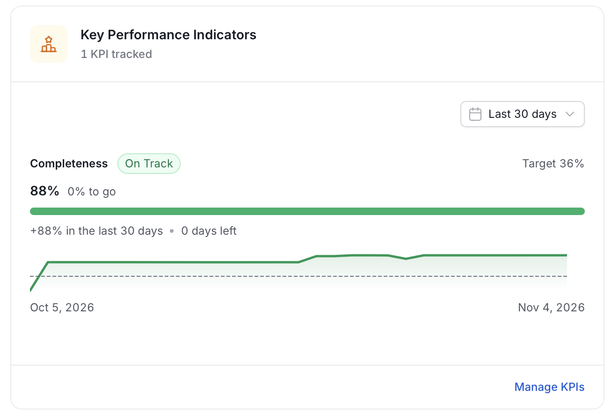

### Pipeline Status

Shows each pipeline's latest run, with failures first, its last 10 runs, and the error behind a failure.

## Product Tour

The product tour walks you through the main pages of OpenMetadata on recorded sample data, so every page is populated and nothing in your own data changes.

To start the tour, select **Help** > **Tour** from the profile menu.

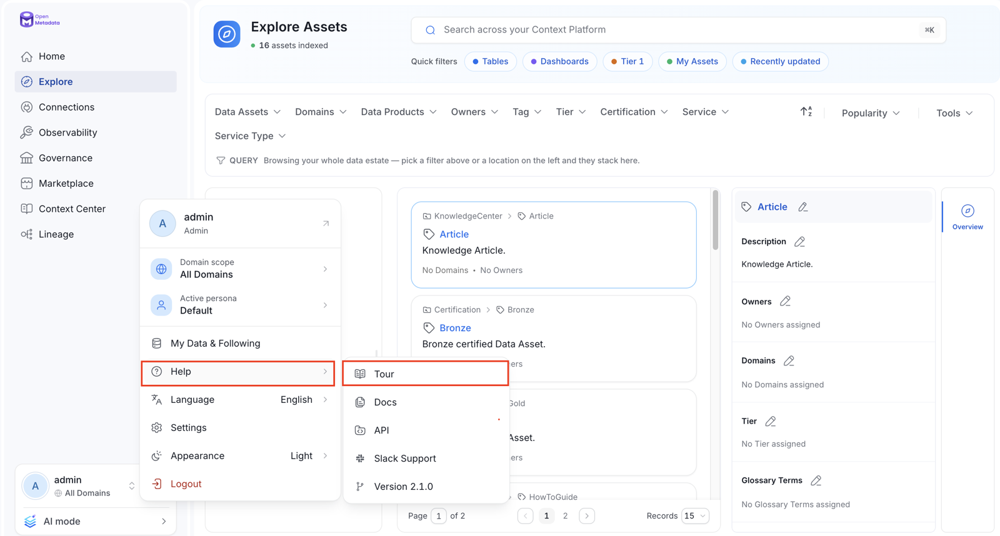

The tour has nine steps: **Home**, **Explore**, **Services**, **Glossary**, **Ontology Studio**, **Data Quality**, **Data Marketplace**, **Context Center**, and **Memories**. Each step highlights one area of the page and describes it. Use the arrows to move between steps. The dots show your progress. Click the close icon to exit the tour at any step.

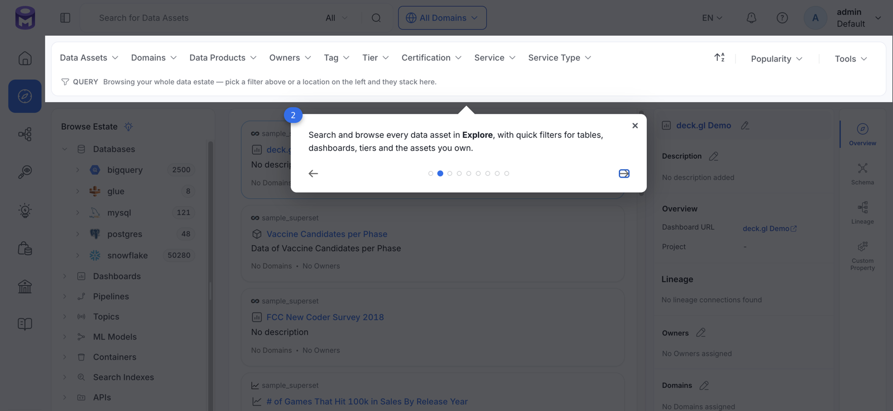

<Card title="Overview of Data Assets" href="/v2.1.x-SNAPSHOT/how-to-guides/guide-for-data-users/data-asset-tabs" >
    Know it all about data assets.
  </Card>