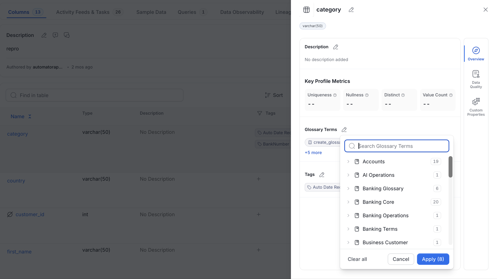
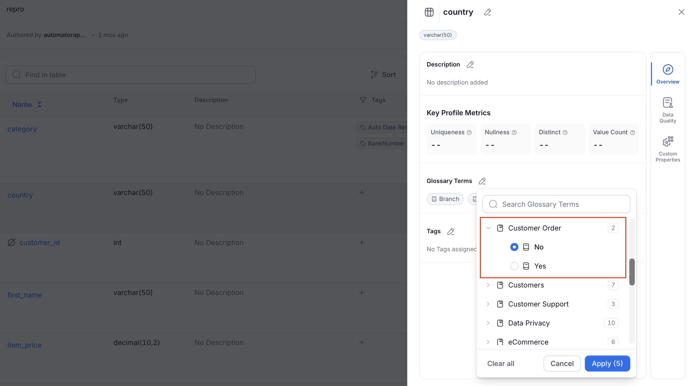

# How to Add Glossary Terms

1. From the Explore page, select a data asset and click the edit icon or **+ Add** for **Glossary Terms**. The glossary term picker opens.

   

2. Select the terms you want to apply. For more information, see [The Glossary Term Picker](#the-glossary-term-picker).
3. Click **Apply**.

You can view all the associated glossary terms in the right panel.

## The Glossary Term Picker

OpenMetadata uses one glossary term picker wherever you choose glossary terms, for example when you add terms to an asset or to a column, add related terms to a term, or move a term under another parent. It shows your glossaries and their terms as a tree.

- **Browse**: Click a glossary or a term to expand it. OpenMetadata loads one level at a time, so large glossaries open quickly. A glossary with no terms shows **No Terms added**.
- **Show more**: A level loads up to 100 items. If a level has more, the last row shows **Show N more**, where N is the number of items it loads, and how many items remain. Click it to load the next items.
- **Search**: Type in the **Search Glossary Terms** box to find terms. The results appear under their glossaries.
- **Select**: A glossary is a container, so it has no checkbox. Select a term to apply that term alone. Its child terms aren't selected with it.
- **Mutually exclusive terms**: When a glossary or a term is mutually exclusive, its child terms show radio buttons instead of checkboxes, so you can select only one of them. The same applies when only one term can be selected, for example when you choose a new parent for a term.
- **Apply**: When you add terms to an asset, your selections wait until you click **Apply**. The button shows how many terms you selected. Use **Clear all** to clear the selection, or **Cancel** to close the picker without changes.

Whether you can select more than one term for an asset depends on the data asset rules. For more information, see [Data Asset Rules](/v2.1.x-SNAPSHOT/how-to-guides/admin-guide/data-asset-rules).

## Glossary Terms and Tags

If **Tags** are associated with a **Glossary Term**, then applying that glossary term to a data asset, will also automatically apply the associated tags to that data asset. For example, the glossary term ‘Account’ has a PII.Sensitive tag associated with it. When you add a glossary term to a data asset, the associated tags also get added.

<Card title="How to Create a Custom Property for a Data Asset" href="/v2.1.x-SNAPSHOT/how-to-guides/guide-for-data-users/custom" >
    Learn how to create custom attributes for data assets
  </Card>