# Author: Edit Mode

Edit mode turns the Studio into an authoring workspace for one ontology. It has two surfaces in the sub-mode bar:

| Surface | What you do there |
|---|---|
| **Graph** | Add concepts, draw relationships, and edit a concept in the inspector, including its properties, mappings, and data assets. |
| **Term** | Work through lists of **Concepts**, **Properties**, and **Constraints**, and change the ontology **Settings**. |

Each item is saved on its own, and there is no editing lease, so two people can work on different items at the same time. Every save is an unpublished change on the working draft. Nothing reaches Query or Export until you [publish a release](/v2.1.x-SNAPSHOT/how-to-guides/ontology/studio/releases).

The **Edit** tab appears only if you have edit permission. Buttons are disabled for items you can't change. For the full list, see [Permissions](/v2.1.x-SNAPSHOT/how-to-guides/ontology/studio/ontologies#permissions).

## Open Edit Mode

To open a edit mode, follow these steps:

1. From the Ontology selector dropdown, select an ontology you want to edit.

    If you select **All ontologies**, the **Edit** tab shows Select Ontology field. Select the ontology from the dropdown.

    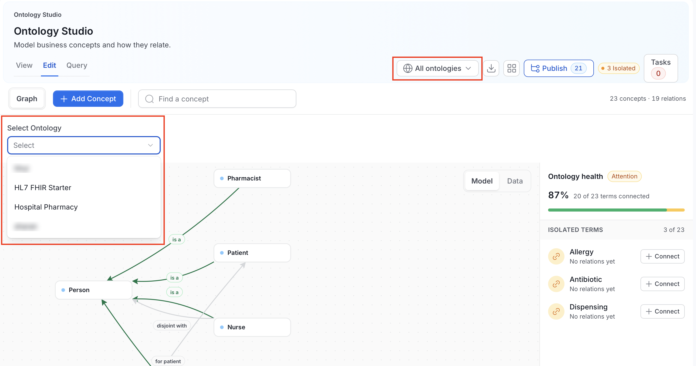

2. Select the **Edit** tab.

    The sub-mode bar shows **Graph** and **Term**, the **Add Concept** button, the version of the active release, such as **v1.5.0**, and a count of concepts and relations. The **Ontology health** panel lists isolated concepts, each with a **Connect** button.

## Add a Concept in the Graph

To add a concept, follow these steps:

1. Select **Edit** > **Graph** and click **Add Concept**. A **New class** panel opens.

    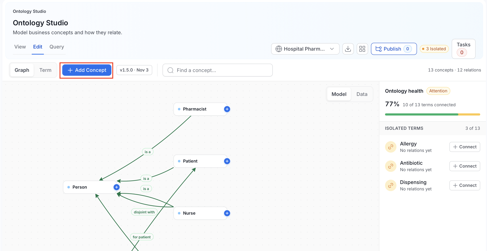

2. Under **Identity**, do the following:

    - Enter a **Label** (required).
    - Enter a **Local name**. The IRI the concept will get is shown under the field: the ontology namespace followed by the local name.
    - Add **Alternative labels** by typing each one and pressing `Enter` or a comma.

    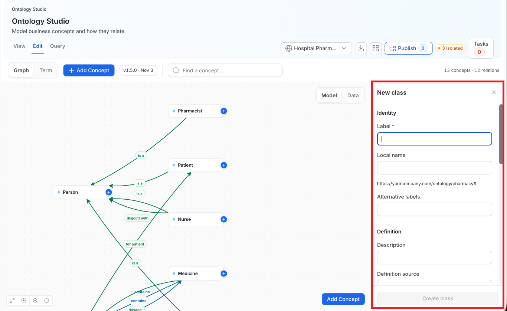

3. Under **Definition**, enter a **Description** and, optionally, a **Definition source**. A definition source must be an absolute IRI.

4. Under **Axioms**, pick the concepts this one relates to:

    - **Subclass of**: The parent concepts. With no parent, the panel says it is a top-level class. With two or more parents, it shows a **Polyhierarchy** badge.
    - **Equivalent to**: Concepts that mean exactly the same thing.
    - **Disjoint with**: Concepts that can't overlap with this one.

    These fields are disabled if you can't create constraints.

5. Optional: Check **Abstract** box to mark the concept as one that isn't used directly.

6. Review **Inherited properties**. The panel lists the properties the concept receives from its parents, each shown as the property name and the parent it comes from.

7. Optional: Under **Own properties**, add properties for this concept.

    - Enter a **Property name**.
    - Pick a **Type** and a **Range**.
    - For an enum, add at least two distinct **Allowed values**.
    - Select **Identifier** if the property identifies the concept.
    - Select **Add**.

8. Under **Governance**, check the **Layer**, which comes from the ontology, and set the **Owners**.

9. Click **Create class**. The panel notes that the class becomes part of the working ontology and must be reviewed before publication.

## Edit a Concept in the Graph

To edit a concept in a graph, follow these steps:

1. In **Edit** > **Graph**, select a concept. The inspector opens beside the canvas.

    

    It shows the concept name, a type badge such as **owl class**, a provider badge such as **user**, the IRI, a **Completeness** bar, the description, and the **Relationships**, **Properties**, **Mappings**, and **Data Assets** sections. Each section has its own **Add** action.

2. To change the basic fields, select **Edit**. The **Edit Concept** panel opens.

    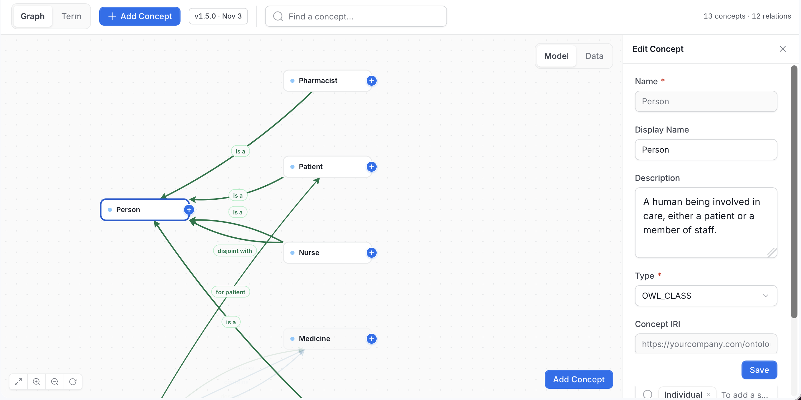

    **Name** and **Concept IRI** are locked. **Display Name**, **Description**, **Type**, and **Synonyms** are editable.

3. Select **Save**.

### Add a Relationship

1. Click the **+** handle on a concept node, and then click the concept you want to relate it to. A banner reads **Click another term to draw a connection from** the first concept. Press `Esc`, or select the close icon on the banner, to cancel.

    

2. Select a relationship type from the relationship picker.

    - The picker header shows the two concepts, for example "Medication Record > Observation Record".
    - Use **Filter relationships** to search by name.
    - The types are grouped, for example **CORE · OWL / SKOS**, and each shows its inverse.
    - **Subclass Of** is the standard "is a" relationship.

    

The relationship is created as soon as you select the type. It appears as a labeled edge between the two concepts and is saved as an unpublished change.

If the relationship type you need doesn't exist, create one from the picker if you have permission. See [Relationship Types](/v2.1.x-SNAPSHOT/how-to-guides/ontology/studio/relationship-types). Drawing a relationship creates a constraint behind the scenes. Studio saves it for you.

### Add a Property

1. Click **Add** next to **Properties** in the inspector.

2. Enter a **Name** and pick a **Data Type**: `string`, `integer`, `decimal`, `boolean`, `date`, `dateTime`, or `enum`. For `enum`, enter the allowed values separated by commas.

3. Optional: Select **Identifier** if the property identifies the concept.

4. Click **Add Property**.

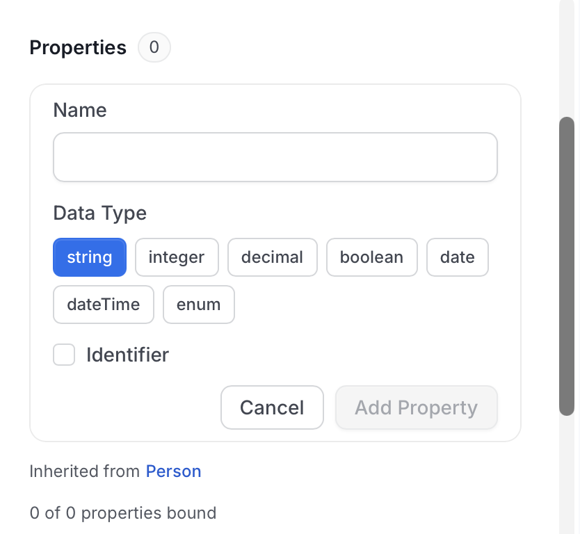

Inherited properties are shown with the ancestor that declares them, for example "Inherited from Person", and a count such as "0 of 0 properties bound".

### Add a Mapping

1. Click **Add** next to **Mappings** in the inspector, or **Add mapping** in the concept form.

2. Choose a **Mapping type**. It starts on `EXACT_MATCH`.

3. Enter the **Concept IRI** of the external concept (required). Optionally add a **Scheme IRI** and a **Source**.

4. Click **Save**.

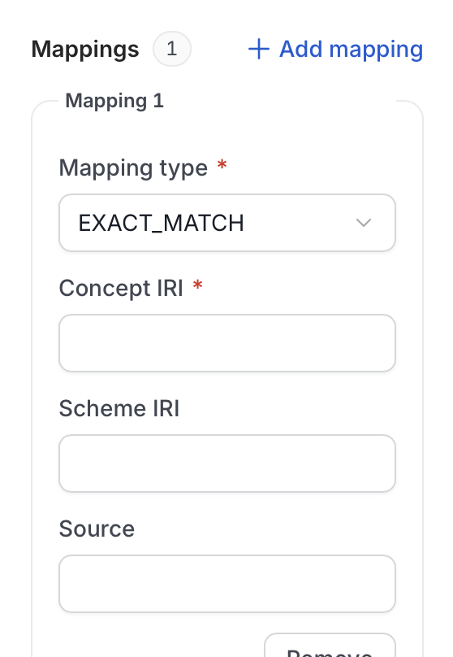

Mapping types are `EXACT_MATCH`, `CLOSE_MATCH`, `BROAD_MATCH`, `NARROW_MATCH`, `RELATED_MATCH`, and `SAME_AS`. Select **Remove** to delete a mapping, then **Save**.

### Link Data Assets

The **Data Assets** section shows **Current catalog links, separate from semantic releases.** Data asset links apply to the catalog right away and aren't part of a release.

1. Click **Link Asset**.

    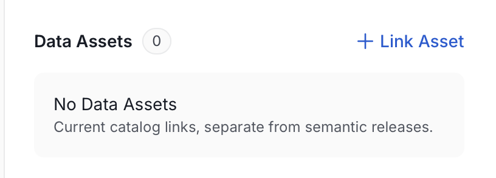

2. In **Add Data Assets**, search for tables, or narrow the list with **All** or **Tables**.

3. Select the assets you want, or select **Select All**.

    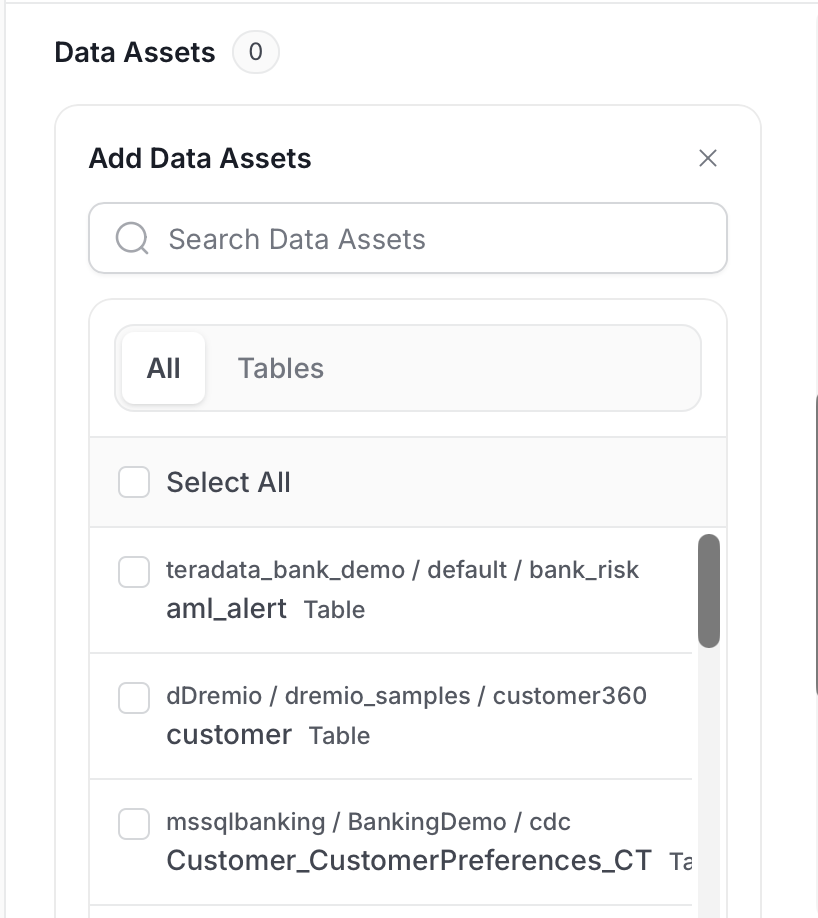

4. Click **Save**. The assets appear in the section with their type and path.

To link a property to a column of a linked table, use **Bind to column** on the property. If no table is linked yet, Studio asks you to link one first.

## Work in the Term Surface

The **Term** surface works on lists instead of the graph.

1. In **Edit**, select **Term** in the sub-mode bar.

    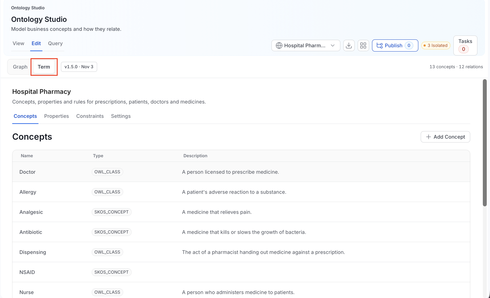

2. Choose a tab: **Concepts**, **Properties**, **Constraints**, or **Settings**. For **Settings**, see [Edit Ontology Settings](/v2.1.x-SNAPSHOT/how-to-guides/ontology/studio/ontologies#edit-ontology-settings).

Each list shows its items 25 at a time, with **Previous** and **Next**. Select an item to edit it, or use the add button above the list.

### Concepts

A concept is a class or term in your ontology, such as Patient or Medication.
The **Concepts** tab lists every concept with its **Name**, **Type**, and **Description**.

#### Add a Concept

1. Click **Add Concept**. The concept form opens. It is the same form used when you edit a concept.

    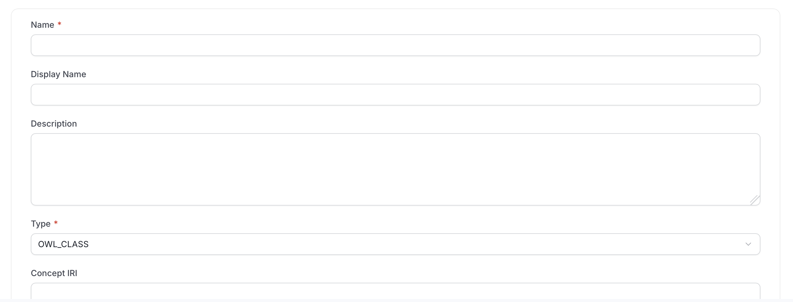

2. Complete the fields.

    | Field | Required | Notes |
    |---|---|---|
    | **Name** | Yes | Letters, numbers, underscores, hyphens, periods, parentheses, and ampersands only. Locked after saving. |
    | **Display Name** | No | The label shown in the graph. |
    | **Description** | No | What the concept means. |
    | **Type** | Yes | `OWL_CLASS`, `SKOS_CONCEPT`, or `BOTH`. It starts on `OWL_CLASS`. It records which standard vocabulary the concept comes from, so imported ontologies keep their original typing. |
    | **Concept IRI** | No | Leave it empty and OpenMetadata builds one from the ontology namespace. Locked after saving. |
    | **Synonyms** | No | Type a synonym and press `Enter` to add it. |

3. Optional: Under **Mappings**, select **Add mapping** to link the concept to an external one.

    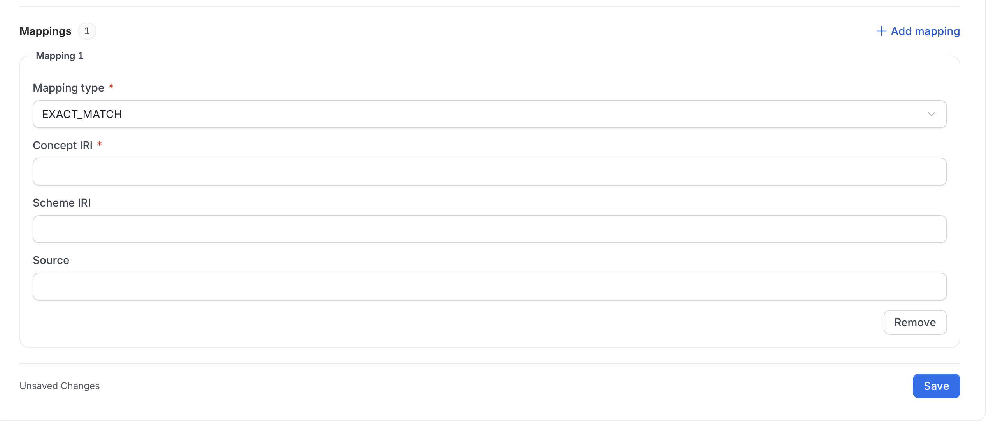

4. Click **Save**. The footer shows **Unsaved Changes** until you do.

### Properties

A property describes how concepts relate to each other or to values.
The **Properties** tab lists each property with its **Name**, **Type**, and **Description**.

#### Add a Property

1. Click **Add Property**. The **New Property** form opens.

    

2. Fill in the following fields:

    | Field | Applies to | Notes |
    |---|---|---|
    | **Name** | All | Same naming rules as a concept. Locked after saving. |
    | **Display Name**, **Description** | All | Optional. |
    | **Type** | All | `OBJECT` (links two concepts), `DATA` (holds a value such as text or a number), or `ANNOTATION` (a label or note). It starts on `OBJECT`. Locked after saving. |
    | **Domain classes** | All | The concepts the property applies to. One IRI per line. |
    | **Range** | All | For an `OBJECT` property, the concepts it points to. For a `DATA` property, the data types. One IRI per line. |
    | **Unit** | `DATA` | A unit label or IRI, kept as a note. Studio doesn't convert values. |
    | **Identifier** | `DATA` | Marks the property as identifying a concept. It doesn't enforce uniqueness in your data. |
    | **Enum Values** | `DATA` | Allowed values. Each has a **Value** and an optional **Data Type** IRI. |

3. Optional: Expand **Advanced** for the rest.

    

    | Field | Applies to | Notes |
    |---|---|---|
    | **Characteristics** | `OBJECT` and `DATA` | For `OBJECT`: `ASYMMETRIC`, `FUNCTIONAL`, `INVERSE_FUNCTIONAL`, `IRREFLEXIVE`, `REFLEXIVE`, `SYMMETRIC`, `TRANSITIVE`. For `DATA`: only `FUNCTIONAL`. |
    | **Inverse** | `OBJECT` | The IRI of the property that runs the opposite way. |
    | **Disjoint properties** | `OBJECT` and `DATA` | Properties that can never both hold between the same pair. One IRI per line. |
    | **Property chain** | `OBJECT` | Properties that, applied in order, imply this one. One IRI per line. The order is preserved. |
    | **Property IRI** | All | Optional. Built from the namespace if empty. Locked after saving. |

4. Click **Save**.

### Constraints

A constraint is a logical rule about your concepts. The technical name is an axiom: a statement the ontology asserts to be true.
The **Constraints** tab lists each constraint with its **Name**, **Type**, and **Description**.

Constraints that came from an import or a library pack are named **Imported object property assertion**.

#### Add a Constraint

1. Click **Add Constraint**. The **New Constraint** form opens.

    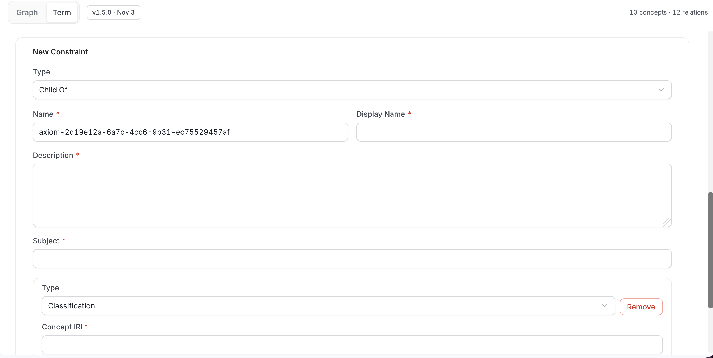

2. Pick a **Type**. It starts on **Child Of**.

    

    | Type in the menu | What it states | Extra fields |
    |---|---|---|
    | **Child Of** | The subject is a subclass of another concept (`SUBCLASS_OF`). | One or more expressions |
    | **Exact Match** | The subject means exactly the same as the expression (`EQUIVALENT_CLASS`). | Expressions |
    | **Conflict Resolution** | The subject can't overlap with the expression (`DISJOINT_WITH`). | Expressions |
    | **Classification** | The subject is an instance of a concept (`CLASS_ASSERTION`). | Expressions |
    | **Relationship** | The subject is linked to a target by a property (`OBJECT_PROPERTY_ASSERTION`). | **Property Concept IRI**, **Target Concept IRI** |
    | **Custom Property** | The subject has a fixed value for a property (`DATA_PROPERTY_ASSERTION`). | **Property Concept IRI**, **Value**, optional **Data Type Concept IRI** |

    The menu labels reuse general terms, so they read oddly for ontology work. The technical type in parentheses is what is stored. **Child Of** is the standard "is a" relationship.

3. Enter a **Name**, which is pre-filled with a generated value, a **Display Name**, and a **Description**. All three are required.

4. Enter the **Subject**, the IRI of the concept the rule is about.

5. Complete the expression fields for the type. Click **Add Constraint** inside the form to add another expression, and **Remove** to delete one. Each expression has its own **Type**.

    

    | Expression type | What it means | Fields |
    |---|---|---|
    | **Classification** | A single named concept | **Concept IRI** |
    | **Constraint** | A rule about a property | **Property Concept IRI**, **Constraint Type**, and a nested expression or value |
    | **and** | All of the nested expressions must hold | Nested expressions |
    | **or** | At least one nested expression must hold | Nested expressions |
    | **Select** | One of a list of named individuals | **Target Concept IRI**, comma-separated |

    For a **Constraint** expression, **Constraint Type** is one of:

    - **Include**: the property has at least one value of the nested type.
    - **Only specific entity**: every value of the property is of the nested type.
    - **Cardinality ≥**, **Cardinality ≤**, **Cardinality =**: at least, at most, or exactly the number you enter in **Cardinality**.
    - **Value**: the property has one specific value, given as a **Target Concept IRI** or a literal **Value** with an optional **Data Type**.

    Nesting goes at most four levels deep.

6. Check the **Preview** below the expressions. It shows the constraint as it will be saved.

    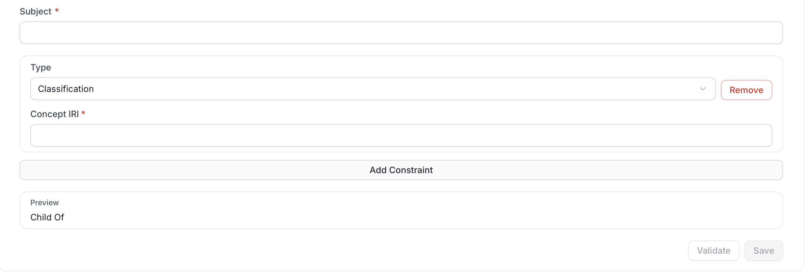

7. Click **Validate**. **Save** stays disabled until validation passes.

8. Click **Save**.

## Delete a Concept, Property, or Constraint

Open the item in the **Term** surface. When you have delete permission on it, a **Delete** button appears below **Save**. Select it and confirm. The deletion is an unpublished change like any other, and it is included in your next release.

The property form has the same buttons, with the **Advanced** section collapsed above them.

## Next Steps

- [Publish a release](/v2.1.x-SNAPSHOT/how-to-guides/ontology/studio/releases) to make your changes visible to Query and Export.
- [Import & Export](/v2.1.x-SNAPSHOT/how-to-guides/ontology/studio/import-export) to bring a file in as unpublished changes.
