# Edit Mode

Edit mode turns the Studio into an authoring workspace for one ontology. It has three views in the sub-mode bar:

| View | What you do there |
|---|---|
| **Graph** | Add concepts, draw relationships, and edit a concept in the inspector, including its relationships, mappings, and data assets. |
| **Tree** | Work through the concept hierarchy and open any concept in the inspector. |
| **Ontology** | Work through lists of **Concepts**, **Properties**, and **Constraints**, review the **Overview**, and change the ontology **Settings**. |

Each item is saved on its own, and there is no editing lease, so two people can work on different items at the same time. Every save is an unpublished change to the working **Draft**. Other users don't see it until you [publish a release](/v2.1.x-SNAPSHOT/how-to-guides/ontology/studio/releases).

The **Edit** tab appears only if you have edit permission. Buttons are disabled for items you can't change. For the full list, see [Permissions](/v2.1.x-SNAPSHOT/how-to-guides/ontology/studio/ontologies#permissions).

## Open Edit Mode

1. Pick the ontology you want to edit in the **Ontology selector**. Edit mode works on one ontology at a time, so with **All ontologies** selected it asks you to pick one.

2. Click the **Edit** tab.

    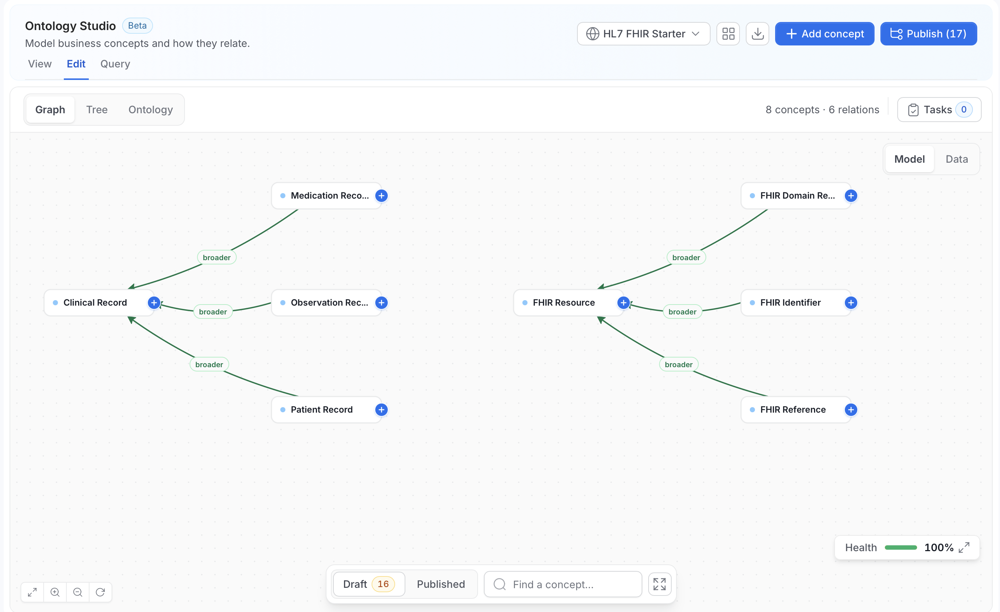

    The header shows **Add concept** and **Publish (N)**, where N is the number of unpublished changes. The canvas shows a **+** handle on each concept. The **Draft** chip at the bottom shows that you are editing the working version.

Edit always works on the draft. If you switch the version chip to **Published**, the **Edit** tab isn't available until you switch back to **Draft**.

## Add a Concept

1. In **Edit** mode, click **Add concept** in the header. The **New concept** panel opens.

    Alternatively, navigate to **Ontology** > **Concepts** and click **Add concept**.

    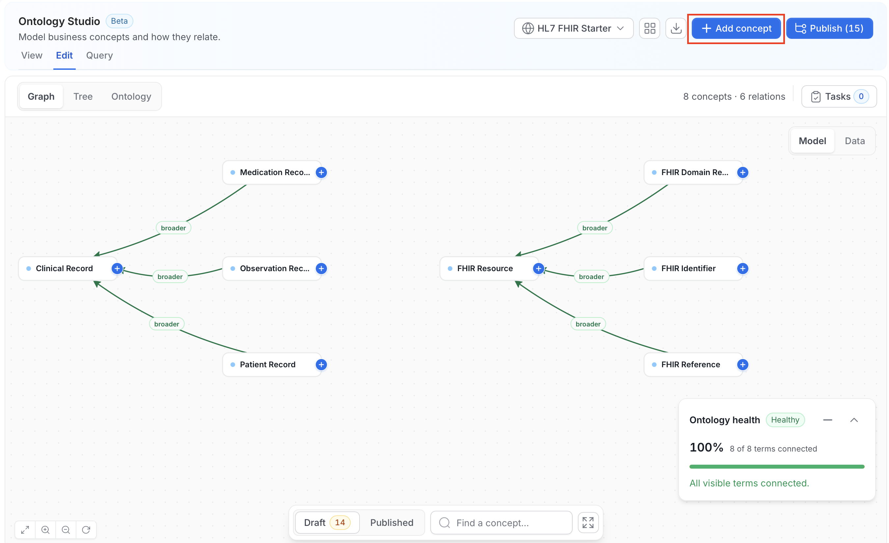

2. Under **Identity**, complete the fields.

    | Field | Required | Notes |
    |---|---|---|
    | **Name** | Yes | The unique ID the system uses. Use letters, digits, underscores, and hyphens. Locked after you create the concept. |
    | **Display name** | No | Shown on the graph and in lists. Defaults to the name. |
    | **Synonyms** | No | Type a synonym and press `Enter`. |
    | **Type** | No | How the concept is modeled. See the list below. It starts on **Class (OWL)**. |
    | **Concept IRI** | No | Leave it empty to generate it from the namespace and name. It can't change after you create the concept. |

    **Type** has three options:

    - **Class (OWL)**: Best when you need rules like cardinality or disjointness.
    - **Concept (SKOS)**: A vocabulary term, for hierarchies and mappings.
    - **Both (OWL + SKOS)**: A class you can reason over that also reads as a vocabulary term.

    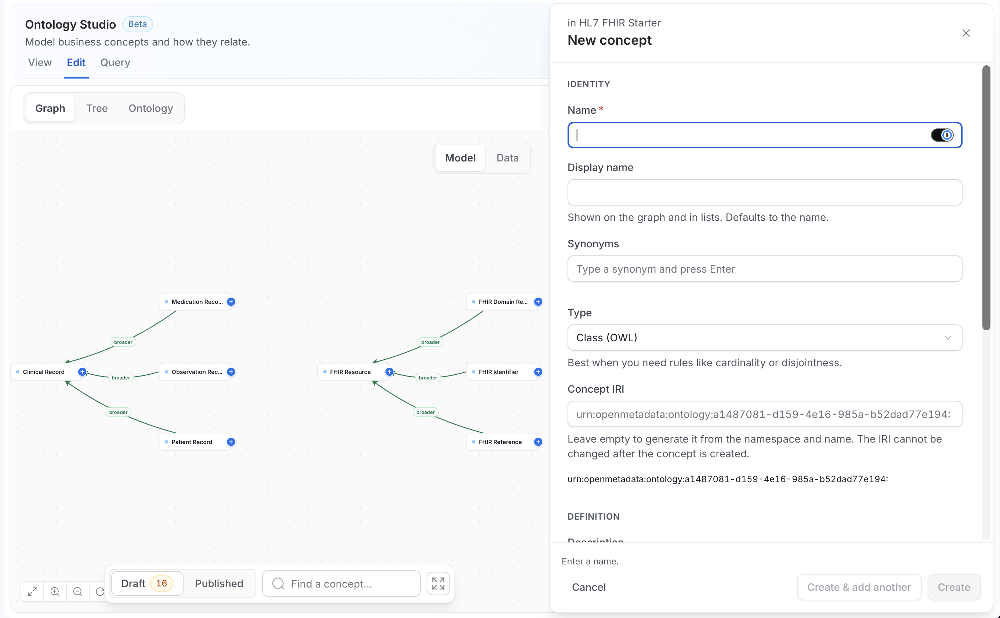

3. Under **Definition**, enter a **Description** that explains what the concept means in the business.

4. Optional: Under **Mappings**, link the concept to equivalent terms in other vocabularies.

    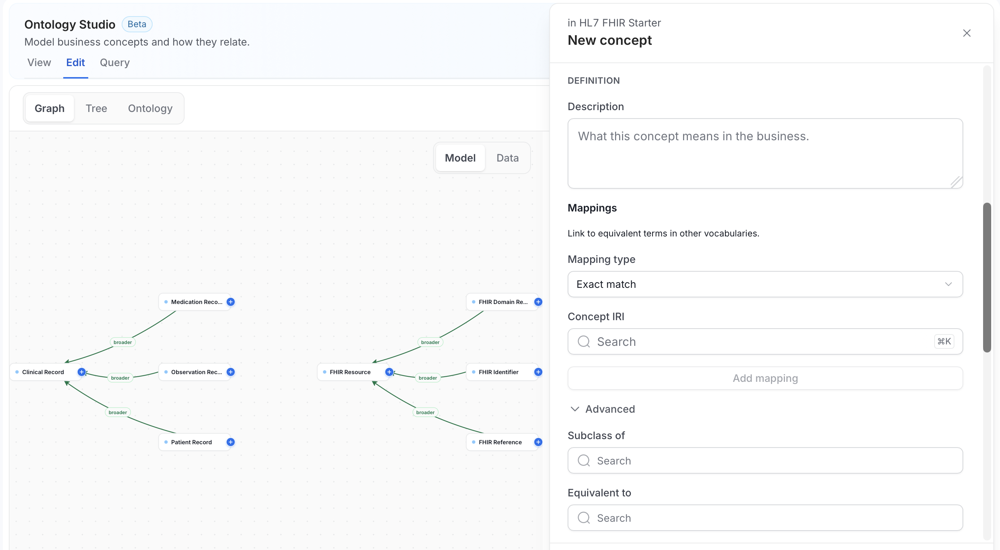

    - Choose a **Mapping type**. It starts on **Exact match**.
    - Search for the **Concept IRI** of the external concept, or paste a full IRI.
    - Click **Add mapping**.

5. Optional: Expand **Advanced** for the following.

    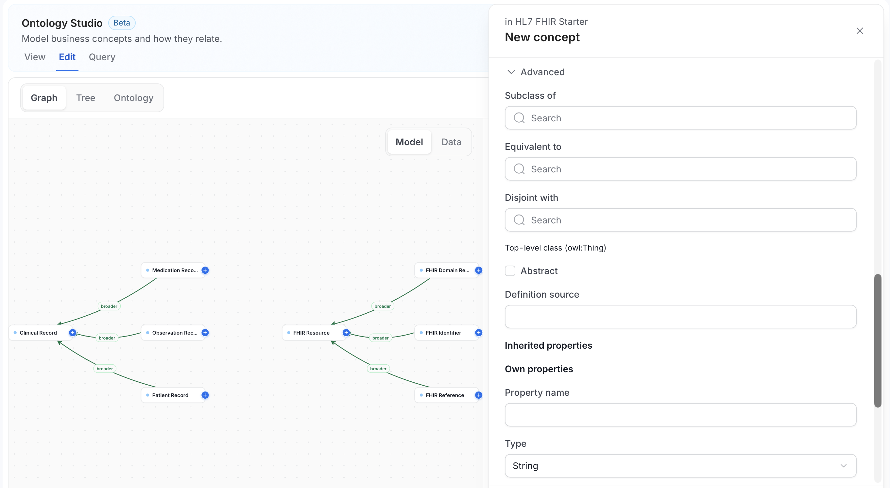

    - **Subclass of**: The parent concepts. With no parent, the concept is a top-level class (`owl:Thing`).
    - **Equivalent to**: Concepts that mean exactly the same thing.
    - **Disjoint with**: Concepts that can't overlap with this one.
    - **Abstract**: Check it to mark the concept as one that isn't used directly.
    - **Definition source**: Where the definition comes from. It must be an absolute IRI.
    - **Inherited properties**: Properties the concept receives from its parents.
    - **Own properties**: Properties for this concept. Enter a **Property name** and choose a **Type**, for example **String**.

    The **Subclass of**, **Equivalent to**, and **Disjoint with** fields are disabled if you can't create constraints.

6. Click **Create**. To add several concepts in a row, click **Create & add another** instead. **Create** stays disabled until you enter a name, and the footer says "Enter a name."

The concept appears in the graph and counts as an unpublished change.

## Edit a Concept

1. In the **Graph** tab, click a concept. Alternatively, in the **Tree** tab, click a row. The inspector opens beside the canvas.

    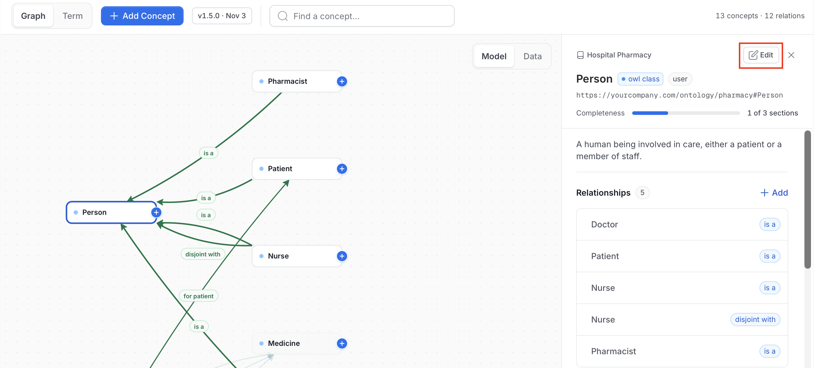

    In Edit mode the inspector is a form. At the top it shows the breadcrumb, the concept name with its type badge, the IRI, and a **Completeness** bar, for example "1 of 5 sections".

2. Change the fields you need.

    - **Display name**
    - **Description**
    - **Type**: Hover the help icon for what each type means.
    - **Relationships**, **Properties**, **Rules**, **Synonyms**, **Mappings**, and **Data assets**: Each section has its own **Add** action, and each item has edit and delete controls.

    **Name** and **Concept IRI** are locked.

3. Click **Save**. The footer reads "All changes saved" when nothing is pending. Click **Cancel** to discard your edits.

To delete the concept, see [Delete a Concept](#delete-a-concept).

## Add a Relationship

A relationship is a typed link between two concepts, such as **broader**.

1. Start the relationship in either of two ways:

    - **From the inspector**: Open the concept and click **Add** next to **Relationships**.
    - **From the graph**: Click the **+** handle on a concept node. A banner reads "Click another term to draw a connection from" the concept. Click the concept you want to relate it to. Press `Esc`, or click the close icon on the banner, to cancel.

        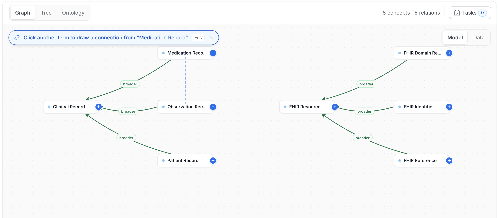

2. In the **Relationship** field, choose a relationship type. Each type shows its inverse, for example **Broader** with **Inverse: Narrower**.

    - The list includes types such as **Subclass Of**, **Superclass Of**, **Antonym**, **Broader**, and **Calculated From**. Scroll for more.

        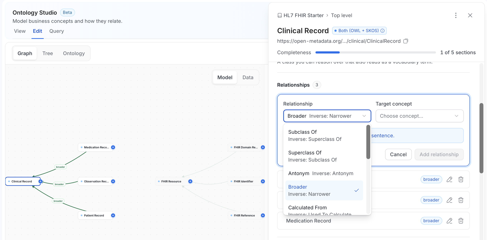
    - If no type fits, create one if you have permission. See [Relationship Types](/v2.1.x-SNAPSHOT/how-to-guides/ontology/studio/relationship-types).

3. In **Target concept**, click **Choose concept...** and pick the concept to link to. Studio shows "Pick a concept to complete the sentence" until you do.

    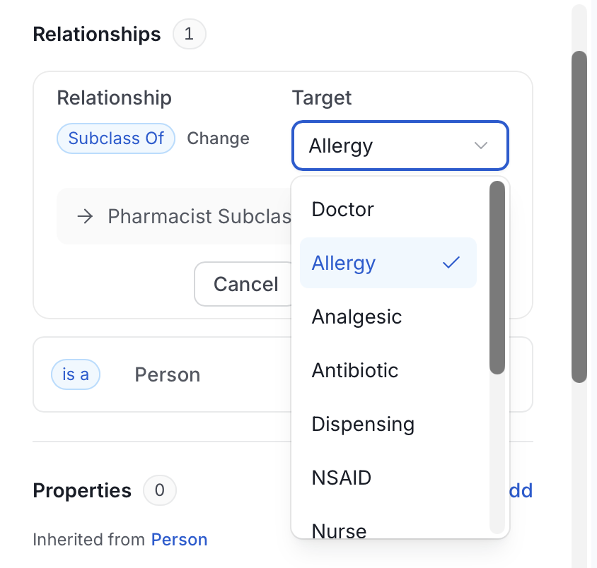

4. Click **Add relationship**. Click **Cancel** to discard it.

Studio checks for links from a concept to itself, duplicate links, and loops in the hierarchy before it saves.

The relationship appears as a labeled edge between the two concepts and counts as an unpublished change.

### Edit or Delete a Relationship

Click an edge in the graph, or a relationship in the inspector, to open the relationship panel.

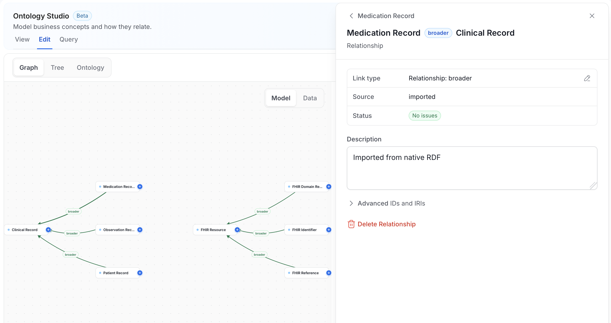

- **Link type**: The relationship type. Click the pencil icon to change it.
- **Source**: How the link was created, for example **imported**.
- **Status**: For example **No issues**.
- **Description**: A note about the link.
- **Advanced IDs and IRIs**: The identifiers of the link.
- **Delete Relationship**: Removes the link.

Click the back arrow to return to the concept.

## Link Data Assets

The **Data assets** section of the inspector lists the tables and columns bound to the concept. It shows "Current catalog links, separate from semantic releases." Data asset links apply to the catalog right away and aren't part of a release.

Each linked asset shows its name, a **Sample Data** link, its full path, and the number of column bindings, for example "table · 0 column bindings". Click **+N more** to show the rest.

To link more assets, switch the canvas to **Data** and click **Link data**. See [Data Mode](/v2.1.x-SNAPSHOT/how-to-guides/ontology/studio/explore#data-mode). When you link a table, Studio can suggest which property each column maps to. Accept the suggestions, or choose to link the whole table only.

### Live Data

Below the linked assets, **Live data** shows a query generated from the bindings, for example `SELECT TOP 50 * FROM [cdc].[Customer_CustomerPreferences_CT]`. The query is labeled **not stored**. Click the copy icon to copy it, or click **Search around** to explore the data near the concept.

## The Ontology View

The **Ontology** view has five tabs: **Overview**, **Concepts**, **Properties**, **Constraints**, and **Settings**. The counts next to the tab names show how many items each list has.

### Overview

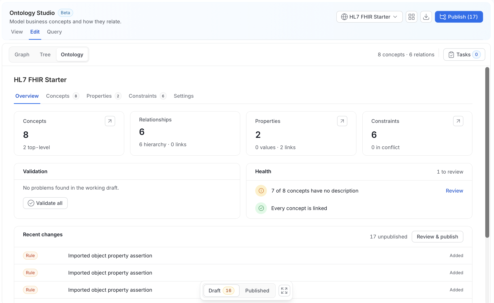

The **Overview** shows:

- **Concepts**, **Relationships**, **Properties**, and **Constraints**: The count of each. Click the arrow on a card to open its tab.
- **Validation**: The result of the checks on the working draft. Click **Validate all** to run them again. If constraints conflict, the card shows the number of conflicts, for example **1 conflict**, and a **Review conflicts** button. Conflicts block publishing, and each one is explained in **Constraints**.

    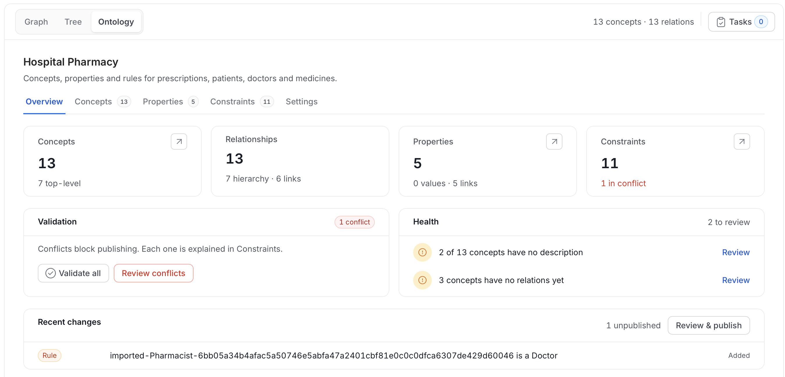
- **Health**: What to review, for example "7 of 8 concepts have no description" or "3 concepts have no relations yet". Click **Review** to go to those items.
- **Recent changes**: The latest unpublished changes, each marked **Added**, **Changed**, or **Removed**, with the count and a **Review & publish** button.

### Concepts

A concept is a class or term in your ontology, such as Patient or Medication.

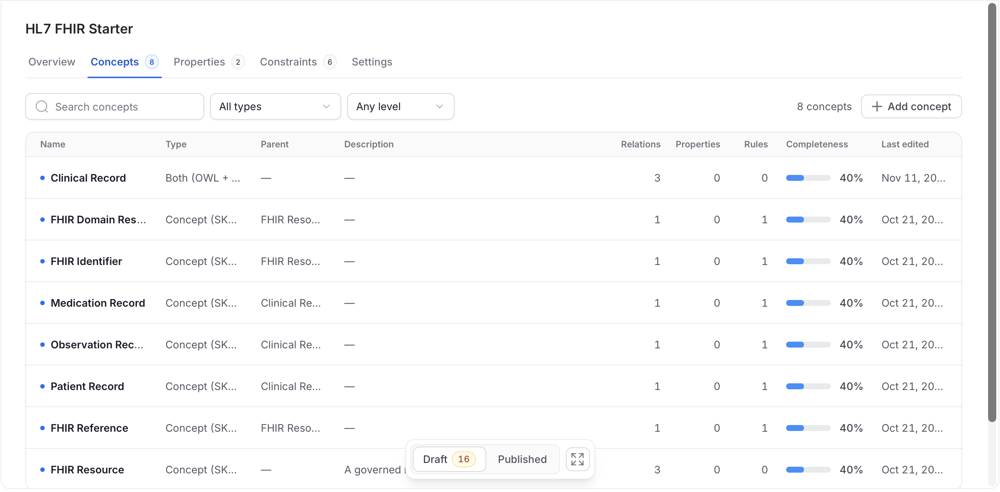

The **Concepts** tab lists every concept with its **Name**, **Type**, **Parent**, **Description**, the number of **Relations**, **Properties**, and **Rules**, a **Completeness** percentage, and when it was **Last edited**.

- **Search concepts**: Filters by name.
- **All types** and **Any level**: Filter by concept type and by layer.
- **Add concept**: Opens the [New concept](#add-a-concept) panel.

Click a concept to open it in the inspector.

### Properties

A property describes how concepts relate to each other or to values.

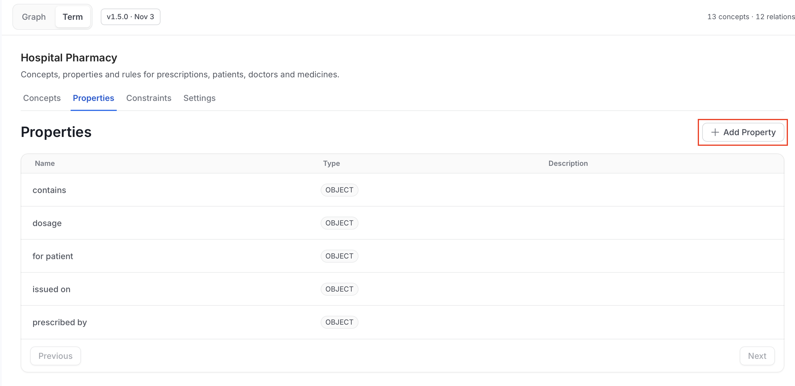

The **Properties** tab lists each property with its **Name**, **Kind**, **Used by**, **Value type or target**, and **Description**.

- **All**, **Object**, **Data**, and **Annotation**: Filter by kind. Each shows its count.
- **Search properties**: Filters by name.
- **Add property**: Opens the **New property** panel.

#### Add a Property

1. Click **Add property**. The **New property** panel opens.

    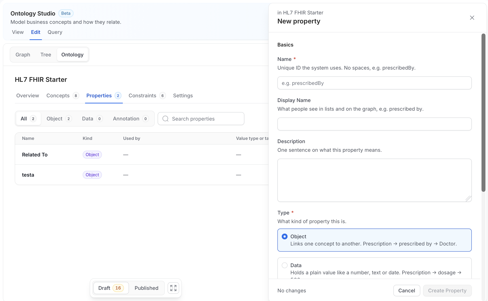

2. Under **Basics**, complete the fields.

    | Field | Required | Notes |
    |---|---|---|
    | **Name** | Yes | The unique ID the system uses. No spaces, for example `prescribedBy`. Locked after you create the property. |
    | **Display Name** | No | What people see in lists and on the graph, for example "prescribed by". |
    | **Description** | No | One sentence on what the property means. |
    | **Type** | Yes | The kind of property. See the list below. It starts on **Object**. |

    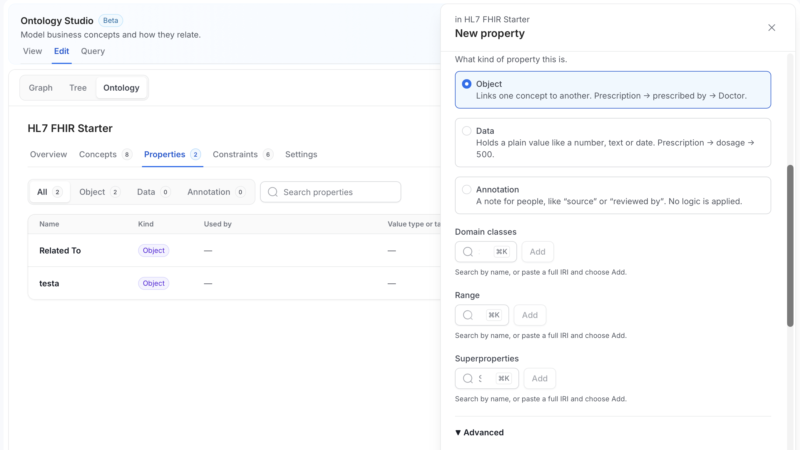

    - **Object**: Links one concept to another. For example, Prescription → prescribed by → Doctor.
    - **Data**: Holds a plain value like a number, text, or date. For example, Prescription → dosage → 500.
    - **Annotation**: A note for people, like "source" or "reviewed by". No logic is applied.

3. Set where the property applies. In each field, search by name, or paste a full IRI and click **Add**.

    - **Domain classes**: The concepts the property applies to.
    - **Range**: For an **Object** property, the concepts it points to. For a **Data** property, the data types.
    - **Superproperties**: Properties that this one specializes.

4. Optional: Expand **Advanced**.

    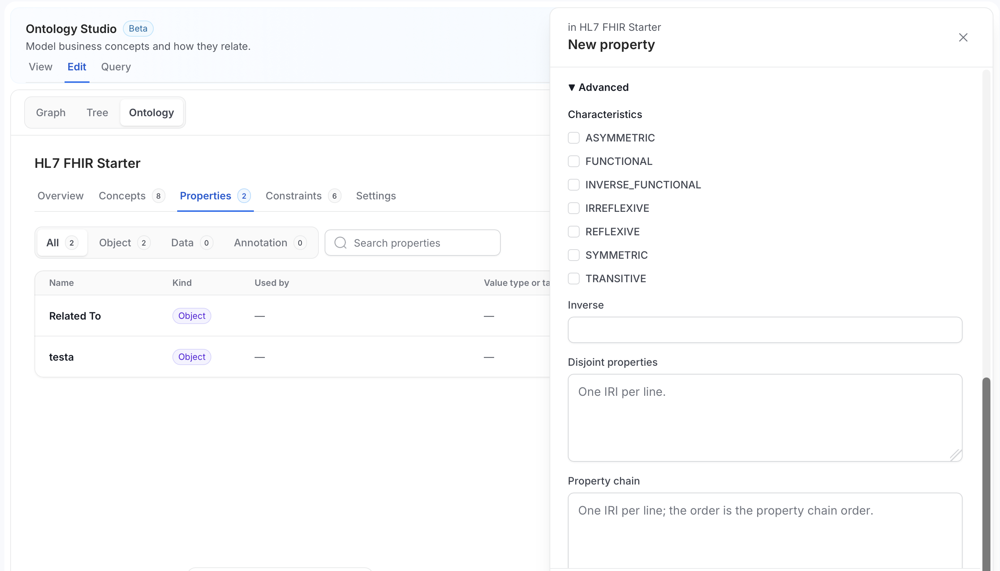

    | Field | Applies to | Notes |
    |---|---|---|
    | **Characteristics** | **Object** and **Data** | For an **Object** property: `ASYMMETRIC`, `FUNCTIONAL`, `INVERSE_FUNCTIONAL`, `IRREFLEXIVE`, `REFLEXIVE`, `SYMMETRIC`, `TRANSITIVE`. For a **Data** property, only `FUNCTIONAL`. |
    | **Inverse** | **Object** | The property that runs the opposite way. |
    | **Disjoint properties** | **Object** and **Data** | Properties that can never both hold between the same pair. One IRI per line. |
    | **Property chain** | **Object** | Properties that, applied in order, imply this one. One IRI per line. The order is preserved. |

5. Click **Create Property**. The footer reads "No changes" until you change a field.

### Constraints

A constraint is a logical rule about your concepts. The technical name is an axiom: a statement the ontology asserts to be true.

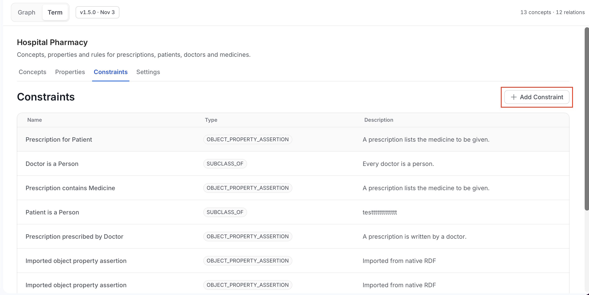

The **Constraints** tab lists each constraint with its **Name**, a **Sentence** that reads the rule in plain language, its **Type**, its **Source**, and its **Description**.

- **All types** and **Any source**: Filter the list. **Source** shows whether a constraint was created in the Studio or **Imported**.
- **Validate all**: Runs the checks on the working draft. The text beside it shows the result, for example "No problems found in the working draft." Conflicts block publishing.
- **Show on graph**: Opens the constraint's concepts in the graph.
- **Add constraint**: Opens the **New constraint** panel.

Constraints that came from an import or a library pack are named **Imported object property assertion**.

#### Add a Constraint

1. Click **Add constraint**. The **New constraint** panel opens with two modes, **Quick** and **Advanced**.

2. In **Quick** mode, write one rule about one concept as a sentence.

    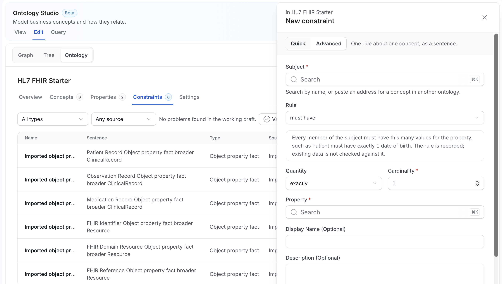

    - **Subject**: The concept the rule is about. Search by name, or paste an address for a concept in another ontology.
    - **Rule**: The kind of sentence. A description below the field explains the one you choose.

        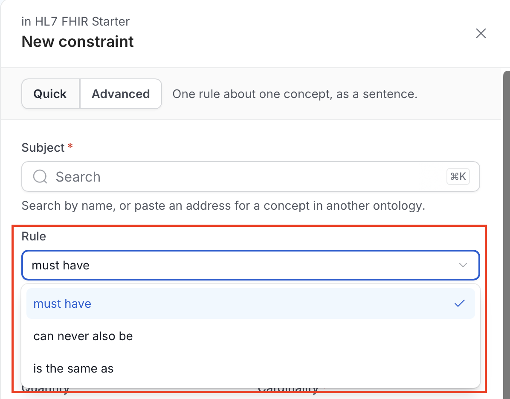

        - **must have**: Every member of the subject must have this many values for the property, such as Patient must have exactly 1 date of birth. The rule is recorded; existing data is not checked against it.
        - **can never also be**: Nothing can be both the subject and the other concept, such as Medicine can never also be Person.
        - **is the same as**: The subject and the other concept have exactly the same members, such as Patient is the same as Case. To map a concept to another vocabulary, use a mapping instead.
    - **Quantity**, **Cardinality**, and **Property**: For **must have**, how many values of which property, for example **exactly** `1` of a date of birth property.
    - **Display Name (Optional)** and **Description (Optional)**.

3. In **Advanced** mode, build any constraint type, with and/or conditions. If you open a constraint that Quick mode can't show, for example one with several conditions, Studio keeps it in Advanced and explains why.

    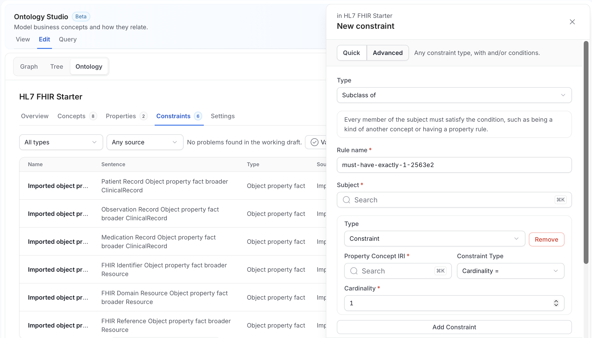

    - **Type**: Choose what the constraint states.

        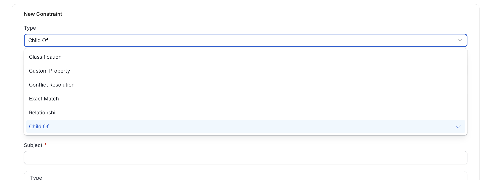

        | Type | What it states |
        |---|---|
        | **Subclass of** | Every member of the subject must satisfy the condition, such as being a kind of another concept or having a property rule. |
        | **Equivalent to** | The subject means exactly the same as the expression. |
        | **Disjoint with** | The subject can't overlap with the expression. |
        | **Class membership** | The subject is an instance of a concept. |
        | **Object property fact** | The subject is linked to a target by a property. |
        | **Data property fact** | The subject has a fixed value for a property. |

    - **Rule name**: Required. Studio fills in a generated name that is editable.
    - **Subject**: Required. The concept the rule is about.
    - **Expression**: The condition. Each expression has its own **Type**. Click **Remove** to delete an expression, and click **Add Constraint** inside the panel to add another.

        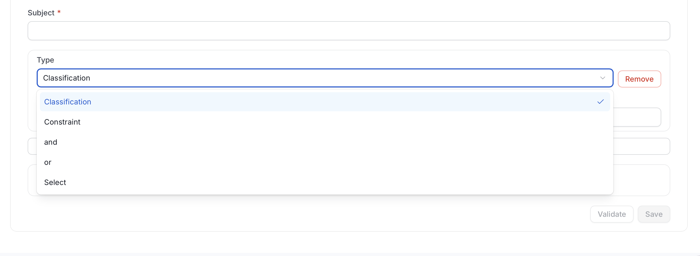

        | Expression type | What it means | Fields |
        |---|---|---|
        | **Classification** | A single named concept | **Concept IRI** |
        | **Constraint** | A rule about a property | **Property Concept IRI**, **Constraint Type**, and a value or nested expression |
        | **and** | All of the nested expressions must hold | Nested expressions |
        | **or** | At least one nested expression must hold | Nested expressions |
        | **Select** | One of a list of named individuals | The target concepts |

        For a **Constraint** expression, **Constraint Type** includes **Cardinality =**, with the number you enter in **Cardinality**. Nesting goes at most four levels deep.

4. Click **Save**.

### Settings

The **Settings** tab holds the ontology's identity and governance fields.

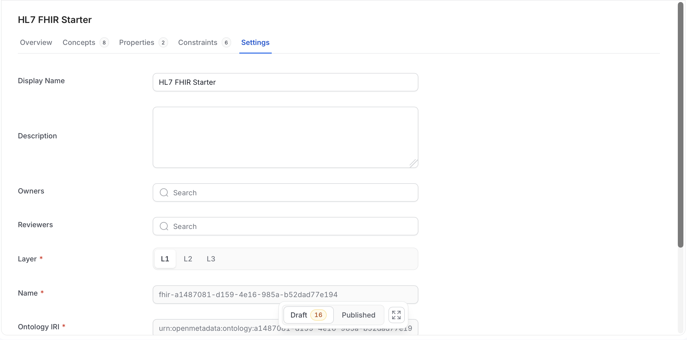

It shows **Display Name**, **Description**, **Owners**, **Reviewers**, **Layer**, and the locked **Name**, **Ontology IRI**, and **Namespace**. For what each field does, see [Edit Ontology Settings](/v2.1.x-SNAPSHOT/how-to-guides/ontology/studio/ontologies#edit-ontology-settings).

## Work in the Tree

In Edit mode, the **Tree** view lists the concepts by hierarchy, as in View mode. Click a row to open the concept in the inspector and edit it. The header shows **Add concept**, and each row shows its number of children and relations.

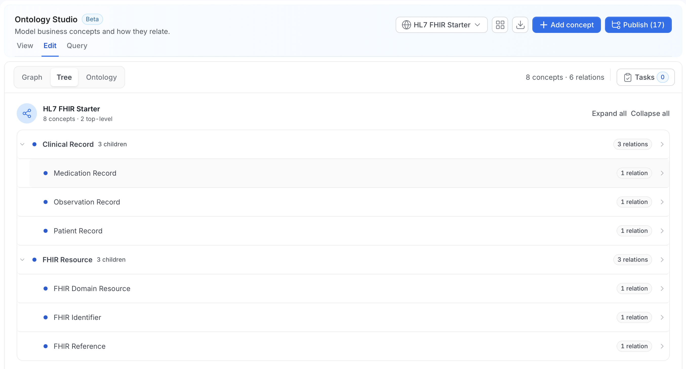

## Delete a Concept

1. Open the concept in the inspector.

2. Click the three dots at the top of the inspector, and then click **Delete Concept**. The item is disabled if you don't have delete permission.

    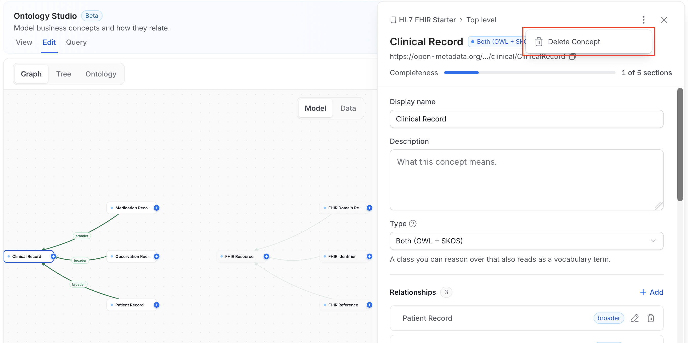

    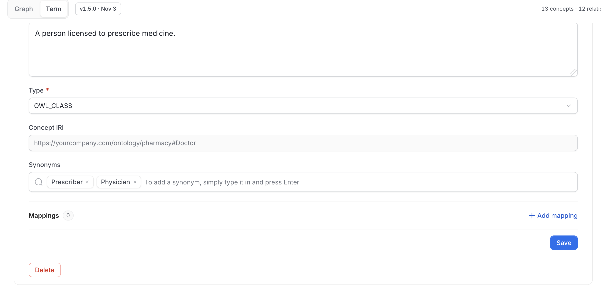

3. Review the **Delete {concept}** dialog. It says "Deleting {concept} also affects:" and lists:

    - Child concepts, which move to the top level.
    - Relationships and rules, which are removed.
    - Data asset bindings, which are removed. The assets themselves aren't changed.
    - Concepts that still point at this one through a domain, range, or replacement. These block the deletion. Change them first.

    If relationships and rules reference the concept, check **Remove these relationships and rules together with** the concept to continue.

4. Click **Delete**. Click **Cancel** to keep the concept.

The deletion is an unpublished change like any other, and it is included in your next release. To delete a relationship, see [Edit or Delete a Relationship](#edit-or-delete-a-relationship).

## Delete a Property or Constraint

1. In the **Ontology** view, open the **Properties** or **Constraints** tab and click the item. Its panel opens.
2. Click the trash icon at the top right of the panel, next to the close icon. The icon is disabled if you don't have delete permission.

    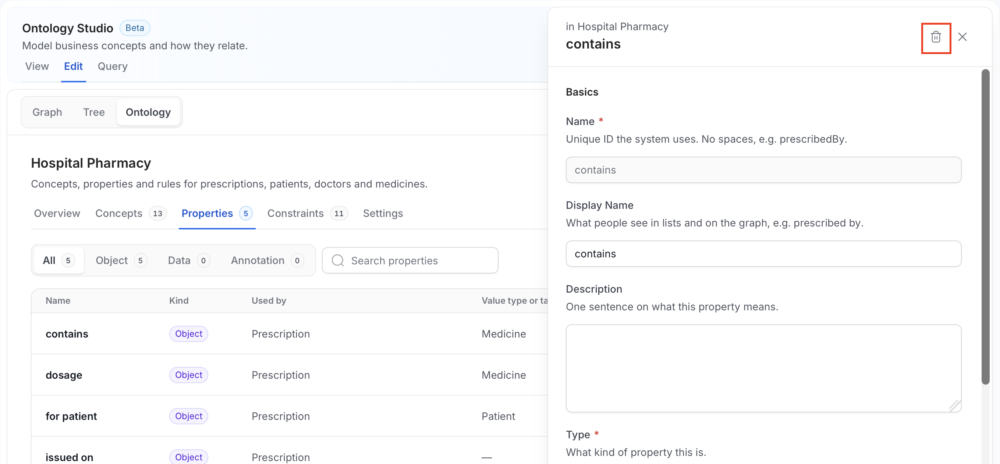

3. In the delete dialog, choose how to delete the item.

    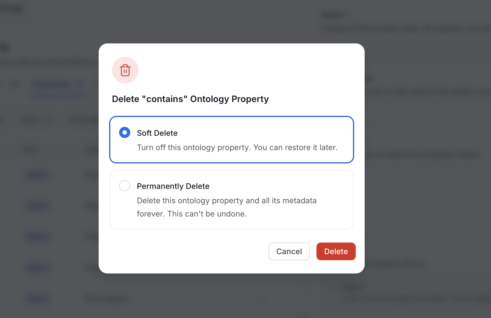

    - **Soft Delete**: Turns off the item. You can restore it later. This is the default.
    - **Permanently Delete**: Deletes the item and all its metadata forever. This can't be undone.

4. Click **Delete**. Click **Cancel** to keep the item.

For a constraint, the trash icon sits in the same place in the panel header.

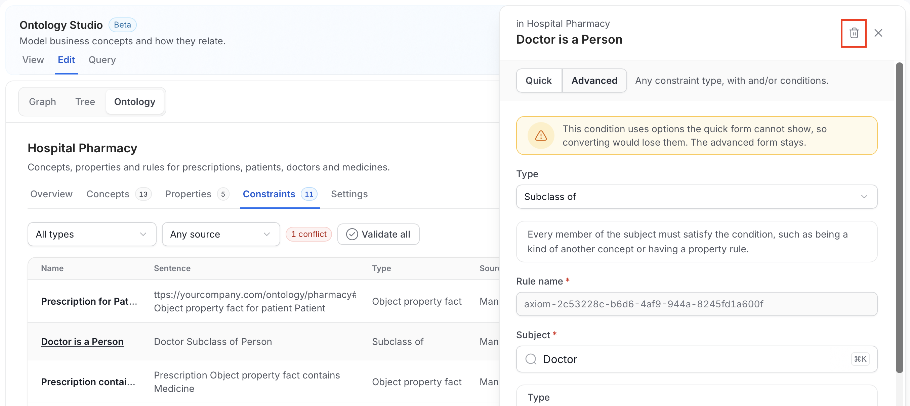

Constraints use the same dialog, titled **Delete "{name}" Ontology Axiom**, with the same two options.

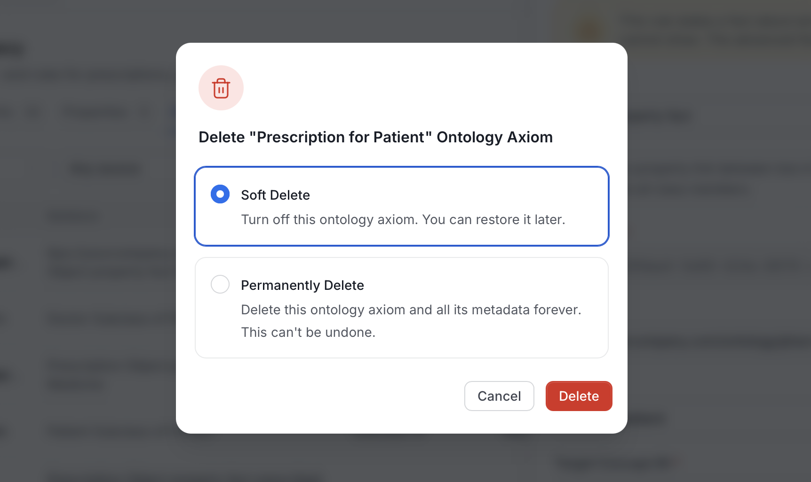

## Review Banners

When a release is waiting for review, a banner appears on the canvas of that ontology in **View** and **Edit**.

- **Reviewers** see "{name}, a release is waiting for your review". The banner shows the ontology, version, number of changes, requester, and task ID, with a **Review now** button.
- **The requester and other users** see the status, for example "In review · waiting on {names}", with a **View task** button.
- **After a decision**, the requester sees "{reviewer} approved {version}. Publish it from Review & publish." or "{reviewer} rejected {version}: {reason}".
- **With All ontologies selected**, each open review has its own line with **View task**. With several, they collapse into "N reviews in progress".

Click **Review now** or **View task** to open the review in the **Tasks** drawer. See [The Tasks Drawer](/v2.1.x-SNAPSHOT/how-to-guides/ontology/studio/releases#the-tasks-drawer).

## Next Steps

- [Publish a release](/v2.1.x-SNAPSHOT/how-to-guides/ontology/studio/releases) to make your changes visible to other users.
- [Import & Export](/v2.1.x-SNAPSHOT/how-to-guides/ontology/studio/import-export) to bring a file in as unpublished changes.
