# View Mode

View mode is for reading the model: what concepts exist, how they connect, which ones are isolated, and which real data assets each one covers. It works with the RDF triple store switched off.

Three views share the sub-mode bar: **Graph**, **Tree**, and **Ontology**. The bar also shows a count of concepts and relations at the right end, for example "8 concepts · 6 relations", and the **Tasks** button. For more information, see [The Tasks Drawer](/v2.1.x-SNAPSHOT/how-to-guides/ontology/studio/releases#the-tasks-drawer).

## Choose What to Read

The **Ontology selector** in the header scopes View to **All ontologies** or to one ontology. **All ontologies** is a read-only aggregate. It is capped at 20 ontologies and 2,000 combined definitions, so pick a single ontology to read a larger model. For more information, see [Choose an Ontology](/v2.1.x-SNAPSHOT/how-to-guides/ontology/studio#choose-an-ontology).

The **Ontology** view works on one ontology at a time. With **All ontologies** selected, it shows **Choose an ontology to review** and a **Search ontologies** field.

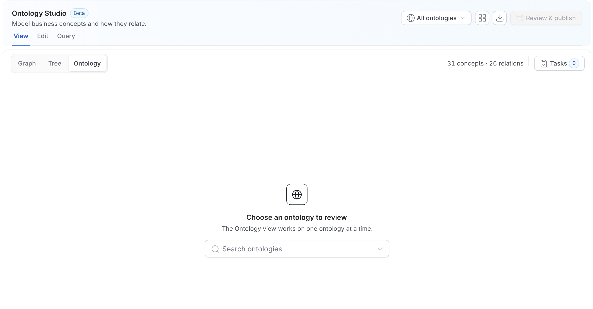

### Draft and Published

An ontology has a working **Draft** and, once released, a **Published** version. The version chip at the bottom of the canvas shows which one you are reading.

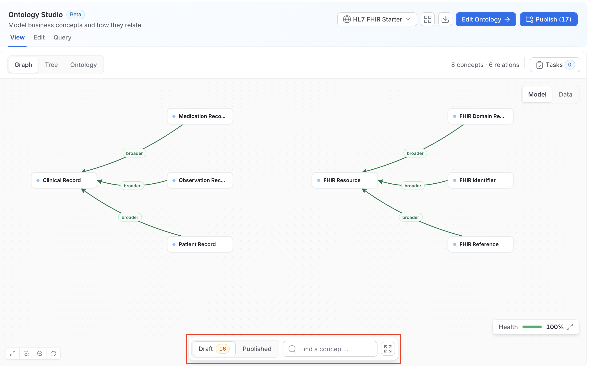

- **Draft**: The working version, including unpublished changes. The number next to it is the count of unpublished changes, for example **Draft 14**.
- **Published**: The active release.

Users with edit permission read the **Draft** by default and can switch to **Published**. Users without edit permission always read the **Published** release and don't see the draft. If you are reading **Published**, the **Edit** tab isn't available until you switch back to **Draft**.

## Graph

The **Graph** view draws the ontology as concepts and typed relations.

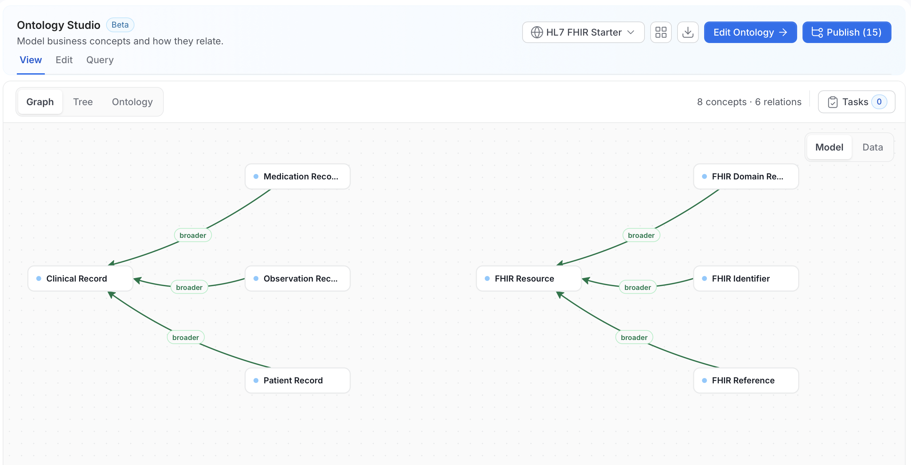

The canvas draws concepts as nodes and typed relations as labeled, color-coded edges, such as **broader**, **is a**, **disjoint with**, and **contains**.

### Model and Data

A **Model / Data** toggle in the upper-right corner of the canvas switches what the graph shows:

- **Model**: The concept-to-concept ontology. The semantic layer on its own.
- **Data**: The data behind one concept. For more information, see [Data Mode](#data-mode).

### Navigating the Canvas

The toolbar at the bottom of the canvas and the controls in its corners help you move around.

- **Find a concept**: Search by name and jump to the concept.
- **Full screen**: The expand icon next to the search box shows the canvas full screen.
- **Canvas controls**: The buttons in the lower-left corner fit the graph to the screen, zoom in, zoom out, and refresh it.

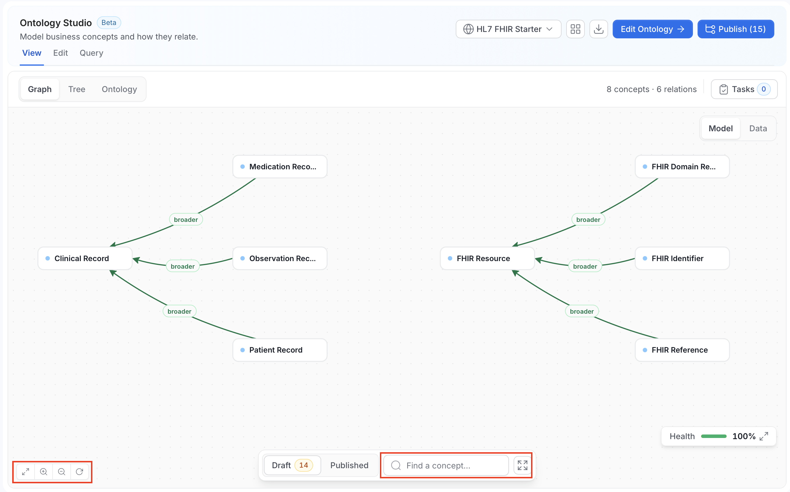

### Large Ontologies

When an ontology has too many concepts to draw at once, **Graph** shows a focused neighborhood around your selection instead of the whole model. The canvas says how many concepts it is showing, for example "Showing N of M concepts around your selection". Click a concept in **Tree**, or use **Find a concept**, to choose where to focus.

## Data Mode

**Data** mode answers a question that makes an ontology worth building: "this concept is modeled well, but is anything in the warehouse actually bound to it?" A concept with no data assets is a definition, not a model.

Data mode works on one concept at a time.

1. Click **Data** in the **Model / Data** toggle.
2. In **See the data behind a concept**, search for a concept, or click the field and pick one from the list. The list groups concepts by whether they have data. Concepts without linked data are listed under **No linked data yet** and marked **No data**.

    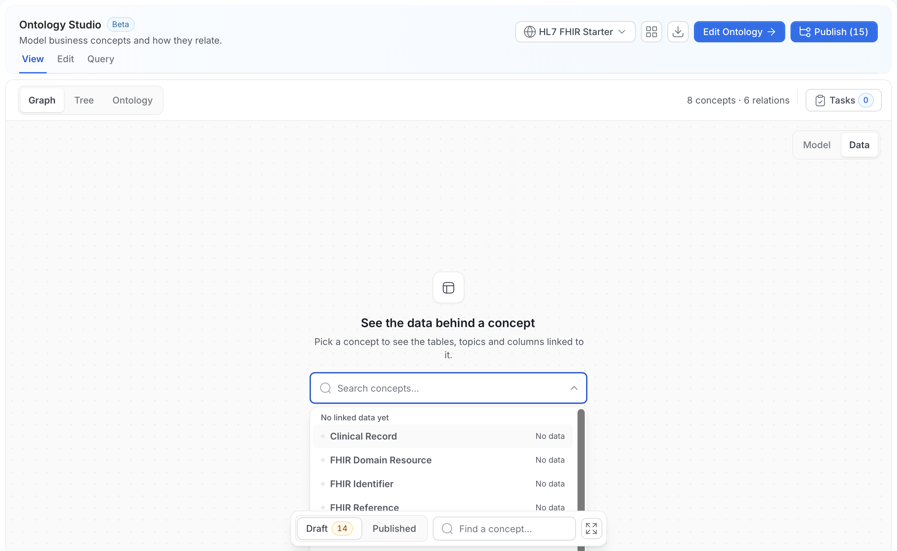

3. The canvas shows the concept as the **ROOT** node, with the assets bound to it grouped by source, for example **BIGQUERY**, **DREMIO**, **MSSQL**, and **REDSHIFT**. Each asset card shows the asset name, its source and type, and the number of bound columns, for example "0 columns". The chip at the top shows the concept, with the number of assets and sources, for example "5 assets · 4 sources".

    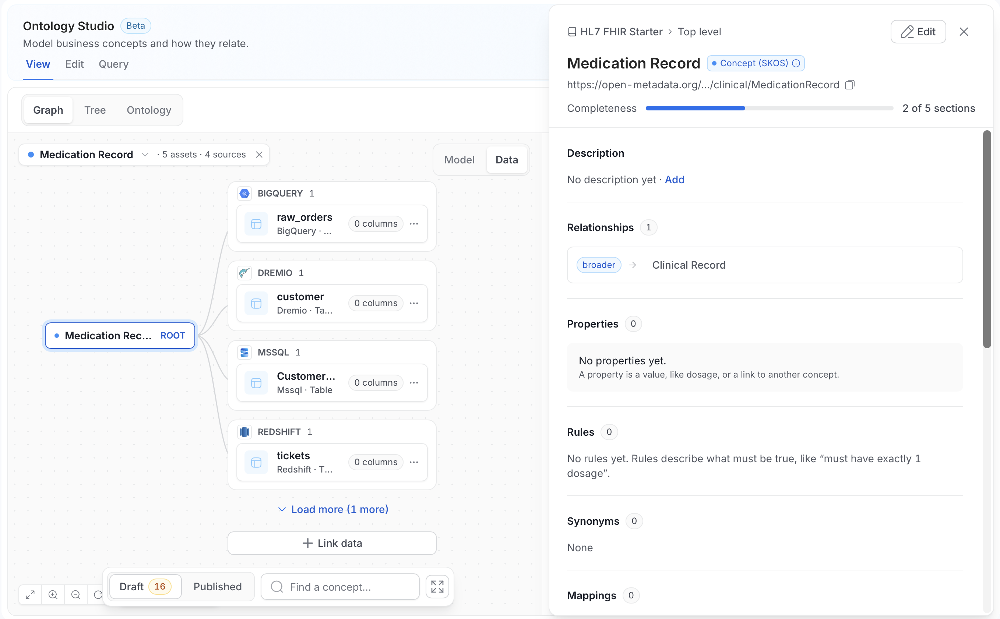

Use the controls on the canvas to work with the data:

- **Concept chip**: Click the arrow to switch to another concept, or click the **x** to clear it.
- **Load more**: Shows the remaining assets when a concept has more than fit on the canvas.
- **Link data**: Opens the editor to bind more assets to the concept. For more information, see [Author](/v2.1.x-SNAPSHOT/how-to-guides/ontology/studio/author).
- **More actions** (the three dots on an asset card): Opens actions for that asset.

## Tree

The **Tree** view lists the concepts of the ontology by hierarchy. It is the fastest way to audit structure rather than shape.

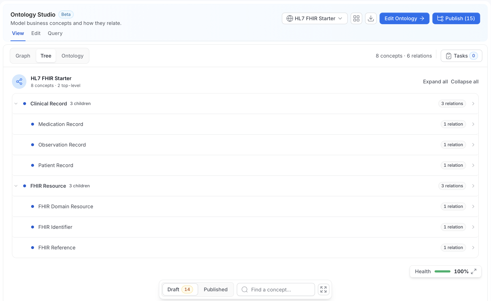

The header shows the ontology name and counts, for example "8 concepts · 2 top-level". **Expand all** and **Collapse all** open or close the hierarchy.

- Each row shows the concept name, how many children it has, for example "3 children", and its number of relations, for example "3 relations".
- Child concepts are indented under their parent.
- A concept with more than one parent is shown under each parent and marked "also under" with the other parents. This is called **polyhierarchy**. It is legitimate in an ontology, but a frequent source of ambiguity when it wasn't intentional.
- Click a row to open the concept in the inspector.

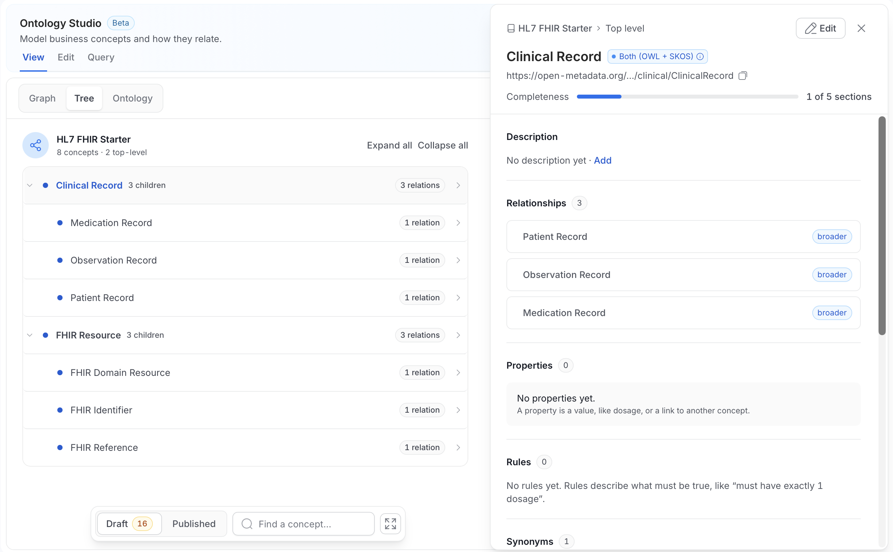

## Ontology

The **Ontology** view is a read-only overview of one ontology. It shows "The overview shows the Draft version and cannot be edited." when you read the draft.

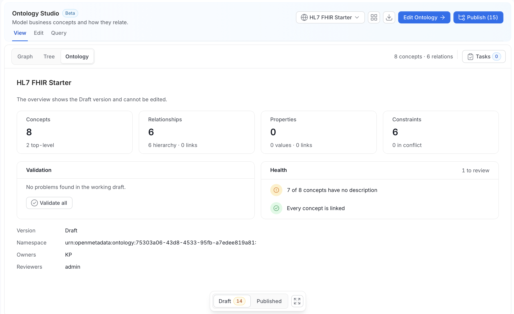

It shows:

- **Concepts**, **Relationships**, **Properties**, and **Constraints**: The number of each, with a breakdown underneath. For example, **Concepts** shows "2 top-level", **Relationships** shows "6 hierarchy · 0 links", and **Constraints** shows "0 in conflict".
- **Validation**: The result of the checks on the working draft, for example "No problems found in the working draft." Click **Validate all** to run the checks again. If constraints conflict, the card lists them and links to the conflicts.
- **Health**: A short list of things to review, with the count in the header, for example "1 to review". For example, "7 of 8 concepts have no description" and "Every concept is linked".
- **Version**, **Namespace**, **Owners**, and **Reviewers**: The ontology's identity and who maintains it.

For more information, see [Edit Ontology Settings](/v2.1.x-SNAPSHOT/how-to-guides/ontology/studio/ontologies#edit-ontology-settings).

## Ontology Health

The **Health** card sits in the lower-right corner of the **Graph** and **Tree** views. Collapsed, it shows the percentage of concepts that are connected, for example "100%", with a progress bar.

Click the expand icon to open the **Ontology health** card. It shows:

- A status badge, **Attention** or **Healthy**.
- The percentage of concepts that are connected, for example "90% · 28 of 31 terms connected", and a progress bar.
- An **Isolated terms** list, headed by a count such as "3 of 31". Each row shows the concept, **No relations yet**, and, if you have edit permission, a **Connect** button that opens the concept to relate it to the rest of the ontology.
- A minimize button and a collapse arrow to shrink the card.

When nothing needs fixing, the card shows the **Healthy** badge and says all terms are connected.

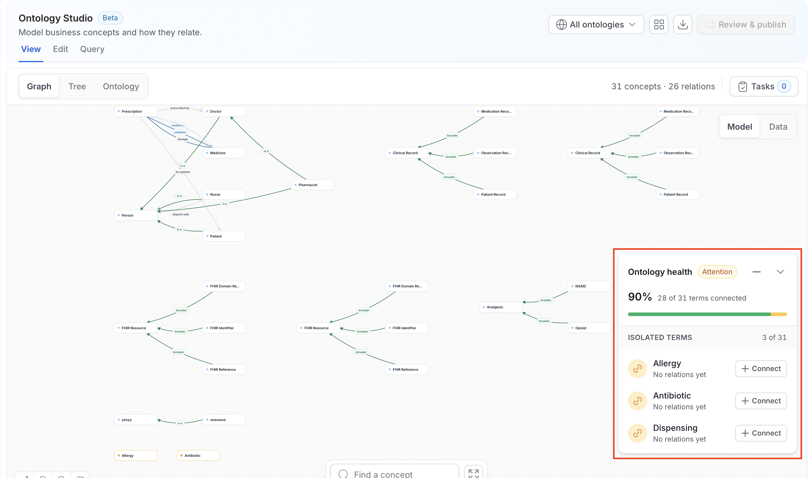

Isolation is the metric to drive down. A glossary of 400 unlinked terms and an ontology of 400 connected concepts look identical in a list view and behave completely differently for a query engine or an agent.

## The Inspector

Click a node in **Graph**, a row in **Tree**, or an edge to open a panel.

For a **concept**, the panel is the same inspector you use in Edit mode, read-only here, with an **Edit** button that takes you into Edit mode.

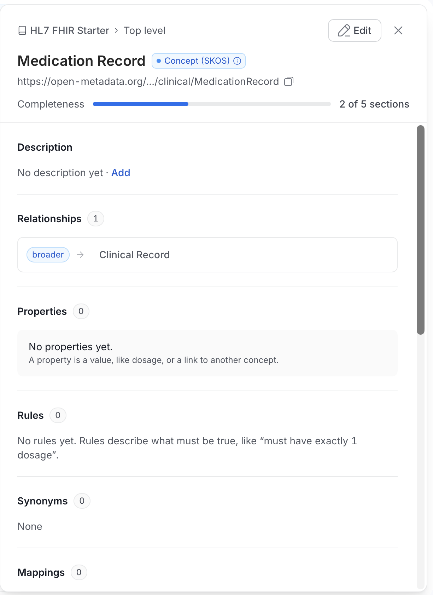

It shows:

- **Breadcrumb**: The ontology and the parent concept, for example "HL7 FHIR Starter > Top level". Click the close icon to dismiss the panel.
- **Name and type**: The concept name and a badge for its type, for example **Concept (SKOS)**. Hover the info icon for what the type means.
- **IRI**: The concept IRI. Click the copy icon to copy it.
- **Completeness**: A bar showing how many of the sections below have content, for example "2 of 5 sections".
- **Description**: The description, or "No description yet" with an **Add** link.
- **Relationships**: Every typed relation, with the relationship type and the related concept. Click one to move to that concept.
- **Properties**: Typed properties, with inherited properties marked **Inherited from** and the ancestor that declares them. A concept with none shows "No properties yet."
- **Rules**: The constraints that apply to the concept. A concept with none shows "No rules yet."
- **Synonyms**: Alternative names for the concept.
- **Mappings**: External concept mappings with their match type.
- **Data assets**: The tables and columns bound to the concept, with their path and number of column bindings. Click **+N more** to show the rest.
- **Live data**: A query generated from the bindings, labeled **not stored**. Click the copy icon to copy it, or click **Search around** to explore the data near the concept.

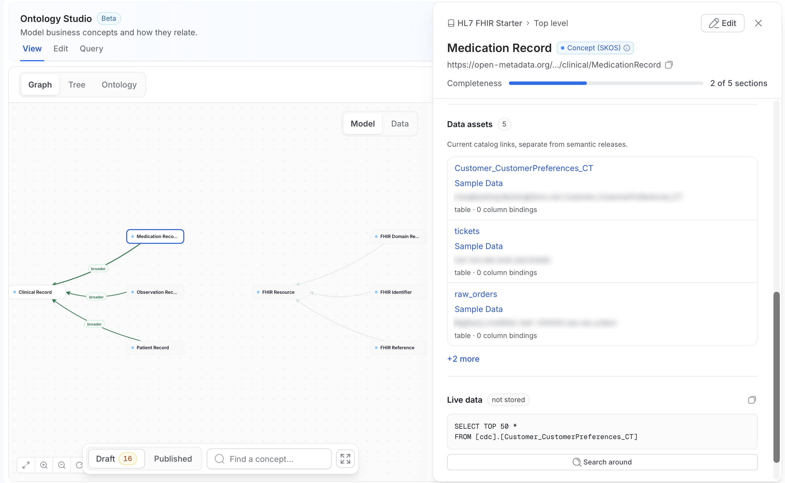

For a **relation**, the panel shows:

- **Source** and **Target**.
- **Provenance**: For example **Manual**, **Imported**, **Suggestion**, or **Ontology inferred**.
- **Status**.
- **Created by** and **Created at**.
- For inferred relations, an **inference explanation** naming which rules contributed and when they last ran, when materialized inference is enabled.

## Scoped View from a Glossary Term

The same graph is available scoped to a single concept from that term's **Relations Graph** tab in the glossary, which is often the better entry point when you already know the concept you care about. That tab adds a toolbar with **Export Graph** (PNG and SVG, plus OWL, SKOS, and JSON-LD when RDF is enabled) and **Graph Settings** (layout and edge labels), which Ontology Studio doesn't have. To export a whole ontology from Ontology Studio, use [Import & Export](/v2.1.x-SNAPSHOT/how-to-guides/ontology/studio/import-export).
