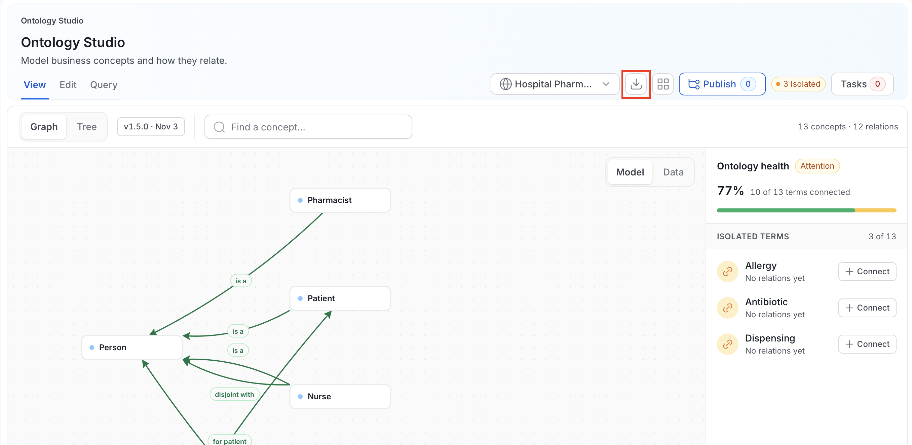
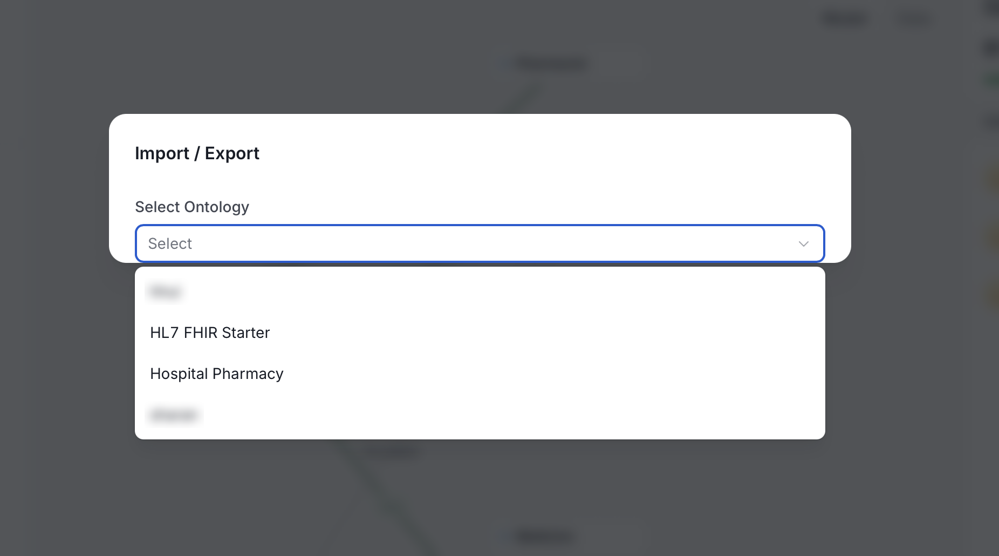
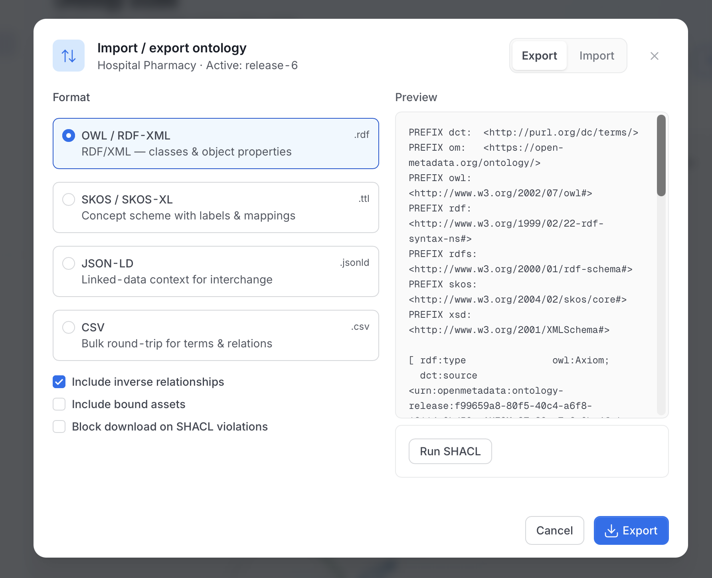
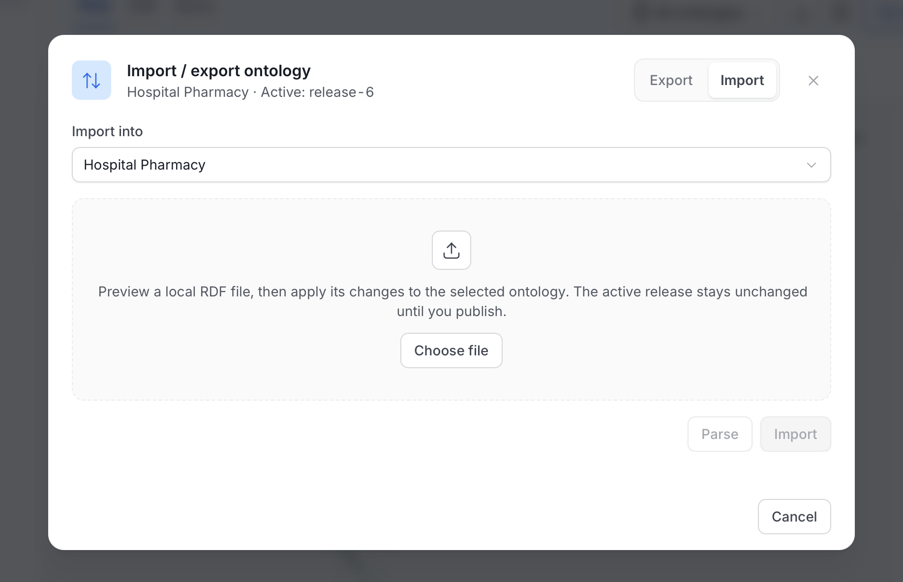
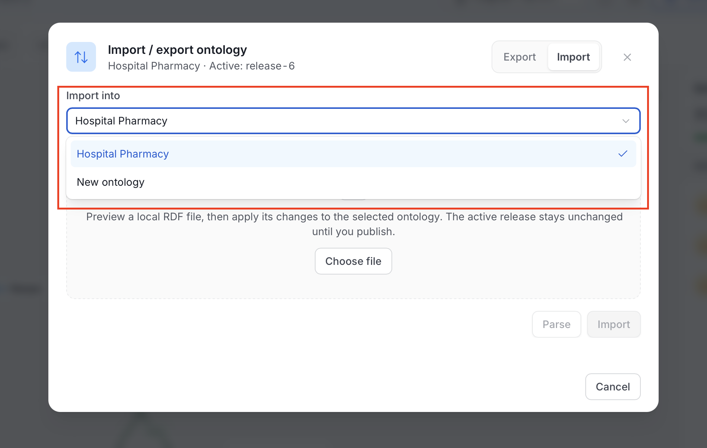

# Import & Export

An ontology authored in Protégé, exported from an EDM tool, or produced by a standards body can be imported into OpenMetadata. Export an ontology back out in a format other tools accept.

Import adds the file's changes to the working draft as unpublished changes. Export downloads the **active release**. For how drafts become releases, see [Releases](/v2.1.x-SNAPSHOT/how-to-guides/ontology/studio/releases).

## Open Import / Export

1. Select the **Import / Export** icon in the Ontology Studio header.

    

2. If **All ontologies** is selected, the dialog asks you to choose one. Pick an ontology from **Select Ontology**.

    

    The dialog is titled **Import / export ontology**. Its subtitle shows the ontology and its active release, for example "Hospital Pharmacy · Active: release-6". The **Export** and **Import** tabs sit at the top right.

## Export

Export downloads the active release of the selected ontology. If there is no active release, the dialog says so: **There is no active release to export. Capture, approve, and activate a release first.**

1. In the **Import / export ontology** dialog, click the **Export** tab.

    

2. Choose a **Format** from the below table:

    | Format | Extension | What it is |
    |---|---|---|
    | **OWL / RDF-XML** | `.rdf` | RDF/XML with classes and object properties. It is selected first. |
    | **SKOS / SKOS-XL** | `.ttl` | A concept scheme with labels and mappings. Turn on **Use SKOS-XL labels** to write SKOS-XL labels. |
    | **JSON-LD** | `.jsonld` | A linked-data context for interchange. |
    | **CSV** | `.csv` | A bulk round-trip for terms and relations. |

3. Set the following options:

    - **Include inverse relationships**: also write the inverse of each relationship, using each relationship type's declared inverse. It is on by default.
    - **Include bound assets**: also write the data assets bound to concepts. It is off by default and isn't available for **CSV**.
    - **Block download on SHACL violations**: run SHACL validation first and block the download if the ontology doesn't conform. It is off by default.

4. Check the **Preview**. It shows the start of the serialized output before you download it. **OWL / RDF-XML** and **JSON-LD** preview as Turtle, because the content is the same and Turtle is easier to read.

5. Optional: Click **Run SHACL** to validate the ontology against its shapes and download the validation report.

6. Click **Export**.

To export a release that isn't active, use the **Export** menu on that release in the **Releases** tab. See [Export a Release](/v2.1.x-SNAPSHOT/how-to-guides/ontology/studio/releases#export-a-release).

## Import

Import reads a local RDF file into an ontology. It needs edit permission on the target ontology.

1. In the **Import / export ontology** dialog, click the **Import** tab.

    

2. In **Import into**, pick the ontology to change. Optionally, pick **New ontology** to create one from the file.

    

3. Click **Choose file** and pick the file. Accepted formats are Turtle, RDF/XML, N-Triples, JSON-LD, or native CSV, up to 10 MB. OpenMetadata detects the format from the file. If it can't, the dialog asks you to use one of the supported formats.

4. Click **Parse**. OpenMetadata checks the file and previews the result without saving anything.

    - The preview shows how many concepts and properties the file would add, and how many would be updated or left unchanged.
    - The dialog states **Nothing persisted yet** until you import.
    - When you pick **New ontology**, the dialog shows the name of the ontology it will create.

5. Review the preview, then click **Import**.

The imported changes become unpublished changes, and imported concepts enter **Draft**. As the dialog says, the active release stays unchanged until you publish. Open **Publish** to review the changes and capture a release.

## What Gets Mapped

The import maps source constructs to ontology definitions as follows.

| Source construct | Becomes |
|---|---|
| `owl:Class` and `skos:Concept` | Concept |
| `skos:prefLabel` | The concept display name |
| `skos:definition` | The concept description |
| `rdfs:subClassOf` | Parent hierarchy |
| `owl:ObjectProperty` and `owl:DatatypeProperty` | Property |
| `skos:exactMatch`, `closeMatch`, `broadMatch`, `narrowMatch`, `relatedMatch` | Concept mappings |
| SKOS relations such as `skos:broader` | A relationship that keeps its exact IRI |

A `skos:broader` relationship isn't a subclass relationship, so it doesn't give the concept inherited properties. Export writes `rdfs:label` and `rdfs:comment` for names and descriptions. If a file has conflicting annotations for the same concept, the preview fails.

## Import Limits

Parsing stops with an error if a file goes past any of these limits. A file with unsupported statements fails the whole preview instead of importing part of it.

| Limit | Value |
|---|---|
| File size | 10 MB |
| RDF statements | 100,000 |
| Changed definitions | 1,000 |
| Parsing time | 30 seconds |

JSON-LD files must carry inline contexts. For larger ontologies, split the file and import the parts one at a time.

## REST Endpoints

Paths start with `/api`.

| Path | Access | Notes |
|---|---|---|
| `POST /v1/ontologies/{id}/imports/preview` | View | Turns an RDF file into a list of proposed changes. Does not save anything. |
| `POST /v1/ontologyChangeSets`, `POST /v1/ontologyChangeSets/{id}/apply` | `EditAll` on the ontology, plus rights on each item changed | The UI creates and applies a change set when you select **Import**. |
| `GET /v1/ontologyReleases/{id}/export?format=` | View | Exports one release. Default `turtle`. The UI uses `turtle`, `rdfxml`, `ntriples`, and `jsonld`. |

For the full reference, see the [Ontology API Reference](/v2.1.x-SNAPSHOT/how-to-guides/ontology/studio/api).

## Exporting the Graph, Not the Model

The formats above export one ontology. To export a slice of the knowledge graph, an entity and its neighborhood including instance data, use `GET /api/v1/rdf/graph/explore/export` (Turtle or JSON-LD, admin only). Use `GET /api/v1/rdf/ontology` for the canonical OpenMetadata ontology itself.
