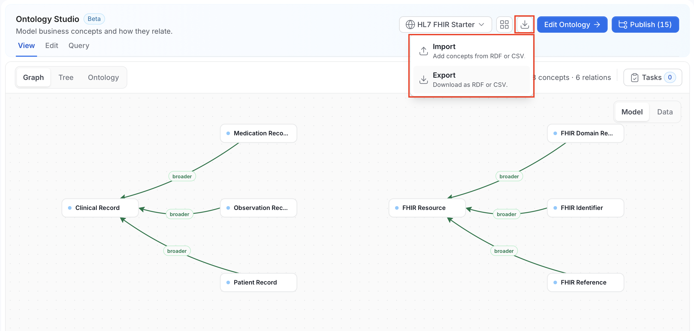
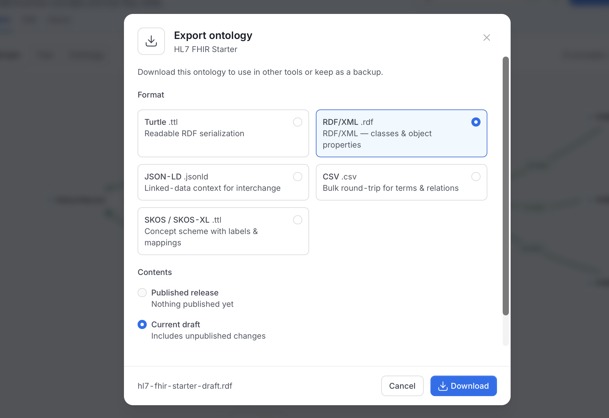
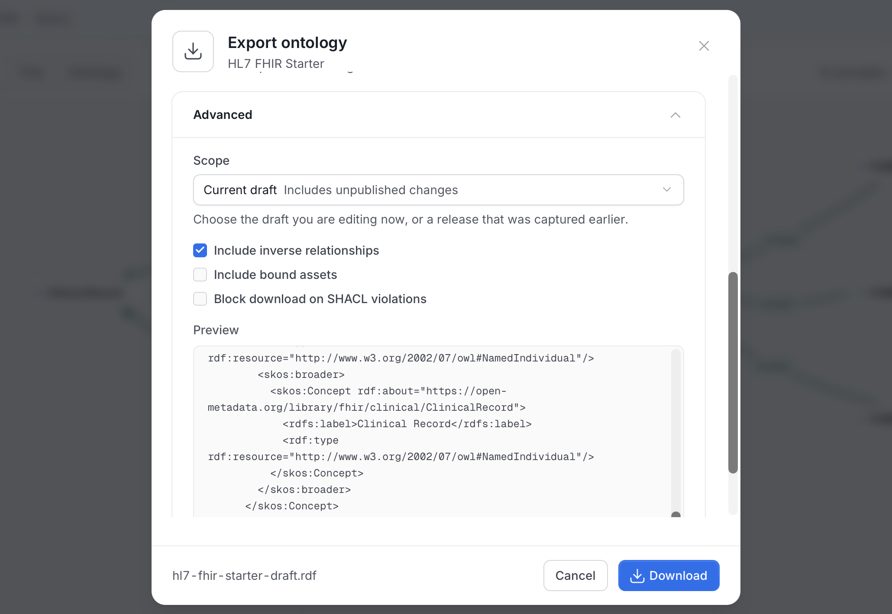

# Import & Export

An ontology authored in Protégé, exported from an EDM tool, or produced by a standards body can be imported into OpenMetadata. Export an ontology back out in a format other tools accept.

Import adds the file's changes to the working **Draft** as unpublished changes. Export downloads either the current draft or a captured release. For more information, see [Releases](/v2.1.x-SNAPSHOT/how-to-guides/ontology/studio/releases).

## Open Import / Export

Click the **Import / Export** icon (the download icon) in the Ontology Studio header. It is available when you select one ontology. The menu has two items:

- **Import**: "Add concepts from RDF or CSV."
- **Export**: "Download as RDF or CSV."

## Export

1. Click **Import / Export**, and then click **Export**. The **Export ontology** dialog opens. It shows the ontology name and "Download this ontology to use in other tools or keep as a backup."

    

2. Under **Format**, choose a format.

    | Format | Extension | What it is |
    |---|---|---|
    | **Turtle** | `.ttl` | A readable RDF serialization. |
    | **RDF/XML** | `.rdf` | RDF/XML with classes and object properties. It is selected first. |
    | **JSON-LD** | `.jsonld` | A linked-data context for interchange. |
    | **CSV** | `.csv` | A bulk round-trip for terms and relations. For more information, see [Native CSV](#native-csv). |
    | **SKOS / SKOS-XL** | `.ttl` | A concept scheme with labels and mappings. Turn on **Use SKOS-XL labels** to write SKOS-XL labels. |

    To download N-Triples (`.nt`), use the **Export** menu on a release in the **Releases** tab. For more information, see [Export a Release](/v2.1.x-SNAPSHOT/how-to-guides/ontology/studio/releases#export-a-release).

3. Under **Contents**, choose what to export.

    - **Published release**: The sealed content of the active release. If the ontology has no release, it reads "Nothing published yet" and is disabled.
    - **Current draft**: "Includes unpublished changes." Choose it to export the version you are editing. Users with edit permission can choose it.

    The footer shows the file name, for example `hl7-fhir-starter-draft.rdf`. It changes with your choices.

4. Expand **Advanced** and set the options you need.

    

    - **Scope**: Choose the draft you are editing now, or a release that was captured earlier. Use it to export an older release.
    - **Include inverse relationships**: Also writes the inverse of each relationship, using each relationship type's declared inverse. It is on by default.
    - **Include bound assets**: Also writes the data assets bound to concepts. It is off by default. It isn't available for **CSV** or for the current draft.
    - **Block download on SHACL violations**: Runs SHACL validation first and blocks the download if the ontology doesn't conform. It is off by default. It isn't available for the current draft.

5. Check the **Preview** in **Advanced**. It shows the start of the serialized output before you download it. **RDF/XML** and **JSON-LD** preview as Turtle, because the content is the same and Turtle is easier to read.

6. Optional: Click **Run SHACL** to validate the ontology against its shapes. The dialog shows the number of violations and the findings. It doesn't download a report. SHACL validation uses the built-in ontology shapes and doesn't need a triple store.

7. Click **Download**.

If the export fails, the dialog says "The export could not be generated." with a **Retry** button.

## Import

Import reads a local file into an ontology. It needs edit permission on the target ontology.

1. Click **Import / Export**, and then click **Import**. The **Import into ontology** dialog opens.

2. In **Import into**, pick the ontology to change. To create an ontology from the file, pick **New ontology**.

3. Click **Click to upload**, or drag a file into the area. Accepted formats are OWL and SKOS files (Turtle, RDF/XML, N-Triples, and JSON-LD) and native CSV, up to 10 MB. Studio reads the file as soon as you choose it and detects the format from the file. If it can't, the dialog asks you to use a supported format.

4. Review the preview. Nothing is saved yet.

    - The summary reports what the file contains, for example "Found 12 term(s), 9 relation(s), 3 concept mapping(s), and 2 custom property(ies)."
    - Each item has a checkbox. Click **Select all** or **Deselect all**, or clear the items you don't want. If an item depends on another that you cleared, the preview says "Needs {name}, which is not ticked." Clearing a concept also clears the relationships that use it.
    - When you pick **New ontology**, the dialog shows the name of the ontology it will create.
    - If any statements were skipped or need review, the dialog shows the count. For more information, see [Skipped Statements](#skipped-statements).

5. Click **Import N changes**, where N is the number of selected items.

The imported changes become unpublished changes to the draft, and imported concepts enter **Draft**. The dialog notes that the changes are saved as a draft. Other users keep reading the published release until you publish. Click **Publish** to review the changes and release them.

## Skipped Statements

Studio imports everything its ontology model can hold and reports the rest. After Studio reads a file, the dialog shows how many items were skipped or need review. Statements the model can't represent are skipped instead of failing the import. `owl:imports` is never fetched, so import the other ontology as its own file.

If a file has conflicting annotations for the same concept, the preview fails.

## What Gets Mapped

The import maps source constructs to ontology definitions as follows.

| Source construct | Becomes |
|---|---|
| `owl:Class` and `skos:Concept` | Concept |
| `skos:prefLabel` | The concept display name |
| `skos:definition` | The concept description |
| `rdfs:subClassOf` | Parent hierarchy |
| `owl:ObjectProperty` and `owl:DatatypeProperty` | Property |
| `skos:exactMatch`, `closeMatch`, `broadMatch`, `narrowMatch`, `relatedMatch` | Concept mappings |
| SKOS relations such as `skos:broader` | A relationship that keeps its exact IRI |

A `skos:broader` relationship isn't a subclass relationship, so it doesn't give the concept inherited properties. Export writes `rdfs:label` and `rdfs:comment` for names and descriptions.

## Native CSV

The native CSV format round-trips an ontology's definitions. It has a fixed header, with the columns in an exact order. Export a CSV from the ontology to get a file with the correct header, then edit it.

## Import Limits

Parsing stops with an error if a file goes past any of these limits.

| Limit | Value |
|---|---|
| File size | 10 MB |
| RDF statements | 100,000 |
| Changed definitions | 1,000 |
| Parsing time | 30 seconds |

JSON-LD files must carry inline contexts. For larger ontologies, split the file and import the parts one at a time.

## REST Endpoints

Paths start with `/api`.

| Path | Access | Notes |
|---|---|---|
| `POST /v1/ontologies/imports/detect` | View | Detects the format of an uploaded file. |
| `POST /v1/ontologies/{id}/imports/preview` | View | Turns an RDF or CSV file into a list of proposed changes and skipped statements. Does not save anything. |
| `POST /v1/ontologyChangeSets`, `POST /v1/ontologyChangeSets/{id}/apply` | `EditAll` on the ontology, plus rights on each item changed | The UI creates and applies a change set when you click **Import**. |
| `GET /v1/ontologies/{id}/export?format=` | View, and edit permission for the draft | Exports the current draft. |
| `GET /v1/ontologyReleases/{id}/export?format=` | View | Exports one release. Default `turtle`. The UI also uses `rdfxml`, `ntriples`, `jsonld`, `skos`, `skos-xl`, and `csv`. |

For the full reference, see the [Ontology API Reference](/v2.1.x-SNAPSHOT/how-to-guides/ontology/studio/api).

## Exporting the Graph, Not the Model

The formats above export one ontology. To export a slice of the knowledge graph, an entity and its neighborhood, including instance data, use `GET /api/v1/rdf/graph/explore/export` (Turtle or JSON-LD, admin only). Use `GET /api/v1/rdf/ontology` for the canonical OpenMetadata ontology itself.
