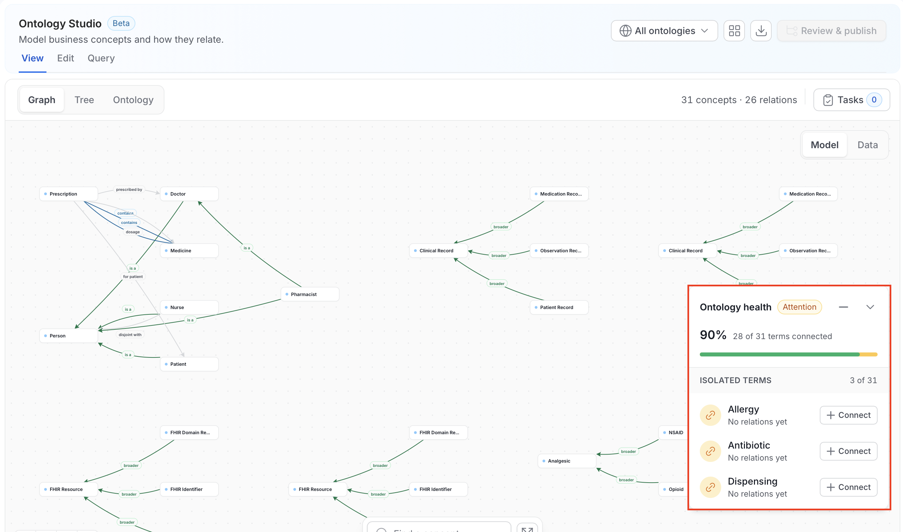
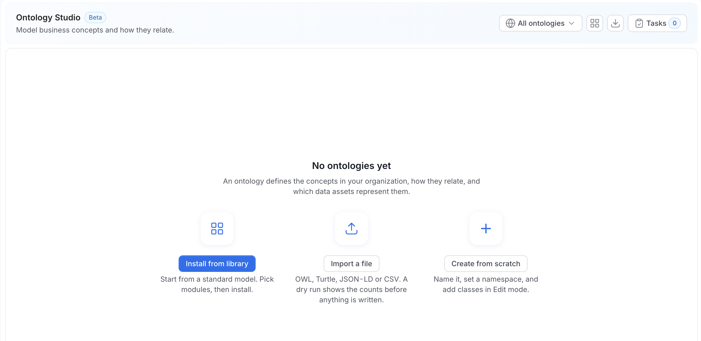

# Ontology Studio

**Ontology Studio** is the workspace where your business concepts stop being a list and become a model. It is one page with up to four modes, depending on your permissions and server settings: **View**, **Edit**, **Query**, and **AI**. All modes work over the same graph, so moving between reading the model, changing it, and querying it never loses your place.

<Note>

**Note**: Ontology Studio is in **Beta**. The header shows a **Beta** badge next to the page title.

</Note>

Open it from **Govern** > **Ontology Studio** in the left navigation, or go directly to `/governance/ontology`.

## The Shell

Every mode shares the same header.

| Control | What it does |
|---|---|
| **Ontology selector** | Scopes the whole studio to one ontology, or to **All ontologies**. The menu lists each ontology with its concept count, a search field, and a **New ontology** action. |
| **Mode tabs** | **View**, **Edit**, **Query**, and **AI**. **Edit** appears only if you have edit permission. **AI** appears only when you select a glossary and AI-assisted flows are enabled on the server. |
| **Library** | The grid icon. Opens the **Ontology Library** of standards-aligned packs. |
| **Import / Export** | The download icon. Opens a menu to import into, or export, the selected ontology. For more information, see [Import & Export](/v2.1.x-SNAPSHOT/how-to-guides/ontology/studio/import-export). |
| **Primary action** | The primary button changes with the mode: **Edit Ontology** in **View**, **Add concept** in **Edit**, and **New query** in **Query**. |
| **Publish** | Opens the review and publish panel for the selected ontology. The number in parentheses, as in **Publish (21)**, is the count of unpublished changes. With **All ontologies** selected, the button reads **Review & publish** and stays disabled until you choose an ontology. For more information, see [Releases](/v2.1.x-SNAPSHOT/how-to-guides/ontology/studio/releases). |
| **Tasks** | Opens the **Tasks** drawer, which lists review requests assigned to you and requests you created. The badge shows the number of open tasks. |

Below the header, a sub-mode bar switches the surface within the current mode and shows a running `N concepts · M relations` count. In **View** and **Edit**, the canvas toolbar provides **Find a concept**, a full-screen toggle, and zoom controls. The **Ontology health** card in the lower-right corner of the canvas reports how many concepts are connected and how many are isolated. Expand the card to see the **Isolated terms** list.

### Choose an Ontology

Click the ontology selector to change scope.

- **All ontologies**: Opens a read-only graph or tree of every ontology. It loads at most 20 ontologies and 2,000 concepts, properties, and axioms combined. If your catalog is larger, Studio asks you to select one ontology.
- **One ontology**: Required for **Edit**, **Query**, and **Publish**. Publishing never applies to several ontologies at once.
- **New ontology**: Creates an ontology. For more information, see [Ontologies](/v2.1.x-SNAPSHOT/how-to-guides/ontology/studio/ontologies).
- **More actions** (on each ontology row): Opens the ontology's settings or deletes it.

Existing glossaries and glossary terms aren't converted into ontologies. Glossary vocabulary stays available as an explicit glossary scope.

### First Run

When your organization has no ontologies, Studio shows **No ontologies yet** with three starting points:

- **Install from library**: Start from a standard model. Pick modules, then install.
- **Import a file**: Bring in OWL, Turtle, JSON-LD, or CSV. A dry run shows the counts before anything is written.
- **Create from scratch**: Name the ontology, set a namespace, and add concepts in **Edit** mode.

### Draft and Published Views

An ontology has a working **Draft** and, once released, a **Published** version.

- Users with edit rights read the **Draft** by default and can switch to the **Published** version with the version chip on the canvas toolbar. The chip reads **Draft** or **Published**. Editing always works on the draft.
- Users without edit rights always read the active **Published** release. They can't open the draft.

Query mode follows the same rule and shows the version it runs against, for example `ontology · v1.0.0` or `ontology · draft`.

### Large Ontologies

When an ontology has too many concepts to draw at once, **Graph** shows a focused neighborhood around your selection instead of the whole model. Click a concept in **Tree**, or use **Find a concept**, to choose where to focus.

## The Modes

Each mode has its own page.

<CardGroup cols={2}>
  <Card title="View" icon="eye" href="/v2.1.x-SNAPSHOT/how-to-guides/ontology/studio/explore">
    **Graph**, **Tree**, and **Ontology** views for reading the model, the **Ontology health** card, search, and a details inspector for any concept or relation.
  </Card>
  <Card title="Edit" icon="pen" href="/v2.1.x-SNAPSHOT/how-to-guides/ontology/studio/author">
    **Graph**, **Tree**, and **Ontology** authoring for concepts, relationships, properties, constraints, data assets, and mappings. Changes are published as [releases](/v2.1.x-SNAPSHOT/how-to-guides/ontology/studio/releases).
  </Card>
  <Card title="Query" icon="terminal" href="/v2.1.x-SNAPSHOT/how-to-guides/ontology/studio/query">
    A **SPARQL console** with saved queries and shared templates, and a **Visual builder** for people who would rather not write SPARQL.
  </Card>
  <Card title="AI" icon="sparkles" href="/v2.1.x-SNAPSHOT/how-to-guides/ontology/studio/ai-assistant">
    Propose relationships, external mappings, SPARQL, and whole domain drafts, always as a reviewable draft, never applied directly.
  </Card>
</CardGroup>

## What Each Mode Needs

| Mode | Requires | Notes |
|---|---|---|
| **View** | Nothing beyond an ontology | Works with RDF disabled. |
| **Edit** | Edit permission on the ontology, or admin | Each item saves on its own, as an unpublished change to the draft until you publish. |
| **Query** | An ontology selected | Without one, the mode asks you to pick an ontology. Querying the draft requires edit permission. Catalog-wide queries run in the SPARQL Playground and need RDF and an admin. |
| **AI** | A glossary selected, `RDF_AI_ENABLED=true` (the older name `RDF_ASK_COLLATE_ENABLED` also works), **and** a configured LLM provider | The tab is hidden when any condition isn't met. |

<Note>

**Note**: `GET /api/v1/rdf/status` is the source the UI uses for this gating. It returns `enabled`, `storageType`, `inference`, `projectionState` (`DISABLED` / `READY` / `REBUILDING` / `DEGRADED`), and `aiEnabled`.

</Note>

## A First Pass Through the Studio

1. Pick an ontology. Choose an ontology in the header. Studio scopes the graph, tree, authoring, and query to it. Leave it on **All ontologies** to read across ontologies.
2. Read the health signal. Look at the **Ontology health** card, for example "90% · 28 of 31 terms connected". Isolated concepts have no relations: they are definitions, not a model. Click the expand icon on the card to open the **Isolated terms** list. If you have edit permission, each isolated concept has a **Connect** button that opens it in the editor. Getting that number down is the work.
3. Explore the shape. Use **Graph** for structure and **Tree** for hierarchy. Use **Ontology** in **View** for a summary of the ontology's concepts, relationships, properties, and constraints.
4. Connect what matters. Click **Edit Ontology**, or open the **Edit** tab, and draw typed relations between concepts. Add properties, data assets, and external mappings in the inspector.
5. Publish. Click **Publish** to review your changes and release them. If the ontology has reviewers, you request a review instead, and reviewers approve it from the **Tasks** drawer.
6. Ask a question. Switch to **Query**. Start from a shared template, or use the visual builder and click **Edit as SPARQL** to see the query it produced.

## Where the Data Comes From

Ontology Studio reads from ordinary OpenMetadata APIs, which is why most of it works with the triple store switched off:

| Surface | API |
|---|---|
| Ontologies | `GET /api/v1/ontologies`, `GET /api/v1/ontologies/{id}` |
| Concepts | `GET /api/v1/ontologyConcepts`, `GET /api/v1/ontologyConcepts/{id}/bindings` |
| Releases | `GET /api/v1/ontologyReleases` |
| Review tasks | `GET /api/v1/ontologies/reviews` |
| Relationship types | `GET /api/v1/relationshipTypes` |
| Ontology-scoped SPARQL | `POST /api/v1/ontologies/{id}/sparql`, with `scope=release` (default) or `scope=draft` |
| Catalog-wide SPARQL | `GET\|POST /api/v1/rdf/sparql`, requires RDF |

The full endpoint list is in the [Ontology API reference](/v2.1.x-SNAPSHOT/how-to-guides/ontology/studio/api).

## In This Section

<CardGroup cols={2}>
  <Card title="Explore (View mode)" href="/v2.1.x-SNAPSHOT/how-to-guides/ontology/studio/explore" />
  <Card title="Ontologies" href="/v2.1.x-SNAPSHOT/how-to-guides/ontology/studio/ontologies" />
  <Card title="Author (Edit mode)" href="/v2.1.x-SNAPSHOT/how-to-guides/ontology/studio/author" />
  <Card title="Releases" href="/v2.1.x-SNAPSHOT/how-to-guides/ontology/studio/releases" />
  <Card title="Query mode" href="/v2.1.x-SNAPSHOT/how-to-guides/ontology/studio/query" />
  <Card title="AI Assistant" href="/v2.1.x-SNAPSHOT/how-to-guides/ontology/studio/ai-assistant" />
  <Card title="Ontology Library" href="/v2.1.x-SNAPSHOT/how-to-guides/ontology/studio/library" />
  <Card title="Import & Export" href="/v2.1.x-SNAPSHOT/how-to-guides/ontology/studio/import-export" />
  <Card title="Relationship Types" href="/v2.1.x-SNAPSHOT/how-to-guides/ontology/studio/relationship-types" />
  <Card title="API Reference" href="/v2.1.x-SNAPSHOT/how-to-guides/ontology/studio/api" />
</CardGroup>
