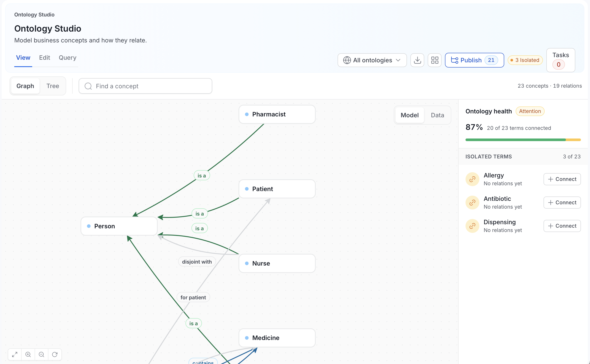
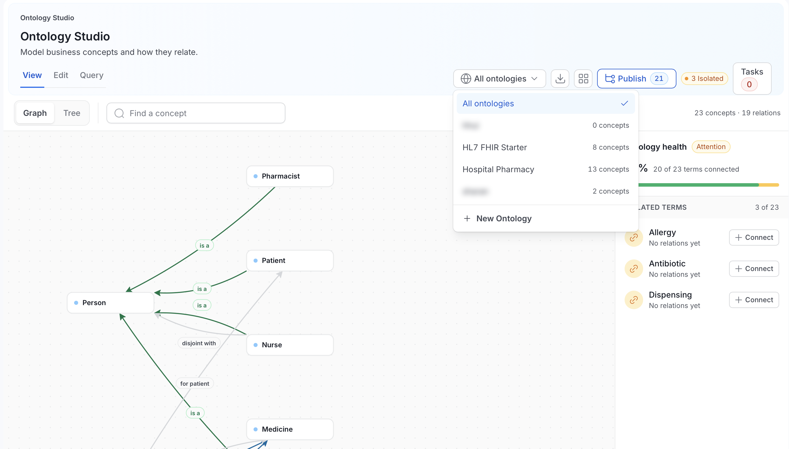

# Ontology Studio

**Ontology Studio** is the workspace where your business concepts stop being a list and become a model. It is one page with up to four modes, depending on your permissions and server settings: **View**, **Edit**, **Query**, and **AI**. They all work over the same graph, so you never lose your place moving between reading the model, changing it, and interrogating it.

Open it from **Govern** > **Ontology Studio** in the left navigation, or go directly to `/governance/ontology`.

## The Shell

Every mode shares the same header:

| Control | What it does |
|---|---|
| **Ontology selector** | Scopes the whole studio to one ontology, or **All ontologies**. Shows a concept count per ontology and a **New Ontology** action. |
| **Mode tabs** | **View**, **Edit**, **Query**, and **AI**. **Edit** appears only if you have edit permission. **AI** appears only if AI-assisted flows are enabled on the server. |
| **Import / Export** | Import and export the selected ontology. Available when one ontology is selected. |
| **Library** | The grid icon. Opens the **Ontology Library** of standards-aligned starter packs. |
| **Publish** | Opens the review and publish panel for the selected ontology. The number is the count of unpublished changes. With **All ontologies** selected, the button reads **Review & publish**. See [Releases](/v2.1.x-SNAPSHOT/how-to-guides/ontology/studio/releases). |
| **Isolated** | A badge that counts concepts with no relations. |
| **Primary action** | The primary button changes with the mode: **Edit Ontology** in **View**, **Add Concept** in **Edit**, and **New Query** in **Query**. |

Below the header, a sub-mode bar switches the surface within the current mode, offers a **Find a concept** search, and shows a running `N concepts · M relations` count. In **View** and **Edit**, an **Ontology health** panel on the canvas reports how many terms are connected.

### Choose an Ontology

Select the ontology selector to change scope.

- **All ontologies** opens a read-only graph or tree of every ontology. It loads at most 20 ontologies and 2,000 concepts, properties, and axioms combined. If your catalog is larger, Studio asks you to select one ontology.
- **One ontology** is required for **Edit**, **Query**, and **Publish**. Publishing never applies to several ontologies at once.
- **New Ontology** creates an empty ontology. See [Ontologies](/v2.1.x-SNAPSHOT/how-to-guides/ontology/studio/ontologies).

Existing glossaries and glossary terms aren't converted into ontologies. Glossary vocabulary stays available as an explicit glossary scope.

## The Modes

Each mode has its own page.

<CardGroup cols={2}>
  <Card title="View" icon="eye" href="/v2.1.x-SNAPSHOT/how-to-guides/ontology/studio/explore">
    **Graph** and **Tree** surfaces for reading the model, ontology health, search, and a details inspector for any concept or relation.
  </Card>
  <Card title="Edit" icon="pen" href="/v2.1.x-SNAPSHOT/how-to-guides/ontology/studio/author">
    **Graph** and **Term** authoring for concepts, relationships, properties, data assets, and mappings. Changes are published as [releases](/v2.1.x-SNAPSHOT/how-to-guides/ontology/studio/releases).
  </Card>
  <Card title="Query" icon="terminal" href="/v2.1.x-SNAPSHOT/how-to-guides/ontology/studio/query">
    A **SPARQL console** with saved queries and shared templates, and a **Visual builder** for people who would rather not write SPARQL.
  </Card>
  <Card title="AI" icon="sparkles" href="/v2.1.x-SNAPSHOT/how-to-guides/ontology/studio/ai-assistant">
    Propose relationships, external mappings, SPARQL, and whole domain drafts, always as a reviewable draft, never applied directly.
  </Card>
</CardGroup>

## What Each Mode Needs

Each mode has its own requirements, listed below.

| Mode | Requires | Notes |
|---|---|---|
| **View** | Nothing beyond an ontology | Works with RDF disabled. |
| **Edit** | Edit permission on the ontology, or admin | Each item saves on its own, as an unpublished change until you publish a release. |
| **Query** | An ontology selected, or RDF enabled for catalog-wide queries | Without either, the mode shows an explanatory notice instead of the console. |
| **AI** | `RDF_AI_ENABLED=true` (the older name `RDF_ASK_COLLATE_ENABLED` also works) **and** a configured LLM provider | The tab is hidden entirely when disabled. |

<Info>

`GET /api/v1/rdf/status` is the source the UI uses for this gating. It returns `enabled`, `storageType`, `inference`, `projectionState` (`DISABLED` / `READY` / `REBUILDING` / `DEGRADED`), and `askCollateEnabled`.

</Info>

## A First Pass Through the Studio

1. **Pick an ontology.** Choose an ontology in the header. Studio scopes the graph, tree, authoring, and query to it. Leave it on **All ontologies** to read across ontologies.
2. **Read the health signal.** Look at the **Ontology health** panel, for example "87% · 20 of 23 terms connected". Isolated terms are concepts nobody has connected to anything: they are definitions, not a model. Each isolated term in the panel has a **Connect** button. Getting that number down is the work.
3. **Explore the shape.** Use **View** > **Graph** for structure and **View** > **Tree** for hierarchy.
4. **Connect what matters.** Select **Edit Ontology**, or open the **Edit** tab, and draw typed relations between concepts. Add properties, data assets, and external mappings in the inspector.
5. **Ask a question.** Switch to **Query**. Start from a shared template, or use the visual builder and select **Edit as SPARQL** to see the query it produced.

## Where the Data Comes From

Ontology Studio reads from ordinary OpenMetadata APIs, which is why most of it works with the triple store switched off:

| Surface | API |
|---|---|
| Ontologies | `GET /api/v1/ontologies`, `GET /api/v1/ontologies/{id}` |
| Concepts | `GET /api/v1/ontologyConcepts`, `GET /api/v1/ontologyConcepts/{id}/bindings` |
| Releases | `GET /api/v1/ontologyReleases` |
| Relationship types | `GET /api/v1/relationshipTypes` |
| Ontology-scoped SPARQL | `POST /api/v1/ontologies/{id}/sparql` |
| Catalog-wide SPARQL | `GET\|POST /api/v1/rdf/sparql`, requires RDF |

The full endpoint list is in the [Ontology API reference](/v2.1.x-SNAPSHOT/how-to-guides/ontology/studio/api).

## In This Section

<CardGroup cols={2}>
  <Card title="Ontologies" href="/v2.1.x-SNAPSHOT/how-to-guides/ontology/studio/ontologies" />
  <Card title="Explore (View mode)" href="/v2.1.x-SNAPSHOT/how-to-guides/ontology/studio/explore" />
  <Card title="Author (Edit mode)" href="/v2.1.x-SNAPSHOT/how-to-guides/ontology/studio/author" />
  <Card title="Releases" href="/v2.1.x-SNAPSHOT/how-to-guides/ontology/studio/releases" />
  <Card title="Query mode" href="/v2.1.x-SNAPSHOT/how-to-guides/ontology/studio/query" />
  <Card title="AI Assistant" href="/v2.1.x-SNAPSHOT/how-to-guides/ontology/studio/ai-assistant" />
  <Card title="Ontology Library" href="/v2.1.x-SNAPSHOT/how-to-guides/ontology/studio/library" />
  <Card title="Import & Export" href="/v2.1.x-SNAPSHOT/how-to-guides/ontology/studio/import-export" />
  <Card title="Relationship Types" href="/v2.1.x-SNAPSHOT/how-to-guides/ontology/studio/relationship-types" />
  <Card title="API Reference" href="/v2.1.x-SNAPSHOT/how-to-guides/ontology/studio/api" />
</CardGroup>
