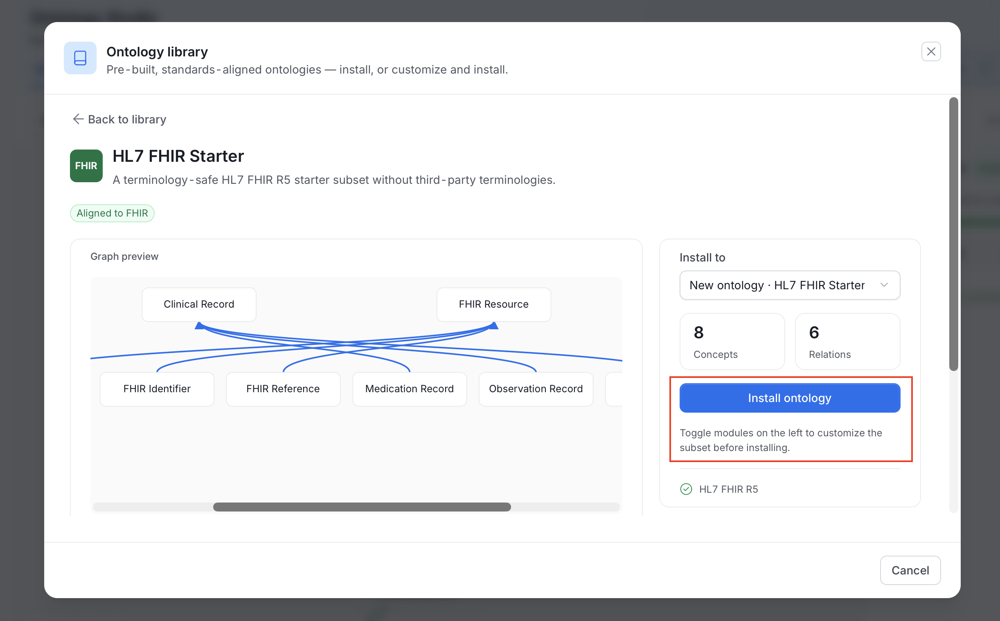
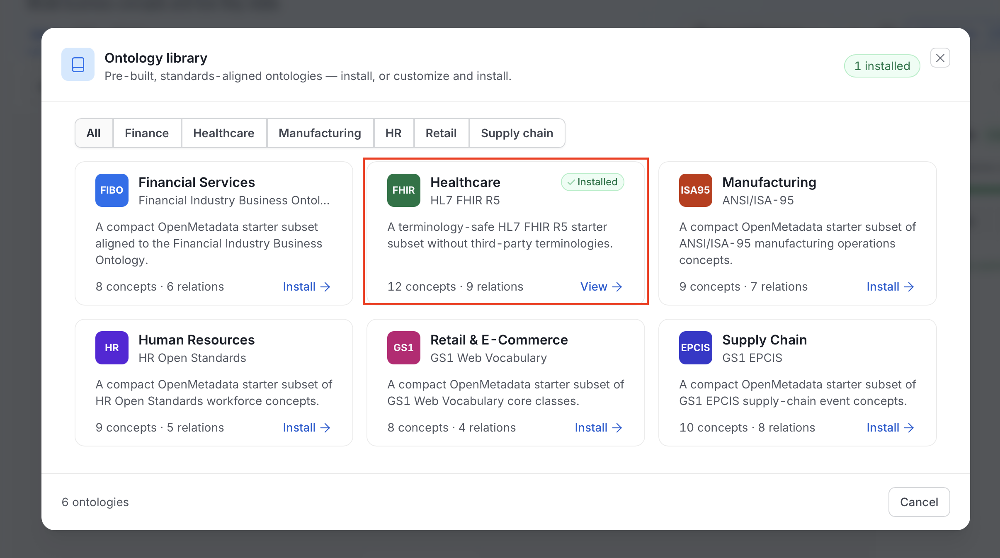

# Ontology Library

Most organizations don't need to invent a model of Customer from first principles. Their industry already has one. The **Ontology Library** ships compact, standards-aligned starter packs that you install into an ontology and then adapt.

Open it from the **Library** icon in the Ontology Studio header.

## What Ships

The library ships the following packs.

| Pack | Standard | Version | License | Concepts / relationships | Modules |
|---|---|---|---|---|---|
| **Financial Services** | Financial Industry Business Ontology (FIBO Starter) | `2025Q1-om1` | MIT | 8 / 6 | Foundations; Business entities (requires Foundations) |
| **Healthcare** | HL7 FHIR R5 (HL7 FHIR Starter) | `5.0.0-om1` | CC0 1.0 (excludes third-party terminologies) | 12 / 9 | Core resources; Clinical records (requires Core); Workflow (requires Core) |
| **Retail & E-Commerce** | GS1 Web Vocabulary | `2025Q1-om1` | MIT | 8 / 4 | Core vocabulary |
| **Supply Chain** | GS1 EPCIS | `2025Q1-om1` | MIT | 10 / 8 | Event model |
| **Manufacturing** | ANSI/ISA-95 | `2025Q1-om1` | MIT | 9 / 7 | Manufacturing operations |
| **Human Resources** | HR Open Standards | `2025Q1-om1` | MIT | 9 / 5 | Workforce |

<Info>

These are deliberately **starter subsets**, not full standards. FIBO in its entirety is tens of thousands of classes. A compact, curated subset is what actually gets adopted. Each pack links to the upstream `sourceUrl` when you need the complete specification. Each ships under a license that permits redistribution, and third-party terminologies with restrictive licensing (for example, in FHIR) are excluded rather than shipped ambiguously.

</Info>

## Installing a Pack

1. Open the library.

    - Click the **Library** icon in the Studio header.
        
    - The catalog opens as a dialog named **Ontology library**.

2. Find a pack.

    - Use the pills to filter by industry: **All**, **Finance**, **Healthcare**, **Manufacturing**, **HR**, **Retail**, or **Supply chain**.
    - Each card shows the pack name, its standard, a short description, and the number of concepts and relations.
    - The footer counts the ontologies in the catalog.

    

3. Click **Install** on the card you want to install.

4. Choose the modules to install.

    - Packs are split into modules. Each module shows its concept count.
    - Select a module to include it. Its dependencies are selected for you, for example **Clinical records** requires **Core resources**.
    - The **Concepts** and **Relations** counts update as you choose.

    

5. Choose where to install.

    - In **Install to**, pick **New ontology** to create one for the pack, or select an existing ontology.
    - A new ontology uses the pack name as its display name, gets a generated identifier, and you own it.
    - The concepts keep the IRIs they have in the source standard.

    

6. Click **Install ontology**.

    - OpenMetadata adds the selected concepts and relations to the ontology as unpublished changes.
    - When it finishes, the page shows **Installed** with an **Open graph** button. Select it to see the result in the Studio.

    

After the install, the target ontology shows the new concepts and the **Publish** button counts the unpublished changes. The concepts aren't queryable until you capture and activate a release.

## Installed Packs

Once a pack is installed, the library shows it.

- A badge in the dialog header counts the installed packs, for example **1 installed**.
- The card of an installed pack shows an **Installed** label, and its action reads **View** instead of **Install**.
- On the pack page, an **Installed in** row links to each ontology that has the pack.

Installing the same version of a pack again adds the modules you select to what is already installed. Installing a different version replaces the recorded installation of that pack.

## Integrity and Governance

- **Content is checksum-verified.** Every module records a SHA-256 of its Turtle payload, checked at install time. A tampered or truncated pack fails to install rather than partially applying.
- **Installation is permissioned.** Installing into an existing ontology requires edit permission on it. Installing into a new ontology requires permission to create ontologies.
- **Installs go through the release process.** An install changes only the ontology's working draft. Nothing reaches the active release until a new release is captured and activated.

## Catalog-only Packs

A pack can be listed but still require independently licensed content before installation. Those show an **External payload required** state in the catalog and remain catalog-only until the content is supplied. The metadata is present for planning, without OpenMetadata redistributing content it isn't licensed to ship.

## API

The following endpoints serve the library.

| Endpoint | Purpose |
|---|---|
| `GET /api/v1/ontologyPacks` | List available packs. |
| `GET /api/v1/ontologyPacks/{packId}` | Pack manifest: modules, dependencies, counts, checksums, license. |
| `GET /api/v1/ontologyPacks/{packId}/sample` | Preview selected concepts. Takes `moduleIds`. |
| `POST /api/v1/ontologies/{id}/library/{packId}/preview` | Preview the selected modules as draft operations on an ontology. |
