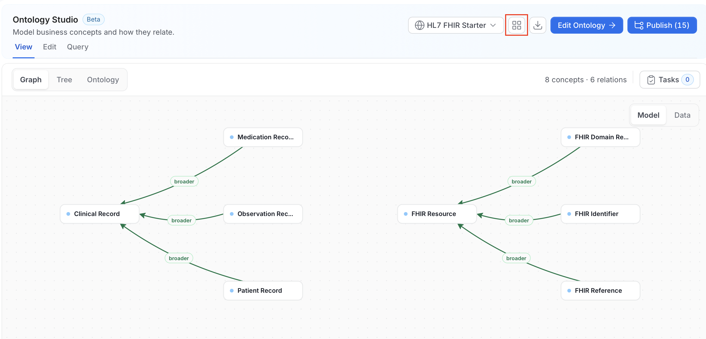
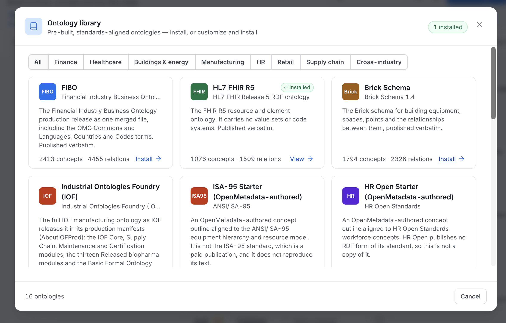
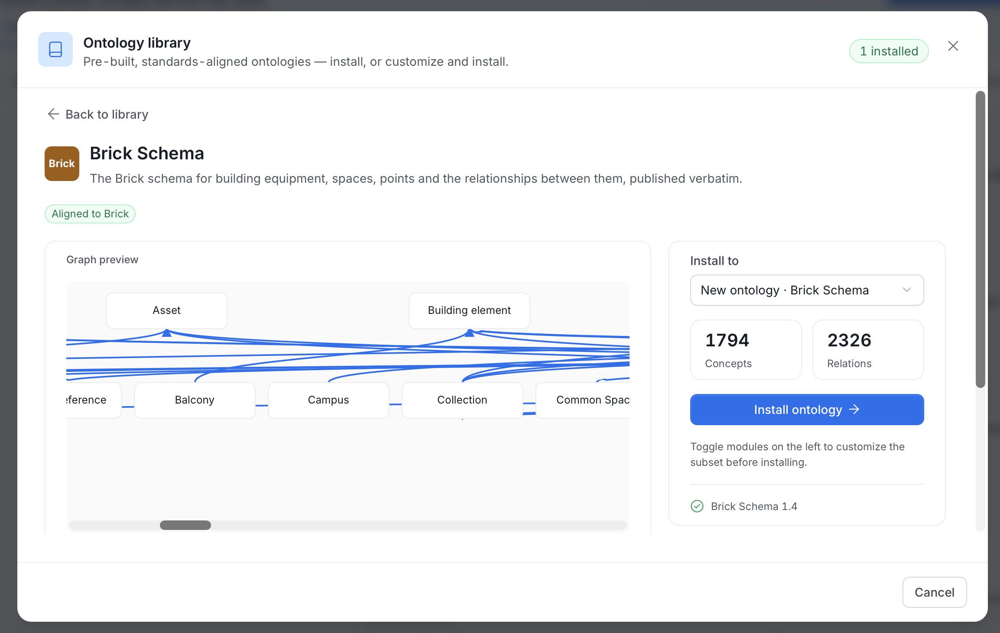
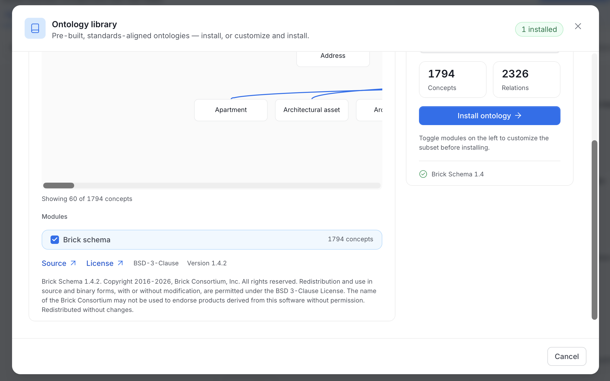
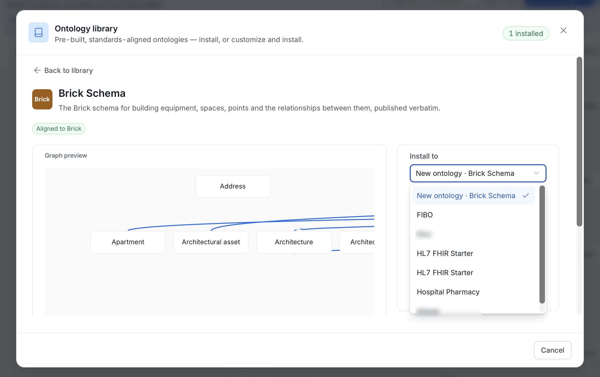

# Ontology Library

Most organizations don't need to invent a model of Customer from first principles. Their industry already has one. The **Ontology Library** ships pre-built, standards-aligned packs that you install into an ontology and then adapt.

Open it from the **Library** icon (the grid icon) in the Ontology Studio header. The catalog opens as a dialog named **Ontology library**. It also opens from **Install from library** on the first-run screen.

## What Ships

The library ships 16 packs. Most are the upstream standard, included as published. Two are compact starters authored in-house.

| Pack | Industry | Version | License |
|---|---|---|---|
| **FIBO** | Finance | `2026Q2` | MIT |
| **HL7 FHIR R5** | Healthcare | `5.0.0` | CC0 1.0 |
| **GS1 Web Vocabulary** | Retail | `1.18` | Apache License 2.0 |
| **GS1 EPCIS 2.0 and CBV** | Supply chain | `2.0.1` | No license statement published by GS1. Included pending confirmation. |
| **Industrial Ontologies Foundry (IOF)** | Manufacturing | `Release_202603` | MIT. The BFO module is CC BY 4.0. |
| **ISA-95 Starter** (OpenMetadata-authored) | Manufacturing | `2025Q1-om1` | Apache License 2.0 |
| **HR Open Starter** (OpenMetadata-authored) | HR | `2025Q1-om1` | Apache License 2.0 |
| **Brick Schema** | Buildings & energy | `1.4.2` | BSD-3-Clause |
| **DCAT 3** | Cross-industry | `3` | CC BY 4.0 |
| **Data Privacy Vocabulary (DPV)** | Cross-industry | `2.3` | W3C Software and Document License |
| **FOAF** | Cross-industry | `0.99` | CC BY 1.0 |
| **ODRL 2.2** | Cross-industry | `2.2` | W3C Document License |
| **W3C Organization Ontology** | Cross-industry | `0.8` | Open Data Commons PDDL 1.0 |
| **OWL-Time** | Cross-industry | `2017-04-06` | CC BY 4.0 |
| **PROV-O** | Cross-industry | `2013-04-30` | W3C Software and Document License |
| **SOSA and SSN** | Cross-industry | `2017-10-19` | W3C Software and Document License, or OGC Software License |

<Info>

**Note**: Each pack links to its upstream source when you need the complete specification. Pack versions follow the upstream release, except the two in-house starters, which are deliberately compact subsets rather than full standards.

</Info>

## Installing a Pack

1. Open the library with the **Library** icon in the Studio header.

2. Find a pack.

    - Use the pills to filter by industry: **All**, **Finance**, **Healthcare**, **Buildings & energy**, **Manufacturing**, **HR**, **Retail**, **Supply chain**, or **Cross-industry**.
    - Each card shows the pack name, the standard it aligns to, a short description, and the number of concepts and relations.
    - The footer counts the ontologies in the catalog, for example "16 ontologies".

    

3. Click **Install** on the card you want. The pack page opens. It shows the pack name and description, an **Aligned to** badge with the standard, and a **Graph preview** of the pack's concepts. Click **Back to library** to return to the catalog.

    

4. Choose the modules to install.

    - Packs are split into modules. Each module shows its concept count.
    - Click a module to include it. Its dependencies are selected for you, for example "Requires Core resources". The **Concepts** and **Relations** counts update as you choose.
    - Click a module to see a concept preview. The preview shows at most 60 concepts and says "Showing N of M concepts" when it is truncated.
    - You must select at least one module.
    - Below the modules, the page shows links to the **Source** and the **License**, the license name, the **Version**, and the license text.

    

5. Choose where to install.

    - In **Install to**, pick **New ontology** to create one for the pack, or pick an existing ontology.
    - A new ontology uses the pack name as its display name, gets a generated identifier, and you own it.
    - The concepts keep the IRIs they have in the source standard.
    - The **Concepts** and **Relations** tiles show what the install will add. Beside them, the page reminds you: "Toggle modules on the left to customize the subset before installing."

    

6. Click **Install ontology**.

    - Studio first shows the changes the install would make for review. If it can't load them, it says so and asks you to retry before installing.
    - The install then runs as a background job. The page shows "Preparing the install" and then progress, for example "Installed 3 of 8 parts, 120 of 400 definitions."
    - Studio adds the selected concepts and relations to the ontology as unpublished changes to its draft.

If an install is cancelled or stops, the page says "Install again to continue from where it stopped." Install again to resume.

After the install, the target ontology shows the new concepts and the **Publish** button counts the unpublished changes. Other users don't see the concepts until you [publish a release](/v2.1.x-SNAPSHOT/how-to-guides/ontology/studio/releases).

## Installed Packs

Once a pack is installed, the library shows it.

- A badge in the dialog header counts the installed packs, for example **1 installed**.
- The card of an installed pack shows an **Installed** label, and its action reads **View** instead of **Install**.
- On the pack page, an **Installed in** row links to each ontology that has the pack.

Installing the same version of a pack again adds the modules you select to what is already installed.

## Integrity and Governance

- **Content is checksum-verified.** Every pack records a SHA-256 of its source and of its payload, checked at install time. A tampered or truncated pack fails to install rather than partially applying.
- **Installation is permissioned.** Installing into an existing ontology requires edit permission on it. Installing into a new ontology requires permission to create ontologies. See [Permissions](/v2.1.x-SNAPSHOT/how-to-guides/ontology/studio/ontologies#permissions).
- **Installs go through the release process.** An install changes only the ontology's working draft. Nothing reaches the active release until you publish a release.

## Catalog-only Packs

A pack can be listed but still require independently licensed content before installation. Those show an **External payload required** state in the catalog with the message "This standard remains catalogue-only until independently licensed content is supplied." The metadata is present for planning, without OpenMetadata redistributing content it isn't licensed to ship.

## API

The following endpoints serve the library.

| Endpoint | Purpose |
|---|---|
| `GET /api/v1/ontologyPacks` | List available packs. |
| `GET /api/v1/ontologyPacks/{packId}` | Pack manifest: modules, dependencies, counts, checksums, license. |
| `GET /api/v1/ontologyPacks/{packId}/sample` | Preview selected concepts. Takes `moduleIds`. |
| `POST /api/v1/ontologies/{id}/library/{packId}/summary` | Summarize the selected modules for an ontology. |
| `POST /api/v1/ontologies/{id}/library/{packId}/preview` | Preview the selected modules as draft operations on an ontology. |
| `POST /api/v1/ontologies/{id}/library/{packId}/review` | List the changes an install would make. |
| `POST /api/v1/ontologies/{id}/library/{packId}/install` | Start the install as a background job. |
| `GET /api/v1/ontologies/{id}/library/jobs/{jobId}` | Read the progress of an install job. |
| `PUT /api/v1/ontologies/{id}/library/jobs/{jobId}/cancel` | Cancel an install job. |
| `POST /api/v1/ontologyPacks/{packId}/install` | Install a pack into a new ontology. |
