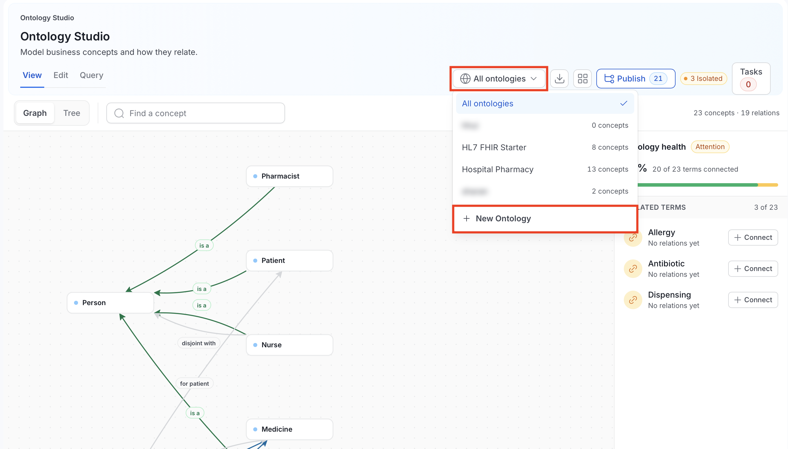
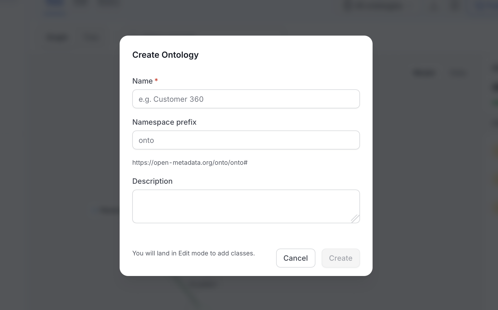
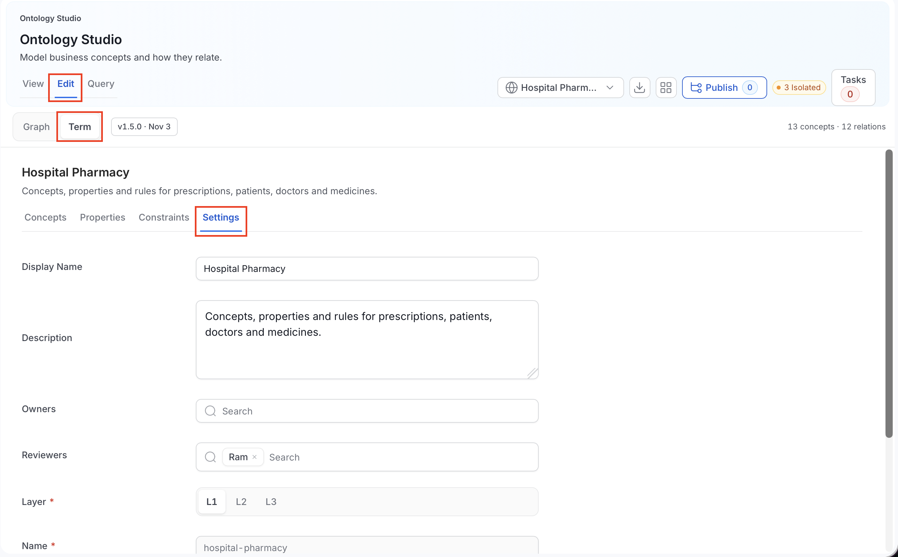

# Ontologies

An ontology is a standalone model that lives in Ontology Studio in its own right. It has its own concepts, properties, and constraints, and it is published as a series of numbered, reviewed [releases](/v2.1.x-SNAPSHOT/how-to-guides/ontology/studio/releases). You don't need a glossary to create one.

<Info>

**Note**: **Query** mode searches the **active release** only. Concepts you have not published yet don't appear in query results.

</Info>

Existing glossaries aren't converted into ontologies. Their terms stay in the glossary.

## Choose an Ontology

The **Ontology selector** is the button at the top right of the Ontology Studio header. It decides what the whole Studio shows.

| Menu item | What it shows |
|---|---|
| **All ontologies** | One combined, read-only graph of every ontology you can see. The Studio opens here by default. |
| An ontology name | That one ontology, with a concept count such as "12 concepts". |
| **New Ontology** | The form for creating an ontology. Shown only if you can create ontologies. |

If the list can't load, the menu shows an error with a **Retry** button.

In the **All ontologies** scope:

- **View** shows the combined graph, with **Graph** and **Tree** surfaces.
- **Edit** and **Query** first ask you to pick a single ontology from a **Select Ontology** list.
- If the catalog has too many concepts for one graph (more than 20 ontologies or 2,000 combined definitions), Studio asks you to select one ontology instead.
- If there are no ontologies yet, you see a **New Ontology** button, when you have permission to create one.

## Create an Ontology

1. Open the Ontology selector and click **New Ontology**. The item appears only if you have permission to create ontologies. See [Permissions](#permissions).

    

2. In the **Create Ontology** dialog, complete the fields. **Create** stays disabled until **Name** is filled in and the namespace preview has loaded.

    | Field | Required | Notes |
    |---|---|---|
    | **Name** | Yes | The name of the ontology, for example Customer 360. You can't change it after saving. |
    | **Namespace prefix** | No | Leave it empty to use the suggested prefix, shown as the placeholder. The suggestion is the name in lowercase, keeping only the letters `a` to `z`, cut to its first 8 characters. It is `onto` when nothing is left. A custom prefix must start with a letter, digit, or underscore, then use letters, digits, dots, hyphens, or underscores. |
    | **Description** | No | What the ontology covers. |

    

    The line under the prefix previews the namespace of the new ontology. It is built as `<base URI>/onto/<prefix>#`, for example `https://open-metadata.org/onto/financec#` for the name Finance Core. The base URI comes from the server's RDF base URI setting (`RDF_BASE_URI`), which defaults to `https://open-metadata.org/`. If the base URI can't be loaded, the dialog shows an error with a **Retry** button.

    If another ontology already uses the namespace, the dialog asks you to change the prefix.

3. Select **Create**. The dialog notes that you land in **Edit** mode to add classes. The new ontology opens there and appears in the selector. You become its owner.

Open the ontology **Settings** to change the display name, layer, owners, and reviewers.

Alternatively, create an ontology by installing a pack from the [Ontology Library](/v2.1.x-SNAPSHOT/how-to-guides/ontology/studio/library), or by importing a file into a new ontology. Those ontologies get a generated identifier of the form `urn:openmetadata:ontology:<id>` instead of the `onto` namespace.

## Edit Ontology Settings

To edit an ontology, follow these steps:

1. Select the ontology in the Ontology selector, then open the **Edit** tab.

2. In the sub-mode bar, select **Term**, then open the **Settings** tab.

    

3. Change the fields you need. **Name** and **Ontology IRI** are locked.

    - **Display Name**: a friendlier label shown in the Studio.
    - **Description**: what the ontology covers.
    - **Owners**: users or teams.
    - **Reviewers**: users or teams who approve releases. You can't submit a release for approval until at least one reviewer is set.
    - **Layer**: **L1**, **L2**, or **L3**. For what the layers mean, see [Ontology Concepts](/v2.1.x-SNAPSHOT/how-to-guides/ontology/concepts).
    - **Ontology IRI**: the permanent, globally unique identifier. An ontology created in the dialog gets `<base URI>/onto/<prefix>`. It must be an absolute IRI.
    - **Namespace**: the prefix OpenMetadata uses to build the IRI of each new concept, property, and constraint. It must be an absolute IRI.

    <Info>

    **What is an IRI?** An IRI (Internationalized Resource Identifier) is a unique, permanent name for a thing, written like a web address or a `urn:` string. It identifies a concept even if you rename it later. IRIs must be absolute, meaning they start with a scheme such as `https:` or `urn:`. A value like `relative/path` is rejected with the message **Enter a valid concept IRI.**

    </Info>

4. Click **Save**. Saving needs edit permission on the ontology.

## Work in an Ontology

With an ontology selected, the Studio modes work on it:

- **View**: read the active model as a **Graph** or **Tree**. See [Explore](/v2.1.x-SNAPSHOT/how-to-guides/ontology/studio/explore).
- **Edit**: add concepts, properties, and constraints, draw relationships, and bind concepts to data assets. See [Author](/v2.1.x-SNAPSHOT/how-to-guides/ontology/studio/author). Each item is saved on its own, and every save is an unpublished change until you publish.
- **Publish**: capture, review, and activate a release. See [Releases](/v2.1.x-SNAPSHOT/how-to-guides/ontology/studio/releases).
- **Query**: search the active release with SPARQL. See [Query](/v2.1.x-SNAPSHOT/how-to-guides/ontology/studio/query).
- **Import / Export**: bring an RDF file in as unpublished changes, or export the active release. See [Import & Export](/v2.1.x-SNAPSHOT/how-to-guides/ontology/studio/import-export).

<Info>

The **Edit** tab appears whenever you have edit permission on ontologies. Your permissions on each item decide which changes are saved. Buttons are disabled when you don't have them.

</Info>

## Permissions

Ontologies use standard OpenMetadata policies. You need the right operation on each type of item.

| To do this | You need |
|---|---|
| See an ontology and its releases | View access (`ViewAll`) on the ontology and on its concepts, properties, and constraints. Data you can't view is left out of lists, diffs, and exports. |
| Create an ontology (**New Ontology**) | `Create` on **Ontology**, or the admin role |
| Change ontology settings | `EditAll` on the ontology |
| Add a concept, property, or constraint | `Create` on **Ontology Concept**, **Ontology Property**, or **Ontology Axiom** |
| Edit one of them | `EditAll` on that item |
| Delete one of them | `Delete` on that item |
| Import a file, install a library pack | `EditAll` on the ontology, plus create or edit rights on each type of item the change touches |
| Capture or activate a release | `EditAll` on the ontology |
| Approve or reject a release | Be one of the ontology's reviewers, and not the person who captured the release |

<Info>

Which roles include these operations depends on your organization's policies. Studio treats an admin as allowed to create ontologies.

</Info>

## Requirements

- **No RDF setup is required** to create, author, publish, import, or export ontologies, or to query their active release. Activating a release does queue an update to the RDF knowledge graph in the background.
- **Releases need an approval workflow.** Publishing a release for review needs a deployed approval workflow with a user approval step.

## REST Endpoints

Paths start with `/api`. For the full reference, see the [Ontology API Reference](/v2.1.x-SNAPSHOT/how-to-guides/ontology/studio/api).

| Path | Access | Notes |
|---|---|---|
| `GET\|POST\|PUT\|PATCH\|DELETE /v1/ontologies`, `/v1/ontologies/{id}`, `/v1/ontologies/name/{fqn}` | Standard entity permissions | Create, read, update, and delete ontologies. `GET` takes `fields`, `limit`, `before`, `after`, and `include`. |
| `/v1/ontologyConcepts`, `/v1/ontologyProperties` | Standard entity permissions | Same entity operations. `GET` takes an `ontology` parameter (the ontology name) to list one ontology's items. |
| `/v1/ontologyAxioms` | Standard entity permissions | Same entity operations. `GET` takes `ontologyId`. |
| `POST /v1/ontologyAxioms/validate` | `Create` on axioms, `ViewAll` on the ontology | Checks a constraint without saving it. |
| `GET\|PUT /v1/ontologyConcepts/{id}/bindings`, `DELETE /v1/ontologyConcepts/{id}/bindings/{assetType}/{assetId}` | Standard entity permissions | Column bindings for a concept. |
| `GET /v1/ontologies/{id}/references?iri=` | View | Finds working definitions that reference an IRI. |
