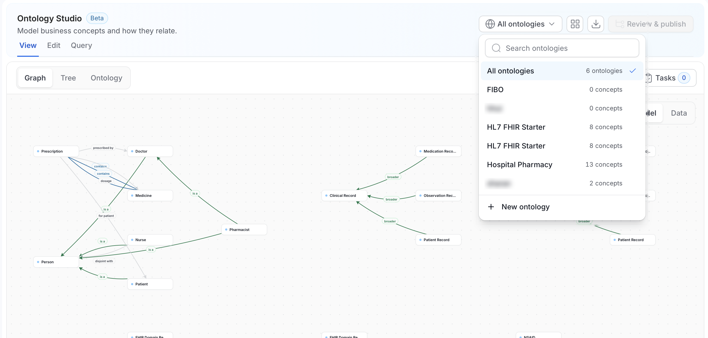
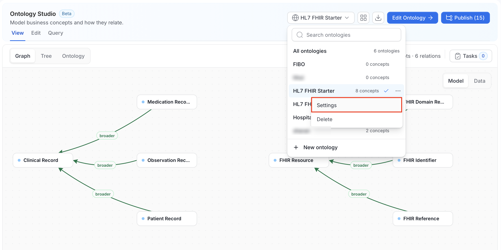
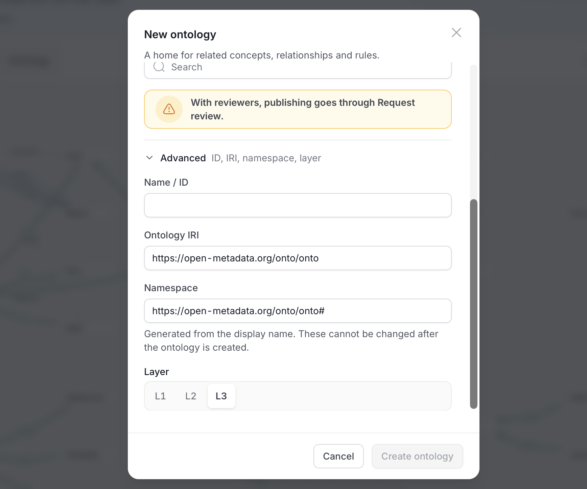
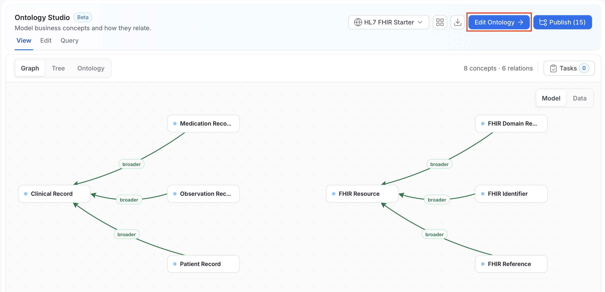
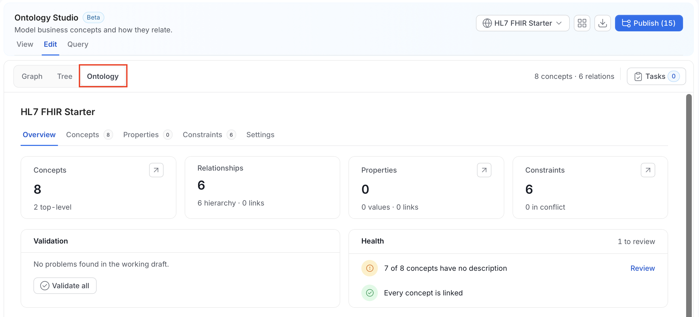
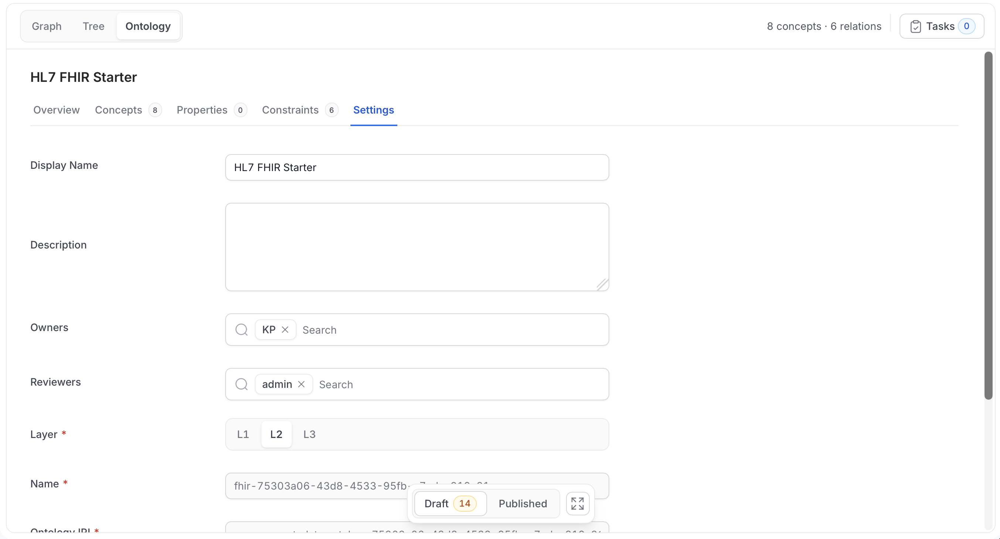

# Ontologies

An ontology is a standalone model that lives in Ontology Studio in its own right. It has its own concepts, properties, and constraints, and it is published as a series of numbered [releases](/v2.1.x-SNAPSHOT/how-to-guides/ontology/studio/releases). You don't need a glossary to create one.

<Info>

**Note**: Users with edit permission read and query the ontology's working **Draft** by default and can switch to the **Published** version. Users without edit permission always read the active published release. Concepts you haven't published don't appear to them. See [Draft and Published Views](/v2.1.x-SNAPSHOT/how-to-guides/ontology/studio#draft-and-published-views).

</Info>

Existing glossaries aren't converted into ontologies. Their terms stay in the glossary.

## Choose an Ontology

The **Ontology selector** is the button at the top right of the Ontology Studio header. It decides what the whole Studio shows.

| Menu item | What it shows |
|---|---|
| **Search ontologies** | Filters the list by name. |
| **All ontologies** | One combined, read-only graph of every ontology you can see. The count next to it is the number of ontologies. Studio opens here by default. |
| An ontology name | That one ontology, with a concept count such as "12 concepts". |
| **New ontology** | The dialog for creating an ontology. Shown only if you can create ontologies. |

Hover an ontology row to show its **More actions** menu, which has **Settings** and **Delete**.

If the list can't load, the menu shows an error with a **Retry** button.

In the **All ontologies** scope:

- **View** shows the combined graph, with **Graph** and **Tree** surfaces.
- **Edit** and **Query** first ask you to pick a single ontology.
- If the catalog has too many concepts for one graph (more than 20 ontologies or 2,000 combined definitions), Studio asks you to pick one ontology instead.

### First Run

If there are no ontologies yet, Studio shows **No ontologies yet** with three cards: **Install from library**, **Import a file**, and **Create from scratch**. See [First Run](/v2.1.x-SNAPSHOT/how-to-guides/ontology/studio#first-run).

## Create an Ontology

1. Open the Ontology selector and click **New ontology**. The item appears only if you can create ontologies. See [Permissions](#permissions). On the first-run screen, click **Create from scratch** instead.

    

2. In the **New ontology** dialog, complete the fields. **Create ontology** stays disabled until **Display name** is valid and the namespace has loaded.

    | Field | Required | Notes |
    |---|---|---|
    | **Display name** | Yes | The name people see, for example Customer 360. It can have up to 256 characters and can't contain double quotes, `>`, `::`, or control characters. |
    | **Description** | No | What the ontology covers. |
    | **Owners** | No | Users or teams that own the ontology. You are added as an owner automatically. |
    | **Reviewers** | No | Users or teams who review releases. If you set reviewers, publishing goes through **Request review**. If you set none, authors publish directly. See [Releases](/v2.1.x-SNAPSHOT/how-to-guides/ontology/studio/releases). |

    

3. Optional: Expand **Advanced** to review or change the generated identifiers.

    | Field | Notes |
    |---|---|
    | **Name / ID** | Generated from the display name in lowercase, with hyphens between words. It can't change after you create the ontology. If no ID can be made from the name, enter one made of letters and digits. |
    | **Ontology IRI** | The permanent, globally unique identifier. It is built as `<base URI>/onto/<prefix>`. It must be an absolute IRI. |
    | **Namespace** | The IRI prefix for each new concept, property, and constraint. It is the ontology IRI followed by `#`. If another ontology already uses it, the dialog asks you to change it. |
    | **Layer** | **L1**, **L2**, or **L3**. The default is **L3**. For what the layers mean, see [Ontology Concepts](/v2.1.x-SNAPSHOT/how-to-guides/ontology/concepts). |

    

    The prefix is the first 8 letters and digits of the display name, in lowercase. It is `onto` when nothing is left. If another ontology already uses it, Studio appends a number. For the name Finance Core, the IRI is `https://open-metadata.org/onto/financec`. The base URI comes from the server's RDF base URI setting (`RDF_BASE_URI`), which defaults to `https://open-metadata.org/`. If the base URI can't be loaded, the dialog shows an error with a **Retry** button.

    <Info>

    **Note**: **What is an IRI?** An IRI (Internationalized Resource Identifier) is a unique, permanent name for a thing, written like a web address or a `urn:` string. It identifies a concept even if you rename it later. IRIs must be absolute, meaning they start with a scheme such as `https:` or `urn:`. A value like `relative/path` is rejected with the message **Enter a valid concept IRI.**

    </Info>

4. Click **Create ontology**. The new ontology opens in **Edit** mode, appears in the selector, and Studio prompts you to add the first concept.

Alternatively, create an ontology by installing a pack from the [Ontology Library](/v2.1.x-SNAPSHOT/how-to-guides/ontology/studio/library), or by importing a file into a new ontology. Those ontologies get a generated identifier of the form `urn:openmetadata:ontology:<id>` instead of the `onto` namespace.

## Edit Ontology Settings

To edit an ontology's settings, use either of the following methods.

**From the Ontology selector**

1. Click the Ontology selector in the header.
2. Hover the ontology row, click **More actions**, and then click **Settings**. The **Ontology settings** dialog opens.

    

**From Edit mode**

1. Pick the ontology in the Ontology selector.
2. In **View** mode, click **Edit Ontology**. Alternatively, click the **Edit** tab.

    

3. In the sub-mode bar, click **Ontology**.

    

4. Click the **Settings** tab. The fields appear on the page instead of in a dialog.

    

## Delete an Ontology

Deleting an ontology removes it together with its concepts, properties, relationships, rules, and releases. It leaves the ontology list immediately.

1. Hover the ontology row in the selector, click **More actions**, and click **Delete**. The item is disabled if you don't have `Delete` on the ontology.

2. In the **Delete ontology** dialog, review the counts of concepts and releases that will be removed.

3. Type the ontology name to confirm, then click **Delete**.

## Work in an Ontology

With an ontology selected, the Studio modes work on it:

- **View**: Read the model as a **Graph**, **Tree**, or **Ontology** view. See [Explore](/v2.1.x-SNAPSHOT/how-to-guides/ontology/studio/explore).
- **Edit**: Add concepts, properties, and constraints, draw relationships, and bind concepts to data assets. See [Author](/v2.1.x-SNAPSHOT/how-to-guides/ontology/studio/author). Each item is saved on its own, and every save is an unpublished change to the draft until you publish.
- **Publish**: Publish a release, or request a review. See [Releases](/v2.1.x-SNAPSHOT/how-to-guides/ontology/studio/releases).
- **Query**: Search the ontology with SPARQL. See [Query](/v2.1.x-SNAPSHOT/how-to-guides/ontology/studio/query).
- **Import / Export**: Bring an RDF or CSV file in as unpublished changes, or export the draft or a release. See [Import & Export](/v2.1.x-SNAPSHOT/how-to-guides/ontology/studio/import-export).

The **Ontology** view shows an overview of the selected ontology: counts of concepts, relationships, properties, and constraints, a **Validation** summary with **Validate all**, a **Health** summary of concepts without a description or without a link, and the version, namespace, owners, and reviewers. See [Explore](/v2.1.x-SNAPSHOT/how-to-guides/ontology/studio/explore#ontology).

<Info>

**Note**: The **Edit** tab appears whenever you have edit permission on ontologies. Your permissions on each item decide which changes are saved. Buttons are disabled when you don't have them.

</Info>

## Permissions

Ontologies use standard OpenMetadata policies, plus two seeded roles. **OntologyAuthor** lets a user create ontologies and publish releases. **OntologyReviewer** lets a user be listed as a reviewer and decide review tasks. The **DataSteward** role includes both. Being listed as a reviewer doesn't give write access.

| To do this | You need |
|---|---|
| See an ontology and its releases | View access (`ViewAll`) on the ontology and on its concepts, properties, and constraints. Data you can't view is left out of lists, diffs, and exports. |
| Read the working draft | Edit permission on the ontology. Other users read the published release. |
| Create an ontology (**New ontology**) | `Create` on **Ontology**, plus the **OntologyAuthor** role, or the admin role |
| Change ontology settings | `EditAll` on the ontology |
| Delete an ontology | `Delete` on the ontology |
| Add a concept, property, or constraint | `Create` on **Ontology Concept**, **Ontology Property**, or **Ontology Axiom** |
| Edit one of them | `EditAll` on that item |
| Delete one of them | `Delete` on that item |
| Import a file, install a library pack | `EditAll` on the ontology, plus create or edit rights on each type of item the change touches |
| Publish a release or request a review | `EditAll` on the ontology and the **OntologyAuthor** role. Only an author or owner can publish. |
| Approve or request changes on a release | Be one of the ontology's reviewers, with the **OntologyReviewer** role. You can't review a release you requested. |

<Info>

**Note**: Which roles include these operations depends on your organization's policies. Studio treats an admin as allowed to create ontologies.

</Info>

If you lack the role, the dialog explains: "You do not have permission to create ontologies. An admin can grant you the OntologyAuthor role."

## Requirements

- **No RDF setup is required** to create, author, publish, import, or export ontologies, or to query them. Publishing a release does queue an update to the RDF knowledge graph in the background.
- **Reviewed releases need an approval workflow.** When an ontology has reviewers, a review request needs a deployed approval workflow with a user approval step. Ontologies with no reviewers publish directly and don't need one.

## REST Endpoints

Paths start with `/api`. For the full reference, see the [Ontology API Reference](/v2.1.x-SNAPSHOT/how-to-guides/ontology/studio/api).

| Path | Access | Notes |
|---|---|---|
| `GET\|POST\|PUT\|PATCH\|DELETE /v1/ontologies`, `/v1/ontologies/{id}`, `/v1/ontologies/name/{fqn}` | Standard entity permissions | Create, read, update, and delete ontologies. `GET` takes `fields`, `limit`, `before`, `after`, and `include`. |
| `/v1/ontologyConcepts`, `/v1/ontologyProperties` | Standard entity permissions | Same entity operations. `GET` takes an `ontology` parameter (the ontology name) to list one ontology's items. |
| `/v1/ontologyAxioms` | Standard entity permissions | Same entity operations. `GET` takes `ontologyId`. |
| `POST /v1/ontologyAxioms/validate` | `Create` on axioms, `ViewAll` on the ontology | Checks a constraint without saving it. |
| `GET\|PUT /v1/ontologyConcepts/{id}/bindings`, `DELETE /v1/ontologyConcepts/{id}/bindings/{assetType}/{assetId}` | Standard entity permissions | Column bindings for a concept. |
| `GET /v1/ontologies/{id}/references?iri=` | View | Finds working definitions that reference an IRI. |
| `GET /v1/ontologies/{id}/working/validation` | Edit permission | Validates the working draft. |
| `GET /v1/ontologies/reviews` | Standard entity permissions | Lists review tasks. Filter with `view=assigned\|created\|pending` and `ontologyId`. |
