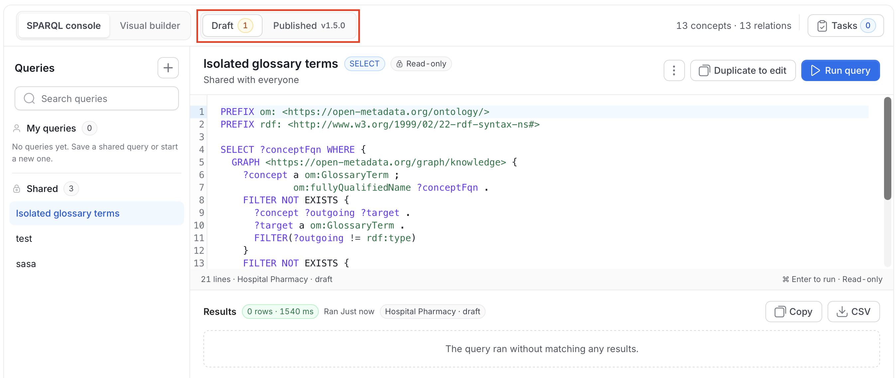
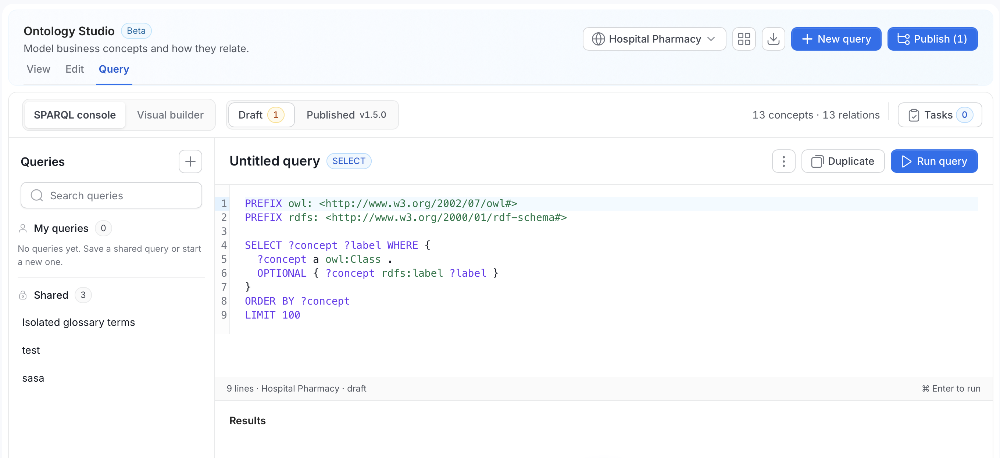
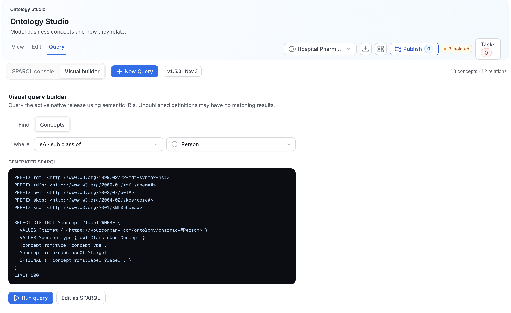
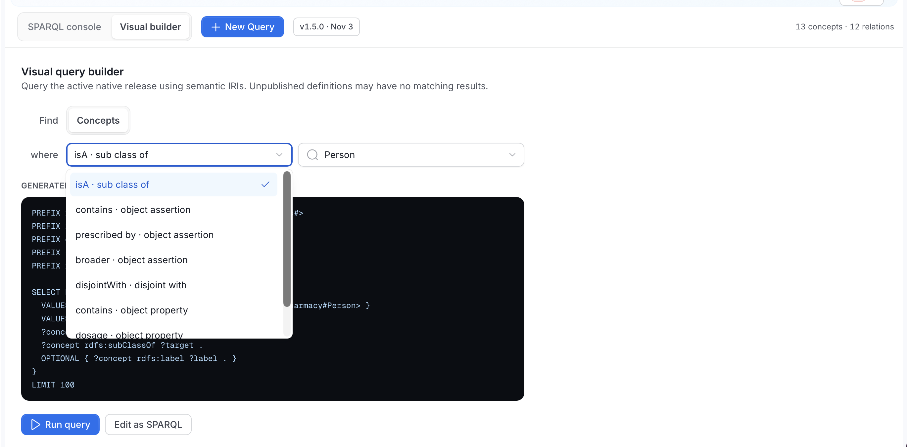
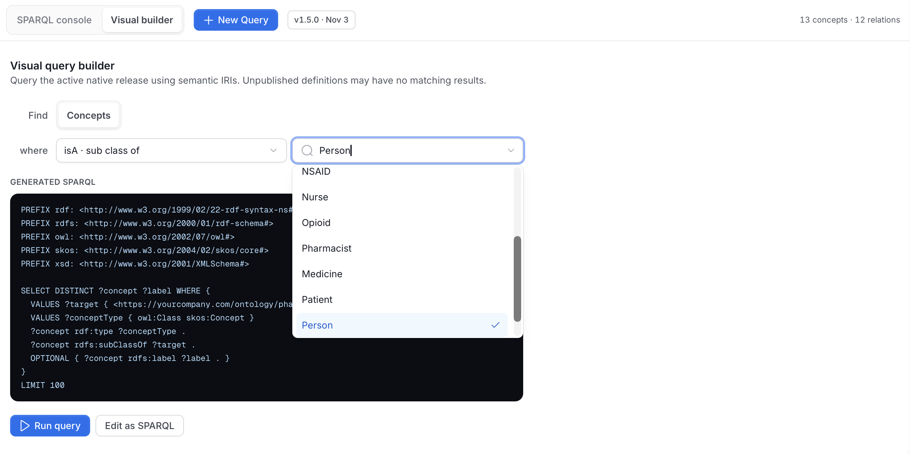
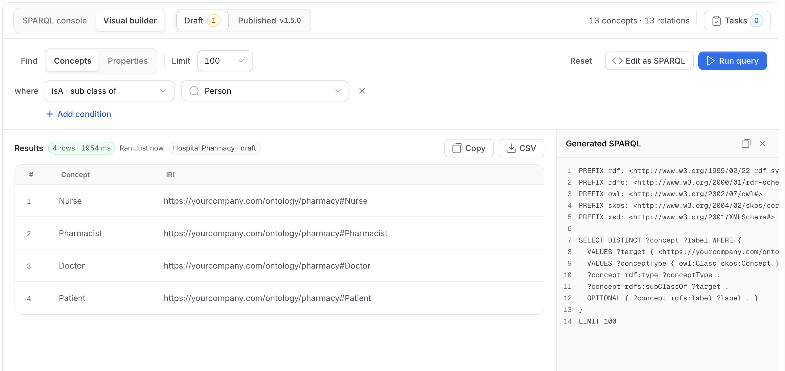

# Query Mode

Query mode is where the model earns its keep. A graph canvas shows you shape, and a query answers a question.

Two surfaces share the sub-mode bar: the **SPARQL console** and the **Visual builder**. Both query one version of the selected ontology at a time. The version chip next to the surfaces shows which one: **Draft** or **Published** with its version, such as **v1.5.0**.

## Choose the Version to Query



- **Draft**: The working version, including unpublished changes. The number is the count of unpublished changes. Only users with edit permission can query the draft.
- **Published**: The active release, for example **v1.5.0**. Concepts you haven't published don't appear in these results.

Users without edit permission always query the **Published** release. The results area names the version a query ran against, for example **Hospital Pharmacy · draft**, and the editor footer shows the same scope.

To make an edit visible to everyone's queries, [publish a release](/v2.1.x-SNAPSHOT/how-to-guides/ontology/studio/releases).

## Open Query Mode

1. Pick the ontology you want to query in the Ontology selector. With **All ontologies** selected, **Query** first asks you to pick one ontology.

2. Click the **Query** tab.

3. Click **SPARQL console** or **Visual builder**.

Querying an ontology doesn't need the RDF knowledge graph. The query runs against `POST /api/v1/ontologies/{id}/sparql`, with `scope=release` (the default) or `scope=draft`. Any user with view access on every member of the active release can query the release. Querying the draft needs edit permission on the ontology.

## The SPARQL Console

The SPARQL console is where you write, save, and run SPARQL queries.



### The Queries Panel

The left panel is headed **Queries**. Click the **+** button to start a new query, or use **Search queries** to filter the list. It holds two groups:

- **My queries**: Your private library, visible only to you. An empty library shows "No queries yet. Save a shared query or start a new one." Hover a query to rename, duplicate, or delete it.
- **Shared**: Read-only queries available to everyone on this ontology. Everyone can read and run them, and only admins can create, update, or delete them with **Save as sample query**. The built-in starters that query glossary terms are hidden here, because an ontology doesn't hold glossary terms.

### Run a Query

1. Click **New query** in the header, or the **+** button in the panel. It opens an untitled query with a starter scaffold:

    ```sparql
    PREFIX owl: <http://www.w3.org/2002/07/owl#>
    PREFIX rdfs: <http://www.w3.org/2000/01/rdf-schema#>

    SELECT ?concept ?label WHERE {
      ?concept a owl:Class .
      OPTIONAL { ?concept rdfs:label ?label }
    }
    ORDER BY ?concept
    LIMIT 100
    ```

2. Edit the query, or click a saved one in the panel.

3. Click **Run query**, or press `Cmd+Enter` (`Ctrl+Enter` on Windows and Linux). Until you run it, the results area is empty.

The footer under the editor shows the line count, the ontology and version the query will run against, for example "9 lines · Hospital Pharmacy · draft", and the shortcut.

### Read the Results

After a run, the **Results** header shows the row count and run time, for example **4 rows · 1954 ms**, when it ran, and the version it ran against.

- **Copy**: Copies the results.
- **CSV**: Downloads the results as a CSV file.
- **Table** and **Graph**: For queries that return graph data, switch between a table and a graph view.
- If a query matches nothing, the area says "The query ran without matching any results."

### Saving Queries

The title row above the editor shows the query name, its type (for example **SELECT**), and where it lives. The buttons depend on what you opened.

| You opened | What you see | Actions |
|---|---|---|
| An untitled query | **Untitled query** | **Duplicate**, **Run query**. In the three-dot menu: **Save as my query**, and **Save as sample query** for admins. |
| One of your queries | The query name, "Only visible to you" | **Save** (reads **Saved** when nothing changed), **Duplicate**, a delete icon, **Run query**. In the three-dot menu: **Save as new**, **Save as sample query** for admins, and **Discard**. |
| A shared query | The query name, a **Read-only** badge, "Shared with everyone" | **Duplicate to edit**, **Run query**. |

When you edit a shared query, an **Unsaved changes** badge appears and a banner explains that your changes stay local until you save them as your own query. Use **Discard** to drop your edits, or **Save as my query** to keep them.

When you save a query, a dialog asks you to name it.

### Limits and Read-Only Rules

- **Read-only**: The console rejects `INSERT`, `DELETE`, `DROP`, `LOAD`, `CLEAR`, and `CREATE`.
- **No federation**: The console refuses `SERVICE`, including `SERVICE` nested inside `EXISTS`.
- **Format**: `SELECT` and `ASK` results as JSON (default), CSV, TSV, or XML. `CONSTRUCT` and `DESCRIBE` results as Turtle, JSON-LD, N-Triples, or RDF/XML.

Every catalog-wide SPARQL read runs behind an admission guard with hard limits, so one expensive query can't take the triple store down:

| Limit | Value |
|---|---|
| Default result limit | 1,000 rows |
| Maximum result limit | 10,000 rows |
| Maximum query length | 100,000 characters |
| Maximum output | 10 MB |
| Query timeout | 30 seconds |
| Global concurrency | 8 concurrent queries |
| Per-principal concurrency | 2 concurrent queries |

The limits above apply to catalog-wide queries. Ontology queries run in a separate, isolated process with their own memory and size limits, and one query at a time is admitted across the server. If an ontology is too large to load for a query, the request fails with an error that says so. Queries that exceed capacity or the timeout fail with an explicit error rather than degrading everyone else's latency.

## The Visual Builder

Not everyone writing governance questions wants to write SPARQL. The visual builder composes a query from choices and compiles it live. It queries the version selected in the version chip.



1. Open the **Visual builder** tab. Under **Find**, choose **Concepts** or **Properties**. **Limit** sets the maximum number of rows, which starts at `100`.

2. Under **where**, choose a condition. The list shows each relationship in the ontology with its kind, for example **isA · sub class of**, **contains · object assertion**, **broader · object assertion**, **disjointWith · disjoint with**, and **dosage · object property**.

    

3. Choose the target concept. Type in the box to search the list.

    

4. Optional: Click **Add condition** to combine another condition. Click the **x** beside a condition to remove it, or click **Reset** to start over.

5. Read the **Generated SPARQL** panel. It updates as you change the choices and uses the standard `rdf`, `rdfs`, `owl`, `skos`, and `xsd` prefixes and the full IRI of the target concept. Click the copy icon to copy it, or the close icon to hide the panel.

6. Click **Run query** to run it in place. The results appear in a table.

    

7. Optional: Click **Edit as SPARQL** to hand the generated query to the console.

**Edit as SPARQL** is the fastest way to learn SPARQL against your own model: build the query visually, then read what it produced. For **isA · sub class of** with the target **Person**, it generates:

```sparql
PREFIX rdf: <http://www.w3.org/1999/02/22-rdf-syntax-ns#>
PREFIX rdfs: <http://www.w3.org/2000/01/rdf-schema#>
PREFIX owl: <http://www.w3.org/2002/07/owl#>
PREFIX skos: <http://www.w3.org/2004/02/skos/core#>
PREFIX xsd: <http://www.w3.org/2001/XMLSchema#>

SELECT DISTINCT ?concept ?label WHERE {
  VALUES ?target { <https://yourcompany.com/ontology/pharmacy#Person> }
  VALUES ?conceptType { owl:Class skos:Concept }
  ?concept rdf:type ?conceptType .
  ?concept rdfs:subClassOf ?target .
  OPTIONAL { ?concept rdfs:label ?label . }
}
LIMIT 100
```

## Query the Whole Catalog

Queries against the whole knowledge graph, including entities, tags, and lineage, are separate from ontology queries. They need RDF enabled, run against `POST /api/v1/rdf/sparql`, and are for admins only. For more information, see [Enable RDF (Knowledge Graph)](/v2.1.x-SNAPSHOT/how-to-guides/ontology/enable).

A separate **SPARQL Playground** (marked **Beta**) is available at `/governance/sparql`, without the Studio chrome. It isn't in the left navigation, so navigate to it directly. It has **Saved queries** and **Installation queries** lists, an **Inject prefixes** option, a **Format** selector, an **Inference** selector (**None**, or **Custom** when materialized inference is enabled), and a **Download** option for results. It shares the same limits and runs against the catalog-wide endpoint.

<Warning>

**Breaking change in 2.1.** The `rdfs` and `owl` inference levels were removed along with the in-process reasoner. Saved queries and scripts that request them now fail with `503`. Switch them to `none`, or to `custom` if you enabled materialized inference. The Playground lists only the levels the server reports as available, and only **None** if it cannot read the status.

</Warning>

More recipes, such as PII propagation, lineage traversal, coverage gaps, and contract checks, are in the [SPARQL cookbook](/v2.1.x-SNAPSHOT/how-to-guides/ontology/knowledge-graph/sparql#cookbook).
