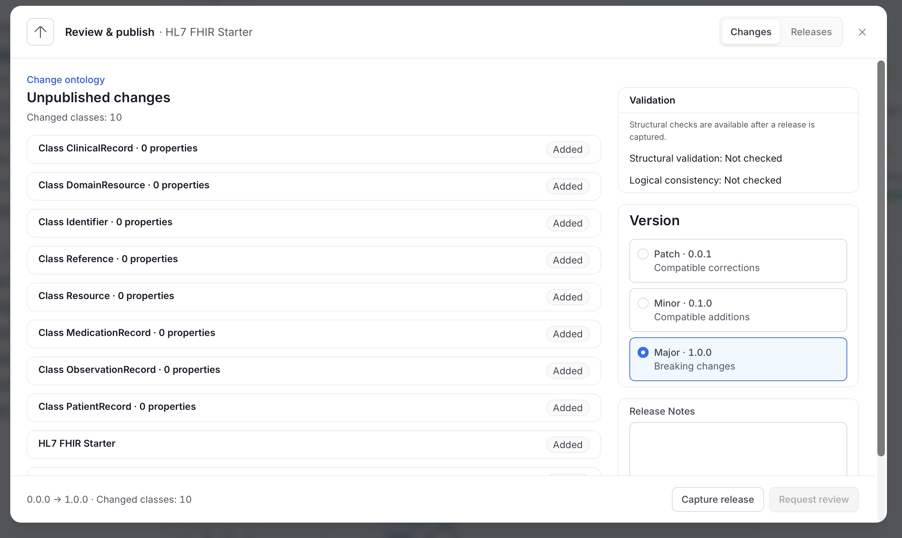
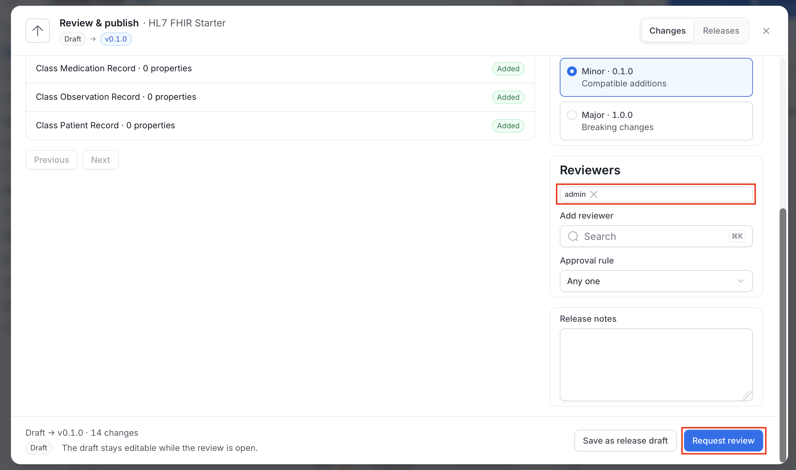
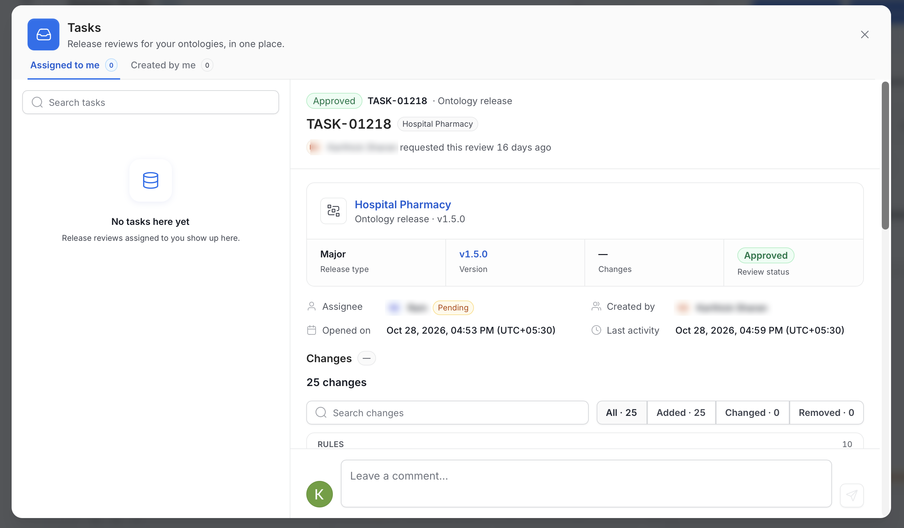
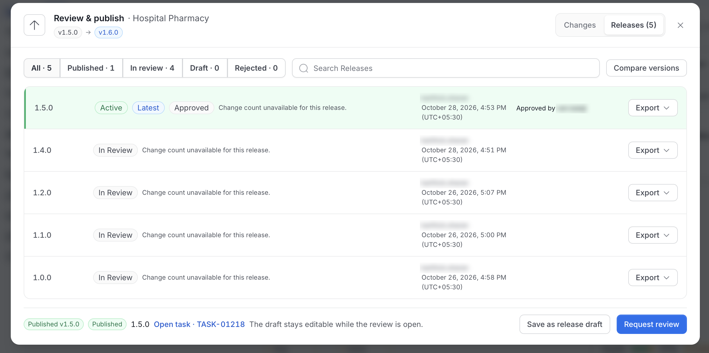
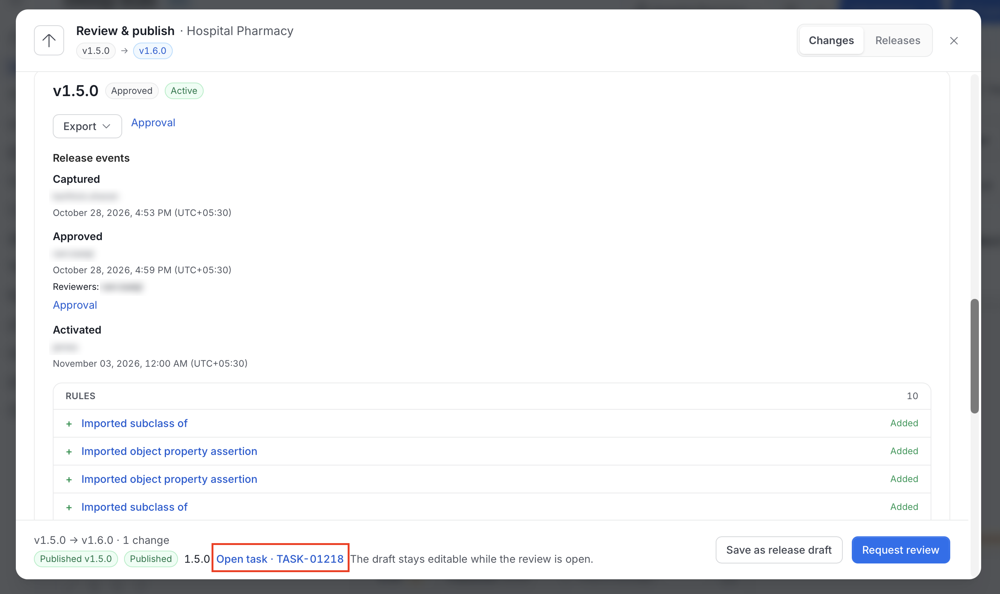
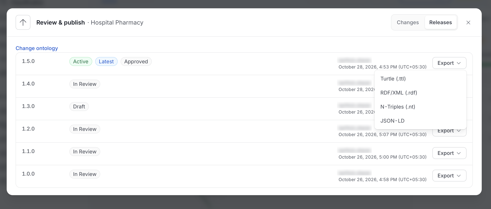

# Ontology Releases

Editing an ontology doesn't change what other users see. Edits collect as **unpublished changes** on the working **Draft**. **Publishing** turns them into a **release**: a frozen, numbered snapshot that can't change afterward. Only one release is **Active** at a time. The active release is what users without edit permission read and query, and what the knowledge graph uses.

How a release goes live depends on whether the ontology has reviewers:

- **No reviewers**: An author or owner clicks **Publish**, and the release goes live immediately. The release is recorded as published without review.
- **One or more reviewers**: The author clicks **Request review**. Reviewers approve or reject the release in the **Tasks** drawer. After approval, an author or owner clicks **Publish** to make the release live.

Set reviewers when you [create the ontology](/v2.1.x-SNAPSHOT/how-to-guides/ontology/studio/ontologies#create-an-ontology) or in its [settings](/v2.1.x-SNAPSHOT/how-to-guides/ontology/studio/ontologies#edit-ontology-settings).

## Open the Review & Publish Dialog

Click **Publish** in the Studio header. The number in parentheses, as in **Publish (15)**, shows how many changes are waiting.

- With one ontology selected, **Publish** opens the **Review & publish** dialog for that ontology.
- With **All ontologies** selected, the button reads **Review & publish** and is disabled. Choose an ontology first.

The dialog also opens from **Review & publish** on the ontology's **Overview** tab.

The dialog has two tabs: **Changes** and **Releases**. The header shows the version path, for example from **Draft** to **v0.1.0**.

## The Changes Tab

The **Changes** tab lists the unpublished changes and is where you publish a release or request a review.

### Review the Changes

The summary line, for example "14 changes: 8 concepts, 6 rules", shows how much changed. Below it:

- **Search changes**: Filters the list by name.
- **All**, **Added**, **Changed**, and **Removed**: Filter by type of change. Each shows its count.
- **Change cards**: Changes are grouped under **Concepts**, **Properties**, **Relationships**, **Rules**, and **Ontology settings**. Each row shows the item, for example "Class Clinical Record · 0 properties", and whether it was **Added**, **Changed**, or **Removed**.
- **Previous** and **Next**: Page through the list.

### Check Validation

The **Validation** panel checks the working draft before any release is captured:

- **Structural validation**: Whether the ontology is well formed. It reads **Passed** or **Failed**. A failure blocks publishing, with the message "Fix these to publish."
- **Logical consistency**: **Not checked**. Studio checks that the ontology is well formed, but it doesn't prove that the rules are free of contradictions.

For a captured release, the panel also shows:

- **SHACL validation**: The number of violations and warnings found by the built-in ontology shapes. This check doesn't need a triple store.
- **Deprecation impact**: The bound assets, subclasses, and properties that still use a deprecated concept.

### Choose a Version

The **Version** panel offers three increments. It shows the resulting number next to each choice.

| Choice | When to use it | Example |
|---|---|---|
| **Patch** | Compatible corrections | `1.2.0` becomes `1.2.1` |
| **Minor** | Compatible additions | `1.2.0` becomes `1.3.0` |
| **Major** | Breaking changes | `1.2.0` becomes `2.0.0` |

Studio preselects an increment from your changes: removals suggest **Major**, additions suggest **Minor**, and edits suggest **Patch**. Choose a different one if needed. Studio bases the new version on the active release.

For the first release, **Minor** is preselected and gives `v0.1.0`. A note explains that `v0.1.0` starts the unstable `0.x` line, and that **Major** gives `v1.0.0` as the stable release.

### Set Reviewers

The **Reviewers** panel lists the people who will review the release. It appears when the ontology has reviewers.

- **Reviewers**: The current reviewers appear as chips. Click the **x** on a chip to remove one.
- **Add reviewer**: Search for a user or team to add.
- **Approval rule**: Choose how many reviewers must approve.
    - **Any one**: One approval is enough.
    - **All**: Every reviewer must approve.

Reviewers and the approval rule are locked while a review is open. The panel then reads "Reviewers and approval rule are locked by review {version}."

If you are the only reviewer, **Request review** is disabled with the message "You are the only reviewer. Add another reviewer, or remove yourself to publish without review."

### Add Release Notes

Use **Release notes** to explain what changed, up to 16,384 characters. The notes are kept with the release.

### Publish or Request Review

The footer shows the version path and the number of changes, for example "Draft → v0.1.0 · 14 changes", with a status message. Which buttons you see depends on the ontology's reviewers and the state of the release.

| Situation | Message in the footer | Button |
|---|---|---|
| No reviewers | "No reviewers set. Publishing makes this version live for everyone." | **Publish v0.1.0** publishes the release immediately. |
| Reviewers set | "The draft stays editable while the review is open." | **Request review** sends the release to the reviewers. |
| Review in progress | "Waiting for {reviewers}." Shows progress, for example "1 of 2 approved." | **Withdraw request**, visible to the person who requested the review. **Publish** is disabled. |
| Approved | "Approved by {reviewers} · ready to publish" | **Publish**, enabled for authors and owners only. |
| Reviewer requested changes | The reviewer's reason | **Request review again**, available after you edit the ontology. |

**Save as release draft** is available in each case. It saves the version as a release in **Draft** status without publishing or requesting review. If nothing changed since the saved draft, Studio tells you it is the same draft.

Withdrawing a request returns the release to **Draft**.

## The Tasks Drawer

Review requests appear in the **Tasks** drawer. Click **Tasks** in the Studio header to open it. The badge shows your open tasks.

The drawer has two tabs:

- **Assigned to me**: Review requests where you are a reviewer.
- **Created by me**: Review requests you submitted.

Use **Search tasks** to filter either list. Click a task to open its details:

- **Task header**: The review status, the task ID such as `TASK-01218`, the ontology name, and who requested the review and when.
- **Release summary**: The release type, version, number of changes, and review status.
- **People and dates**: The **Assignee** with their status, **Created by**, **Opened on**, and **Last activity**.
- **Changes**: The same searchable change list as in the **Changes** tab.
- **Comments**: A comment thread. Type in **Leave a comment...** and send.

If you are a reviewer on an open task, you also see the decision buttons:

- **Approve**: Records your approval. With the approval rule set to **All**, the release is approved when every reviewer approves.
- **Approve & publish**: Appears when you are also allowed to publish. It approves the release and makes it active in one step.
- **Reject**: Asks for a reason, then returns the release to the author with the reviewer's reason.

On the ontology canvas, banners keep everyone informed. Reviewers see **Review now**, and authors see **View task** and the number of reviews in progress. When a reviewer rejects a release, the author sees "{reviewer} rejected {version}: {reason}." Edit the ontology, then click **Request review again**.

## The Releases Tab

The **Releases** tab lists every release of the ontology, newest first.

The header shows the number of releases, as in **Releases (5)**. The toolbar has:

- **Filters**: **All**, **Published**, **In review**, **Draft**, and **Rejected**, each with its count. **Rejected** lists releases where a reviewer asked for changes.
- **Search Releases**: Filters by version or name.
- **Compare versions**: Choose a **From version** and a **To version** to see what changed between two releases.

Each row shows:

- The version, for example `1.5.0`.
- Badges for **Active** and **Latest**, and the release status.
- A summary of the changes, or "Change count unavailable for this release." for releases created before change counts were recorded.
- Who created the release and when.
- Who approved it, for example "Approved by ram.balaji".
- An **Export** menu for that release.

The footer shows the state of the release you are working on, with a link to its open task, for example **Open task · TASK-01218**.

### Release Statuses

A release moves through the following statuses.

| Status | Meaning |
|---|---|
| **Draft** | Saved but not yet published or submitted for review. |
| **In review** | A review task is open for the ontology's reviewers. |
| **Changes requested** | A reviewer rejected it. Edit the ontology and request review again. |
| **Approved** | The required reviewers approved it. An author or owner can publish it. |
| **Published** | It is live. The **Active** badge marks the release that is currently live. |

### Release Details

Click a release to see its details.

- **Version and badges**: The version with its status, for example **Approved** and **Active**.
- **Export**: Download the release. For more information, see [Export a Release](#export-a-release).
- **Approval**: A link to the release's review task.
- **Release events**: A log of what happened to the release, with who did it and when. Events include **Captured**, **Review requested**, **Review withdrawn**, **Approved**, **Rejected**, and **Activated**. Approved events list the reviewers.
- **Changes**: The items in the release, grouped by type, with a before and after view of each item's definition.

### Activate and Roll Back

Publishing a release makes it the active one. To go back to an earlier version, open an older **Approved** release and click **Activate release**, or click **Roll back to {version}**, and confirm. The newer releases stay in the list and can be activated again.

Activation queues an update to the RDF knowledge graph in the background.

## Export a Release

Every row in the **Releases** tab has an **Export** menu, to download any release, not only the active one.

| Format | File |
|---|---|
| **Turtle (.ttl)** | `.ttl` |
| **RDF/XML (.rdf)** | `.rdf` |
| **N-Triples (.nt)** | `.nt` |
| **SKOS / Turtle** | `.ttl` |
| **CSV** | `.csv` |
| **JSON-LD** | `.jsonld` |

To export the working draft, to run SHACL checks before you download, or to import a file, use [Import & Export](/v2.1.x-SNAPSHOT/how-to-guides/ontology/studio/import-export).

## Permissions

The following permissions apply to releases.

| To do this | You need |
|---|---|
| See releases | View access (`ViewAll`) on the ontology and on its concepts, properties, and constraints. Data you can't view is left out of lists, diffs, and exports. |
| Save a release draft, request a review, or publish | `EditAll` on the ontology and the **OntologyAuthor** role. Only an author or owner can publish. |
| Activate or roll back a release | `EditAll` on the ontology |
| Approve or reject | Be one of the ontology's reviewers, with the **OntologyReviewer** role. You can't review a release you requested. |
| Withdraw a review request | Be the person who requested the review |

If you lack the role, Studio shows "You need the OntologyAuthor role to capture or publish a release. An admin can grant it." For more information, see [Ontologies](/v2.1.x-SNAPSHOT/how-to-guides/ontology/studio/ontologies#permissions).

## Requirements

An ontology with reviewers needs a deployed approval workflow with a user approval step. If the workflow is missing or suspended, Studio can't submit a release for review. An ontology with no reviewers publishes directly and doesn't need the workflow.

## REST Endpoints

Paths start with `/api`. For the full reference, see the [Ontology API Reference](/v2.1.x-SNAPSHOT/how-to-guides/ontology/studio/api).

| Path | Access | Notes |
|---|---|---|
| `GET /v1/ontologies/{id}/state` | View | Working and activation revision numbers, and the active release. |
| `GET /v1/ontologies/{id}/working/diff` | View | Unpublished changes. Takes `limit` (1–1,000, default 25) and `after`. |
| `GET /v1/ontologies/{id}/working/validation` | Edit permission | Validates the working draft. |
| `POST /v1/ontologies/{id}/releases` | `EditAll` on the ontology | Captures a release. The body takes `expectedWorkingRevision`, `versionBump` (`major`, `minor`, `patch`), and `releaseNotes`. |
| `GET /v1/ontologies/{id}/releases` | View | Release history. |
| `GET /v1/ontologies/reviews` | View | Review tasks. Filter with `view=assigned\|created\|pending` and `ontologyId`. |
| `PUT /v1/ontologies/{id}/activation` | `EditAll` on the ontology | Activates an approved release, or rolls back to an older approved one. |
| `GET /v1/ontologyReleases/{id}` | View | One release. Also `/versions/{version}`. |
| `GET /v1/ontologyReleases/{id}/diff` | View | Changes against `baseReleaseId`. |
| `GET /v1/ontologyReleases/{id}/structure` | View | Structural validation report. |
| `GET /v1/ontologyReleases/{id}/export?format=` | View | Default `turtle`. The UI also uses `rdfxml`, `ntriples`, `jsonld`, `skos`, `skos-xl`, and `csv`. |
| `GET /v1/ontologyReleases/{id}/events` | View | Captured, review requested, review withdrawn, approved, rejected, and activated events. |
| `GET /v1/ontologyReleases/{id}/members/{kind}[/{memberId}]` | View | Frozen definitions inside a release. |
