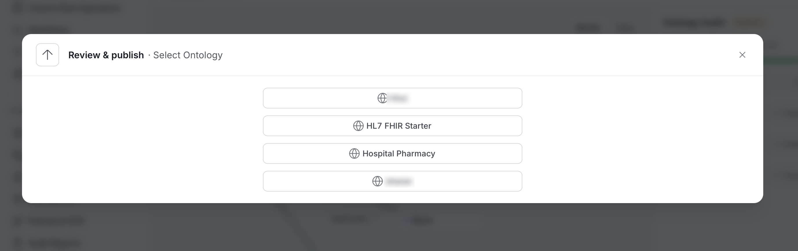

# Ontology Releases

Editing an ontology doesn't change what Query, Export, or the knowledge graph see. Edits collect as **unpublished changes** on the working draft. **Publishing** turns them into a **release**: a frozen, numbered snapshot that can't change afterward. Only one release is **Active** at a time, and the active release is what **Query** searches and what **Export** downloads.

The lifecycle is:

1. Edit the working draft.
2. Capture a release, which starts in **Draft** status.
3. Request review. Reviewers approve or reject the release through an approval task.
4. Activate an approved release.

## Open the Publish Dialog

Select **Publish** in the Studio header. A count, such as **Publish 21**, shows how many changes are waiting.

- With one ontology selected, **Publish** opens the **Review & publish** dialog for that ontology.
- With **All ontologies** selected, the button reads **Review & publish** and first asks you to pick an ontology. Use **Change ontology** in the dialog to pick another.

The dialog has two tabs: **Changes** and **Releases**.

## The Changes Tab

The Changes tab lists the unpublished changes and is where you capture a release.

The **Unpublished changes** list compares the working draft with the active release, 25 items at a time, with **Previous** and **Next**. A summary line, such as "Changed classes: 10", shows how much changed. Each row shows the item name, for example "Class ClinicalRecord · 0 properties", and whether it was **Added**, **Changed**, or **Removed**.

### Choose a Version

The **Version** panel offers three increments. The panel shows the resulting number next to each choice.

| Choice | When to use it | Example |
|---|---|---|
| **Patch** | Compatible corrections | `1.2.0` becomes `1.2.1` |
| **Minor** | Compatible additions. This is the default once a release exists. | `1.2.0` becomes `1.3.0` |
| **Major** | Breaking changes. This is the default for the first release. | `1.2.0` becomes `2.0.0` |

A line at the bottom, such as "0.0.0 → 1.0.0 · Changed classes: 10", previews the version the new release will get. The first release starts from `0.0.0`.

### Add Release Notes

Use **Release Notes** to explain what changed, up to 16,384 characters. The notes are kept with the release.

### Validation

The **Validation** panel reports:

- **Structural validation**: whether the ontology is well formed. It reads **Not checked** until a release is captured, then **Passed** or **Failed**.
- **Logical consistency**: always **Not checked**. Studio checks that the ontology is well formed, but it doesn't prove that the rules are free of contradictions.

A **Reviewers** panel lists the people who will review the release.

### Capture or Request Review

Two buttons finish the step. Both need edit permission on the ontology.

- **Capture release** freezes your changes as a new release in **Draft** status. Nothing is approved or active yet.
- **Request review** captures the release and sends it for approval in one step, then opens the approval task. If something fails after capture, the button changes to **Retry review** and reuses the captured release.

## The Releases Tab

The Releases tab lists every release of the ontology.

The **Releases** tab lists every release of the ontology, newest first. Until you capture the first release it shows **No data available.** Each row shows:

- The version, for example `1.5.0`. Older releases without a version show **Release N**.
- Badges for **Active** and **Latest**, and the status.
- Who captured the release and when.
- An **Export** menu for that release.

Select **Load More** for older entries. The list shows up to the first 1,000.

Select a release to see its details:

- **Approval** links to its approval task.
- **Request approval** appears on a release in **Draft** status.
- **Activate release** makes the release the active one. It is enabled only for an **Approved** release that isn't already active.
- **Release events** is a log of **Captured**, **Approved**, **Rejected**, and **Activated** events, with who did it and when, plus the reviewers who voted.
- A list of the changes in the release, with a **Before** and **After** view of each item's definition.

### Release Statuses

A release moves through the following statuses.

| Status | Meaning |
|---|---|
| **Draft** | Captured but not yet submitted for review. |
| **In Review** | An approval task is open for the ontology's reviewers. |
| **Approved** | A reviewer approved it. It can now be activated. |
| **Rejected** | A reviewer rejected it. You can't review the same release again. Fix the issues and capture a new release. |

If a review task is cancelled before a decision, the release returns to **Draft**.

### Activate and Roll Back

Activating an approved release makes it the one that Query, Export, and the knowledge graph use. Activating an older approved release rolls back to it. The newer releases stay in the list and can be activated again.

Activation queues an update to the RDF knowledge graph in the background.

## Review a Release

Reviewers receive an approval task about the release. Open it from **Approval** on the release as well. The task shows a **Submitted definition** panel with the release name and version, the list of changed items, and a **Before** and **After** view of each. The panel must finish loading before a decision can be made.

Three rules apply:

- The ontology needs at least one **Reviewer**. Without one, review can't start. Set reviewers in the ontology's **Settings**. See [Ontologies](/v2.1.x-SNAPSHOT/how-to-guides/ontology/studio/ontologies#edit-ontology-settings).
- The reviewer must be a different person from the author of the release and from the person who requested the approval.
- Your organization needs an active approval workflow that has a user approval step. If it is missing or suspended, Studio can't submit the release for review.

## Export a Release

Every row in the **Releases** tab has an **Export** menu, to download any release, not only the active one.

| Format | File |
|---|---|
| **Turtle** | `.ttl` |
| **RDF/XML** | `.rdf` |
| **N-Triples** | `.nt` |
| **JSON-LD** | `.jsonld` |

To export the active release with a preview, or to import a file, use [Import & Export](/v2.1.x-SNAPSHOT/how-to-guides/ontology/studio/import-export).

## Permissions

The following permissions apply to releases.

| To do this | You need |
|---|---|
| See releases | View access (`ViewAll`) on the ontology and on its concepts, properties, and constraints. Data you can't view is left out of lists, diffs, and exports. |
| Capture a release | `EditAll` on the ontology |
| Activate a release | `EditAll` on the ontology |
| Submit a release for approval | At least one **Reviewer** on the ontology, and an active approval workflow |
| Approve or reject | Be one of the ontology's reviewers, and not the person who captured the release |

## REST Endpoints

Paths start with `/api`. For the full reference, see the [Ontology API Reference](/v2.1.x-SNAPSHOT/how-to-guides/ontology/studio/api).

| Path | Access | Notes |
|---|---|---|
| `GET /v1/ontologies/{id}/state` | View | Working and activation revision numbers, and the active release. |
| `GET /v1/ontologies/{id}/working/diff` | View | Unpublished changes. Takes `limit` (1 to 1000, default 25) and `after`. |
| `POST /v1/ontologies/{id}/releases` | `EditAll` on the ontology | Captures a release. The body takes `expectedWorkingRevision`, `versionBump` (`major`, `minor`, `patch`), and `releaseNotes`. |
| `GET /v1/ontologies/{id}/releases` | View | Release history. |
| `PUT /v1/ontologies/{id}/activation` | `EditAll` on the ontology | Activates an approved release, or rolls back to an older approved one. |
| `GET /v1/ontologyReleases/{id}` | View | One release. Also `/versions/{version}`. |
| `GET /v1/ontologyReleases/{id}/diff` | View | Changes against `baseReleaseId`. |
| `GET /v1/ontologyReleases/{id}/structure` | View | Structural validation report. |
| `GET /v1/ontologyReleases/{id}/export?format=` | View | Default `turtle`. The UI uses `turtle`, `rdfxml`, `ntriples`, and `jsonld`. |
| `GET /v1/ontologyReleases/{id}/events` | View | Captured, approved, rejected, and activated events. |
| `GET /v1/ontologyReleases/{id}/members/{kind}[/{memberId}]` | View | Frozen definitions inside a release. |
