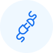

import { Integrations } from "/snippets/v2.1.x-SNAPSHOT/components/ConnectorGrid/Integration.jsx"
import { ReleaseCarousel } from "/snippets/v2.1.x-SNAPSHOT/components/ReleaseCarousel/ReleaseCarousel.jsx"

<h1 className="page-header">
  Unlock the Power of Metadata
</h1>

  Start with OpenMetadata and learn how to document, discover, and govern your data assets end-to-end.

<input
  type="text"
  id="homepage-search"
  className="homepage-search-input"
  placeholder="Search for connectors, how to guides and more"
  onMouseDown={(e) => {
    e.preventDefault();
  }}
  onClick={(e) => {
    e.preventDefault();
    // Trigger the native search dialog using its keyboard shortcut (Cmd+K / Ctrl+K)
    const event = new KeyboardEvent('keydown', {
      key: 'k',
      code: 'KeyK',
      keyCode: 75,
      which: 75,
      ctrlKey: !navigator.platform.includes('Mac'),
      metaKey: navigator.platform.includes('Mac'),
      bubbles: true,
      cancelable: true
    });
    document.dispatchEvent(event);
  }}
  onKeyDown={(e) => {
    // Keep this reachable for keyboard-only users
    if (e.key === 'Enter' || e.key === ' ') {
      e.preventDefault();
      const event = new KeyboardEvent('keydown', {
        key: 'k',
        code: 'KeyK',
        keyCode: 75,
        which: 75,
        ctrlKey: !navigator.platform.includes('Mac'),
        metaKey: navigator.platform.includes('Mac'),
        bubbles: true,
        cancelable: true
      });
      document.dispatchEvent(event);
    }
  }}
  readOnly
/>
⌘K

<a href="/v2.1.x-SNAPSHOT/connectors/database/databricks" className="chip purple">
  <Icon icon="/public/images/connectors/databrick.webp" color="#6938EF" /> Databricks
</a>

<a href="/v2.1.x-SNAPSHOT/connectors/database/bigquery" className="chip purple">
  <Icon icon="/public/images/connectors/bigquery.webp" color="#6938EF" /> BigQuery
</a>

<a href="/v2.1.x-SNAPSHOT/connectors/database/redshift" className="chip purple">
  <Icon icon="/public/images/connectors/redshift.webp" color="#6938EF" /> Redshift
</a>

<a href="/v2.1.x-SNAPSHOT/connectors/database/snowflake" className="chip purple">
  <Icon icon="/public/images/connectors/snowflakes.webp" color="#6938EF" /> Snowflake
</a>
<a href="/v2.1.x-SNAPSHOT/how-to-guides/mcp" className="chip purple">
  <Icon icon="/public/images/icons/mcp.svg" color="#6938EF" /> MCP
</a>

<a href="/v2.1.x-SNAPSHOT/sdk/ai-sdk" className="chip purple">
  <Icon icon="/public/images/homepage-icons/ai-sdk2.svg" color="#6938EF" /> AI SDK
</a>

<ReleaseCarousel />

Deployment

<h2 className="guide-header">Get Started with OpenMetadata</h2>

 Choose how you want to deploy and use OpenMetadata based on your needs.

Best for: PoC, exploration

<h3>Quick Start</h3>

Try OpenMetadata quickly using a hosted sandbox or local Docker setup to explore features with minimal effort.

<a className="read-more" href="/v2.1.x-SNAPSHOT/quick-start">
    Read More
    
  </a>

Best for: Teams, orgs

<h3>Production</h3>

Deploy OpenMetadata securely at scale using Kubernetes, cloud-managed services, or bare metal for production workloads.

<a className="read-more" href="/v2.1.x-SNAPSHOT/deployment">
    Read More
    
  </a>

Best for: Existing users

<h3>Upgrade</h3>

Upgrade your OpenMetadata deployment to the latest supported minor version with compatibility checks and safe rollback options.

<a className="read-more" href="/v2.1.x-SNAPSHOT/deployment/upgrade">
    Read More
    
  </a>

How-to Guides

<h2 className="guide-header">Quick Setup Guides</h2>

  Dive into our library of guides to master OpenMetadata's features.

<a href="/v2.1.x-SNAPSHOT/how-to-guides/data-discovery" className="guide-card">
  <Icon icon="/public/images/homepage-icons/discovery.svg" />
  
Discovery

</a>

<a href="/v2.1.x-SNAPSHOT/how-to-guides/data-lineage" className="guide-card">
  <Icon icon="/public/images/homepage-icons/lineage.svg" />
  
Lineage

</a>

<a href="/v2.1.x-SNAPSHOT/how-to-guides/data-quality-observability" className="guide-card">
  <Icon icon="/public/images/homepage-icons/observability.svg" />
  
Observability

</a>

<a href="/v2.1.x-SNAPSHOT/how-to-guides/data-insights" className="guide-card">
  <Icon icon="/public/images/homepage-icons/insights.svg" />
  
Insights

</a>

<a href="/v2.1.x-SNAPSHOT/how-to-guides/data-contracts" className="guide-card">
  <Icon icon="/public/images/homepage-icons/contract.svg" />
  
Data Contract

</a>

<a href="/v2.1.x-SNAPSHOT/how-to-guides/data-governance" className="guide-card">
  <Icon icon="/public/images/homepage-icons/governance.svg" />
  
Governance

</a>

<a href="/v2.1.x-SNAPSHOT/connectors" className="guide-card">
  <Icon icon="/public/images/homepage-icons/connectors.svg" />
  
Connectors

</a>

<a href="/v2.1.x-SNAPSHOT/how-to-guides">See All</a>

Connectors

<h2 className="guide-header">Seamless Data Integrations</h2>

  Integrate diverse data sources with OpenMetadata.

<Integrations />

Highlights

<h2 className="guide-header">What’s New in OpenMetadata</h2>

  Stay up to date with the latest features, enhancements, and platform updates in OpenMetadata.

  
  
Hierarchical Lineage Maps

  
Explore lineage as a map you can zoom into, from services down to individual fields.

  <a className="read-more" href="/v2.1.x-SNAPSHOT/how-to-guides/data-lineage/explore">
    Read More
    
  </a>

  
  
Persona Landing Page

  
Set a default landing page for each persona, and let people choose their own preferences.

  <a className="read-more" href="/v2.1.x-SNAPSHOT/how-to-guides/admin-guide/persona-landing-page-customization">
    Read More
    
  </a>

  
  
Metrics

  
Define business metrics, view their hierarchy, and link the data assets behind them.

  <a className="read-more" href="/v2.1.x-SNAPSHOT/how-to-guides/data-governance/metrics">
    Read More
    
  </a>

  
  
Failure Thresholds

  
Set how many failures a data quality test can tolerate before it fails.

  <a className="read-more" href="/v2.1.x-SNAPSHOT/how-to-guides/data-quality-observability/quality/failure-thresholds">
    Read More
    
  </a>

  
  
Ontology and RDF

  
Turn business concepts into a governed ontology and a knowledge graph you can query with SPARQL.

  <a className="read-more" href="/v2.1.x-SNAPSHOT/how-to-guides/ontology">
    Read More
    
  </a>

  
  
New Connectors

  
Ingest metadata from seven new sources: Rill, NATS JetStream, ClickZetta, Salesforce Data360, Tableau Prep, Databend, and Neo4j.

  <a className="read-more" href="/v2.1.x-SNAPSHOT/connectors">
    Read More
    
  </a>

Quick Links

<h2 className="guide-header">Trending Quick Links</h2>

  Explore the most popular resources and links, handpicked by the OpenMetadata community.

<Icon icon="list" color="#414651" size={20} />
<h3>Core Features</h3>

<a href="/v2.1.x-SNAPSHOT/how-to-guides/data-lineage/explore">Hierarchical Lineage Maps</a>
<a href="/v2.1.x-SNAPSHOT/how-to-guides/data-governance/metrics">Metrics</a>
<a href="/v2.1.x-SNAPSHOT/how-to-guides/ontology">Ontology</a>
<a href="/v2.1.x-SNAPSHOT/how-to-guides/data-quality-observability/quality/failure-thresholds">Failure Thresholds</a>
<a href="/v2.1.x-SNAPSHOT/how-to-guides/mcp">MCP Server</a>

<Icon icon="book-open" color="#414651" size={20} />
<h3>Blogs & Articles</h3>

<a href="https://blog.open-metadata.org/announcing-openmetadata-2-1-your-business-definitions-in-the-context-graph-54c65a6c6749" target="_blank">Announcing OpenMetadata 2.1</a>
<a href="https://blog.open-metadata.org/the-enterprise-ai-moat-isnt-the-model-81f8f669e8d3" target="_blank">The Enterprise AI Moat Isn’t the Model</a>
<a href="https://blog.open-metadata.org/announcing-openmetadata-2-0-the-open-context-layer-for-ai-agents-83b8ce8b9dde" target="_blank">Announcing OpenMetadata 2.0</a>
<a href="https://blog.open-metadata.org/your-data-platform-has-a-knowledge-gap-context-center-closes-it-984f1ba07714" target="_blank">Context Center Closes the Knowledge Gap</a>
<a href="https://blog.open-metadata.org/october-2026-openmetadata-community-news-3010803f5f73" target="_blank">October 2026 Community News</a>

<Icon icon="note" color="#414651" size={20} />
<h3>Release Note</h3>

<a href="/v2.1.x-SNAPSHOT/releases">Latest Release</a>
<a href="/v2.1.x-SNAPSHOT/releases/2.0-release">Release v2.0</a>
<a href="/v2.1.x-SNAPSHOT/releases/1.13-release">Release v1.13</a>
<a href="/v2.1.x-SNAPSHOT/releases/1.12-release">Release v1.12</a>
<a href="/v2.1.x-SNAPSHOT/releases/1.11-release">Release v1.11</a>

<h3 className="explore-header">Explore More</h3>

Learn more about OpenMetadata

<a className="explore-card" href="https://slack.open-metadata.org" target="_blank">

Community

Join our Slack community for instant support and updates.

</a>

<a className="explore-card" href="https://blog.open-metadata.org/" target="_blank">

Blogs

Get to know more about what’s new in data cataloging.

</a>

<a className="explore-card" href="https://www.youtube.com/c/OpenMetadataChannel" target="_blank">

Videos

Explore data analytics with quick and interesting lessons.

</a>

©2026 OpenMetadata. All rights reserved.

<a className="social-link" href="https://github.com/open-metadata/OpenMetadata" target="_blank"><Icon icon="github" size={20} /></a>
<a className="social-link" href="https://www.youtube.com/c/OpenMetadataChannel" target="_blank"><Icon icon="youtube" size={20} /></a>
<a className="social-link" href="https://twitter.com/open_metadata" target="_blank"><Icon icon="x-twitter" size={20} /></a>

