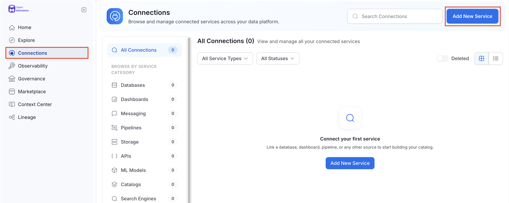

# Setting Up a Database Service for Metadata Extraction

You can quickly set up a database service for metadata extraction in OpenMetadata SaaS. Below is an example of how to configure a connection using the `Snowflake` Connector:

1. ## Log in to OpenMetadata SaaS 
   1. Navigate to **Connections** > **Databases**.
   2. Click **Add New Service**.

2. ## Select Database Type

   1. Choose the database type for your service. In this example, select `Snowflake`.
   2. Enter the required details, such as the **Name** and **Description**, to identify the database.

3. ## Enter Connection Details
- Provide the necessary connection parameters, such as hostname, port, credentials, etc.
- The side panel offers guidance with available documentation, and you can also refer to the specific `Snowflake` Connector [documentation](/v2.1.x-SNAPSHOT/connectors)for more information.

4. ## Test the Connection
Click Test Connection to verify the setup. This will check if OpenMetadata can reach the Snowflake service.

5. ## Set Default Data Filters

Configure default filters to control which databases, schemas, and tables are included or excluded during ingestion.

#### Default Database Filter Pattern
- **Includes / Excludes**:  
  To add a filter pattern, simply type it in and press `Enter`.

#### Default Schema Filter Pattern
- **Includes / Excludes**:  
  To add a filter pattern, simply type it in and press `Enter`.

#### Default Table Filter Pattern
- **Includes / Excludes**:  
  To add a filter pattern, simply type it in and press `Enter`.

These filters help streamline the ingestion process by targeting only the relevant data assets.
