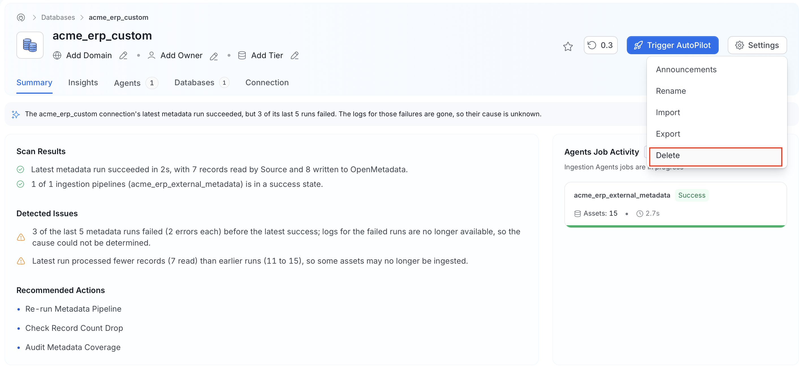
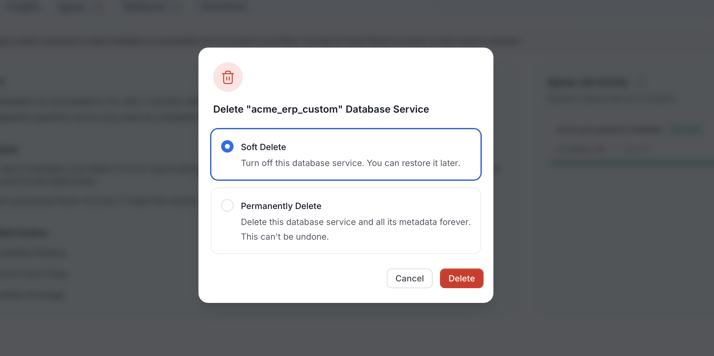
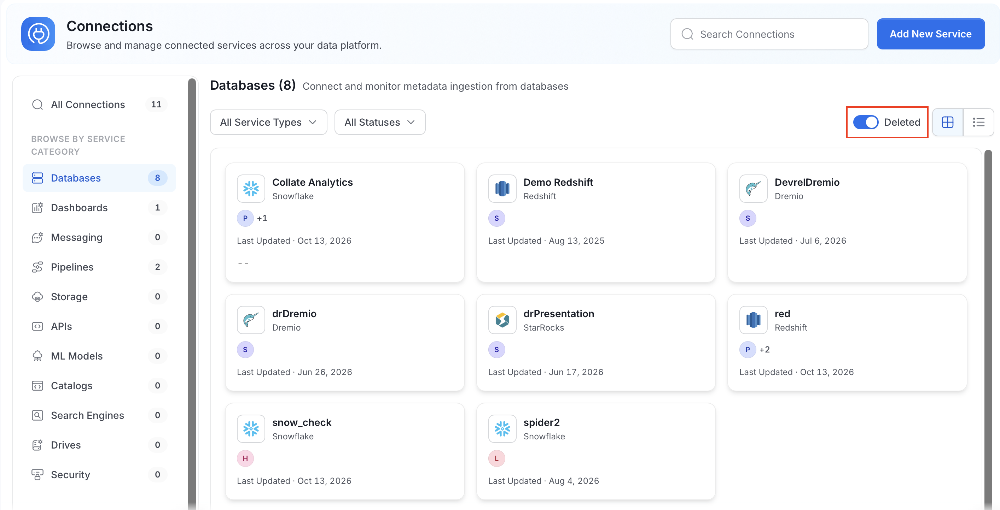
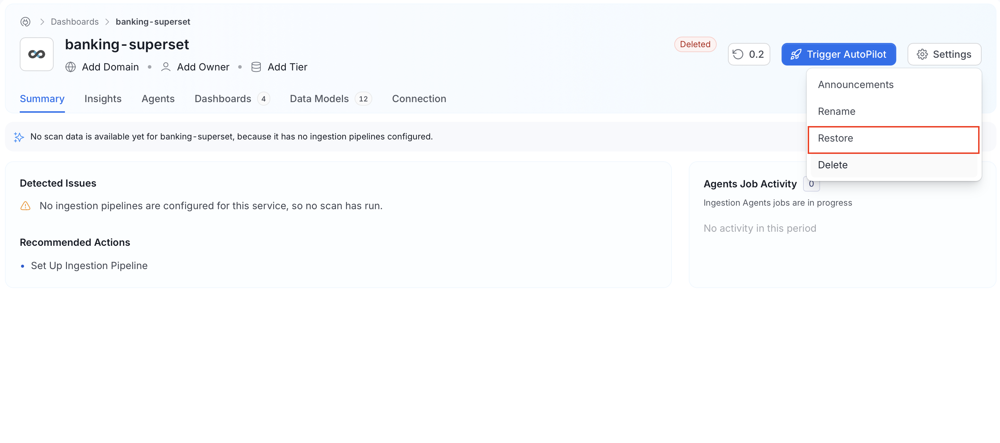
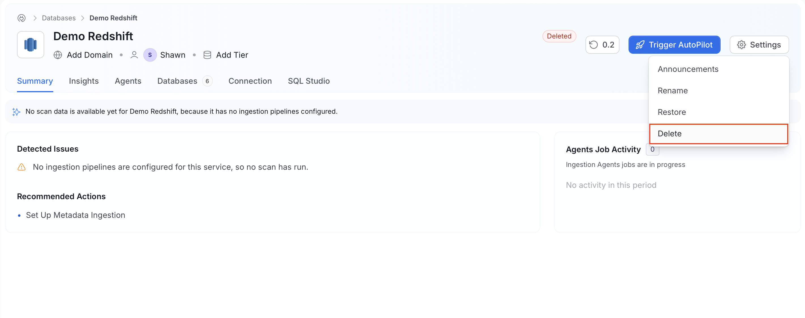
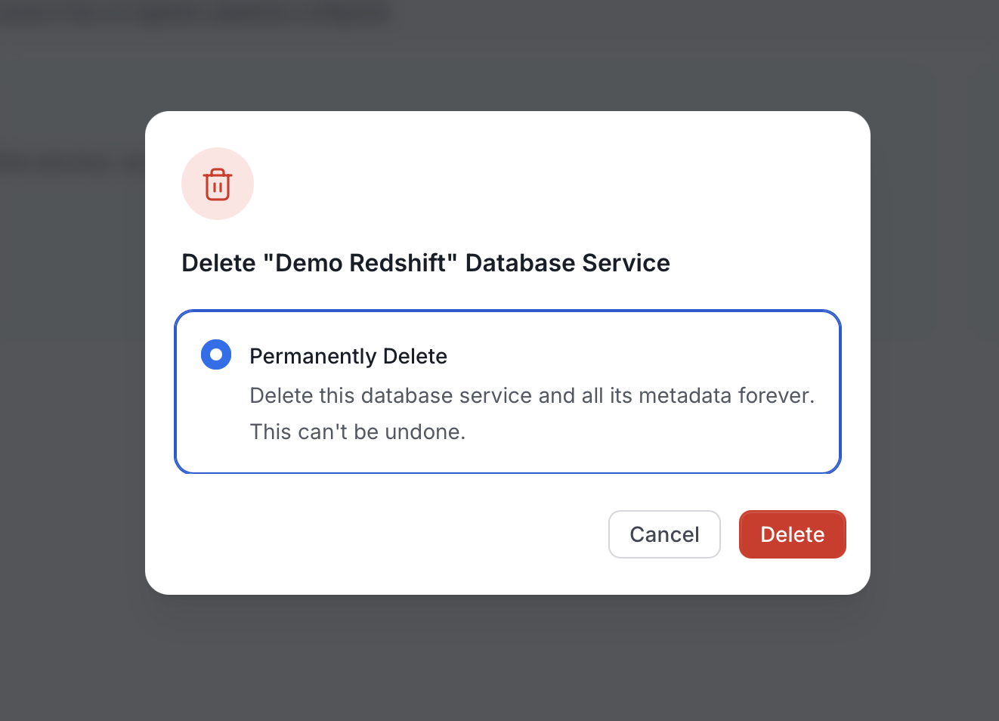

# Delete and Restore Service Connections

You can delete a service connection in two ways:

- **Soft Delete**: Hides the service. You can restore it later.
- **Permanently Delete**: Removes the service and its metadata forever. You can't undo this.

To delete a database, schema, table, or another data asset, see [Delete and Restore Data Assets](/v2.1.x/how-to-guides/guide-for-data-users/delete).

## Delete a Service Connection

<Warning>
Permanent deletion can't be undone. Select **Soft Delete** if you might need the service again.
</Warning>

1. Select **Connections** in the left navigation bar, and open the service.
2. Click **Settings** > **Delete**.

   

3. Select **Soft Delete** or **Permanently Delete**.

   

4. Click **Delete**.

## Find Soft-Deleted Service Connections

1. Select **Connections** in the left navigation bar.
2. Turn on the **Deleted** toggle. Soft-deleted services then appear in the list.

   

## Restore a Service Connection

1. Find the soft-deleted service. See [Find Soft-Deleted Service Connections](#find-soft-deleted-service-connections).
2. Open the service. A **Deleted** badge appears next to its name.
3. Click **Settings** > **Restore**.

   

After you restore a service connection, you can find it on the **Connections** page.

## Permanently Delete a Soft-Deleted Service Connection

<Warning>
Permanent deletion can't be undone, and you can't restore the service afterward.
</Warning>

1. Find the soft-deleted service. See [Find Soft-Deleted Service Connections](#find-soft-deleted-service-connections).
2. Open the service.
3. Click **Settings** > **Delete**.

   

4. In the dialog, **Permanently Delete** is selected. Click **Delete** to confirm.

   
