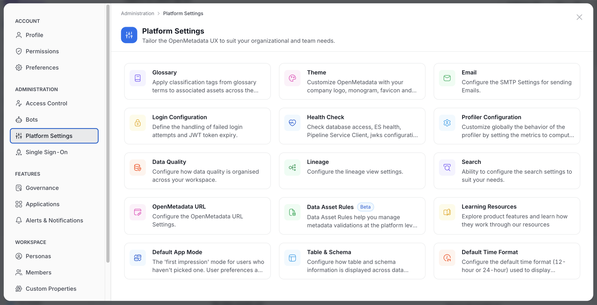
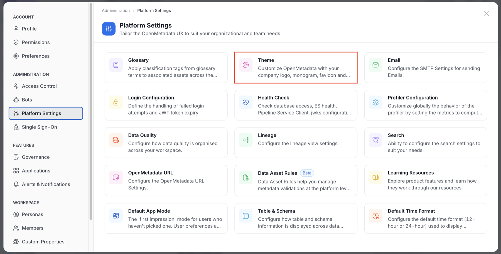
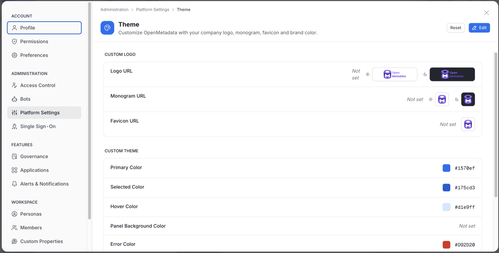
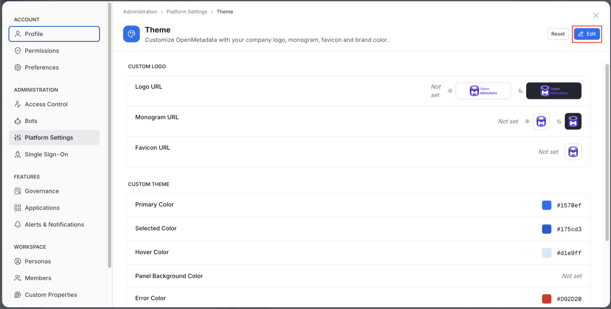
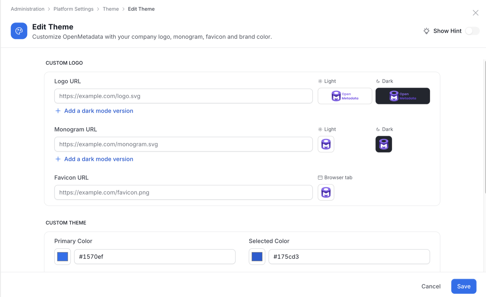
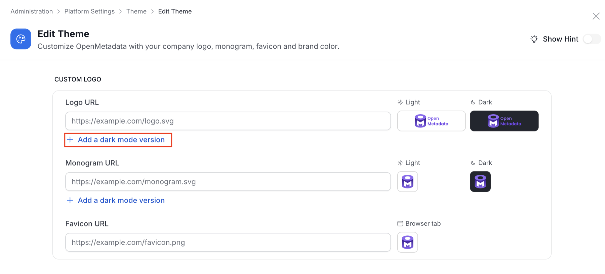
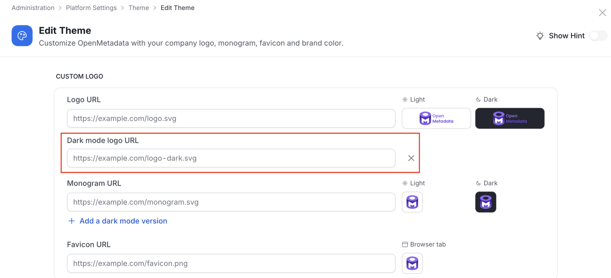
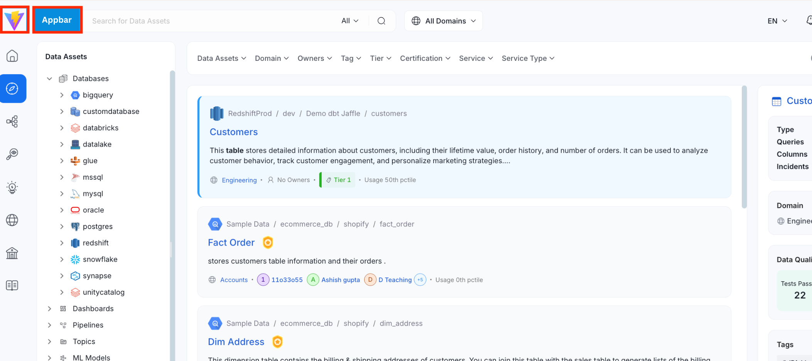
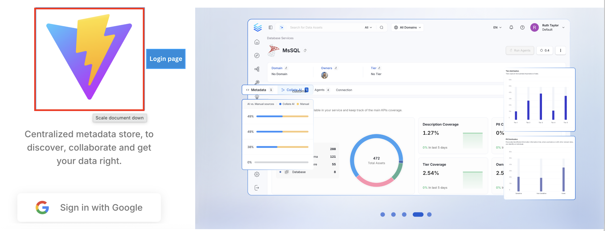

# Theme and Branding

Theme and Custom Logo are organization-wide settings that require Admin access. The setting lives in **Settings** > **Platform Settings** > **Theme**, and has two sections:

- **Custom Logo**: Images and icons (logo, monogram, favicon)
- **Custom Theme**: The color palette

**Purpose and Benefits**
- **Purpose**: Customize the platform's logo, icons, and color palette to match your brand.
- **Benefits**: Makes OpenMetadata feel like an internal tool built for your organization instead of an off-the-shelf product.

Changes here apply instantly for every user on the instance once they refresh the page.

<Note>
This page covers the organization-wide logo and colors that admins set. Each user also picks **Light**, **Dark**, or **System** for themselves in **Settings** > **Preferences** (under **Account**) > **Theme**. That choice applies in AI mode only. Classic mode always uses the light theme, and OpenMetadata keeps the choice for when the user returns to AI mode. For more information, see [Profile Menu and Settings](/v2.1.x/how-to-guides/admin-guide/profile#your-preferences).
</Note>

## How to Access

1. Click the **Profile** icon and navigate to **Settings** > **Platform Settings**.

     Platform Settings" />

2. Click **Theme**.

    

The **Theme** page shows your current logo, monogram, favicon, and colors. A setting that is not set shows **Not set**, and the previews show the default OpenMetadata branding.

## Edit the Theme

Follow these steps to change the logo, monogram, favicon, or colors.

1. On the **Theme** page, click **Edit**.

    

2. On the **Edit Theme** page, update the fields in the **Custom Logo** and **Custom Theme** sections. Turn on **Show Hint** at the top right to see guidance for each field.

    

3. Click **Save** to apply your changes, or click **Cancel** to discard them.

## Custom Logo

The **Custom Logo** section replaces the default OpenMetadata branding assets with your organization's own images. Each field takes a URL rather than a file upload, so the image needs to already be hosted somewhere reachable by anyone loading the OpenMetadata UI, such as your own CDN or object storage:

| Field | Description | Recommended size |
|:--- |:--- |:--- |
| **Logo URL** | URL of the image shown on the login page | 5:2 aspect ratio, 150 x 60 px |
| **Dark mode logo URL** | URL of the image shown on the login page when the dark theme is active. If empty, OpenMetadata uses the **Logo URL** | 5:2 aspect ratio, 150 x 60 px |
| **Monogram URL** | URL of the image shown in the navigation bar | 1:1 aspect ratio, 30 x 30 px |
| **Dark mode monogram URL** | URL of the image shown in the navigation bar when the dark theme is active. If empty, OpenMetadata uses the **Monogram URL** | 1:1 aspect ratio, 30 x 30 px |
| **Favicon URL** | URL of the browser tab icon | 1:1 aspect ratio, 16 x 16 px |

The dark mode fields are hidden until you add them. Next to each field, a preview shows how the image looks:

- **Light** and **Dark** previews appear next to **Logo URL** and **Monogram URL**. The **Dark** preview shows the light image until you add a dark mode version.
- A **Browser tab** preview appears next to **Favicon URL**.

### Add a Dark Mode Version

A dark mode version is optional. Add one when your logo or monogram is hard to see on a dark background.

1. Under **Logo URL** or **Monogram URL**, click **Add a dark mode version**.

    

2. Enter the URL of the dark mode image in the field that appears (**Dark mode logo URL** or **Dark mode monogram URL**).

    

3. To remove it, click the remove icon (**X**) next to the field. OpenMetadata then uses the light image in dark mode again.

### URL Checks

OpenMetadata checks each URL as you type:

- A URL must start with `https://`. Otherwise you see "Enter a full URL starting with https://".
- While the image loads, you see "Checking image…". If it can't be loaded, you see a message to check that the link is public and points to an image file.
- If a logo is hard to see on a dark background and you have not added a dark mode version, you see "This logo is hard to see in dark mode". Add a dark mode version to fix it.

You can't save while a URL that you changed is still being checked or has an error.

After you click **Save**, changes can take a few minutes to reflect everywhere in the UI, so refresh the page and wait briefly before assuming a URL was entered incorrectly.

## Custom Theme

The **Custom Theme** section defines the brand colors used across buttons, links, and status indicators throughout the interface, so the whole product reads as consistent with the rest of your brand rather than just the parts with a logo on them. Each field accepts a HEX color code or a color picker selection. An invalid code shows "Input is not valid HEX code." Leaving a field blank keeps OpenMetadata's own default for that color, shown below.

| Color | Applied to | Default |
|:--- |:--- |:--- |
| **Primary Color** | Primary buttons, links, and key UI elements | `#1570EF` |
| **Selected Color** | Selected state on data assets and navigation items | `#175CD3` |
| **Hover Color** | Background highlight on interactive elements | `#D1E9FF` |
| **Info Color** | Informational messages and hints | `#84CAFF` |
| **Panel Background Color** | Background of the landing page welcome panel. Individual users and personas can still override this value | Not set |
| **Success Color** | Success confirmations and positive states | `#039855` |
| **Warning Color** | Warning messages and caution alerts | `#DC6803` |
| **Error Color** | Error messages and destructive action indicators | `#D92D20` |

After configuring colors, click **Save** to apply them.

<Tip>
  Click **Reset** at the top of the Theme page to clear every logo and color field back to OpenMetadata's own defaults shown in the tables above.
</Tip>

<Warning>
Reset clears every logo and color field immediately and asks for no confirmation.
</Warning>
