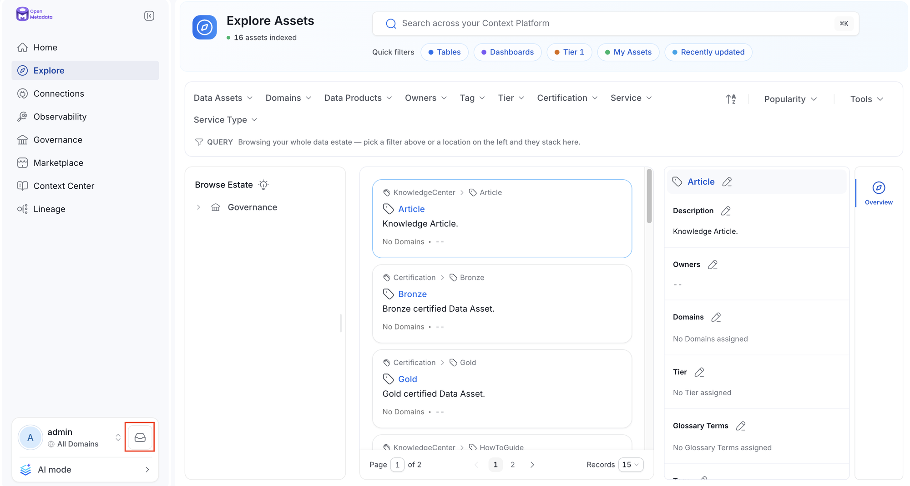
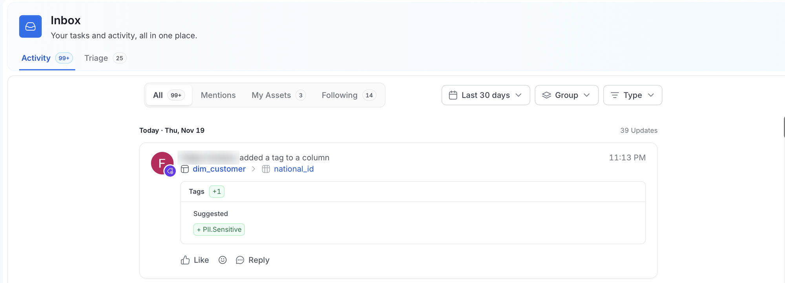
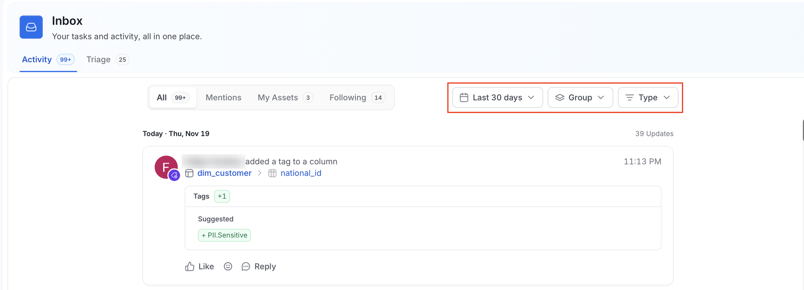
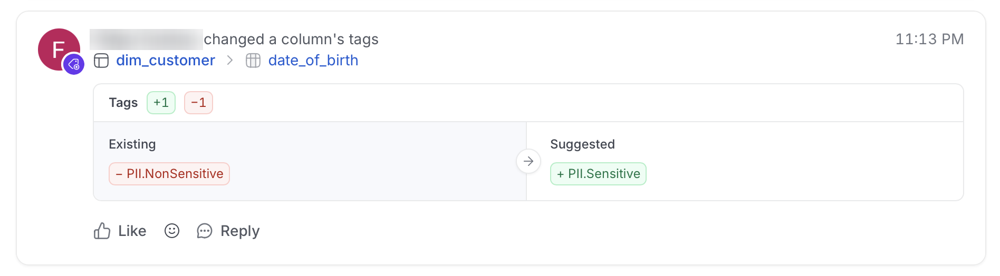

# Understanding Activity Feeds

Activity feeds show the activity around the data you own and the data you follow. They are great conversation starters to collaborate with your team. In AI mode, you read your activity feed in the **Inbox**. In Classic mode, you read it in the **Activity Feeds** widget on the home page.

## Inbox Activity

<Note>
The Inbox is available in AI mode only.
</Note>

To open the Inbox, click the **Inbox** icon next to your profile at the bottom of the left sidebar.

The badge on the icon shows your open tasks plus your unread activity. If you have open tasks, the icon opens the **Triage** tab. Otherwise, it opens the **Activity** tab. For more information about tasks, see [Manage Tasks in the Inbox](/v2.1.x/how-to-guides/data-collaboration/tasks#manage-tasks-in-the-inbox).

The **Activity** tab has the following sub-tabs. Each one shows the number of items in it. A count above 99 shows as **99+**.

- **All**: All the activity you can see.
- **Mentions**: Activity where you or one of your teams are mentioned, including mentions in replies.
- **My Assets**: Activity on the data assets you own.
- **Following**: Activity on the data assets you follow.

### Filter and Group the Feed

Use the controls above the feed to change what it shows:

- **Date**: Select **Yesterday**, **Last 3 days**, **Last 7 days**, **Last 14 days**, or **Last 30 days**. The default is **Last 30 days**, and the feed never goes back further than 30 days.
- **Group**: Select **Asset** or **User** to group the feed by data asset or by the person who made the change. Select **None** to group it by day, which is the default.
- **Type**: Select one or more of **Tags**, **Owners**, **Domains**, **Description**, and **Other**. **Other** covers everything else, such as creating or deleting an asset, and conversations.

### Read an Activity Card

Each card describes one event in a sentence, such as who added a tag or changed an owner. The data asset is on its own line and links to the asset page.

- **Existing and Suggested**: When a tag, owner, domain, or description changes, the card shows the old value under **Existing** and the new value under **Suggested**, with the number of values added (+) and removed (−). A single edit that removes one value and adds another shows as one card.

  
- **Mentioned you**: A card shows this badge when the activity, or a reply under it, mentions you or one of your teams.

### Like, React, and Reply

On each card, you can:

- Click **Like** to like the activity.
- Add an emoji reaction.
- Click **Reply**, or the reply count if the card has replies, to open the replies under the card. If the card has no replies yet, the reply box opens ready to type. Click **Hide replies** to close them.

To reply, type your message in the reply box and press **Enter** to send it. Press **Shift** + **Enter** to start a new line. Type `@` to mention a user or team, and type `#` to mention a data asset. The suggestions update as you type.

You can edit your own replies. You can delete a reply if you wrote it, if you are an admin, or if your role allows deleting conversations. You can also add emoji reactions to any reply.

## Activity Feeds Widget in Classic Mode

In Classic mode, click the OpenMetadata icon to open the home page with the activity feeds.

The **Activity Feeds Widget** displays:
- **All:** All the activities related to the data assets that you own, follow, or where you are mentioned
- **@Mentions:** Feeds where you are mentioned
- **Tasks:** Tasks created by you, or assigned to you are displayed. Only the Open tasks are displayed here.

Users can Reply to discuss further as well as Edit, Delete, or share Reactions with the team by using emojis.

<Card title="Conversation Threads" href="/v2.1.x/how-to-guides/data-collaboration/conversation" >
    Collaborate around data assets right within OpenMetadata.
  </Card>
