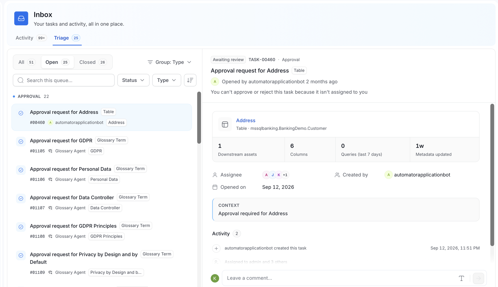
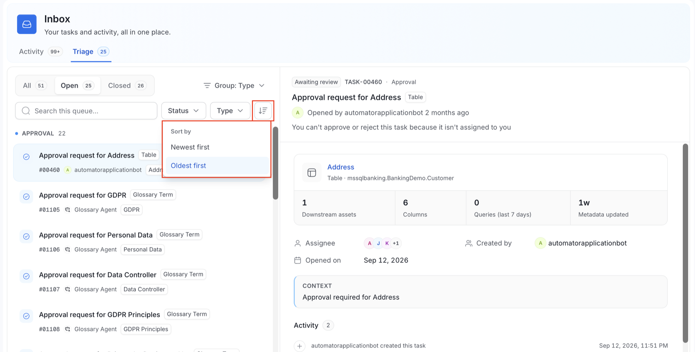

# Create Tasks

Tasks are an extension to the Conversation Threads feature where users can create tasks to
request to create or update description or tags for a data asset. Tasks are assgined to the owner of the data asset by default. If there are no owners, the task can be assigned to an appropriate user or team.

## Memory Conflict Tasks

A **Memory conflict** task asks you to decide between two memories that contradict each other. When an application such as Collate detects that a **Draft** memory contradicts an **Approved** memory, it opens this task automatically.

- You can't create or edit a **Memory conflict** task, and you can't close it by hand. It closes when the review is decided.
- The task has two outcomes, chosen with **Keep this one** in the **Compare memories** dialog. Keeping the memory in review approves it and supersedes the disputed memories. Keeping the **Approved** memory rejects the memory in review and leaves the disputed memory unchanged.
- The task is assigned to the owners of both memories.

Review these tasks from **Context Center** > **Memories** > **Needs review**. For more information, see [Review Conflicting Memories](/v2.1.x/how-to-guides/context-center/memories#review-conflicting-memories).

## Manage Tasks in the Inbox

<Note>
The Inbox is available in AI mode only.
</Note>

The **Triage** tab of the Inbox lists the tasks assigned to you or created by you, with the details of the selected task in a separate panel.

To open it, click the **Inbox** icon next to your profile at the bottom of the left sidebar, then select **Triage**. The badge on the icon shows your open tasks plus your unread activity. If you have open tasks, the icon opens **Triage**. Otherwise, it opens the **Activity** tab. For more information, see [Understanding Activity Feeds](/v2.1.x/how-to-guides/data-collaboration/activity-feeds).

### Find Tasks

Use the controls above the list to narrow it down:

- **All**, **Open**, and **Closed**: Each tab shows the number of tasks in it. The list opens on **Open**.
- **Search this queue**: Finds tasks by title.
- **Status**: Narrows the list by task status. The options depend on the tab:
    - **Open** tab: **Pending approval** (tasks waiting for you) and **In review** (tasks someone is already working on).
    - **Closed** tab: **Approved** and **Rejected**.
    - **All** tab: all four options.
- **Type**: Narrows the list to one or more task types. It offers only the types in the tasks that are loaded.
- **Group**: Groups the list by **Type**, which is the default, or by **None**.
- **Sort**: Changes the order of the list. For the steps, see [Sort Tasks](#sort-tasks).

When a search or filter matches nothing, the list says so and offers **Clear all** to return to the full list.

The list scans up to 200 tasks to build the groups and the **Type** counts. When more tasks remain, each group count reads "N+" and the **Type** menu hides its counts.

A link that contains `?taskId=` for a closed task opens the **Closed** tab with that task selected. After it opens, you can move to any tab.

### Sort Tasks

To change the order of the task list:
1. Open **Inbox** > **Triage**.
2. Click the **Sort** icon, and select one of the following options:

    - **Newest first**: Shows the most recently created tasks first. This is the default.
    - **Oldest first**: Shows the earliest created tasks first.

The sort order uses the date a task was created, and applies to the **All**, **Open**, and **Closed** tabs.

### Review a Task

Select a task in the list to open its details panel. The details panel shows:

- **Status**, the task ID, and the task type.
- **Assignee** and **Created by**, and the date the task was **Opened on**.
- The **Context** of the request, and a card for the data asset the task is about, with a few facts about it, such as its downstream assets, columns, and recent queries.
- An **Activity** timeline of what has happened on the task, and the comments on it.

From the details you can add a comment. The actions available depend on the task type and on your role. For approval tasks, only the assignees or reviewers can **Approve** or **Reject**. If you are not one of them, the details tell you so.

Some workflow transitions need information before they run, for example a custom task that needs a target field and proposed text. When you choose such a transition, the Inbox opens a form so you can fill in the required fields. **Bulk resolve** skips these tasks instead of resolving them without input.

Incident tasks lead with the action for the next stage, and the steps back are in the **⋮** menu. For an **Assigned** incident, **Resolve** and **Reassign** are buttons, and **New** and **Acknowledge** are in the menu.

<Card title="How to Request for Description" href="/v2.1.x/how-to-guides/data-collaboration/request-description" >
    Request for a description and discuss the same within OpenMetadata
  </Card>

<Card title="How to Request for Tags" href="/v2.1.x/how-to-guides/data-collaboration/request-tags" >
    Request for tags and discuss about the same, all within OpenMetadata.
  </Card>