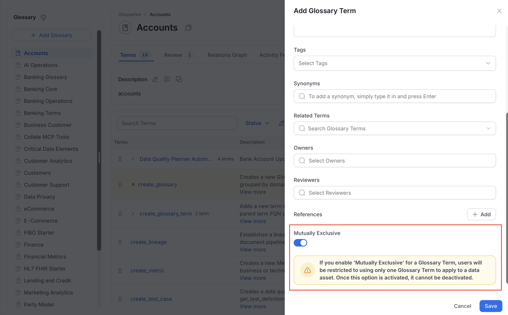
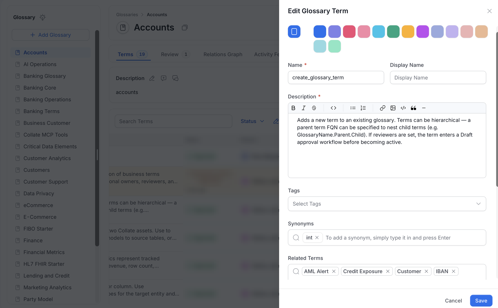

# How to Create Glossary Terms

Once a glossary has been created, you can add multiple **Glossary Terms** and **Child Terms** in it.

To add a term:

1. Open the glossary and click **Add term**. To add a child term, open the parent term, click **Add**, and select **Glossary Term**. The **Add** menu appears only when the parent term is **Approved**.
2. In the **Add Glossary Term** drawer that opens on the right, enter the details of the term.

   

3. Click **Save**.

The drawer has these fields. An asterisk (*) marks a required field:

- **Icon** and **Color**: The icon and color of the term. For the icon, select one from the list or enter an icon URL. The icon aspect ratio should be 1:1, and the recommended size is 64 x 64 px.
- **Name***: The name of the glossary term.
- **Display Name**: The display name of the glossary term.
- **Description***: A unique and clear definition to establish consistent usage and understanding of the term.
- **Tags**: Classification tags can be added to glossary terms. When adding a glossary term to assets, it will also add the associated tags to that asset. This helps to further describe and categorize the data assets.
- **Synonyms**: Other terms that are used for the same concept. For example, for a term ‘Customer’, the synonyms can be ‘Client’, ‘Shopper’, ‘Purchaser’. Type a synonym and press **Enter** to add it. Press **Backspace** to remove the last one.
- **Related Terms**: These terms can build a network of concepts to capture an associative relationship. For example, for a term ‘Customer’, the related terms can be ‘Customer LTV (LifeTime Value)’, ‘Customer Acquisition Cost (CAC)’. Select them in the glossary term picker. The term you are editing doesn't appear in the picker, because a term can't be related to itself. For more information about the picker, see [The Glossary Term Picker](/v2.1.x/how-to-guides/guide-for-data-users/glossary#the-glossary-term-picker).
- **Owners**: Either a Team or a User can be the Owner of a Glossary term.
- **Reviewers**: Multiple reviewers can be added.
- **References**: Click **Add** to add a link from the internet from where you inherited the term. Enter a **Name** and an **Endpoint**. The endpoint must be a valid URL that starts with `http` or `https`. Click the remove icon to remove a reference.
- **Mutually Exclusive**: There are cases where only one term from a particular glossary is relevant for a data asset. For example, an asset can either be ‘PII-Sensitive’ or a ‘PII-NonSensitive’. It cannot be both. For such cases, a Glossary Term can be created where the child terms can be mutually exclusive. If this configuration is enabled, you won’t be able to assign multiple terms from the same Glossary Term to the same data asset.

<Warning>
Once you turn on **Mutually Exclusive**, you can't turn it off.
</Warning>

If your organization uses an intake form for glossary terms, the drawer also shows its required fields and custom properties when you add a term. Errors, such as a name that already exists in the glossary or a mutually exclusive conflict, appear next to the field, and the drawer stays open so you can fix them.

To change a term, click the edit icon for the term in the terms table. The **Edit Glossary Term** drawer opens with the term's details. If you clear all the owners and save, the term has no owners.

Once a glossary term has been added, you can create **Child Terms** under it. The child terms help to build a conceptual hierarchy (Parent-Child relationship) to go from generic to specific concepts. For example, for a term ‘Customer’, the child terms can be ‘Loyal Customer’, ‘New Customer’, ‘Online Customer’.

Instead of creating a glossary manually, you can **[bulk upload glossary terms](/v2.1.x/how-to-guides/data-governance/glossary/import)** using a CSV file.

<Card title="How to Bulk Import a Glossary" href="/v2.1.x/how-to-guides/data-governance/glossary/import" >
    Save time and effort by bulk uploading glossary terms using a CSV file.
  </Card>

<Card title="How to Add Assets to Glossary Terms" href="/v2.1.x/how-to-guides/data-governance/glossary/assets" >
    Associate glossary terms to data assets making it easier for data discovery
  </Card>