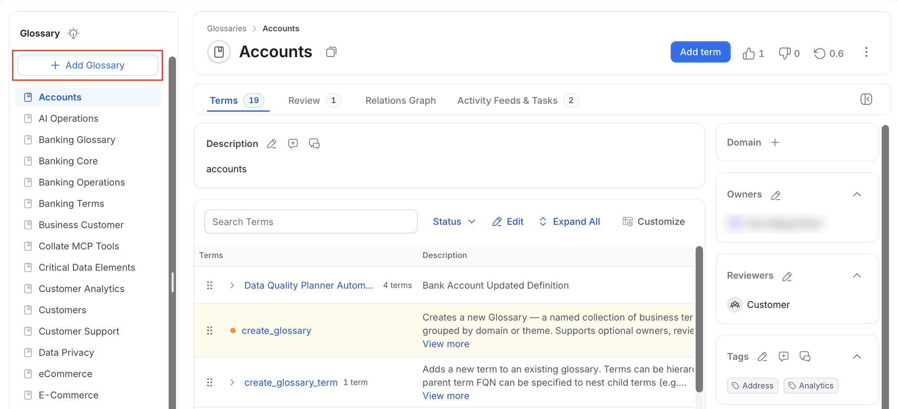
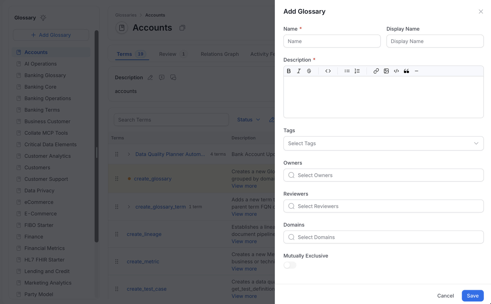

# How to Setup a Glossary

To create a glossary manually in OpenMetadata:

1. Navigate to **Govern** > **Glossary**.
2. Click **Add Glossary**. The button is in the left panel, and also on the page when no glossary exists yet.

   

3. In the **Add Glossary** drawer that opens on the right, enter the details to configure the glossary. An asterisk (*) marks a required field:
   - **Name***: The name can have up to 128 characters, and can contain only letters, numbers, underscores, hyphens, periods, parentheses, and ampersands.
   - **Display Name**: The name shown in the UI. It can have up to 128 characters.
   - **Description***: Describe the context or domain of the glossary.
   - **Tags**: Classification tags can be added to a glossary.
   - **Owners**: By default, a glossary can have multiple users or a single team as owners. Admins can change this in [Data Asset Rules](/v2.1.x/how-to-guides/admin-guide/data-asset-rules).
   - **Reviewers**: Select the users or teams that review the glossary terms. You can add more than one reviewer.
   - **Domains**: Select the domain of the glossary. By default, you can select only one domain.
   - **Mutually Exclusive**: There are cases where only one term from a particular glossary is relevant for a data asset. For example, an asset can either be ‘PII-Sensitive’ or a ‘PII-NonSensitive’. It cannot be both. For such cases, a Glossary can be created where the glossary terms can be mutually exclusive. If this configuration is enabled, you won’t be able to assign multiple terms from the same Glossary to the same data asset.

   

4. Click **Save**.

<Warning>
Once you turn on **Mutually Exclusive**, you can't turn it off. The drawer shows this warning when you turn the switch on.
</Warning>

If your organization uses an intake form for glossaries, the drawer also shows its required fields and custom properties. A field that is required shows a message when you leave it empty. Errors, such as a name that already exists, appear next to the field.

## Add a Owner and Reviewers to a Glossary

Add the glossary **Owners** and **Reviewers** in the **Add Glossary** drawer. Either a Team or a User can be an Owner of the Glossary. Select the **Owners** field and search for the users or teams. Select more than one user to add several owners, or select a single team.

Multiple users or teams can be added as **Reviewers** in the same way. If the **Reviewers** exist for a glossary, then the same details are reflected when adding a new term manually as well.

A term also inherits the reviewers of its glossary or parent term. They appear alongside any reviewers set directly on the term.

If the Owner and Reviewer details are added while creating the glossary, and the glossary terms are **[bulk uploaded using a CSV file](/v2.1.x/how-to-guides/data-governance/glossary/import)**, then the glossary Owner and Reviewers are inherited for all the glossary terms. These details can be changed later.

<Card title="How to Create Glossary Terms" href="/v2.1.x/how-to-guides/data-governance/glossary/create-terms" >
    Setup Glossary Terms to define the terminology. Add tags, synonyms, related terms, links, etc.
  </Card>

<Card title="How to Bulk Import a Glossary" href="/v2.1.x/how-to-guides/data-governance/glossary/import" >
    Save time and effort by bulk uploading glossary terms using a CSV file.
  </Card>

<Card title="How to Add Assets to Glossary Terms" href="/v2.1.x/how-to-guides/data-governance/glossary/assets" >
    Associate glossary terms to data assets making it easier for data discovery
  </Card>