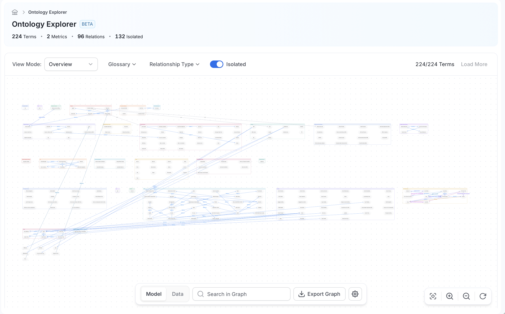
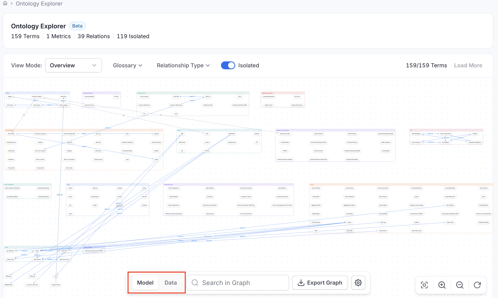
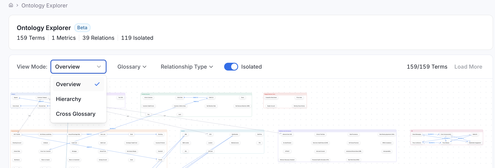
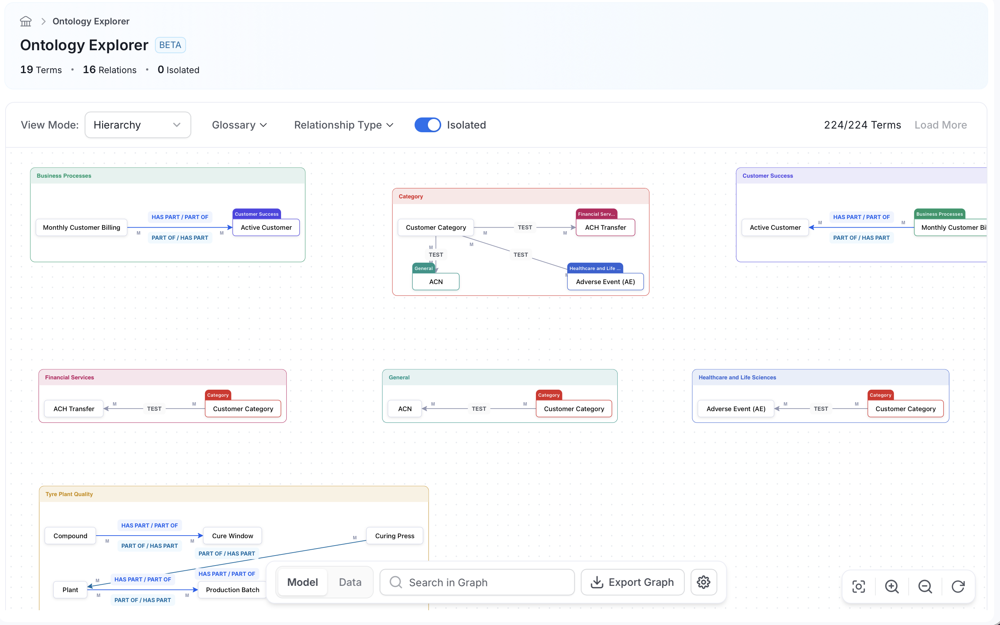
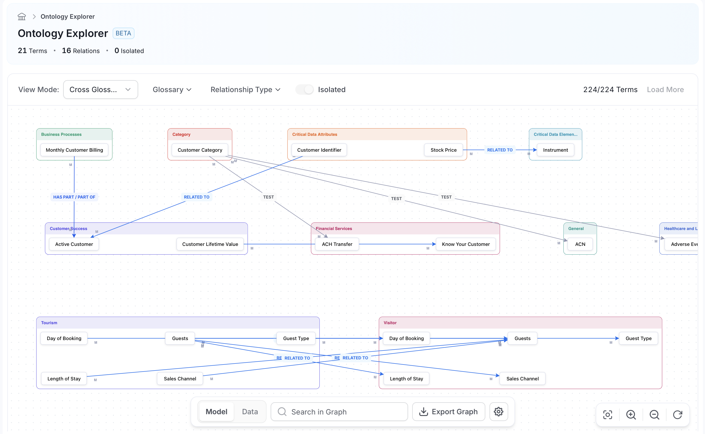
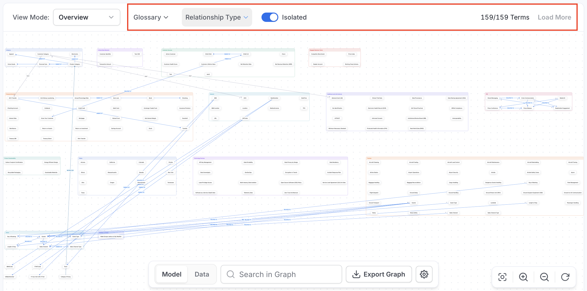
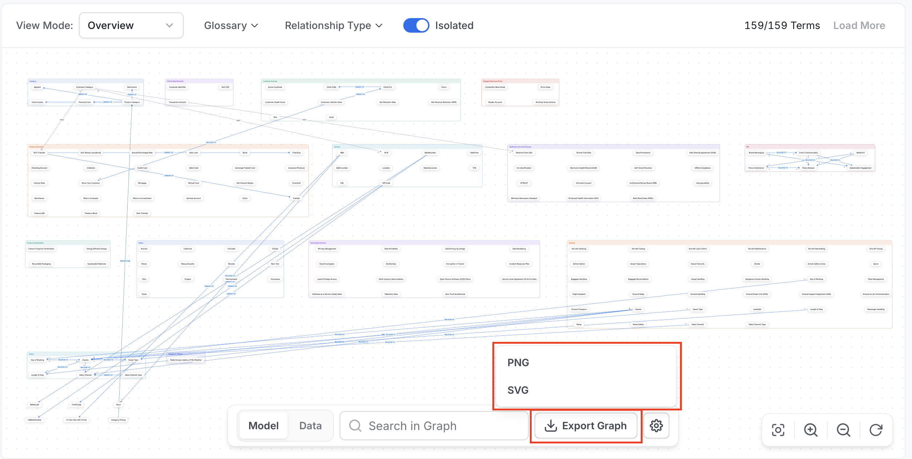
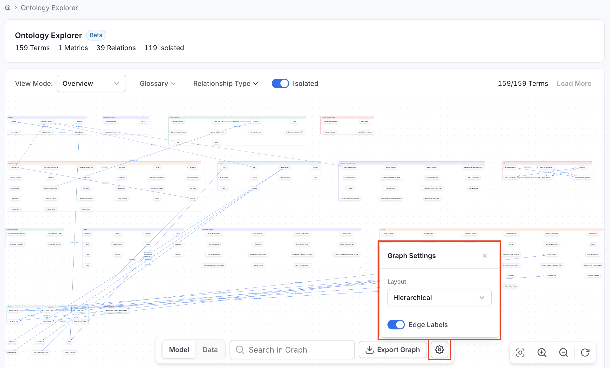

# Ontology Explorer

<Note>
Ontology Explorer is currently a Beta feature.
</Note>

<Info>
Ontology Explorer is the read-only graph view in OpenMetadata. Collate adds **Ontology Studio**, a workspace for authoring, reviewing, and publishing ontologies.
</Info>

The **Ontology Explorer** renders your Glossary as an interactive graph, letting you visualize how terms relate to one another (parent/child hierarchies, related terms, and metrics) beyond what the flat Glossary list view can show.

## Accessing the Ontology Explorer

Reach the Ontology Explorer from the main navigation, or scoped to a single term from that term's page.

- In the left navigation menu, select **Govern** > **Ontology Explorer**.
- The same graph is also available scoped to a single term: open any **Glossary Term** and go to its **Relations Graph** tab.

## Reading the Graph

The graph page combines a summary bar with the term canvas itself.

- **Summary bar**: At the top of the page, OpenMetadata shows counts for **Terms**, **Metrics**, **Relations**, and **Isolated** terms, which are terms with no relationships to any other term.
- **Term clusters**: OpenMetadata groups terms into boxes by their parent glossary, each labeled and color-coded by glossary name.
- **Relationship edges**: Lines connect related terms across and within clusters, labeled with the relationship type, for example **PARENT OF** or **RELATED TO**.
- **Term details**: Select any term node to open a side panel with its details and relationships.

## Model and Data Views

Use the **Model** / **Data** toggle below the graph to switch what the graph renders:

- **Model**: Shows the term-to-term ontology: how glossary terms relate to each other. The **View Mode**, **Isolated** toggle, and term pagination (**Load More**) described below only apply in this view.
- **Data**: Shows terms alongside the data assets tagged with them. Select a term node to expand it and load the assets (tables, dashboards, and so on) associated with that term.

## View Modes

In **Model** view, use the **View Mode** dropdown above the graph to choose how much of the ontology you see and how it is laid out. Select the dropdown to see the three options: **Overview**, **Hierarchy**, and **Cross Glossary**.

### Overview

Overview is the default. It shows every term in your glossaries, grouped into one box per glossary, along with all the relationships between them. Use it to get a complete picture of your ontology, including terms that have no relationships yet.

### Hierarchy

Hierarchy focuses on terms that are connected to other terms, so you can follow how they are organized. Each glossary is still shown as its own box. When a term in one glossary is related to a term in another glossary, the related term also appears inside the box, with a small colored tag that names the glossary it belongs to. The lines between terms are labeled with the relationship type, such as **HAS PART / PART OF**.

Use Hierarchy when you want to trace how a term sits within a structure, for example which terms belong to a larger concept.

### Cross Glossary

Cross Glossary shows only the relationships that connect terms in different glossaries. Terms that are not linked to another glossary are left out. Use it to see how your glossaries depend on each other, for example how a term in a Sales glossary relates to a term in a Finance glossary.

The **Isolated** toggle is turned off and can't be changed in this view, because a term with no relationships can't cross glossaries.

### How the Summary Bar Changes

The counts in the summary bar at the top of the page (**Terms**, **Metrics**, **Relations**, and **Isolated**) match what the graph currently shows. Because Hierarchy and Cross Glossary show only connected terms, their counts are lower than in Overview, and **Isolated** is 0. The **Metrics** count is hidden when it is 0.

## Filtering the Graph

Narrow the graph down using the filter controls in the toolbar.

- **Glossary**: Scope the graph to one or more specific glossaries.
- **Relationship Type**: Filter edges down to a specific relationship type.
- **Isolated**: Toggle whether the graph shows terms with no relationships.
- **Term count**: The toolbar shows how many terms are currently loaded (for example, `159/159 Terms`). Use **Load More** to page in additional terms.
- **Clear all**: Once a Glossary or Relationship Type filter is active, a **Clear all** button appears to reset both filters at once.

## Searching, Exporting, and Graph Settings

Beyond filtering, the toolbar also covers search, export, layout, and canvas navigation.

- **Search in Graph**: Find a specific term without manually scanning the canvas.
- **Export Graph**: Download the current graph view as a **PNG** or **SVG**. If your instance has RDF (Resource Description Framework) indexing enabled and the graph is scoped to a single glossary, **Turtle** and **RDF/XML** export are also available.

  

- **Graph Settings**: Select the **Settings** icon to:
  - Change the graph **Layout**. Choose between **Hierarchical** and **Circular**.
    - **Hierarchical**: Arranges terms into ranked, tree-like layers based on their relationships. Useful for following parent/child structure top-down.
    - **Circular**: Arranges terms around a circular layout instead of in ranked layers. Useful for getting an overview of a cluster without a directional hierarchy.
  - Toggle **Edge Labels** on or off, to show or hide relationship-type labels on the connecting lines.

  

- **Canvas controls**: Use the canvas control icons to **Fit to Screen**, **Zoom In**, **Zoom Out**, or **Refresh** the graph.

## Related Reading

<CardGroup cols={2}>
<Card title="Glossary" href="/v2.1.x/how-to-guides/data-governance/glossary" >
    Learn how to create and organize glossary terms.
  </Card>
<Card title="Relation Types" href="/v2.1.x/how-to-guides/data-governance/ontology/relationship-types" >
    Configure the relation types available between glossary terms, including custom types.
  </Card>
<Card title="RDF Indexing" href="/v2.1.x/deployment/rdf-knowledge-graph" >
    Enable RDF indexing to unlock Turtle and RDF/XML export from the Ontology Explorer.
  </Card>
</CardGroup>
