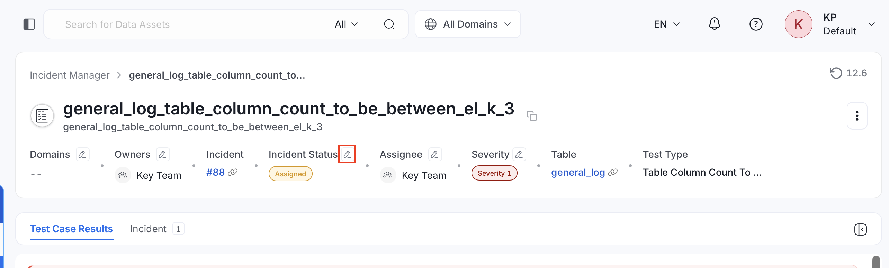
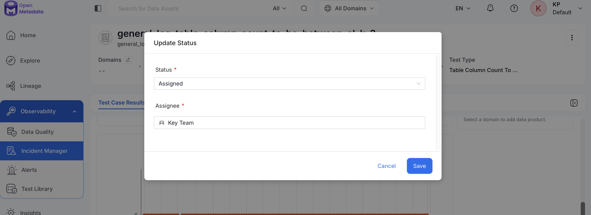

# How to Work with the Incident Manager Workflow

## Incident Manager Page

The **Incident Manager** page is the central place to triage incidents. It lists open incidents in groups, so you can handle many failures at once, and it lists the individual incidents behind each group.

### Summary Metrics

Four cards at the top of the page show key incident statistics:

- **Open Incidents**: Total number of currently active incidents.
- **Resolved Incidents**: Total number of closed incidents.
- **Response Time**: Average time from incident creation to first acknowledgement.
- **Resolution Time**: Average time from incident creation to resolution.

### Incident Groups

The page groups open incidents. A resolved incident leaves its group. Use **Group By** to choose how OpenMetadata groups the incidents:

- **Test case type**: One group for each test definition, such as Column Values To Be Not Null. This is the default.
- **Table**: One group for each table that has open incidents.
- **Test case owner**: One group for each owner of the failing test cases. Test cases that nobody owns appear in a **No Owner** group.

Each group row shows the following:

- **The group name**: The first column is named after the grouping, for example **Test case type**. A line under the name lists related tables, or check types when you group by **Table**.
- **Tables**: The number of tables that the group's incidents cover, for example "2 tables". When you group by **Table** or **Test case owner**, this column is **Check type** and counts check types instead.
- **Incidents**: The number of open incidents in the group.
- **Severity**: The most critical severity among the open incidents in the group, or **No Severity** when none of them has one.
- **Status**: The most actionable status in the group, ranked Assigned, then Ack, then New. A bar and counts, for example "2 ack", show how many incidents are in each status.
- **Assignees**: The users and teams that the incidents are assigned to, or **None**.
- **Last Seen**: When the group's incidents last changed, with the month and year of the first incident, for example "First Jul '26".
- **Trend**: Whether new incidents in the group are **Rising**, **Falling**, or **Steady**.

Above the table, a summary shows the number of groups and how many are recurring, for example "3 groups" and "0 recurring". A group is recurring when its **Trend** is **Rising**. OpenMetadata counts recurring groups only among the groups loaded on the current page.

To sort the groups, click the **Incidents**, **Severity**, or **Last Seen** column header. By default, the groups with the most open incidents appear first. Use the pager below the table to move between pages, and the **Records** menu to change how many groups appear on a page. The default is 15.

### Filters

Use the filter row to narrow the groups. It sits on one row next to **Group By**, and the filters apply to the incidents inside each group:

- **Test case**: Filter by a specific test case name.
- **Assignee**: Filter by the user or team that the incident is assigned to.
- **Status**: Filter by current status: **New**, **Ack**, or **Assigned**. Resolved incidents are not part of a group.
- **Severity**: Filter by the severity of the incident.
- **Date Filter**: Choose the date field to filter by: **Created at** or **Updated at**.
- **Date Range**: Set a custom date range.

Click **Clear all** to remove every filter. The filters stay in the page address, so a link or a page reload keeps them.

### Open a Group

- Click a group to open the **Incident group** panel. It shows when the group's incidents were first and last seen, and it lists the **Individual incidents** in the group.
- Click the right arrow next to the test case type to open the full list of the group's incidents, and click **Back to groups** to return to the groups with your filters still applied. The list shows only the incidents that match the filters of the groups. Click **Clear Filters** to list every open incident in the group.
- Each row in the incident list represents one incident and shows:
    - **Test Case Name**: The test case that triggered the incident, with the data asset that it belongs to underneath.
    - **Last Updated**: Date and time of the most recent activity.
    - **Status**: Current stage of the incident (New, Ack, Assigned, Resolved). Click the value to change it.
    - **Severity**: Severity level assigned to the incident. Click the value to change it.
    - **Assignee**: The user or team responsible for resolution.

### Triage Incidents with the API

In OpenMetadata 2.1, three API changes help you triage many incidents at once.

#### Group Open Incidents

`GET /v1/dataQuality/testCases/testCaseIncidentStatus/incidentGroups` groups open incidents by one of three dimensions:
- `table`
- `testDefinition`
- `owner`: a test case with several owners counts once for each owner.

Narrow the groups by open status, current assignee, test case, domain, and a `createdAt` or `updatedAt` date range. A request for the `Resolved` status returns a `400` error, because only open incidents are grouped. Sort groups by incident count, ascending or descending, and page through results with cursors.

Each group returns:
- `incidentCount`: the number of incidents in the group.
- `severity`: the most critical severity in the group.
- `status`: one status for the group, ranked `Assigned`, then `Ack`, then `New`. A group with any assigned incident shows `Assigned`.
- `assignees` and `assigneeCount`: who the incidents are assigned to.
- `firstSeen` and `lastSeen`: when an incident in the group first and last occurred.
- `trend`: eight time buckets and a direction of `Rising`, `Falling`, or `Steady`.

#### Drill Into a Group

The incident list endpoint accepts three new filters, to list the incidents behind a group:
- `testDefinition`
- `owner`: the direct user or team owner of the test case.
- `assignee`

An unknown filter value returns a `404` error.

Incidents created in OpenMetadata 2.1 also store a `failureSummary`. Incidents created before OpenMetadata 2.1 don't have one.

#### Update Many Incidents at Once

`PUT /v1/dataQuality/testCases/testCaseIncidentStatus/bulk` changes the status, the severity, or both for up to 100 incidents per call. The call runs immediately, and checks permissions and validity for each incident separately. The response reports success or failure for each incident, so one failure doesn't stop the others.

## Incident Status Change

Incident status can be updated to reflect the current stage of the incident resolution process. The owner of the incident has the ability to assign it to an appropriate assignee for further action.

### Steps to Change Incident Status:
1. Navigate to **Observability** > **Incident Manager**.
2. Select the incident that needs a status update.
3. Click the **Edit** icon next to **Incident Status**.

    

4. Select a **Status** and an **Assignee**.

    
5. Click **Save**.

### Change Several Groups at Once

To change the status or severity of all the open incidents in several groups at once, you need permission to edit incident status:

1. Select the checkbox next to each group, or select the checkbox in the header row to select every group on the page. A bar shows how many groups you selected and how many incidents the change can affect.
2. In the bar, click **Set status** and choose **Ack**, **Assigned**, or **Resolved**. Or click **Set severity** and choose **Severity 1** to **Severity 5**.
3. Complete the action for the option that you selected:
    - **Ack**: Click **Apply**.
    - **Assigned**: Select an **Assignee**, which can be a user or a team, and click **Apply**.
    - **Resolved**: The dialog is titled **Resolve**.
        1. Select a **Reason**: **Duplicates**, **False positive**, **Missing data**, **Out of bounds**, or **Other**.
        2. Enter a **Comment**.
        3. Click **Apply**.
    - **Severity**: The dialog is titled **Set severity** and shows the severity that you chose. It has no fields. Click **Apply**.

OpenMetadata reports how many incidents it updated. If some incidents already had the change, or were past that stage, OpenMetadata skips them and reports how many. If some updates fail, a message shows how many incidents could not be updated, and **Incidents not updated** lists them. Click **Clear selection** to deselect the groups.

To make the same changes from code, see [Update Many Incidents at Once](#update-many-incidents-at-once).

## Incident Resolution

Once an incident has been resolved, it can be officially closed. Ensure to describe a Root Cause Analysis (RCA) in the comments to provide context and understanding of the resolution process.

### Steps to Resolve and Close an Incident:
1. Verify that all necessary steps to resolve the incident have been completed.
2. Describe the RCA in the resolution comments.
3. Change the status of the incident to 'Resolved'.
4. Confirm the closure to update the incident in the list.

## Incident Activities

Each incident includes a detailed timeline where all relevant information is consolidated. This timeline provides a comprehensive view of the incident's lifecycle, including key events, RCA documentation, and closure updates.

### How to View Incident Activities:
1. Open the incident from the **Incident Manager** page.
2. Navigate to the 'Incident' tab within the incident details.
3. Review the chronological events, RCA, and closure updates associated with the incident.

## Set Up Alerts for Incident Activity

To receive notifications when an incident is created, updated, commented on, or assigned, configure an alert with **Source = Task**.

Incidents in OpenMetadata are Task threads with task type `RequestTestCaseFailureResolution`. Alert sources are matched by thread type, not task type — so if you configure an alert with Source = **Conversation**, it will never fire for incidents.

### Steps to Create an Incident Alert

1. Click the **Profile** icon and go to **Settings** > **Features** > **Alerts & Notifications** > **Alerts**.
2. Select **Add Alert**.
3. Set **Source** to **Task**.
4. *(Optional)* Add a **Mentioned User or Team** filter to limit alerts to incidents where a specific person or team is @-mentioned.
5. Select your **Destination** — Slack, MS Teams, email, or internal OpenMetadata users.
6. Save the alert.

<Note>
The Task source covers all structured workflow tasks — incidents, description requests, tag requests, and approval workflows. There is currently no filter to restrict to incidents only. If you only want incident notifications, configure a dedicated alert and instruct your team to use that alert's destination channel for incident discussions.
</Note>

For a full reference of alert source entities and their available filters, see [System & Governance Notifications](/v2.1.x/how-to-guides/data-quality-observability/alerts-notifications/system-governance-notifications).
