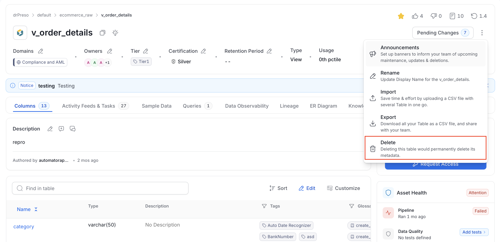
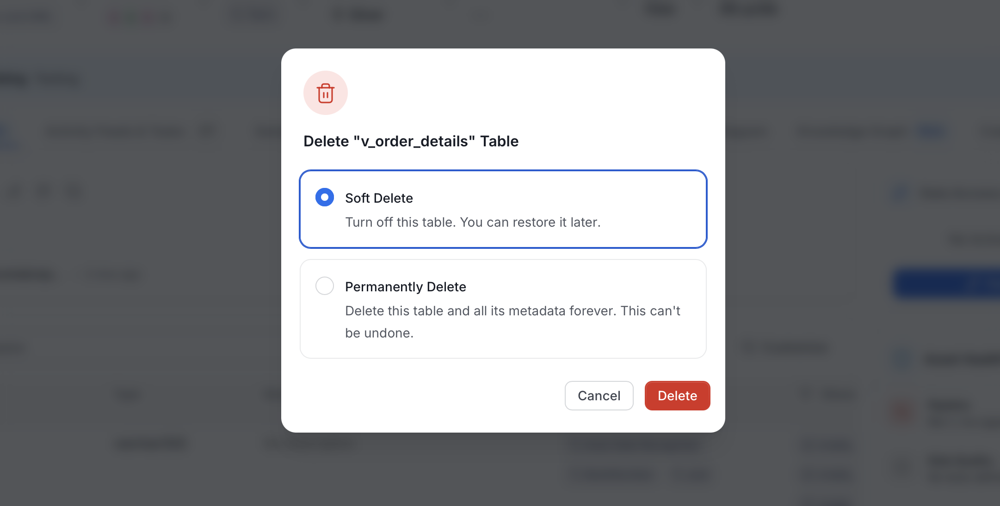
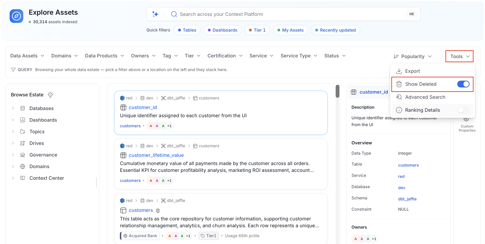
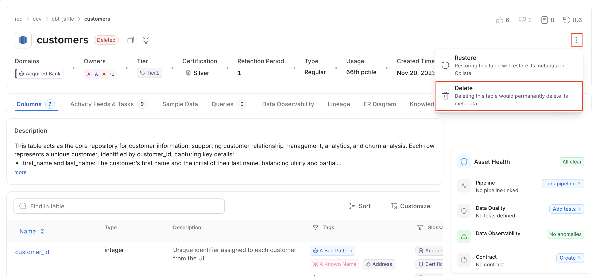

# Delete and Restore Data Assets

A data asset is a database, a schema, a table, or another asset in your catalog. You can delete a data asset in two ways:

- **Soft Delete**: Hides the asset. You can restore it later.
- **Permanently Delete**: Removes the asset and its metadata forever. You can't undo this.

To delete and restore a service connection, see [Delete and Restore Service Connections](/v2.1.x/how-to-guides/admin-guide/delete-service-connection).

A data asset carries metadata that is hard to recreate, such as descriptions, tags, owners, tiers, profiler results, lineage, and test results. Select **Soft Delete** unless you are sure that you no longer need the asset.

Metadata agents also soft delete assets for you. When a **Mark Deleted** toggle is on, the agent soft deletes an asset that no longer exists in the source. For more information, see [Soft-Deleted Assets](/v2.1.x/how-to-guides/admin-guide/data-retention#soft-deleted-assets).

## Delete a Data Asset

<Warning>
Permanent deletion can't be undone. Select **Soft Delete** if you might need the asset again.
</Warning>

1. In the left navigation bar, click **Explore**.
2. Search for the data asset, such as a database, schema, or table, and open it. To narrow your search, use the **Data Assets** filter.
3. Click the **⋮** icon and select **Delete**.

   

4. Select **Soft Delete** or **Permanently Delete**.

   

5. Click **Delete**.

The same steps apply to other data assets, such as stored procedures, dashboards, charts, pipelines, topics, ML models, containers, search indexes, API collections, API endpoints, and metrics.

## Find Soft-Deleted Data Assets

A soft-deleted data asset is hidden from your normal search results.

1. In the left navigation bar, click **Explore**.
2. Click **Tools** and turn on **Show Deleted**.

   

3. Search for the data asset. To narrow your search, use the **Data Assets** filter.

## Restore a Data Asset

You need the **Edit All** permission on the data asset to restore it.

1. Find the soft-deleted data asset. For the steps, see [Find Soft-Deleted Data Assets](#find-soft-deleted-data-assets).
2. Open the data asset.
3. Click the **⋮** icon and select **Restore**.

   

After you restore a data asset, you can find it on the **Explore** page. Restoring a data asset also restores its soft-deleted child assets. You can't restore a data asset that was permanently deleted.

## Permanently Delete a Soft-Deleted Data Asset

<Warning>
Permanent deletion can't be undone, and you can't restore the asset afterward.
</Warning>

1. Find the soft-deleted data asset. For the steps, see [Find Soft-Deleted Data Assets](#find-soft-deleted-data-assets).
2. Open the data asset.
3. Click the **⋮** icon and select **Delete**.

   

4. Click **Delete**.

A metadata agent only soft deletes assets, and the Data Retention application doesn't remove them. To remove a soft-deleted asset for good, permanently delete it yourself.

## Delete and Restore with the API or SDK

For a table, use these calls. Other data assets use the same options on their own endpoints.

- **Soft delete**: Send `DELETE /api/v1/tables/{id}`.
- **Permanently delete**: Send `DELETE /api/v1/tables/{id}?hardDelete=true`.
- **Restore**: Send `PUT /api/v1/tables/restore` with the body `{"id": "<id>"}`.

With the Python SDK:

```python
from metadata.generated.schema.entity.data.table import Table

metadata.delete(entity=Table, entity_id=table_id)                    # soft delete
metadata.delete(entity=Table, entity_id=table_id, hard_delete=True)  # permanent delete
metadata.restore(entity=Table, entity_id=table_id)                   # restore
```

For more information, see [Delete a Table](/v2.1.x/api-reference/data-assets/tables/delete).

<Tip>
**Tip**: Notify team members of data changes by creating [announcements](/v2.1.x/how-to-guides/guide-for-data-users/add-announcement).
</Tip>
