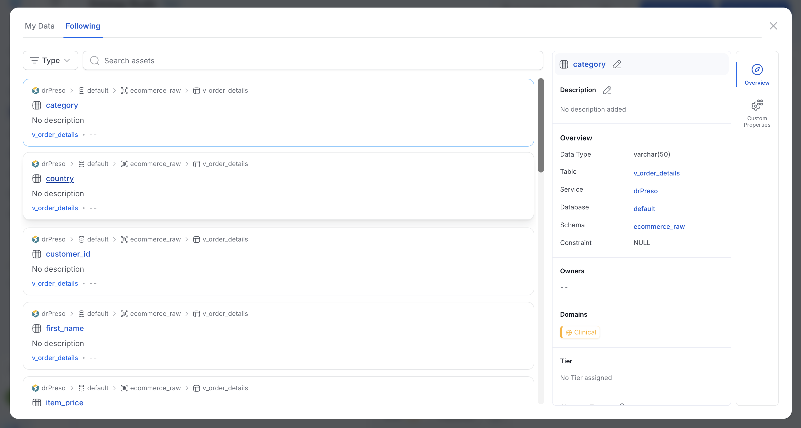

# How to Follow a Data Asset

Users can get timely information about all the **activities**, **announcements**, and **feeds** related to a data asset by following those assets. The owners of the data assets will receive all the updates by default. The follow option can be used for the assets that you do not own.

<iframe
  width="800"
  height="450"
  src="https://www.youtube.com/embed/xKg596qN7LA?start=0&end=112"
  frameBorder="0"
  allow="accelerometer; autoplay; clipboard-write; encrypted-media; gyroscope; picture-in-picture"
  allowFullScreen>
</iframe>

To follow a data asset,
- Navigate to the **Explore** page.
- Select the relevant type of data asset (Tables, Topics, Dashboards, Pipelines, ML Models, and Containers).
- Select a data asset.

- Click the **Follow** button to start following it.

## See the Assets You Follow

The way you see the assets you follow depends on your app mode.

### AI Mode

The assets you follow appear in the **Following** tab of the **Yours and Followed** card on the home page. Click **View All Followed Assets** to open the full list. For more information, see [Yours and Followed](/v2.2.x-SNAPSHOT/how-to-guides/guide-for-data-users/basics-openmetadata#yours-and-followed).

You can also open the full list from the profile menu:

1. Click the **Profile** icon and select **My Data & Following**.
2. Select the **Following** tab.
3. Use the **Type** filter to show one asset type, or use **Search assets** to find an asset by name.
4. Select an asset to see its **Overview** and **Custom Properties** in the details panel.

For more information, see [My Data & Following](/v2.2.x-SNAPSHOT/how-to-guides/admin-guide/profile/index#my-data--following).

### Classic Mode

The data assets you are following are displayed in the **Following** section on the **My Data** page.

Clicking on **View All** to check all the data assets you are following will redirect to the **Profile Page > Following Tab**.

The Activity Feeds tab displays all the activities related to the data assets that you own, follow, or where you are mentioned.

<Card title="How to Add Tags" href="/v2.2.x-SNAPSHOT/how-to-guides/guide-for-data-users/tags" >
    Add tags to data assets and learn about auto-PII classification.
  </Card>