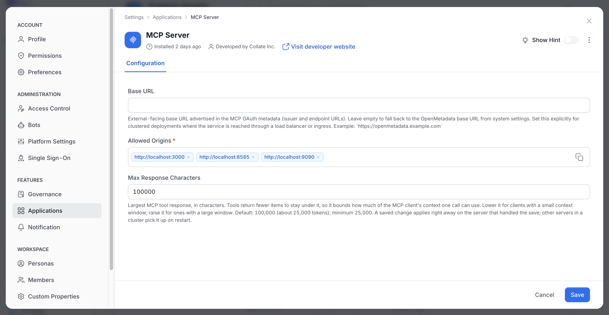

# OAuth 2.0 Authentication for MCP Server

OpenMetadata's MCP Server supports **OAuth 2.0 authentication**, allowing you to connect AI assistants like Claude, Cursor, and VS Code directly using your existing OpenMetadata login. This is the same way you sign in to the OpenMetadata UI. No need to generate, copy, or rotate Personal Access Tokens.

{/* TODO: Add hero image showing OAuth login flow in action */}

## Why OAuth 2.0?

| | Personal Access Token (PAT) | OAuth 2.0 |
|---|---|---|
| **Setup** | Generate token, copy into config | Enter server URL, sign in via browser |
| **Security** | Token stored in plain text config files | No secrets stored locally |
| **Expiration** | Manual rotation when token expires | Tokens refresh automatically |
| **Access** | Must generate and manage tokens per user | Uses your existing OpenMetadata login |

<Note>

OAuth 2.0 is **recommended for interactive clients** (Claude Desktop, Cursor, VS Code, and similar tools a person signs into) because it removes token management for the human user. It requires a one-time browser login and cannot complete without user interaction, so it doesn't work for headless or unattended processes. For an automated agent or long-running unattended process, use a **Bot's JWT token** instead (see [Bot Token](/v2.2.x-SNAPSHOT/how-to-guides/mcp#bot-token) and [How to Set Up Bots](/v2.2.x-SNAPSHOT/developers/bots)).

</Note>

## How It Works

Connecting via OAuth is simple:

1. **Add your OpenMetadata MCP Server URL** in your AI client (e.g., `https://your-openmetadata-instance.com/mcp`)
2. **A browser window opens** prompting you to sign in with your usual OpenMetadata credentials
3. **Approve the connection** (SSO and SAML only): after you sign in, OpenMetadata shows an **Authorize Access** page that names the MCP client, your account, and the address you will be sent to. Click **Approve** to continue, or click **Deny** to cancel.
4. **You're connected** and tokens are managed automatically in the background

That's it. Your MCP client handles the rest, including refreshing your session when needed.

{/* TODO: Add screenshot showing the browser-based login flow */}

## Approving a Client (SSO and SAML)

When you connect through an SSO provider or SAML, OpenMetadata shows an **Authorize Access** page after you sign in. The page reads "`<client name>` is requesting access to OpenMetadata as `<your user name>`" and shows where you will be sent next.

- **Client**: The name the MCP client registered with.
- **User**: The OpenMetadata account you signed in as.
- **Redirect address**: The scheme and host that receive the authorization code, for example `http://localhost:33418`.
- **Approve**: OpenMetadata issues the authorization code and returns you to the client.
- **Deny**: OpenMetadata returns `access_denied` to the client and issues no code.

Deny the request if you did not start the connection or do not recognize the address. Each approval can be used once. If the page reports that an approval is no longer valid, restart the connection from your MCP client.

Basic authentication and LDAP don't show this page. Their login form names the client and the redirect address before you enter your password.

## Supported Authentication Methods

The MCP Server inherits the authentication method configured for your OpenMetadata instance. Whatever SSO provider your organization uses to sign in to OpenMetadata will also be used for MCP connections.

<CardGroup cols={2}>
  <Card title="Google SSO" href="/v2.2.x-SNAPSHOT/deployment/security/google">
    Sign in with your Google Workspace account.
  </Card>
  <Card title="Azure AD SSO" href="/v2.2.x-SNAPSHOT/deployment/security/azure">
    Sign in with your Microsoft / Azure AD account.
  </Card>
  <Card title="Okta SSO" href="/v2.2.x-SNAPSHOT/deployment/security/okta">
    Sign in with your Okta account.
  </Card>
  <Card title="Auth0 SSO" href="/v2.2.x-SNAPSHOT/deployment/security/auth0">
    Sign in with your Auth0 account.
  </Card>
  <Card title="Amazon Cognito" href="/v2.2.x-SNAPSHOT/deployment/security/amazon-cognito-sso">
    Sign in with Amazon Cognito.
  </Card>
  <Card title="Custom OIDC" href="/v2.2.x-SNAPSHOT/deployment/security/custom-oidc">
    Sign in with any OIDC-compatible provider.
  </Card>
  <Card title="SAML" href="/v2.2.x-SNAPSHOT/deployment/security/saml">
    Sign in with your SAML identity provider.
  </Card>
  <Card title="LDAP" href="/v2.2.x-SNAPSHOT/deployment/security/ldap">
    Sign in with your LDAP / Active Directory credentials.
  </Card>
</CardGroup>

If your instance uses **basic authentication** (username and password), you will see a login form where you can enter your OpenMetadata credentials directly.

<Note>

**Session token expiry**: If a client authenticates through this login form (or LDAP/SAML) rather than through the OAuth flow described above, the resulting session token expires after **1 hour by default**, configurable by an admin under **Settings** > **Preferences** > **Login Configuration**. A long-running or headless agent using this login method must detect a 401 response and re-authenticate, which requires a human to sign in again. For a process that needs to run unattended for more than an hour, use a Bot's [JWT token](/v2.2.x-SNAPSHOT/how-to-guides/mcp#bot-token) instead, which isn't subject to this 1-hour limit.

</Note>

## Changing Your Authentication Method

The MCP Server automatically uses the same authentication method configured for your OpenMetadata instance. To change how users authenticate:

1. Navigate to **Settings** in your OpenMetadata instance
2. Go to the **SSO** configuration section
3. Update the authentication provider (e.g., switch from basic auth to Google SSO)

Once updated, all MCP client connections will use the new authentication method with no changes needed on the client side.

{/* TODO: Add screenshot of Settings > SSO configuration page */}

For detailed instructions on configuring each SSO provider, see the [Security documentation](/v2.2.x-SNAPSHOT/deployment/security).

## Token Management

OAuth tokens are handled entirely by your MCP client with no manual management needed:

- **Access tokens** expire after 10 minutes. MCP clients use refresh tokens to obtain new access tokens.
- **Refresh tokens** rotate each time the client uses them.
- **Re-authenticate** when the current refresh token expires after 30 days of inactivity or is revoked.

To **revoke access** for an MCP client, use the OAuth 2.0 Token Revocation endpoint described under [Revoking Access](#revoking-access) below.

## Request and Redirect Limits

The MCP server enforces the following limits:

| Input | Maximum size |
|---|---|
| Dynamic client registration body | 64 KiB |
| MCP message after decompression | 4 MiB |
| Redirect URI | 2,048 characters |

Requests that exceed these limits are rejected before they reach an MCP tool.

## Security

OpenMetadata's MCP OAuth implementation follows industry-standard security practices:

- **Explicit approval**: With SSO and SAML, OpenMetadata issues no authorization code until you click **Approve** on the consent page.
- **PKCE (Proof Key for Code Exchange)**: Protects the authorization flow against interception attacks, even on desktop and CLI clients
- **Encrypted refresh token storage**: Refresh tokens are encrypted at rest in the OpenMetadata database. Access tokens are short-lived signed JWTs and aren't stored by the server.
- **Short-lived access tokens**: Access tokens expire quickly, limiting exposure if compromised
- **Automatic token refresh**: Clients seamlessly refresh tokens without user interaction
- **Rate limiting**: Built-in protection against brute-force and abuse
- **No user-managed PAT in config files**: OAuth avoids placing an OpenMetadata PAT in a plain-text config file. MCP clients still manage their own OAuth credentials, including refresh tokens, according to their storage model.

## Supported MCP Clients

Set up OAuth authentication with your preferred MCP client:

<CardGroup cols={2}>
  <Card title="Claude Desktop" href="/v2.2.x-SNAPSHOT/how-to-guides/mcp/claude">
    Connect via Anthropic's AI assistant.
  </Card>
  <Card title="Cursor" href="/v2.2.x-SNAPSHOT/how-to-guides/mcp/cursor">
    Connect via Cursor IDE.
  </Card>
  <Card title="VS Code" href="/v2.2.x-SNAPSHOT/how-to-guides/mcp/vscode">
    Connect via Visual Studio Code.
  </Card>
  <Card title="Claude Code" href="/v2.2.x-SNAPSHOT/how-to-guides/mcp/claude-code">
    Connect via Claude Code CLI.
  </Card>
  <Card title="Goose" href="/v2.2.x-SNAPSHOT/how-to-guides/mcp/goose">
    Connect via Block's open-source AI agent.
  </Card>
</CardGroup>

## How the Connection Works (Under the Hood)

OpenMetadata's MCP OAuth implementation uses **OAuth 2.0 Dynamic Client Registration** (RFC 7591), so MCP clients connect without any manual app setup:

1. The MCP client fetches OpenMetadata's OAuth discovery document at `/.well-known/oauth-authorization-server` to learn the authorization, token, and registration endpoints.
2. The client automatically registers itself by posting its metadata to the registration endpoint. OpenMetadata issues a `client_id` in response — no admin action is required.
3. The client initiates an **Authorization Code flow with PKCE** (SHA-256), opening your browser to sign in via your configured SSO provider or basic auth.
4. After you sign in through SSO or SAML, OpenMetadata asks you to approve the client on a consent page. **Approve** returns an authorization code to the client. **Deny** sends the client an `access_denied` error. With basic auth or LDAP, the login form names the client and where the code is sent. Signing in is the approval, so there is no separate page.
5. The client exchanges the code for an access token and a refresh token.
6. All subsequent MCP tool calls include the access token. When it expires, the client uses the refresh token to get a new one silently.

### Discovery Endpoints

| Endpoint | Purpose |
|----------|---------|
| `GET /.well-known/oauth-authorization-server` | OAuth 2.0 authorization server metadata (RFC 8414) |
| `GET /.well-known/openid-configuration` | Serves the same authorization server metadata, with the OpenID Connect discovery fields (`jwks_uri`, `subject_types_supported`, and `id_token_signing_alg_values_supported`) that some MCP clients require |
| `GET /.well-known/oauth-protected-resource` | OAuth 2.0 protected resource metadata (RFC 9728) |
| `POST /mcp/register` | Dynamic client registration |

## Token Lifetimes

OAuth tokens are handled entirely by your MCP client with no manual management needed.

| Token type | Lifetime | Notes |
|-----------|---------|-------|
| **Access token** | 10 minutes | Short-lived to limit exposure. Automatically refreshed by the client |
| **Authorization code** | 10 minutes | Single-use. Expires if the login flow stalls |
| **Refresh token** | 30 days | Grants new access tokens without re-authentication. Expires after 30 days of inactivity |

Refresh tokens rotate each time the client uses them. Re-authenticate when the current refresh token expires after 30 days of inactivity or is revoked. To **revoke access** for an MCP client, use the OAuth 2.0 Token Revocation endpoint described under [Revoking Access](#revoking-access) below.

## Rate Limits

The MCP OAuth endpoints are rate-limited per IP address to prevent abuse:

| Endpoint | Limit |
|---------|-------|
| `/mcp/register` (client registration) | 10 requests per hour |
| `/mcp/token` (token requests) | 30 requests per minute |

These limits are per-server-instance. In clustered deployments, the effective limit is multiplied by the number of instances.

## Allowed Origins (CORS)

By default, the MCP Server allows CORS requests only from a small set of local development origins (`http://localhost:3000`, `http://localhost:8585`, `http://localhost:9090`) — it does not allow all origins. This allowlist is part of OpenMetadata's MCP settings, stored in the database rather than the static server configuration file. Update it from **Settings** > **Applications** > **MCP Server** > **Configuration** (`<YOUR-OpenMetadata-SERVER>/settings/apps/McpApplication`) or via the `GET`/`PUT /api/v1/system/mcp/config` API (admin only).

Only requests whose `Origin` header exactly matches an entry in the allowlist receive a valid `Access-Control-Allow-Origin` response header — there is no wildcard or prefix matching. This is relevant for browser-based MCP clients or custom integrations that call the MCP endpoint directly from a web page.

## Response Size Limit

The MCP Server limits the size of each tool response. Tools return fewer items to stay under the limit. Administrators can change it from the MCP Server application settings:

1. Navigate to **Settings** > **Applications**.
2. Click the **MCP Server** application.
3. In the **Configuration** tab, set **Max Response Characters**.



4. Click **Save**.

The default is `100,000` characters, about 25,000 tokens, and the minimum is `25,000`. Lower the value for clients with small context windows, and raise it for clients with large ones. A saved change applies immediately on the server that handled the save. Other servers pick it up after a restart.

## Restricting MCP Tools

Administrators can limit which tools the MCP Server offers to MCP clients. Both options apply to every MCP client and every user, admins included. Each user's own permissions still apply to the tools that remain available.

### Read-only Mode

Read-only Mode exposes only the tools that do not change metadata, such as search, lineage, and entity details. Tools that create or edit metadata, such as `create_entity`, `patch_entity`, `create_lineage`, and `create_test_case`, are blocked. `describe_entity_type` is also blocked, because it only prepares a `create_entity` call.

1. Navigate to **Settings** > **Applications**.
2. Click the **MCP Server** application.
3. In the **Configuration** tab, turn on **Read-only Mode**.
4. Click **Save**.

- **Turning it on**: Write tools are refused right away. They leave the tool list that clients see after the server restarts.
- **Turning it off**: Write tools become available again after a restart.

### Disabling Individual Tools

**Disabled Tools** turns off single tools, whether they read or write metadata. Use it when you want to keep most tools available but hide a specific one. **Read-only Mode** still applies to the rest.

1. Navigate to **Settings** > **Applications**.
2. Click the **MCP Server** application.
3. In the **Configuration** tab, select the tools to turn off under **Disabled Tools**. The list shows the tools registered on your server.
4. Click **Save**.

- **Disabling a tool**: Calls to it are refused right away. It leaves the tool list after the server restarts.
- **Enabling it again**: The change applies after a restart.
- **New tools**: A tool added by an upgrade is available until you disable it.
- **Unknown names**: A name that matches no registered tool is ignored.

Administrators can also read the registered tool names with `GET /api/v1/system/mcp/tools` (admin only), and save the `disabledTools` list through the `PUT /api/v1/system/mcp/config` API.

## Revoking Access

MCP clients can revoke an access or refresh token directly using the OAuth 2.0 Token Revocation endpoint ([RFC 7009](https://datatracker.ietf.org/doc/html/rfc7009)), advertised as `revocation_endpoint` in the OAuth discovery document. Revoking a refresh token prevents future refreshes. Already-issued access tokens are signed JWTs validated statelessly, so they can remain valid until their 10-minute expiry. There is currently no separate admin-side option to revoke an MCP client's access. Revocation is a client-initiated action using its registered credentials.

The revocation endpoint requires the client identity that [Dynamic Client Registration](#how-the-connection-works-under-the-hood) issued. Confidential clients use a `client_id` and `client_secret`. Public clients registered with `token_endpoint_auth_method: none` use their `client_id` without a secret.

For a confidential client, authenticate using either method:

**HTTP Basic authentication** (client credentials in the `Authorization` header):
```http
POST {baseUrl}/mcp/revoke
Authorization: Basic <base64(client_id:client_secret)>
Content-Type: application/x-www-form-urlencoded

token=<token>&token_type_hint=access_token
```

**Form-based authentication** (client credentials in the request body):
```http
POST {baseUrl}/mcp/revoke
Content-Type: application/x-www-form-urlencoded

token=<token>&token_type_hint=access_token&client_id=<client_id>&client_secret=<client_secret>
```

For a public client, include the `client_id` in the form body and omit `client_secret`:

```http
POST {baseUrl}/mcp/revoke
Content-Type: application/x-www-form-urlencoded

token=<token>&token_type_hint=access_token&client_id=<client_id>
```

`token_type_hint` is optional and can be `access_token` or `refresh_token`. A request without the required client identity returns `invalid_client`.
